<h1 align="center">EzTest</h1>

<p align="center"><strong>AI-driven, semi-autonomous end-to-end testing for web apps and HTTP APIs.</strong></p>

<p align="center">
  <a href="README.zh-CN.md">简体中文</a> | English
</p>

<p align="center">
  
  
  
  
  
  
  
</p>

> **Status: v0.2-preview (pre-release).** EzTest implements the complete pipeline below and has been
> exercised end-to-end on the maintainers' host with a real browser and a real OpenAI-compatible model.
> This is a preview for evaluation, not a production release — validate it in your own environment
> before relying on it.

---

## Table of contents

- [Overview](#overview)
- [How it works](#how-it-works)
- [Screenshots](#screenshots)
- [Getting started](#getting-started)
  - [Option A — Portable packages (Windows / Linux)](#option-a--portable-packages-windows--linux)
  - [Option B — Docker Compose](#option-b--docker-compose)
  - [Option C — Run from source](#option-c--run-from-source)
  - [First-run configuration](#first-run-configuration)
  - [Ports and health endpoints](#ports-and-health-endpoints)
- [Architecture and technical route](#architecture-and-technical-route)
- [Project layout](#project-layout)
- [License](#license)

---

## Overview

**EzTest is a self-hosted, AI-driven, semi-autonomous end-to-end testing platform for web
applications and HTTP APIs.** Give it a release version and its requirements and it produces reviewed,
executable, evidence-backed end-to-end coverage: it clarifies requirements in a conversation, designs
scenarios and cases against the real codebase, drives a real Chromium browser and HTTP APIs, classifies
failures, files and merges issues, renders reports, and drives the version to completion. It is built
for small QA and engineering teams that want AI leverage without giving up control of what gets tested.

**Humans stay in the loop exactly where judgment is required** — clarifying requirements, opening a
design conversation, and confirming the resulting cases. Everything in between runs autonomously on a
deterministic platform core: a shared task board with leases and fencing, a reconciler that compares
desired and actual state, four agent teams plus a Version Steward, and persistent version × team
collaboration channels. Agents only submit structured candidates; the server validates scope, state and
evidence before anything is written, and every verdict is bound to content-addressed, immutable
evidence.

---

## How it works

A normal journey has six steps. Only the first three contain human judgment points; the rest is
automated by agent teams on top of the deterministic platform core.

| # | Step | Human | Automated |
|---|---|---|---|
| 1 | **Admin setup** | The administrator onboards systems, environments, pages/APIs, read-only databases, accounts and browser sessions, local Git repositories, the LLM provider and team users. | Settings live in the database settings center, hot-reload where possible, with audit and masked secrets. |
| 2 | **Version & requirements** | Any signed-in user creates a version, binds one or more SUTs, and talks to the clarification team — editing and confirming requirements one by one or in batches. | The clarification team drafts and rewrites requirement versions, proposes relations and keeps immutable revision history. |
| 3 | **Design** | The user opens a design conversation and can edit the result; then confirms cases per case, scenario or requirement. | The design team scans what needs designing, authors scenarios → cases → steps → assertions with requirement sources, SUT targets and code anchors, self-reviews, and keeps drafting until confirmed. |
| 4 | **Execution** | Nothing, unless an automated login cannot be completed; then a human-takeover request appears. | Confirmation creates execution intents; the planner groups them into waves (one active wave per version); case executors drive real Chrome and HTTP, with optional read-only PostgreSQL and visual assertions. |
| 5 | **Delivery** | Confirm or reject issues; read and export reports. | Failures are analyzed and classified into issue candidates with stable dedupe keys; wave and version reports are append-only revisions (HTML is authoritative, PDF is rendered by a separate worker); the exploration chain exposes requirement → case → result → issue lineage. |
| 6 | **Close & continue** | Nothing; a human may reopen a completed version. | When the closure predicates hold (no open work, all requirements closed, version report published), the Version Steward proposes completion and the server validates it. New requirements, reopened requirements or newly confirmed cases move the version back to running for the next incremental wave. |

The UI is organized as **8 global shell items** — Versions, Issues, Reports, Knowledge, Resources,
Quality, Agent center and Settings — and **8 version tabs** — Overview, Requirements & clarification,
Case design, Execution, Exploration chain, Issues, Reports, and Code & changes. Global search
(`Ctrl/Cmd+K`) and the todo drawer live in the top bar; knowledge is global, not version-owned.

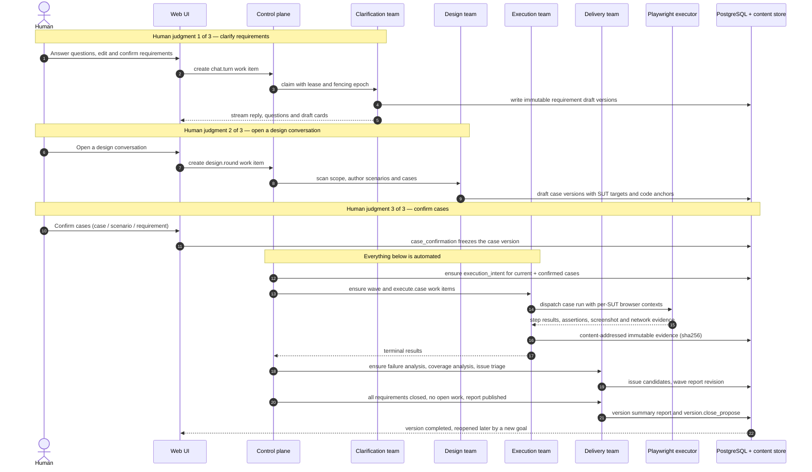

---

## Screenshots

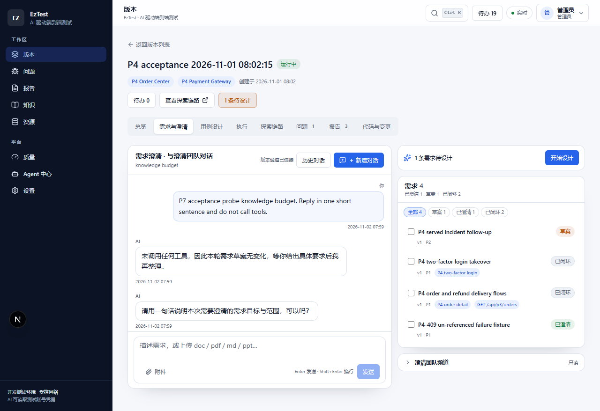

*Clarify requirements in a conversation with the AI team; the requirement list, open questions and the
hand-off to design stay in one workspace.*

### Version workspace

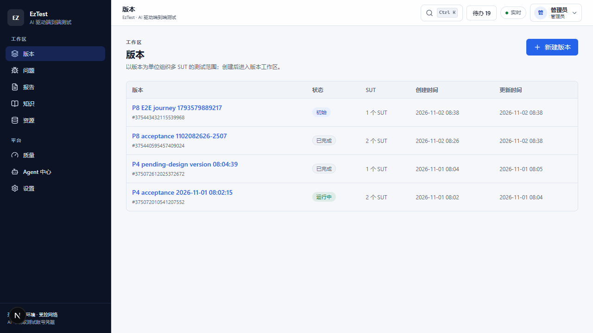

*Every release version is a workspace with its status, requirements and bound systems.*

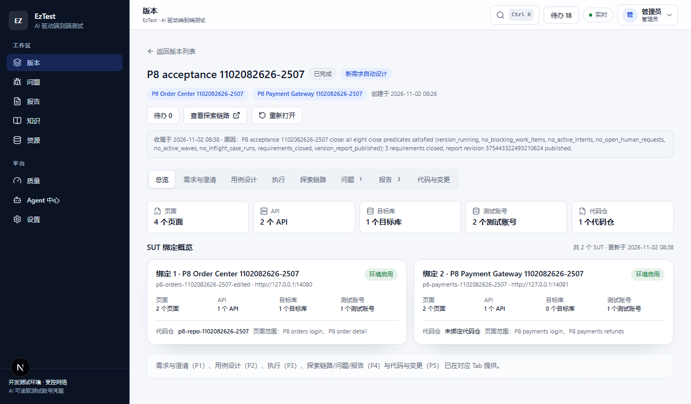

*Version overview: coverage, SUT bindings, execution state and the closure criteria of the version.*

### Case design

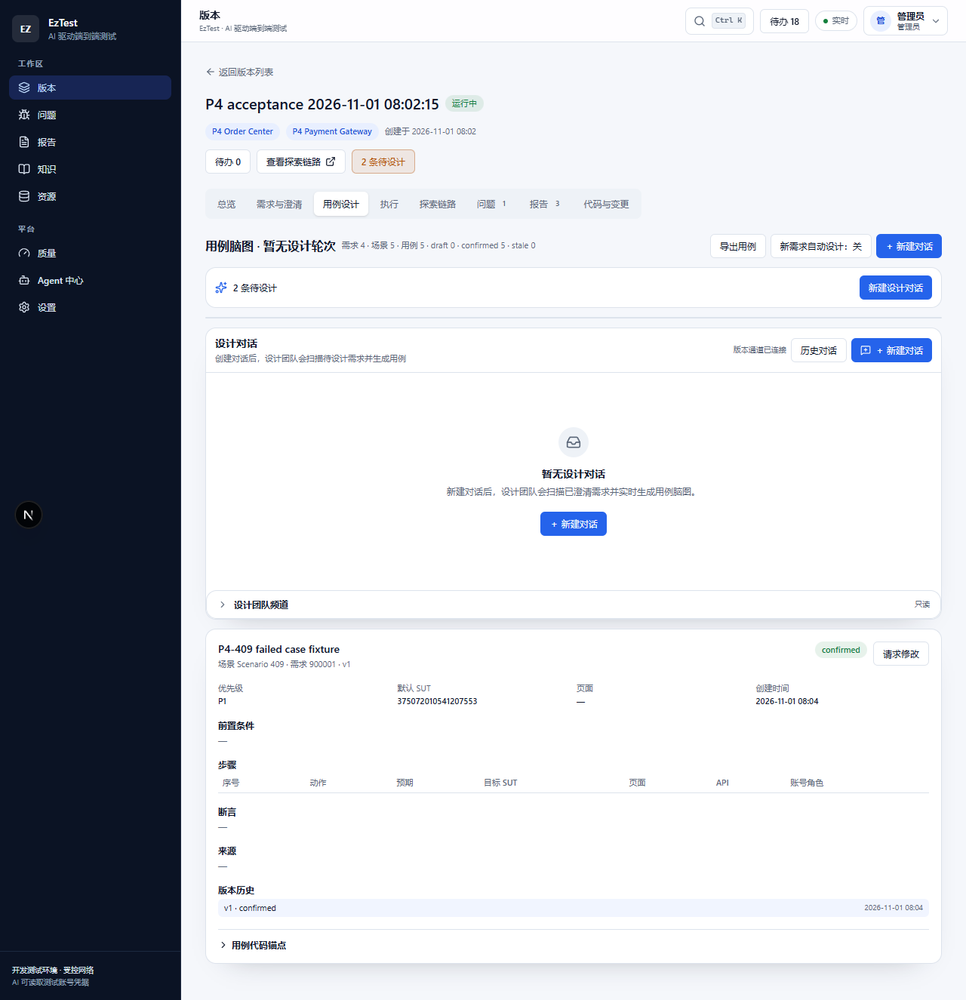

*Case design workspace: scenarios, cases, steps and assertions are reviewed and confirmed here; the
design team drafts them from requirements plus code context.*

### Execution and evidence

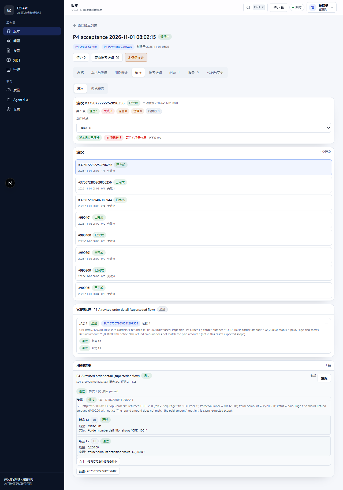

*Execution waves run the confirmed cases; the live trace and per-case results stay next to the evidence.*

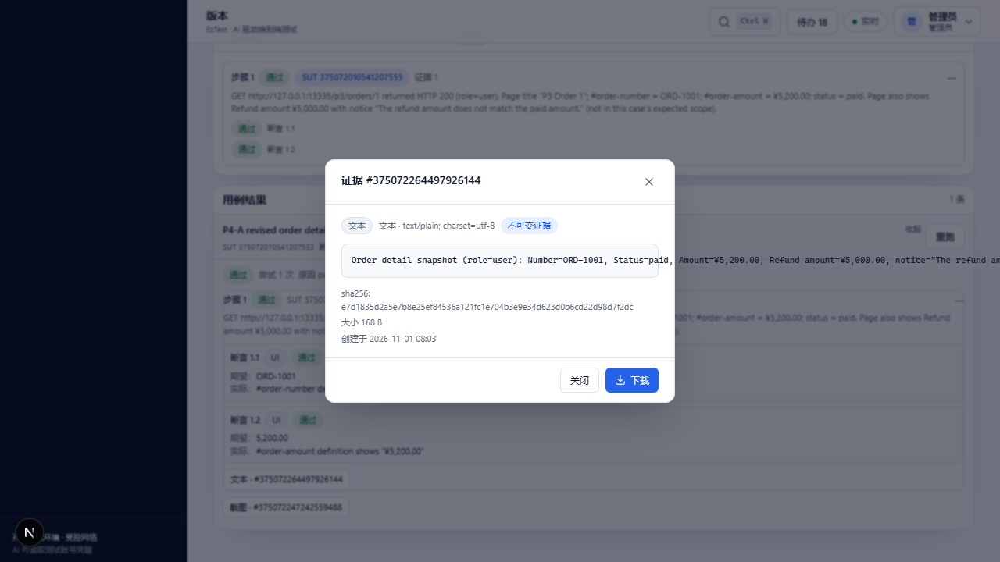

*Content-addressed evidence behind every verdict, with sha256 metadata and immutable storage.*

### Delivery

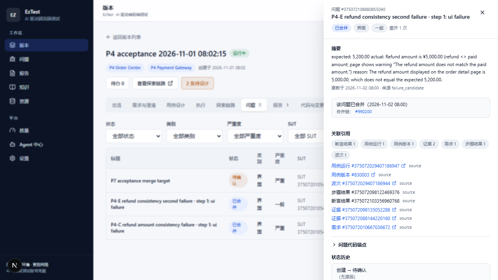

*Failures become issues with evidence and code anchors; duplicate reports merge into one traced chain.*

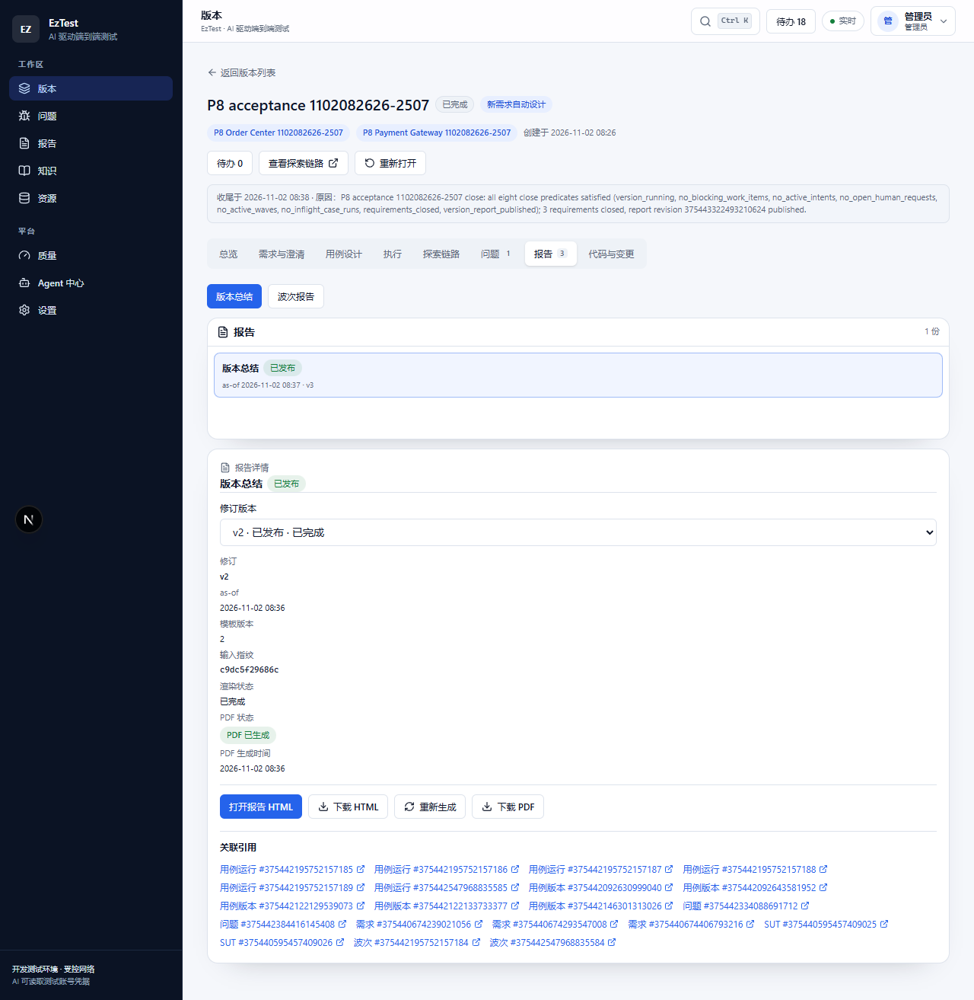

*Append-only report revisions with HTML/PDF output, coverage and risks; a report becomes stale when its
inputs change and can be regenerated without rewriting history.*

### Exploration chain

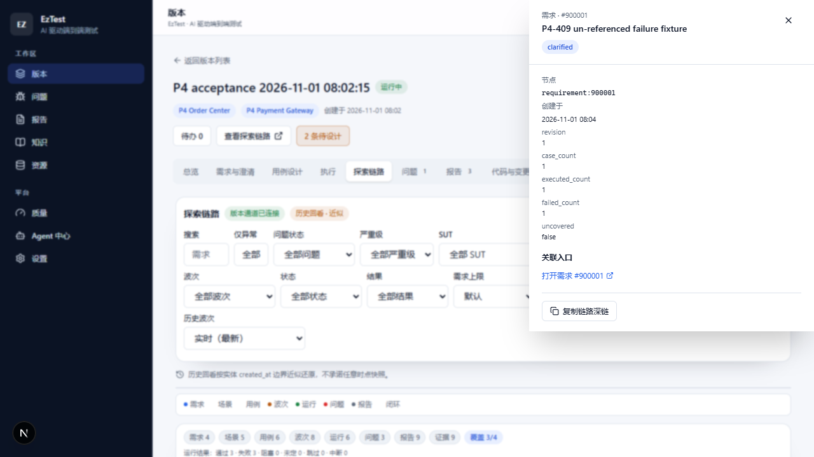

*The exploration chain links requirements, cases, waves, runs, results, evidence, issues and reports.*

### Platform

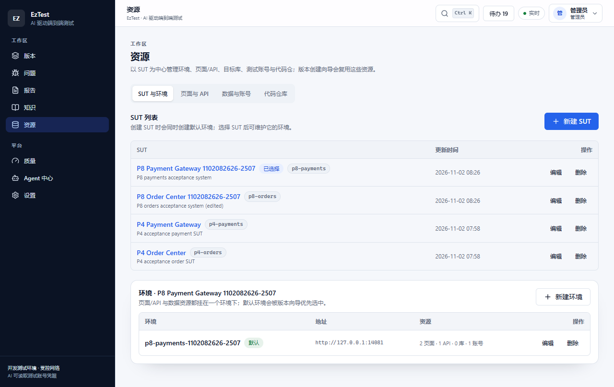

*Shared resources: systems under test with their environments, pages, APIs, read-only databases,
accounts and local Git repositories.*

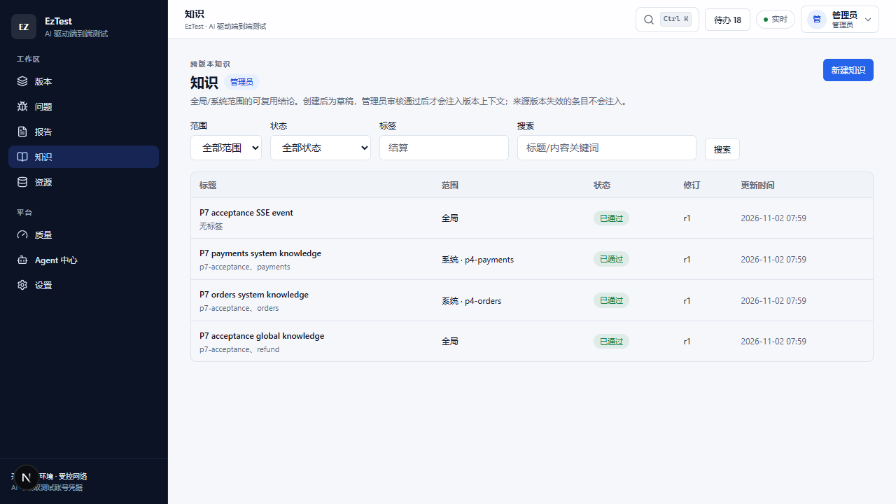

*Global knowledge is reviewed by the administrator and injected into agent prompts with citation
budgets and usage records.*

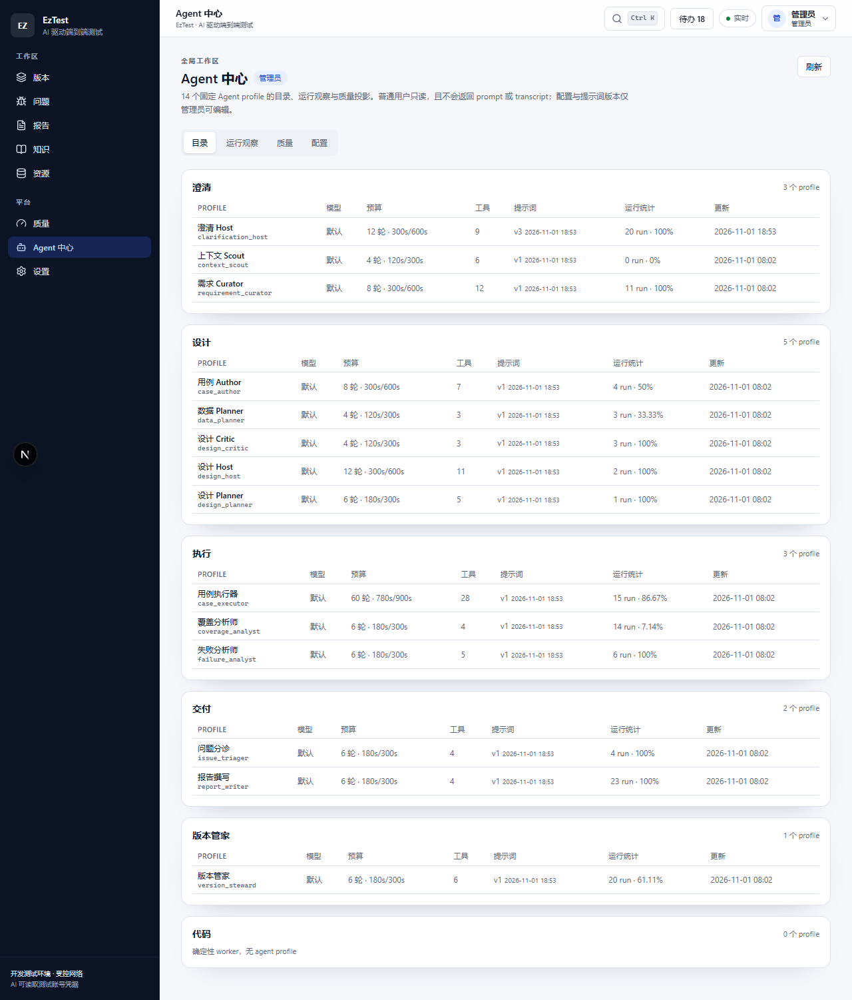

*Agent center: 14 built-in agent profiles with their teams, tools, budgets, prompt revisions and run
statistics.*

---

## Getting started

EzTest runs as a single-host stack. The API, web UI, executor and PDF renderer are separate processes;
PostgreSQL 17 is the only mandatory external dependency.

| Component | Role | Default port |
|---|---|---|
| `web` | Next.js 16 web application | 6868 |
| `api` | Go 1.24 REST + SSE API, migrations, background workers | 13333 |
| `executor` | Node + Playwright browser execution service | 13336 (loopback) |
| `renderer` | Node headless HTML→PDF worker (bundled in portable packages) | 13337 (loopback) |
| `postgres` | PostgreSQL 17 database | 5433 (development) |

Requirements in all cases: **PostgreSQL 17**, a **Chromium-based browser** available to the executor
(the portable packages bundle Chromium; from source you can install Playwright Chromium or use Google
Chrome / Microsoft Edge), and an **OpenAI-compatible LLM endpoint** for the AI features (optional for
deterministic paths).

### Option A — Portable packages (Windows / Linux)

The preview release ships Docker-free, self-contained packages for **Windows x64** and **Linux x64**.
Each archive contains the API binary, the prebuilt web application, the Playwright executor, the headless
PDF renderer, the pinned Playwright browsers, a Node.js 22 runtime, and start / stop / status / smoke
scripts. PostgreSQL is not bundled; it must be reachable from the machine.

| Platform | Archive |
|---|---|
| Windows x64 | `eztest-0.2.0-preview.1-windows-x64.zip` (~400 MB) |
| Linux x64 (glibc) | `eztest-0.2.0-preview.1-linux-x64.tar.gz` (~400 MB) |
| Checksums | `SHA256SUMS.txt` |

Download the archives from the [Releases](https://github.com/EdouardRichard/EzTest/releases) page.
Each package also ships the OpenAPI 3.0 contract at `docs/openapi/api.yaml`.
On Linux, run the bundled `install-linux-deps.sh` once to install the Chromium system libraries
(needs sudo); Windows needs nothing beyond the package. Free ports **13333**, **6868**, **13336** and
**13337** before starting.

```powershell
# Windows (PowerShell), after expanding the archive
cd .\eztest-0.2.0-preview.1-windows-x64
.\init-config.ps1 -DatabaseUrl "postgres://eztest:<password>@localhost:5433/eztest?sslmode=disable"
.\start-eztest.ps1        # starts API, executor, renderer and web, then waits for health
.\status-eztest.ps1       # processes, health probes and PostgreSQL status
.\stop-eztest.ps1         # stops web -> renderer -> executor -> API
.\smoke-test.ps1          # end-to-end checks of the running installation
```

```bash
# Linux (x64), after extracting the archive
cd eztest-0.2.0-preview.1-linux-x64
bash install-linux-deps.sh                                  # once, needs sudo
bash init-config.sh --database-url "postgres://eztest:<password>@localhost:5433/eztest?sslmode=disable"
bash start-eztest.sh
bash status-eztest.sh
bash stop-eztest.sh
bash smoke-test.sh
```

`init-config` creates the package `.env` (database URL, ports and the executor/renderer tokens), then
`start-eztest` brings the stack up and prints the URLs. Open <http://localhost:6868> and sign in — the
first boot seeds the administrator account `admin` / `admin123`; **change that password immediately** in
the UI (Settings → account). HTML and PDF report rendering work out of the box: the bundled renderer
starts with the stack. See [deploy/README.md](deploy/README.md) for the Docker deployment and
multi-replica notes.

### Option B — Docker Compose

> **Validation status:** the maintainers did not have Docker on their development host, so the images
> have never been built and the Compose stack has never been started there. Only static validation is
> performed. Treat this path as delivered-but-unverified and validate it in your environment.

Requirements: Docker Engine 24+ with Compose v2, 4 vCPU / 8 GiB RAM / 20 GiB disk, and the repository
checked out at the build-context root. The Compose file delivers six services: two API replicas, web,
PostgreSQL 17, the Playwright executor and the PDF renderer.

```bash
cp .env.example .env      # set POSTGRES_* and the secrets required by deploy/docker-compose.yml
docker compose --env-file .env -f deploy/docker-compose.yml up -d --build
docker compose --env-file .env -f deploy/docker-compose.yml ps
```

Open <http://localhost:6868>; API health: <http://localhost:13333/api/health>. See
[deploy/README.md](deploy/README.md) for the full variable list, volumes and multi-replica notes.

### Option C — Run from source

Requirements: Go **1.24.6** (as declared in `backend/go.mod`), Node.js **22+** with pnpm **11+**,
PostgreSQL **17**, and a Chromium-based browser for the executor.

```bash
# 0) The API process reads exactly four startup variables.
export EZTEST_DATABASE_URL="postgres://eztest:<password>@localhost:5433/eztest?sslmode=disable"
export EZTEST_API_PORT=13333
export EZTEST_WEB_PORT=6868
export EZTEST_EXECUTOR_PORT=13336

# 1) API — applies embedded migrations and seeds the administrator on first start
cd backend && go run ./cmd/eztest

# 2) Web UI (second terminal)
cd frontend && pnpm install && pnpm dev        # http://localhost:6868

# 3) Playwright executor (third terminal)
cd executor && pnpm install && pnpm exec playwright install chromium
EZTEST_EXECUTOR_TOKEN=<execution.executor_token> pnpm start

# 4) Optional PDF renderer (fourth terminal)
cd renderer && pnpm install
EZTEST_RENDER_TOKEN=<report.render_token> node src/server.mjs
```

The executor and renderer tokens must match the database settings `execution.executor_token` and
`report.render_token` (both seeded with development defaults on first boot and editable in the
administrator settings). On Windows, set environment variables with `$env:NAME="value"`. Tests:

```bash
pwsh scripts/test.ps1        # Go unit + integration, frontend lint / typecheck / Vitest
cd executor && pnpm test     # executor node:test suite
cd renderer && node --test   # renderer node:test suite
```

### First-run configuration

After signing in as the administrator:

1. **Change the seeded password** (`admin` / `admin123` on a fresh database).
2. **Settings → LLM configuration:** add an OpenAI-compatible provider (base URL, API key, model),
   refresh the model catalog and run the connectivity test. Credentials are masked in the UI.
3. **Resources:** register the systems under test, their environments, pages and HTTP APIs, optional
   read-only PostgreSQL targets, test accounts and browser sessions, and the local Git repositories the
   AI may read (read-only).
4. **Versions:** create a version, bind its SUTs, add requirements, and follow the workflow from
   clarification to execution, issues and reports.
5. *(Optional)* **Settings → users:** create ordinary accounts; only the administrator changes
   configuration, resources, LLM settings and knowledge review.

### Ports and health endpoints

| Endpoint | What it reports |
|---|---|
| `GET http://localhost:13333/healthz` | Liveness: the API process responds |
| `GET http://localhost:13333/api/health` | Readiness: database ping, version/commit, LLM presence, rate-limit and GC settings |
| `GET http://localhost:13333/api/health/ready` | Orchestration readiness, including in-flight counters |
| `GET http://localhost:13336/healthz` | Executor health, including the browser version (loopback) |
| `GET http://localhost:13337/healthz` | PDF renderer health (loopback) |
| <http://localhost:6868> | Web application |

`/api/health` returning 200 proves that the API and database are up; it does not prove that the LLM
endpoint is reachable or that the executor is healthy — the executor is probed when execution starts.

---

## Architecture and technical route

### Stack

| Layer | Technology |
|---|---|
| API / services | Go 1.24.6, standard-library `net/http` router, `pgx/v5` driver, embedded append-only SQL migrations |
| Domain modelling | 20 bounded contexts in one modular-monolith binary, ports and adapters, event-driven read models |
| Data | PostgreSQL 17 (85 application tables, 42 migrations), filesystem content store with a sha256 content ledger |
| Web | Next.js 16 App Router (standalone output), React 19, TypeScript, Tailwind CSS 4, Radix primitives, `@xyflow/react` |
| Realtime | Server-Sent Events with persisted sequence numbers, snapshot cursor and `Last-Event-ID` replay |
| Control plane | `work_item` task board as the only execution queue: dedupe keys, leases, fencing epochs, attempts, reconciler |
| Agent runtime | 4 product teams + Version Steward, 14 agent profiles, 63 tools, context packets and token/turn/time budgets |
| Execution | Separate Node 22 + Playwright 1.64 service (wire protocol v1.2): contexts, storage state, action protocol, screenshots, pixel diff |
| LLM | OpenAI-compatible `chat_completions` / `responses` protocols, streaming, tool calling, multimodal, retries, model catalog |
| Ops | Docker Compose, readiness/drain probes, per-instance rate limiting, event/audit retention, GC, backup/restore scripts |

### 1. System architecture

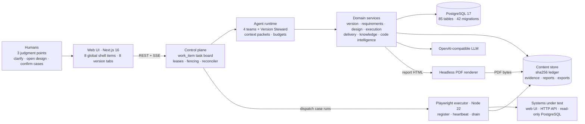

### 2. The control plane is the only execution queue

- Every agent action — including a chat turn — is a `work_item` with a team, type, priority, dedupe
  key, dependencies, attempts, a lease and a fencing epoch. Long tasks renew their lease with a
  heartbeat; an expired lease is reclaimed and the stale writer is rejected by the epoch.
- A **reconciler** scans every few seconds and compares desired with actual state, creating only the
  work that is missing (design coverage, execution intents, wave analysis, reports, closure, gaps).
  Events wake it early; missed events are covered by the next scan.
- **Four product teams** — clarification, design, execution and delivery — plus a **Version Steward**
  collaborate through persistent version × team channels. Teams never call each other: a hand-off is a
  written artifact plus a new task on the board. Two internal platform teams (code indexing and
  operations) run deterministic background work on the same board.
- Version status is a **projection, not a gate**. `initial → running → completed`, with automatic
  reopening when a new goal appears; agents never read the status to decide their work.

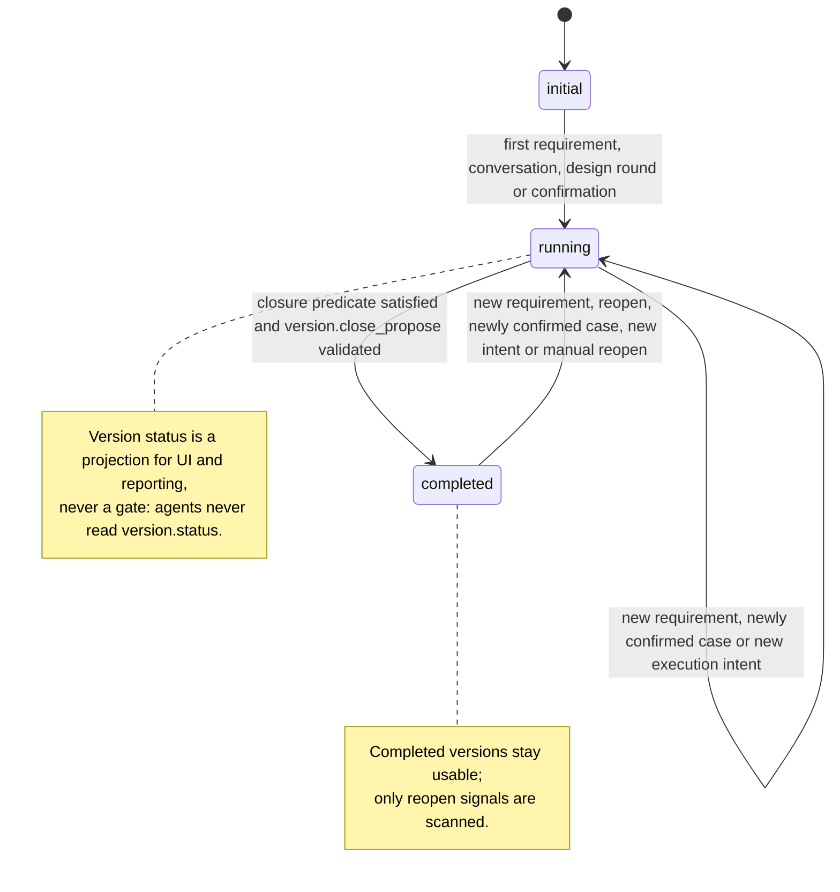

### 3. Agent runtime and context engineering

- Runs are bound to a `work_item`, an instance and a lease epoch; the runtime injects the version/SUT
  scope, so tools never have to trust model-provided identifiers.
- Budgets cover turns, wall-clock time, hard timeouts, tool calls and tokens. A run that exhausts a
  budget ends in a classified state (`model`, `context`, `tool`, `budget`, `aborted`, `interrupted`),
  not a crash, and dead work is visible on the board for human follow-up.
- Context is layered: a version packet, a task packet, conversation memory (recent window + rolling
  summary + pinned facts), team-channel summaries and tool/evidence context, all under a token budget.
  Oversized tool results spill to the content store and are referenced by head + content reference.
  Context overflow is handled by compaction, not by failing the run. Every run persists its context
  packet for audit and reproduction.

### 4. Multi-SUT execution and evidence

- One version can bind several systems; resources are scoped by `version_sut_id`, and a case step can
  target a different SUT than the previous step. Browser contexts are created per
  `(version_sut, account_role)`, so one SUT can run several roles at once.
- Cross-system cases are scheduled as a whole with reserved quotas to avoid deadlocks; single-SUT cases
  run concurrently under per-SUT quotas. One active wave per version; pause/resume and checkpoint
  recovery are supported.
- Results are four-state — `passed` / `failed` / `blocked` / `inconclusive` — with failure
  classification (application, environment, session, model, case). A failure claimed without supporting
  evidence is downgraded to `inconclusive` rather than reported as a product defect.
- Screenshots, console logs, network traces, API responses and visual diffs are stored as
  content-addressed, immutable objects (`sha256` keys); the database stores only metadata and
  references. GC works on the content ledger, defaults to dry-run and honours retention windows.

### 5. Configuration and operations

- The API process reads exactly **four startup environment variables**: `EZTEST_DATABASE_URL`,
  `EZTEST_API_PORT`, `EZTEST_WEB_PORT` and `EZTEST_EXECUTOR_PORT`. Everything else — paths, LLM
  credentials, executor/renderer URLs and tokens, limits, retention, rate limiting, report templates —
  lives in the database settings center and is managed from **Settings** in the UI (85 settings keys,
  audited, secrets masked).
- Migrations are append-only, embedded in the binary, applied at startup under an advisory lock and
  checksummed; rollback is a restore from backup, not a down migration.
- API replicas are multi-replica safe: leases and leader advisory locks live in PostgreSQL, readiness
  exposes in-flight counters, instances can be drained, and all replicas must share the same content
  directory. Rate limiting is per instance (total rate = replicas × limit; default disabled), and
  event/audit retention cleanup runs daily on the leader.
- Back up PostgreSQL and all content directories together; keep `EZTEST_SECRET_KEYS` separately.

---

## Project layout

```text
backend/                 Go 1.24 API: cmd/eztest (composition root), internal/<context> (bounded
                         contexts), internal/db/migrations (embedded append-only SQL migrations)
frontend/                Next.js 16 App Router UI: app routes, features, components, lib; Vitest and
                         Playwright E2E specs
executor/                Node 22 + Playwright browser execution service (wire protocol v1.2)
renderer/                Node headless HTML-to-PDF renderer service
deploy/                  Docker Compose stack (two API replicas, web, PostgreSQL, executor, renderer)
                         plus API, web and renderer Dockerfiles
scripts/                 Development, test, acceptance and release tooling
eval/                    Evaluation fixtures and metrics used by the quality center
assets/screenshots/      README screenshots
.env.example             Annotated template with the four startup variables
LICENSE                  Apache License 2.0
```

---

## License

Licensed under the [Apache License 2.0](LICENSE).

EzTest's product design was inspired by ideas explored in the ARTEX project (AGPL-3.0); no ARTEX source
code is included. Third-party components (Go modules, npm packages, Node.js, Playwright and Chromium)
are distributed under their own licenses; the portable packages include a `THIRD_PARTY_NOTICES.md`.
