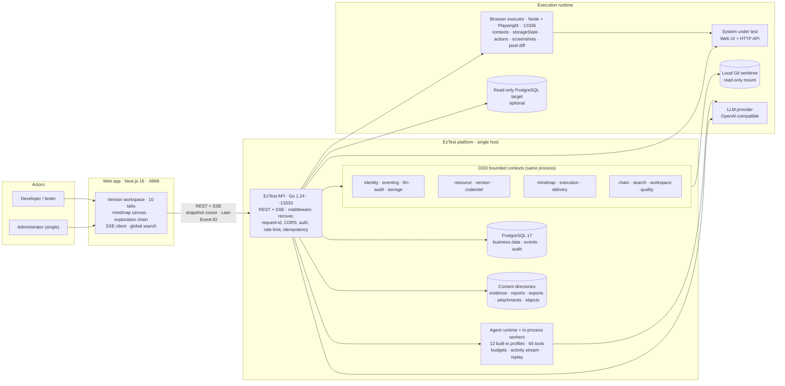
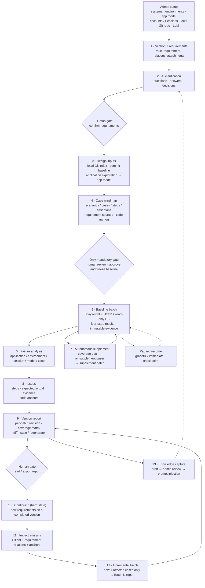
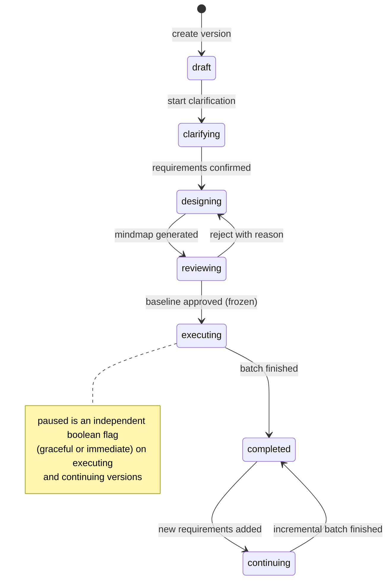

<h1 align="center">EzTest</h1>

<p align="center"><strong>AI-driven end-to-end functional testing — from release requirements to evidence-backed test reports.</strong></p>

<p align="center">
  <a href="README.zh-CN.md">简体中文</a> | English
</p>

<p align="center">
  
  
  
  
  
  
</p>

> **Status: v0.1-preview.** EzTest implements the complete pipeline described below and has been
> exercised end-to-end with a real LLM and a real Chrome browser (29/29 acceptance checks, 7/7
> deterministic evaluation metrics, a local SLO measurement, a backup/restore drill including an
> application smoke test on the restored database, and a live security audit). Validate it in your own
> environment before relying on it.

---

## Table of contents

- [Table of contents](#table-of-contents)
- [Overview](#overview)
  - [What makes EzTest different](#what-makes-eztest-different)
  - [Who it is for](#who-it-is-for)
- [How it works](#how-it-works)
- [Features](#features)
- [Screenshots](#screenshots)
  - [Sign in](#sign-in)
  - [Versions](#versions)
  - [Version overview](#version-overview)
  - [Requirements and clarification](#requirements-and-clarification)
  - [Case mindmap review](#case-mindmap-review)
  - [Results and evidence](#results-and-evidence)
  - [Exploration chain](#exploration-chain)
  - [Issues](#issues)
  - [Report](#report)
  - [Agent center](#agent-center)
  - [Shared resources](#shared-resources)
  - [Knowledge and quality (administrator)](#knowledge-and-quality-administrator)
- [Getting started](#getting-started)
  - [Option A — Docker Compose](#option-a--docker-compose)
  - [Option B — Portable packages (Windows / Linux)](#option-b--portable-packages-windows--linux)
  - [Option C — Run from source](#option-c--run-from-source)
  - [First-run configuration](#first-run-configuration)
  - [Ports and health endpoints](#ports-and-health-endpoints)
- [Architecture and technical approach](#architecture-and-technical-approach)
  - [Stack](#stack)
  - [1. System architecture](#1-system-architecture)
  - [2. End-to-end workflow](#2-end-to-end-workflow)
  - [3. Version lifecycle](#3-version-lifecycle)
  - [4. Key design decisions](#4-key-design-decisions)
  - [5. Data, identity and storage](#5-data-identity-and-storage)
  - [6. Agent runtime and LLM gateway](#6-agent-runtime-and-llm-gateway)
- [Project layout](#project-layout)
- [License](#license)

---

## Overview

**EzTest is an open-source, AI-driven end-to-end functional testing platform for Web and HTTP API
systems.** Give it one release version and the requirements inside it, and a team of LLM agents runs a
semi-autonomous pipeline:

> requirements clarification with a human → code-aware test design → a **single human review** of the
> case mindmap → autonomous execution in a real browser and against the API → evidence, issues and
> per-batch reports → incremental re-testing when new requirements or code changes arrive.

Every verdict is bound to reproducible steps and immutable evidence. The platform is designed so that
humans participate only where judgment is genuinely required:

| Human touch point | Why it cannot be skipped |
|---|---|
| Answer clarification questions | Requirements ambiguity is a business decision |
| **Review and approve the case mindmap** | The only mandatory gate; approving freezes the test baseline |
| Complete a login that cannot be automated (2FA / captcha) | A one-time human takeover card |
| Read the report | Consumption, not a gate |

Everything else — exploration, test design, execution, failure classification, coverage-gap supplement,
issue creation, report generation and the next incremental batch — is driven by agents on top of a
deterministic platform core.

### What makes EzTest different

- **Version-first, not script-first.** A version bundles multiple related requirements; clarification,
  design, execution, evidence and reports are all scoped to that version and its batches.
- **Code-aware design.** A read-only local Git worktree is the source of truth for the code baseline.
  Test design and regression scope are derived from requirement relations plus code diffs and anchors —
  not from hand-maintained page objects.
- **One human review instead of all manual test design.** AI produces the scenario / case / step /
  assertion mindmap with requirement sources and code anchors; a human approves it once and the frozen
  baseline is reproducible.
- **Real browser + API execution with evidence.** A separate Playwright executor drives Chromium,
  captures screenshots, console and network evidence, and supports optional read-only PostgreSQL
  assertions and pixel-level visual assertions.
- **Autonomous loop, not a one-shot run.** Failures are classified and triaged, coverage gaps are
  supplemented with marked `ai_supplement` cases, and completed versions can enter the `continuing`
  state for incremental batches when new requirements arrive.
- **Observable and interruptible.** Server-Sent Events stream agent activity in real time with
  `Last-Event-ID` replay; runs can be paused gracefully or immediately and resumed from the last
  completed step; the exploration chain explains *why* a case failed.
- **Bring your own LLM.** Any OpenAI-compatible endpoint (`chat_completions` or `responses` protocol),
  configured by an administrator, encrypted at rest, with model catalog refresh and connectivity tests.
- **Honest degradation.** Without a working LLM the deterministic parts keep functioning; without the
  executor, batches fail closed instead of pretending to pass.

### Who it is for

| User | Typical job |
|---|---|
| Test engineers / QA | Turn version requirements into reviewed, executable E2E coverage without hand-writing every step |
| Developers self-testing a change | Run a focused regression against the real UI/API and get evidence for a fix |
| Test leads / release owners | Read coverage, results, issues and per-batch report diffs; know what was tested against which commit |
| Platform administrator (single) | Onboard systems, environments, accounts/Sessions, local Git repos and LLM settings; manage users and audit |

---

## How it works

The end-to-end workflow is a fixed sequence of stages with two human gates (requirements confirmation and
mindmap approval):

1. **Onboard shared resources (admin).** Systems, environments, application models, test accounts and
   browser Sessions (Playwright `storageState` or token headers), read-only local Git repositories, and
   LLM configurations.
2. **Create a version and its requirements.** Requirements support attachments (text and screenshots),
   priorities, acceptance criteria and four relation types: `depends_on`, `conflicts_with`, `overlaps`,
   `shares_scope`.
3. **Clarify with AI.** Multi-turn clarification produces questions, answers and accepted/rejected
   decisions; requirements move from `draft` to `clarified`. This step keeps working (manually) when the
   LLM is unavailable.
4. **Design with code context.** The local Git repository is indexed (files, routes, API surfaces,
   commit baseline); application exploration fills the app model; the design agent produces the case
   mindmap (scenarios → cases → steps → assertions with requirement sources and code anchors) and a
   design self-review.
5. **Human review → frozen baseline.** A human edits and approves the mindmap. Approval freezes the
   baseline and moves the version to execution; a rejection requires a reason and returns it to design.
6. **Autonomous execution.** A baseline batch runs the frozen cases in a real browser / against the API
   / against an optional read-only database target. Results are four-state
   (`passed` / `failed` / `blocked` / `inconclusive`) with failure classification
   (`application` / `environment` / `session` / `model` / `case`) and immutable evidence.
7. **Failure analysis and autonomous supplement.** Failures are analyzed and deduplicated into issues;
   a supplement agent looks for coverage gaps and appends marked `ai_supplement` cases (never mutating the
   approved baseline) which run as a follow-up batch.
8. **Deliver.** Issues carry steps, expected/actual results, evidence and code anchors. Each batch
   produces a versioned report (revision, coverage matrix, risks, conclusion) that becomes `stale` when
   its inputs change and can be regenerated without rewriting history.
9. **Continue incrementally.** Adding requirements to a completed version enters the hard `continuing`
   state: incremental clarification → incremental design and impact analysis (Git diff + requirement
   relations + anchors) → an incremental batch running only new and affected cases → a batch report diff.

See the [end-to-end workflow diagram](#2-end-to-end-workflow) in the technical section.

---

## Features

| # | Area | What you get | Maturity |
|---|---|---|---|
| 1 | Requirements workspace | Version container, multi-requirement editing, relations, attachments, clarification chat, questions and decisions, deep-linkable tabs | Verified in real E2E |
| 2 | Code intelligence | Read-only local Git tree/file/diff/search/commits, async indexing, evidence-checked AI code facts, human fact review, impact analysis with explicit unmapped changes | Delivered; real-model path via gated script |
| 3 | Case mindmap | Scenario/case/step/assertion tree, requirement sources, code anchors, AI design / review / data-plan runs, baseline freeze, Markdown/Mermaid/OPML export | Verified in real E2E |
| 4 | Execution engine | Baseline / incremental / supplement batches, Playwright executor, Session injection, graceful and immediate pause, checkpoint resume, immutable evidence, manual takeover | Verified in real E2E |
| 5 | Assertions | UI, API, text, database (read-only PostgreSQL) and visual (selector/region/threshold/viewport/DPR with approved PNG baselines and diff evidence) | Verified in real Chrome |
| 6 | Delivery | Failure analysis, issue triage with evidence and `file:line` anchors, per-batch report revisions, report diff and stale detection, Markdown export | Verified in real E2E |
| 7 | Continuing versions | Hard `continuing` state, incremental clarification/design/execution, batch timeline, code-diff-driven affected-case selection | Verified in real E2E |
| 8 | Exploration chain | React Flow canvas explaining requirement → case → latest result → issue lineage, filters, follow-run, budget truncation | Verified in real E2E |
| 9 | Observability | SSE event stream with snapshot cursor and replay, agent activity streams, real-time broadcast, execution sessions, evidence viewer, audit log | Verified in real E2E |
| 10 | Agent center | 13-role catalogue, run observation and quality metrics for all users; profile/tool/prompt/model configuration for admins | Verified in real E2E |
| 11 | Knowledge capture | Version-scoped knowledge drafts (pattern/pitfall/decision/case-idea), admin review, injection into clarification and design prompts with budgets | Verified in real E2E |
| 12 | Quality center | Deterministic and real-LLM evaluation tracks, 6 design/impact/classification/supplement metrics plus visual classification accuracy, baseline regression rules | Delivered |
| 13 | Global shell | Version switcher, global search (`Ctrl/Cmd+K`), todo center, mobile navigation, dark/light theme | Verified in real E2E |
| 14 | Platform operations | Health/readiness probes, per-instance rate limiting, evidence GC (dry-run by default), backup/restore tooling, advisory-lock single-active workers | Delivered |
| 15 | Security | Two roles (single admin + users), hashed bearer tokens, AES-256-GCM encrypted LLM credentials, audit trail, idempotent writes, request IDs, CORS | Verified by live audit |

---

## Screenshots

All screenshots are captured from the current build against seeded demo data in the shipped web UI
(Simplified Chinese). The demo version is a fictional e-commerce release.

### Sign in


*Login: the platform is single-admin plus ordinary users; the browser token is kept in `sessionStorage`.*

### Versions


*Version list: every release version is a workspace with status, requirements and bound resources.*

### Version overview


*Version overview: requirement coverage, case results, issues, current batch timeline, coverage matrix
and code-change summary.*

### Requirements and clarification


*Requirements workspace: multiple requirements, acceptance criteria, priorities, relations, attachments
and the resource bindings of the version.*


*AI clarification: clarification chat, open questions and decisions; requirements move from `draft` to
`clarified` before design.*

### Case mindmap review


*Case mindmap: scenarios, cases, steps and assertions with requirement sources and code anchors. The
human review is the only mandatory gate and freezes the baseline for reproducible execution.*

### Results and evidence


*Results & evidence: per-case four-state results with failure classification, step/assertion drill-down
and batch selection.*


*Evidence viewer: content-addressed screenshots captured by the Playwright executor, with sha256
metadata; every verdict is bound to steps and immutable evidence.*

### Exploration chain


*Exploration chain: an interactive React Flow graph from requirements to cases, latest results and
issues.*

### Issues


*Issues: evidence, expected/actual steps, severity, failure classification and `file:line` code anchors.*

### Report


*Per-batch report: immutable revision, case results, coverage, risks and conclusion; a report becomes
`stale` when its inputs change and can be regenerated without rewriting history.*

### Agent center


*Agent center: the 13-role catalogue with profiles, tools and success rates; every logged-in user can
observe runs, while only administrators change prompts and tool access.*

### Shared resources


*Shared resources: systems, environments, application models, accounts, browser sessions and local Git
repositories (read-only).*

### Knowledge and quality (administrator)


*Knowledge capture: version-scoped entries taken from real runs, reviewed by the administrator, then
injected into clarification and design prompts.*


*Quality center: evaluation KPIs (design coverage, impact precision/recall, classification accuracy,
issue false-positive rate, supplement hit rate) measured against thresholds and a recorded baseline.*

---

## Getting started

EzTest runs as a single-host stack of four components:

| Component | Role | Default port |
|---|---|---|
| `web` | Next.js 16 web application | 6868 |
| `api` | Go 1.24 REST + SSE API, migrations, workers | 13333 |
| `postgres` | PostgreSQL 17 database | 5433 (host) |
| `executor` | Node + Playwright browser execution service | 13336 (internal only) |

Choose one of the three installation options below. All options require a PostgreSQL 17 database, a
**Chromium-based browser** for the executor (bundled Chromium, or Google Chrome / Microsoft Edge already
installed), and an OpenAI-compatible LLM endpoint for the AI features.

### Option A — Docker Compose

> Docker is the reference deployment, but at the v0.1-preview stage the images have only been **validated
> statically** — the maintainers have never actually built or started the stack. Validate it in your
> environment before using it for anything important.

Requirements: Docker Engine 24+ with Compose v2, 4 vCPU / 8 GiB RAM / 20 GiB disk, and a checkout of this
repository (the Compose build context is the repository root).

```bash
# 1. Create your environment file and edit the required values
cp .env.example .env

# 2. Build and start
docker compose --env-file .env -f deploy/docker-compose.yml up -d --build

# 3. Check health and follow the API log
docker compose --env-file .env -f deploy/docker-compose.yml ps
docker compose --env-file .env -f deploy/docker-compose.yml logs -f api
```

Required values in `.env` (see `.env.example` for the full annotated template):

| Variable | Purpose |
|---|---|
| `POSTGRES_USER` / `POSTGRES_PASSWORD` / `POSTGRES_DB` | Database credentials shared by Compose services |
| `EZTEST_SECRET_KEYS` / `EZTEST_SECRET_KEY_ACTIVE` | AES-256-GCM keyring that encrypts LLM API keys and headers — back it up separately; losing it makes stored credentials unrecoverable |
| `EZTEST_ADMIN_USERNAME` / `EZTEST_ADMIN_PASSWORD` | Seeded administrator account (password ≥ 10 characters) |
| `EZTEST_EXECUTOR_TOKEN` | Shared bearer token between API and executor |
| `EZTEST_WEB_ORIGIN` | Browser origin allowed by CORS (default `http://localhost:6868`) |
| `NEXT_PUBLIC_API_BASE_URL` | Build-time browser API origin (default `http://localhost:13333`) |

Then open <http://localhost:6868> and sign in with the seeded administrator. API health:
<http://localhost:13333/api/health>.

Stop the stack with `docker compose --env-file .env -f deploy/docker-compose.yml down` (data is kept;
`down -v` deletes the volumes).

### Option B — Portable packages (Windows / Linux)

The **0.1-preview** release provides self-contained packages for **Windows x64** and **Linux x64**. Each
archive bundles the API binary, the prebuilt web application, the Playwright executor, the pinned
Playwright browsers and a Node.js 22 runtime, plus start / stop / status / smoke scripts:

| Platform | Archive | Download size |
|---|---|---|
| Windows x64 | `eztest-0.1.0-preview.1-windows-x64.zip` | ~400–450 MB |
| Linux x64 | `eztest-0.1.0-preview.1-linux-x64.tar.gz` | ~400–450 MB |
| Checksums | `SHA256SUMS.txt` | — |

External prerequisites:

- **PostgreSQL 17** reachable from the machine — the package does not embed a database server;
- **Linux only:** the Chromium system libraries — run the bundled `install-linux-deps.sh` once (needs sudo);
  Windows needs nothing beyond the package;
- free ports **13333** (API), **6868** (web) and **13336** (executor, loopback only).

```powershell
# Windows (PowerShell)
Expand-Archive .\eztest-0.1.0-preview.1-windows-x64.zip -DestinationPath .\eztest
cd .\eztest
.\init-config.ps1 -DatabaseUrl "postgres://eztest:<password>@localhost:5433/eztest?sslmode=disable"
.\start-eztest.ps1        # starts API, executor and web, then prints the URLs
```

```bash
# Linux (x64)
tar -xzf eztest-0.1.0-preview.1-linux-x64.tar.gz
cd eztest-0.1.0-preview.1-linux-x64
bash install-linux-deps.sh                                  # once, needs sudo
bash init-config.sh --database-url "postgres://eztest:<password>@localhost:5433/eztest?sslmode=disable"
bash start-eztest.sh                                       # or ./start-eztest.sh after chmod
```

`init-config` creates `.env` with an absolute path layout, a generated AES-256 keyring, executor token and
administrator password (never printed; read `EZTEST_ADMIN_PASSWORD` from `.env`). Then open
<http://localhost:6868>.

| Item | Package content |
|---|---|
| API | `bin/eztest.exe` (Windows) / `bin/eztest` (Linux) |
| Web | `web/` — Next.js standalone server, run on the bundled Node runtime |
| Executor | `executor/` — Node + Playwright with pinned browsers under `playwright-browsers/` |
| Runtime | `runtime/node/` — official Node.js 22 LTS runtime |
| Docs | `docs/openapi/api.yaml`, `PACKAGE.md`, `LICENSE`, `THIRD_PARTY_NOTICES.md`, `manifest.json` |
| Lifecycle | `start-eztest.*`, `stop-eztest.*`, `status-eztest.*`, `smoke-test.*` |
| Data | `data/{objects,version-attachments,evidence,reports,exports}` + your PostgreSQL |
| Logs / PIDs | `logs/`, `run/` |

> The web bundle's browser API origin is baked in at build time (`http://localhost:13333` by default). To serve
> the UI from another host or port, rebuild the web bundle with your `NEXT_PUBLIC_API_BASE_URL`; API and
> executor ports can be changed through `.env`. See the release notes for the exact checksums and contents.

### Option C — Run from source

Requirements:

- Go **1.24.6** (the Go toolchain declared in `backend/go.mod`)
- Node.js **22+** and pnpm **11**
- PostgreSQL **17** with two databases, e.g. `eztest` (application) and `eztest_test` (integration tests)
- A Chromium-based browser for the executor (bundled Playwright Chromium, Google Chrome or Microsoft Edge)

```bash
# 0. Repository root
cp .env.example .env        # edit database URL, secret keys and admin credentials

# 1. API (applies embedded migrations and seeds the admin on first boot)
cd backend
go run ./cmd/eztest
#    Listens on :13333; set EZTEST_OPENAPI_PATH to the absolute docs/openapi/api.yaml path
#    if you run it from a different working directory.

# 2. Web (new terminal)
cd frontend
pnpm install
pnpm dev                    # http://localhost:6868

# 3. Playwright executor (new terminal, needed to execute cases)
cd executor
pnpm install
pnpm exec playwright install chromium   # or use an installed Chrome/Edge
pnpm start                  # http://127.0.0.1:13336, guarded by EZTEST_EXECUTOR_TOKEN
```

Useful commands:

```bash
# Go unit tests / integration tests (integration needs EZTEST_TEST_DATABASE_URL)
cd backend && go test -count=1 ./... && go test -tags=integration -count=1 ./...

# Frontend lint / typecheck / unit tests / production build
cd frontend && pnpm lint && pnpm typecheck && pnpm test && pnpm build

# Executor tests
cd executor && pnpm test
```

### First-run configuration

After signing in as the administrator:

1. **Settings → LLM configuration**: add an OpenAI-compatible provider (base URL, API key, model),
   refresh the model catalog and run the connectivity test. Encrypted credentials are never echoed back.
2. **Shared resources**: register the system under test, an environment, the application model,
   a test account and a browser Session (or a login recipe), plus the local Git repository you want the
   AI to read (read-only path, branch and exclusions).
3. **Create a version** under *Versions* and add its requirements, then follow the workflow from
   clarification to execution.
4. *(Optional)* **Settings → users**: create ordinary accounts for the team. Only the administrator can
   change configuration; ordinary users can work on versions, requirements, mindmaps, executions, issues
   and reports.

### Ports and health endpoints

| Endpoint | What it reports |
|---|---|
| `GET http://localhost:13333/healthz` | Liveness: the process responds |
| `GET http://localhost:13333/api/health` | Readiness: database ping, build version/commit, whether a usable default LLM config exists, effective rate-limit and GC settings |
| `GET http://localhost:13333/api/openapi.yaml` | The full OpenAPI 3.0 document (223 operations) |
| `GET http://localhost:13336/healthz` | Executor health (internal only; requires the bearer token) |
| <http://localhost:6868> | Web application |

> `/api/health` returning 200 proves the API and database are up; it does **not** prove that an LLM
> endpoint is reachable or that the executor is healthy (the executor is probed when a batch is created).

---

## Architecture and technical approach

### Stack

| Layer | Technology |
|---|---|
| API / services | Go 1.24.6, standard-library `net/http` router, `pgx/v5` driver, embedded SQL migrations |
| Domain modelling | 16 bounded contexts (domain / application / infrastructure / HTTP interfaces), one composition root |
| Data | PostgreSQL 17 (67 application tables, 47 append-only migrations), filesystem content directories |
| Web | Next.js 16 (App Router, standalone output), React 19, TypeScript, Tailwind CSS 4, Radix primitives, `@xyflow/react` 12 |
| Realtime | Server-Sent Events with persisted per-channel sequence numbers, snapshot cursor, `Last-Event-ID` replay and 20 s heartbeat |
| Execution | Separate Node.js + Playwright 1.64 service; `storageState`-injected browser contexts, action protocol, screenshots, pixel comparison |
| LLM | OpenAI-compatible `chat_completions` / `responses` protocols, streaming, tool calling, multimodal, retries, model catalog |
| Ops | Docker Compose (api/web/postgres/executor), health probes, audit log, per-instance rate limiting, evidence GC, backup/restore scripts |

### 1. System architecture



### 2. End-to-end workflow



### 3. Version lifecycle



### 4. Key design decisions

- **Local Git is the only code source of truth.** EzTest reads administrator-configured worktrees
  read-only (no online Git providers, no checkout writes, no code execution). Each batch records the
  `base` and `head` commits so results, evidence, issues and reports stay reproducible.
- **Deterministic core, AI on top.** State machines, coverage calculations, report content, impact
  candidates and evidence hashing are deterministic platform code. AI contributes structured
  clarification, design, exploration and analysis results, which are validated and persisted before use.
- **Evidence-bound verdicts.** `passed` requires every assertion in the case snapshot to pass, and
  `failed` requires an actually failed assertion. A failure claimed without supporting evidence is
  downgraded to `inconclusive(case, evidence_missing)` instead of being reported as a product defect,
  and evidence is content-addressed and immutable.
- **Frozen baselines.** Approving the mindmap freezes `case_baseline`; later AI supplements are additive
  and marked, so re-runs remain comparable and reports can diff batches.
- **Four-state results.** `passed`, `failed`, `blocked` and `inconclusive` are distinct; failure
  classification separates product defects from environment, session and model problems.
- **Append-only migrations.** 47 SQL migrations are embedded into the binary, applied under a
  PostgreSQL advisory lock, and validated by checksum. Rollback is a restore from backup; historical
  files are never modified.
- **Executor isolation.** The Go API never drives a browser directly: a dedicated Playwright service owns
  browser contexts and enforces a host allow-list, action timeouts and secret-fill scrubbing. Without a
  healthy executor, batch creation fails closed with `503 executor_unavailable`.
- **Observability by replay.** Every state change is an event with a per-channel sequence number, so the
  UI can resume exactly where it left off after a reconnect or a page refresh.
- **Honest degradation.** If no LLM is configured, deterministic paths still work and AI paths return
  retryable `llm_not_configured` / `ai_unavailable` errors rather than failing the whole product.

### 5. Data, identity and storage

- **IDs**: application-generated 64-bit Snowflake IDs (41-bit time, 10-bit node, 12-bit sequence).
  Version-scoped, execution, delivery and agent IDs are serialized as decimal **strings**; legacy
  resource/user IDs remain numbers.
- **Persistence**: PostgreSQL 17 holds all business state, events, audit entries and configuration;
  content directories hold evidence, reports, exports, requirement attachments and content-addressed
  objects. Back up the database and all content directories together.
- **Secrets**: LLM API keys and custom headers are encrypted with AES-256-GCM using a versioned keyring
  (`EZTEST_SECRET_KEYS` / `EZTEST_SECRET_KEY_ACTIVE`). **Only LLM credentials are encrypted** — resource
  access credentials and browser `storageState` are stored as delivered by design, so treat the database
  as sensitive. Bearer tokens are stored only as SHA-256 hashes and expire after 12 hours.

### 6. Agent runtime and LLM gateway

- 12 built-in agent profiles are seeded on first boot (clarification, requirement analysis, context recon,
  app exploration, case design, case review, data plan, supplement, execution, failure analysis, issue
  triage, runtime diagnostic). Administrators can edit prompts, tool allow-lists and model budgets.
- 64 tool definitions span base utilities, code reads, case editing, browser and HTTP actions, DB
  assertions, visual assertions and delivery analysis. Every tool call, result, error and abort is
  audited.
- Runs have turn, wall-clock and hard-timeout budgets, a per-run tool-call budget (default 30, exhaustion
  ends as `inconclusive`), per-tool timeouts and a global concurrency limit. One active run per session.
- The activity contract is frozen: `run_started`, `user_message`, `thinking`, `text`, `tool_use`,
  `tool_result`, `usage`, `decision`, `run_finished`; long text is streamed in segments and reassembled
  by `(message_id, part)`, with full content loaded lazily.
- The LLM gateway normalizes streaming deltas, reasoning deltas, tool calls, finish reasons and usage;
  retries happen only before the first stream event; typed errors (`llm_auth_failed`, `llm_rate_limited`,
  `llm_timeout`, ...) never leak upstream response bodies.

---

## Project layout

```text
backend/                 Go API: cmd/eztest (composition root), internal/<context> (16 DDD contexts),
                         internal/db/migrations (47 embedded SQL migrations), internal/platform
frontend/                Next.js 16 app: app routes, features, components, lib; Playwright E2E specs
executor/                Node.js + Playwright browser execution service (HTTP action protocol)
deploy/                  Docker Compose stack plus API and web Dockerfiles
docs/openapi/api.yaml    OpenAPI 3.0 contract served at GET /api/openapi.yaml
docs/assets/screenshots/ README screenshots
.env.example             Annotated environment template
LICENSE                  Apache License 2.0
```

---

## License

Licensed under the [Apache License 2.0](LICENSE).
