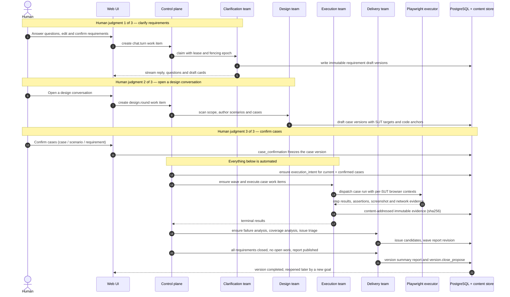
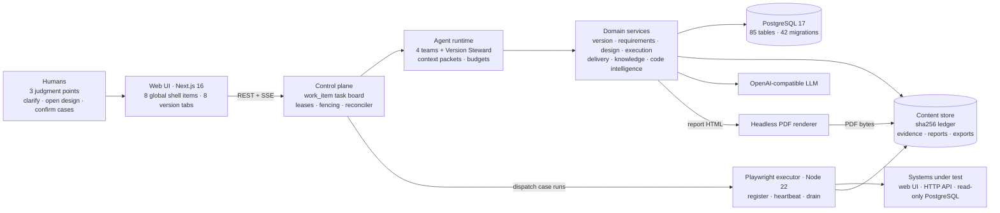
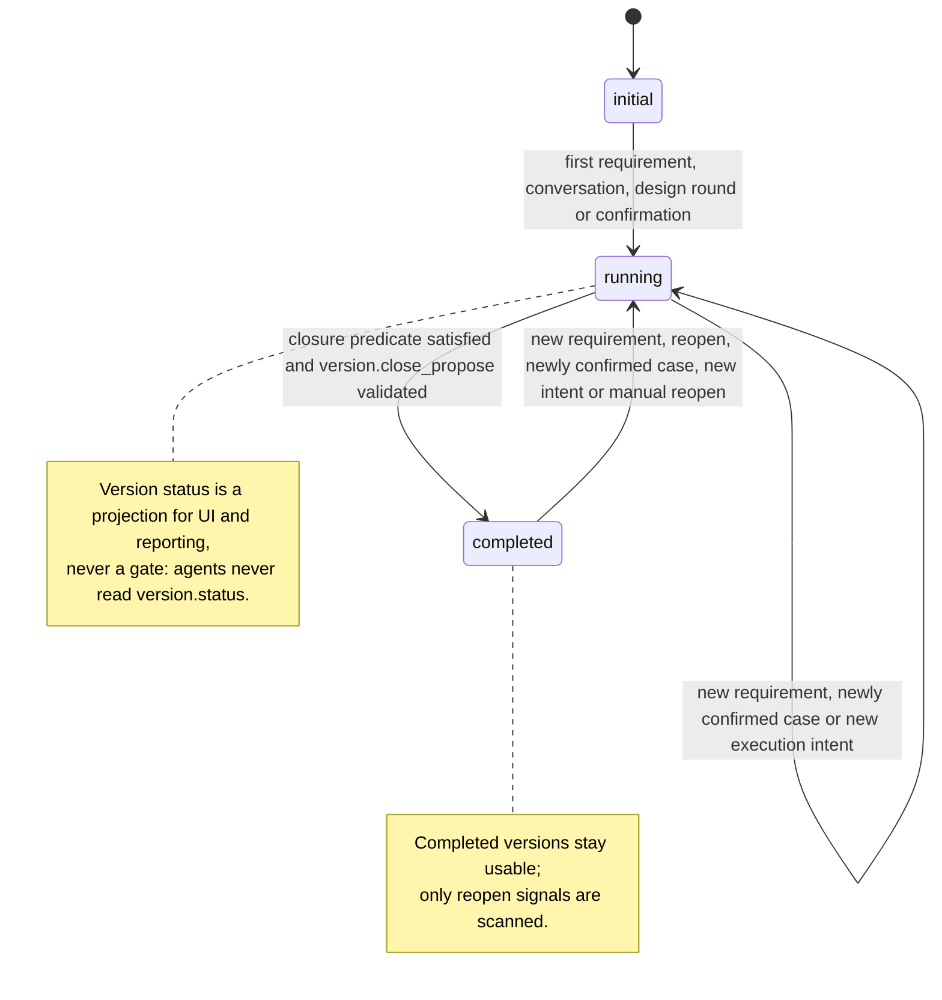

<h1 align="center">EzTest</h1>

<p align="center"><strong>AI 驱动、半自主的 Web 与 HTTP API 端到端测试平台。</strong></p>

<p align="center">
  简体中文 | <a href="README.md">English</a>
</p>

<p align="center">
  
  
  
  
  
  
  
</p>

> **状态：v0.2-preview（预发布）。** EzTest 已实现下文完整链路，并在维护者主机上用真实浏览器、
> 真实 OpenAI 兼容模型完成端到端演练。这是供评估的预览版，不是生产版本——依赖它之前请先在自己的
> 环境验证。

---

## 目录

- [概述](#概述)
- [工作方式](#工作方式)
- [截图](#截图)
- [使用方式](#使用方式)
  - 方式 A —— 免安装可运行包（Windows / Linux）
  - 方式 B —— Docker Compose
  - 方式 C —— 从源码运行
  - 首次使用配置
  - 端口与健康检查
- [主要技术路线](#主要技术路线)
- [项目结构](#项目结构)
- [许可证](#许可证)

---

## 概述

**EzTest 是一个自托管、AI 驱动、半自主的 Web 与 HTTP API 端到端测试平台。** 给它一个发布版本和一组
需求，它会产出经过人工确认、可执行、带证据的端到端覆盖：在对话中澄清需求、结合真实代码库设计场景与
用例、驱动真实 Chromium 浏览器与 HTTP API 执行、分类失败、创建与合并问题、渲染报告，并推动版本收尾。
它面向希望获得 AI 杠杆、但不愿放弃"到底测什么"控制权的小型 QA 与工程团队。

**人只留在真正需要判断的位置**——在对话中澄清需求、开启设计对话、确认产出的用例。其余全部由确定性
平台内核上的自主流程完成：带租约与 fencing 的共享任务板、对比期望/实际状态的 reconciler、四个 Agent
团队加一个 Version Steward、以及持久的版本×团队协作频道。Agent 只提交结构化候选，服务端校验作用域、
状态与证据后才落库；每个结论都绑定按内容寻址、不可变的证据。

---

## 工作方式

一次正常旅程包含六个步骤。只有前三步包含人工判断点，其余由 Agent 团队在确定性平台内核之上自动推进。

| # | 步骤 | 人做什么 | 系统/Agent 自动做什么 |
|---|---|---|---|
| 1 | **管理员配置** | 管理员接入系统、环境、页面/API、只读数据库、账号与浏览器会话、本地 Git 仓库、LLM 供应商与团队用户。 | 配置存放在数据库设置中心，多数热生效，带审计与密钥掩码。 |
| 2 | **版本与需求** | 任意登录用户创建版本、绑定一个或多个 SUT，在澄清对话中提问、编辑并按单条/批量确认需求。 | 澄清团队抽取与改写需求版本、建议需求关系，并保留不可变修订历史。 |
| 3 | **设计** | 用户开启设计对话、可修改结果，然后按用例/场景/需求确认。 | 设计团队扫描待设计范围，产出 场景 → 用例 → 步骤 → 断言（含需求来源、SUT 目标、代码锚点），自审并持续起草，直到人工确认。 |
| 4 | **执行** | 无需操作；自动登录无法完成时会出现人工接管请求。 | 确认生成执行意图；planner 组成波次（每版本一个活跃波）；用例执行器驱动真实 Chrome 与 HTTP，可选只读 PostgreSQL 与视觉断言。 |
| 5 | **交付** | 确认或驳回问题；阅读、导出报告。 | 失败被分析并分类为带稳定去重键的问题候选；波次/版本报告是只追加修订（HTML 为准，PDF 由独立 worker 渲染）；探索链路暴露 需求 → 用例 → 结果 → 问题 的血缘。 |
| 6 | **收尾与继续** | 无需操作；人可以重开已完成版本。 | 收尾谓词满足（无未完成工作、需求全部闭环、版本总结报告已发布）时，Version Steward 提议完成并由服务端校验。新需求、需求重开或新确认用例会让版本回到 running，进入下一个增量波次。 |

UI 由 **8 个全局壳层项**——版本、问题、报告、知识、资源、质量、Agent 中心、设置——和 **8 个版本
Tab**——总览、需求与澄清、用例设计、执行、探索链路、问题、报告、代码与变更——组成。顶栏提供全局搜索
（`Ctrl/Cmd+K`）与待办抽屉；知识是全局的，不归属单个版本。



---

## 截图


*在对话中与 AI 团队澄清需求；需求列表、待解决问题与进入设计的交接都留在同一个工作区。*

### 版本工作区


*每个发布版本都是一个工作区，包含状态、需求与已绑定系统。*


*版本总览：覆盖情况、SUT 绑定、执行状态与该版本的收尾条件。*

### 用例设计


*用例设计工作台：场景、用例、步骤与断言在这里评审与确认；设计团队结合需求与代码上下文起草它们。*

### 执行与证据


*执行波次运行已确认用例；实时轨迹与逐用例结果和证据放在一起。*


*每条结论背后都是按内容寻址、不可变的证据，附带 sha256 元数据。*

### 交付


*失败自动转为带证据与代码锚点的问题；重复问题合并成一条可追溯链路。*


*只追加的报告修订，带 HTML/PDF 输出、覆盖与风险；输入变化时报告会变为过期，可重新生成而不改写历史。*

### 探索链路


*探索链路串联需求、用例、波次、执行、结果、证据、问题与报告。*

### 平台


*公共资源：被测系统及其环境、页面、API、只读数据库、测试账号与本地 Git 仓库。*


*全局知识由管理员审核后注入 Agent 提示词，带引用预算与使用记录。*


*Agent 中心：14 个内置 Agent profile，展示所属团队、工具、预算、提示词修订与运行统计。*

---

## 使用方式

EzTest 以单机栈运行。API、Web UI、执行器和 PDF renderer 是独立进程；PostgreSQL 17 是唯一必需的外部依赖。

| 组件 | 作用 | 默认端口 |
|---|---|---|
| `web` | Next.js 16 Web 应用 | 6868 |
| `api` | Go 1.24 REST + SSE API、迁移与后台 worker | 13333 |
| `executor` | Node + Playwright 浏览器执行服务 | 13336（仅回环） |
| `renderer` | Node 无头 HTML→PDF worker（可运行包内置） | 13337（仅回环） |
| `postgres` | PostgreSQL 17 数据库 | 5433（开发默认） |

所有方式都需要：**PostgreSQL 17**、执行器可用的 **Chromium 内核浏览器**（可运行包已内置 Chromium；
从源码运行时可用 Playwright Chromium 或已安装的 Google Chrome / Microsoft Edge）、以及用于 AI 能力的
**OpenAI 兼容 LLM 端点**（确定性路径不依赖它，可不配置）。

### 方式 A —— 免安装可运行包（Windows / Linux）

预览版提供免 Docker 的自包含可运行包，覆盖 **Windows x64** 与 **Linux x64**。每个压缩包包含 API 二进制、
预构建 Web 应用、Playwright 执行器、PDF renderer、固定版本的 Playwright 浏览器、Node.js 22 运行时，
以及启动/停止/状态/冒烟脚本。PostgreSQL 不内置，需可从本机访问。

| 平台 | 压缩包 |
|---|---|
| Windows x64 | `eztest-0.2.0-preview.1-windows-x64.zip`（约 400 MB） |
| Linux x64（glibc） | `eztest-0.2.0-preview.1-linux-x64.tar.gz`（约 400 MB） |
| 校验和 | `SHA256SUMS.txt` |

请从 [Releases](https://github.com/EdouardRichard/EzTest/releases) 页面下载。每个包内还附带
`docs/openapi/api.yaml` 形式的 OpenAPI 3.0 契约。Linux 上先运行包内
`install-linux-deps.sh`（需要 sudo）安装 Chromium 系统依赖；Windows 除压缩包外无需其他依赖。启动前请
确保端口 **13333**、**6868**、**13336**、**13337** 空闲。

```powershell
# Windows（PowerShell），解压后
cd .\eztest-0.2.0-preview.1-windows-x64
.\init-config.ps1 -DatabaseUrl "postgres://eztest:<password>@localhost:5433/eztest?sslmode=disable"
.\start-eztest.ps1        # 启动 API、执行器、renderer 与 Web，并等待健康检查
.\status-eztest.ps1       # 进程、健康探针与 PostgreSQL 状态
.\stop-eztest.ps1         # 依次停止 web -> renderer -> executor -> API
.\smoke-test.ps1          # 对运行中的安装做端到端检查
```

```bash
# Linux（x64），解压后
cd eztest-0.2.0-preview.1-linux-x64
bash install-linux-deps.sh                                  # 仅首次，需要 sudo
bash init-config.sh --database-url "postgres://eztest:<password>@localhost:5433/eztest?sslmode=disable"
bash start-eztest.sh
bash status-eztest.sh
bash stop-eztest.sh
bash smoke-test.sh
```

`init-config` 生成包内 `.env`（数据库 URL、端口与执行器/renderer token），`start-eztest` 启动整个栈并
打印 URL。打开 <http://localhost:6868> 登录——首次启动会种下管理员 `admin` / `admin123`，
**请立即在 UI 中修改该密码**（设置 → 账号）。HTML 与 PDF 报告开箱即用：包内 renderer 会随栈一起启动。
Docker 部署与多副本说明见 [deploy/README.md](deploy/README.md)。

### 方式 B —— Docker Compose

> **校验状态：** 维护者的开发主机未安装 Docker，因此镜像从未构建、Compose 栈从未启动过；只做了静态
> 校验。请把它视为"已交付但未实跑"的路径，并在自己的环境验证。

要求：Docker Engine 24+ 与 Compose v2、4 vCPU / 8 GiB 内存 / 20 GiB 磁盘，且仓库检出在构建上下文根目录。
Compose 文件交付六个服务：两个 API 副本、Web、PostgreSQL 17、Playwright 执行器与 PDF renderer。

```bash
cp .env.example .env      # 设置 deploy/docker-compose.yml 需要的 POSTGRES_* 与 secret
docker compose --env-file .env -f deploy/docker-compose.yml up -d --build
docker compose --env-file .env -f deploy/docker-compose.yml ps
```

打开 <http://localhost:6868>；API 健康检查：<http://localhost:13333/api/health>。完整变量、卷与多副本
说明见 [deploy/README.md](deploy/README.md)。

### 方式 C —— 从源码运行

要求：Go **1.24.6**（见 `backend/go.mod` 声明）、Node.js **22+** 与 pnpm **11+**、PostgreSQL **17**，
以及执行器可用的 Chromium 内核浏览器。

```bash
# 0) API 进程只读取 4 个启动变量。
export EZTEST_DATABASE_URL="postgres://eztest:<password>@localhost:5433/eztest?sslmode=disable"
export EZTEST_API_PORT=13333
export EZTEST_WEB_PORT=6868
export EZTEST_EXECUTOR_PORT=13336

# 1) API —— 首次启动自动应用内嵌迁移并种下管理员
cd backend && go run ./cmd/eztest

# 2) Web UI（第二个终端）
cd frontend && pnpm install && pnpm dev        # http://localhost:6868

# 3) Playwright 执行器（第三个终端）
cd executor && pnpm install && pnpm exec playwright install chromium
EZTEST_EXECUTOR_TOKEN=<execution.executor_token> pnpm start

# 4) 可选 PDF renderer（第四个终端）
cd renderer && pnpm install
EZTEST_RENDER_TOKEN=<report.render_token> node src/server.mjs
```

执行器与 renderer 的 token 必须分别与数据库设置 `execution.executor_token`、`report.render_token` 一致
（首次启动时会用开发默认值种入，可在管理员设置中修改）。Windows 上用 `$env:NAME="value"` 设置环境
变量。测试命令：

```bash
pwsh scripts/test.ps1        # Go 单元 + 集成测试，前端 lint / typecheck / Vitest
cd executor && pnpm test     # 执行器 node:test 套件
cd renderer && node --test   # renderer node:test 套件
```

### 首次使用配置

以管理员登录后：

1. **修改种子密码**（新库首次启动为 `admin` / `admin123`）。
2. **设置 → LLM 配置：** 添加 OpenAI 兼容供应商（base URL、API Key、模型），刷新模型目录并运行连通性
   测试。凭据在 UI 中只显示掩码。
3. **资源：** 登记被测系统及其环境、页面与 HTTP API，可选的只读 PostgreSQL 目标库、测试账号与浏览器
   会话，以及 AI 可读取的本地 Git 仓库（只读）。
4. **版本：** 创建版本、绑定 SUT、录入需求，然后按澄清 → 设计 → 确认 → 执行 → 问题/报告的流程推进。
5. *（可选）* **设置 → 用户：** 创建普通账号；只有管理员可以修改配置、资源、LLM 设置与知识审核。

### 端口与健康检查

| 端点 | 说明 |
|---|---|
| `GET http://localhost:13333/healthz` | 存活检查：API 进程可响应 |
| `GET http://localhost:13333/api/health` | 就绪检查：数据库 ping、版本/commit、LLM 是否存在、限流与 GC 设置 |
| `GET http://localhost:13333/api/health/ready` | 编排就绪检查，包含在飞计数 |
| `GET http://localhost:13336/healthz` | 执行器健康（含浏览器版本，仅回环） |
| `GET http://localhost:13337/healthz` | PDF renderer 健康（仅回环） |
| <http://localhost:6868> | Web 应用 |

`/api/health` 返回 200 只证明 API 与数据库可用；它不代表 LLM 端点可达或执行器健康——执行器在开始执行时
才会被探测。

---

## 主要技术路线

### 技术栈

| 层 | 技术 |
|---|---|
| API / 服务 | Go 1.24.6、标准库 `net/http` 路由、`pgx/v5` 驱动、内嵌只追加 SQL 迁移 |
| 领域建模 | 单个模块化单体进程内的 20 个限界上下文，端口/适配器风格，事件驱动读模型 |
| 数据 | PostgreSQL 17（85 张业务表、42 个迁移），文件系统内容存储 + sha256 content ledger |
| Web | Next.js 16 App Router（standalone 输出）、React 19、TypeScript、Tailwind CSS 4、Radix、`@xyflow/react` |
| 实时 | Server-Sent Events，持久化序号 + 快照游标 + `Last-Event-ID` 回放 |
| 控制面 | `work_item` 任务板是唯一执行队列：去重键、租约、fencing epoch、重试、reconciler |
| Agent 运行时 | 4 个产品团队 + Version Steward、14 个 Agent profile、63 个工具、上下文包与 token/轮次/时间预算 |
| 执行 | 独立 Node 22 + Playwright 1.64 服务（线协议 v1.2）：浏览器上下文、storageState、动作协议、截图、像素 diff |
| LLM | OpenAI 兼容 `chat_completions` / `responses` 协议，流式、工具调用、多模态、重试、模型目录 |
| 运维 | Docker Compose、readiness/drain 探针、实例级限流、事件/审计保留、GC、备份恢复脚本 |

### 1. 系统架构



### 2. 控制面是唯一执行队列

- 每个 Agent 动作——包括一次聊天回合——都是带团队、类型、优先级、去重键、依赖、重试、租约与 fencing
  epoch 的 `work_item`。长任务通过心跳续租；租约过期会被回收，旧实例的写回因 epoch 不匹配被拒绝。
- **Reconciler** 每隔几秒扫描一次，对比期望状态与实际状态，只补建缺失的工作（设计覆盖、执行意图、波次
  分析、报告、收尾、缺口）。事件用于提前唤醒；漏掉的事件由下一轮扫描兜底。
- **四个产品团队**——澄清、设计、执行、交付——加一个 **Version Steward**，通过持久的版本×团队频道协作。
  团队之间不互相调用：交接 = 写作品 + 任务板上出现新任务。两个内部平台团队（代码索引与运维）在同一
  任务板上执行确定性后台工作。
- 版本状态是**投影，不是闸门**：`initial → running → completed`，出现新目标时自动重开；Agent 从不读取
  版本状态来决定做什么。



### 3. Agent 运行时与上下文工程

- 每个 run 绑定一个 `work_item`、实例与租约 epoch；运行时注入版本/SUT 作用域，工具因此不需要信任模型
  传入的标识符。
- 预算覆盖轮次、墙钟时间、硬超时、工具调用与 token。预算耗尽的 run 以分类状态结束（`model`、
  `context`、`tool`、`budget`、`aborted`、`interrupted`），而不是崩溃；dead 任务在任务板上可见，供人工
  跟进。
- 上下文分层：版本包、任务包、会话记忆（最近窗口 + 滚动摘要 + 钉住事实）、团队频道摘要与工具/证据
  上下文，全部受 token 预算约束。超限的工具结果落盘到内容存储，只回传 head + 内容引用。上下文溢出由
  压缩处理，而不是让 run 失败。每次 run 都会持久化其上下文包，便于审计与复现。

### 4. 多 SUT 执行与证据

- 一个版本可以绑定多个系统；资源以 `version_sut_id` 为作用域，用例步骤可以切换目标 SUT。浏览器上下文
  按 `(version_sut, account_role)` 创建，因此同一 SUT 可以同时运行多个角色。
- 跨系统用例整体调度并预留配额，避免死锁；单 SUT 用例在每 SUT 配额下并发。每版本一个活跃波；支持
  暂停/恢复与检查点恢复。
- 结果是四态的——`passed` / `failed` / `blocked` / `inconclusive`——并带失败分类（应用、环境、会话、
  模型、用例）。没有证据支撑的失败会降级为 `inconclusive`，而不是被当成产品缺陷上报。
- 截图、控制台日志、网络轨迹、API 响应与视觉 diff 以内容寻址的不可变对象（`sha256` 为键）保存；
  数据库只存元数据与引用。GC 基于 content ledger 工作，默认 dry-run 并遵守保留期。

### 5. 配置与运维

- API 进程只读取 **4 个启动环境变量**：`EZTEST_DATABASE_URL`、`EZTEST_API_PORT`、`EZTEST_WEB_PORT`、
  `EZTEST_EXECUTOR_PORT`。其余配置——路径、LLM 凭据、执行器/renderer 的 URL 与 token、限额、保留期、
  限流、报告模板——都在数据库设置中心，通过 UI 的**设置**页管理（85 个设置键，带审计，secret 掩码）。
- 迁移只追加、内嵌在二进制中，启动时在 advisory lock 下应用并做校验和检查；回退方式是恢复备份，而不是
  down migration。
- API 可多副本：租约与 leader advisory lock 存在 PostgreSQL，readiness 暴露在飞计数，实例可以 drain，
  所有副本必须共享同一内容目录。限流按实例计（总速率 = 副本数 × 限额，默认关闭），事件/审计保留清理
  由 leader 每日执行。
- 备份时请同时备份 PostgreSQL 与全部内容目录，并单独保管 `EZTEST_SECRET_KEYS`。

---

## 项目结构

```text
backend/                 Go 1.24 API：cmd/eztest（装配根）、internal/<context>（限界上下文）、
                         internal/db/migrations（内嵌只追加 SQL 迁移）
frontend/                Next.js 16 App Router UI：app 路由、features、components、lib；Vitest 与
                         Playwright E2E 用例
executor/                Node 22 + Playwright 浏览器执行服务（线协议 v1.2）
renderer/                Node 无头 HTML→PDF renderer 服务
deploy/                  Docker Compose 栈（双 API 副本、Web、PostgreSQL、执行器、renderer）与
                         API / Web / renderer Dockerfile
scripts/                 开发、测试、验收与发布工具
eval/                    质量中心使用的评测语料与指标
assets/screenshots/      README 截图
.env.example             4 个启动变量的注释模板
LICENSE                  Apache License 2.0
```

---

## 许可证

基于 [Apache License 2.0](LICENSE) 许可。

EzTest 的产品设计受到 ARTEX 项目中探索过的想法启发（AGPL-3.0）；仓库不包含任何 ARTEX 源代码。第三方
组件（Go 模块、npm 包、Node.js、Playwright 与 Chromium）按其各自许可证分发；可运行包内附
`THIRD_PARTY_NOTICES.md`。
