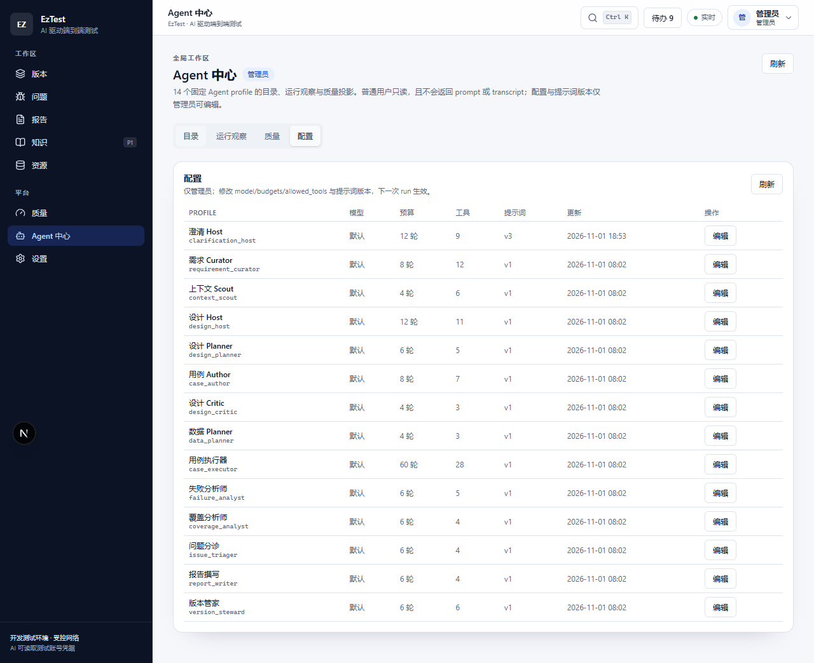
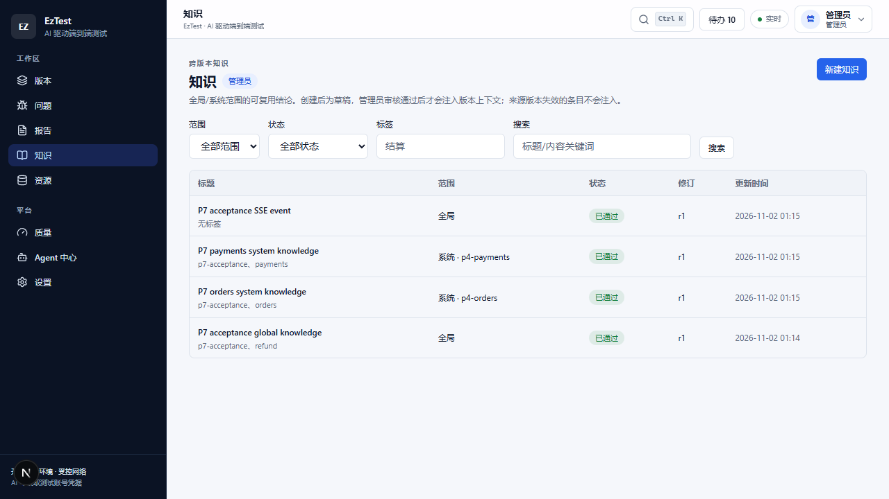
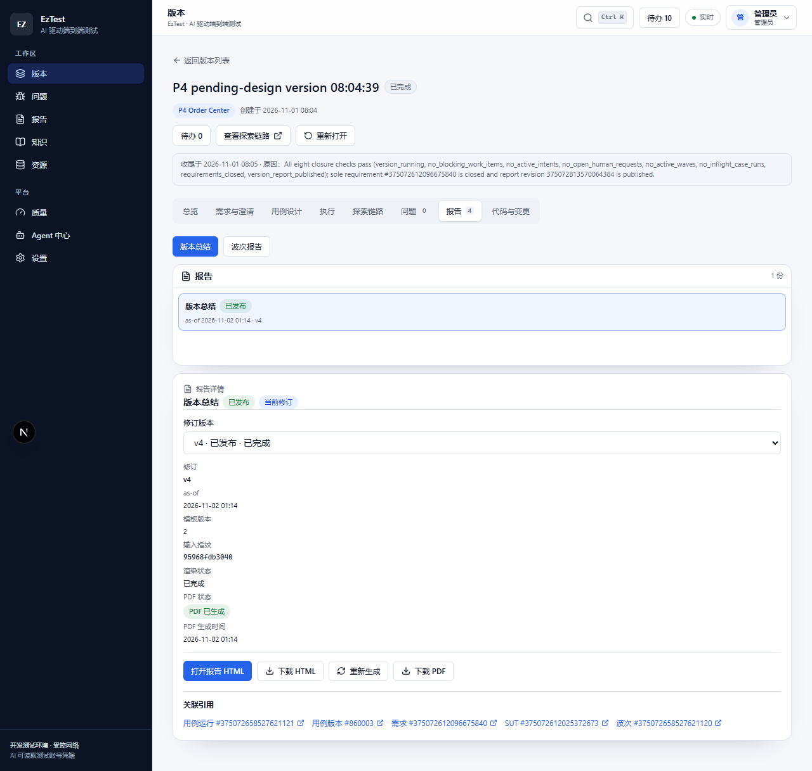
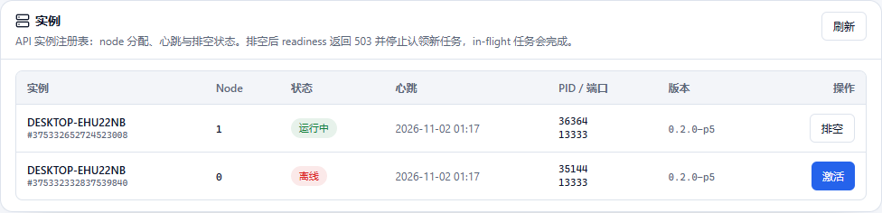
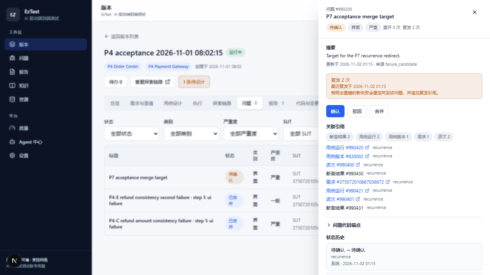

<h1 align="center">EzTest</h1>

<p align="center"><strong>AI 驱动、半自主的 Web 与 HTTP API 端到端测试平台。</strong></p>

<p align="center">
  简体中文 | <a href="README.md">English</a>
</p>

<p align="center">
  
  
  
  
  
  
</p>

> **状态：v0.2（P8）。** 0.2 是完整替代版本：对齐 0.1 P0–P8 的全部能力，并补齐 P9 五项（HTML/PDF
> 报告、跨版本知识、统一 GC、多副本安全、问题重开/合并/跨波次去重）。P8 实施已完成并合回
> `feat/v0.2`；最终验收签核待 S9 的 12 用例/2 波长执行证据（L17）。
>
> **验证状态（请先阅读）。**
>
> - 已落盘证据：P6（`docs/version-V0.2/acceptance/p6/`）与 P7
>   （`docs/version-V0.2/acceptance/p7/`），均使用真实 LLM 与真实 Chrome 执行。
> - P8 证据已记录到 `docs/version-V0.2/acceptance/p8/`：全旅程 S0–S6、韧性 S9 长上下文/S10、
>   多副本 S8、37 行能力矩阵、浏览器 E2E（11/11）与静态门均通过。S9 长执行为部分覆盖
>   （P3 fallback，6 个执行用例），pinned fact 断言未触发；见 `known-limitations.md` L16/L17。
> - `deploy/` 下的 Docker Compose **已交付并做了静态校验，但从未在本机构建或启动**（本机未安装
>   Docker）。
> - 0.2 的 SLO 测量与安全审计**按用户裁定跳过**，本文不作任何相关宣称。

---

## 目录

- [概述](#概述)
- [工作原理](#工作原理)
- [功能](#功能)
- [截图](#截图)
- [快速开始](#快速开始)
- [运维与部署](#运维与部署)
- [文档地图](#文档地图)
- [许可证](#许可证)

---

## 概述

EzTest 接收一个发布版本及其需求，产出经过确认、可执行、带证据的端到端测试覆盖。人只做真正需要判
断的部分：

> 在对话中澄清需求 → 开启设计对话 → 确认生成的可执行用例。

其余工作——设计场景与用例、把确认转成执行波次、在真实浏览器和 HTTP API 上执行、分类失败、创建与合
并问题、生成报告、推进版本收尾——都由 Agent 团队在确定性的平台内核上完成。

0.2 用**控制面模型**替代 0.1 的流水线假设：

- **任务板是唯一执行队列。** 每个 Agent 动作（包括聊天回合）都是带团队、类型、优先级、去重键、租
  约与栅栏令牌的 `work_item`。reconciler 对比期望状态与实际状态并补任务；事件只用于低延迟唤醒。
- **四个团队 + Version Steward。** 澄清、设计、执行、交付团队通过持久化的「版本 × 团队」频道与产
  物交接协作；没有中心编排 Agent，团队之间也不直接调用。
- **版本状态只是投影，不是门禁。** `initial → running → completed`，出现新目标时自动重开；已完成
  版本仍可正常使用。
- **多 SUT 原生支持。** 一个版本可绑定多个系统，每个系统各有环境、页面、API、只读 PostgreSQL 目标
  库、账号/角色与本地 Git 仓库；用例可按步骤指定不同 SUT，证据与断言始终归属 `version_sut_id`。
- **结论绑定证据。** 结果为 `passed` / `failed` / `blocked` / `inconclusive`，失败分为应用、环境、
  会话、模型或用例问题；截图、控制台、网络、API 响应与视觉差异均按内容寻址、不可变。
- **启动配置最小化。** API 进程只读取 4 个启动环境变量；其余运行时配置全部在数据库设置中心（P8 为
  85 项）。

## 工作原理

一次正常旅程分为六步：

1. **管理员配置。** 注册系统、环境、页面、API、只读目标库、账号/浏览器会话、本地 Git 仓库与 LLM
   供应商。
2. **版本与需求。** 创建版本、绑定 SUT、录入需求，由澄清团队把对话沉淀为版本化需求草案。
3. **设计。** 打开设计对话；设计团队扫描待设计范围，产出 场景 → 用例 → 步骤 → 断言（含需求来源、
   SUT 目标与代码锚点），持续补 draft 直到人工确认。
4. **执行。** 确认产生执行意图；planner 组成波次（同版本单活跃波）。用例执行器驱动真实 Chrome 与
   HTTP，可选只读数据库断言与视觉断言。
5. **交付。** 失败变成带证据的问题候选；波次报告与版本总结是 append-only revision（HTML 为权威产
   物，PDF 由独立 worker 渲染）；探索链路解释 需求 → 用例 → 结果 → 问题 的血缘。
6. **收尾与继续。** 所有工作与收尾谓词满足后，Version Steward 提议完成；新增需求、需求重开或新确认
   用例会让版本重开，进入下一波增量。

UI 由 **8 个全局壳**——版本、问题、报告、知识、资源、质量、Agent 中心、设置——和 **8 个版本
Tab**——总览、需求与澄清、用例设计、执行、探索链路、问题、报告、代码与变更——组成。全局搜索
（`Ctrl/Cmd+K`）与待办抽屉位于顶栏；知识是全局的，不归属单个版本。

## 功能

| 领域 | 能力 |
|---|---|
| 需求与澄清 | 多需求版本、澄清对话、不可变需求版本、单条/批量确认、需求关系、附件、AI 提议回退与知识注入 |
| 用例设计 | 设计页即对话、场景/用例/步骤/断言模型、用例版本化、逐用例/场景/需求确认、current+confirmed 执行语义、AI 补充与缺口 draft |
| 控制面与 Agent 团队 | 共享任务板（租约/栅栏）、reconciler、版本 × 团队频道、19 类任务、14 个 Agent profile、上下文包与预算化 run |
| 多 SUT 执行 | 一版本多 SUT、步骤级 SUT 路由、按角色解析的浏览器上下文/账号、环境指纹、带每 SUT 配额的跨系统调度 |
| 执行与证据 | 自动波次、暂停/恢复/检查点续跑、四态结果与失败分类、内容寻址的截图/控制台/网络/API/视觉证据、执行器注册/心跳/容量/drain 与按执行器派发 |
| 代码智能与视觉断言 | 只读本地 Git 索引、树/文件/diff/搜索/commit、带锚点的影响分析与事实复核；按选择器/区域/阈值的视觉断言与已批准基线、diff 证据 |
| 交付 | 问题确认、合并、重开、跨波次复发与去重；带 `as_of`/stale/regenerate 的 append-only 报告 revision；HTML + PDF 报告；导出 |
| 探索链路 | 从需求到用例、波次、结果、证据与问题的交互图，支持过滤、深链、问题侧栏、回放与截断元数据 |
| 全局工作区 | 版本切换器、全局搜索、待办中心、移动端导航、深/浅色主题、跨版本只读问题与报告中心 |
| 知识（P9） | global/system 作用域知识、draft → 审核 → approved/revoked 生命周期、从版本晋升、PostgreSQL 全文注入与引用预算/使用记录 |
| 质量与 Agent 中心 | 确定性与真实 LLM 评测轨、设计/影响/分类/补充指标、基线回归规则、提示词 revision/预览/回退与 run 观察 |
| 运维 | 内嵌 append-only 迁移、readiness/leader、带在飞计数的 drain、每实例限流（429 + `Retry-After`）、事件/审计保留清理、GC dry-run/apply、备份恢复脚本 |

P9 在 0.1 能力集之上交付的五项是：报告 HTML/PDF 与模板、跨版本知识、统一内容 GC、多副本安全、问题
重开/合并/跨波次去重。

## 截图

截图来自已记录的 P6/P7 验收运行，使用 0.2 UI（简体中文）；没有伪造或重新制作的界面。

### 探索链路（P6）


*探索链路 v2：需求 → 用例 → 结果 → 问题图，带过滤、计数与问题侧栏。*

### Agent 中心（P6）



*Agent 中心：14 个 profile 目录、run 观察，以及管理员可用的提示词/profile 配置。*

### 知识（P7）



*全局知识：带作用域、状态与来源版本的可审核条目，注入澄清与设计上下文。*

### 报告与 PDF（P7）



*Append-only 报告 revision 与 PDF 可用状态：HTML 为权威产物，PDF 由独立 worker 异步渲染。*

### 多副本实例（P7）



*实例注册表：双 API 副本、leader 状态与 drain 控制。P8 在此视图上增加
`active_requests`/`active_work` 在飞计数。*

### 问题（P7）



*问题：跨波次复发计数、合并链与重开历史。*

更多证据：[P6 验收](docs/version-V0.2/acceptance/p6/acceptance.md)、
[P7 验收](docs/version-V0.2/acceptance/p7/acceptance.md)、
[P7 浏览器 E2E](docs/version-V0.2/acceptance/p7/e2e.md)。

## 快速开始

### 前置条件

| 依赖 | 说明 |
|---|---|
| PostgreSQL 17 | 本机或远程；开发默认 `localhost:5433`。 |
| Go 1.24 | `backend/go.mod` 声明 Go `1.24.6`。 |
| Node.js 22+ 与 pnpm | 用于 Web、执行器与 PDF 渲染器。 |
| Chromium 内核浏览器 | Google Chrome、Microsoft Edge 或 Playwright Chromium；真实执行需要。 |

### 1. 只需配置 4 个启动变量

把 `.env.example` 复制为 `.env`（已 gitignore），填写数据库 URL；三个端口有默认值：

| 变量 | 用途 | 默认值 |
|---|---|---|
| `EZTEST_DATABASE_URL` | PostgreSQL 连接 URL | 必填 |
| `EZTEST_API_PORT` | API 监听端口 | `13333` |
| `EZTEST_WEB_PORT` | Web 端口；CORS origin 由此派生 | `6868` |
| `EZTEST_EXECUTOR_PORT` | 执行器端口；默认执行器 URL 由此派生 | `13336` |

没有第 5 个启动变量。路径、LLM 凭据、执行器 URL、限额、保留期、限流等运行时配置全部在数据库设置中
心，通过 UI 的**设置**页管理。

### 2. 启动开发栈

```powershell
# 先复制并编辑 .env。
Copy-Item .env.example .env

# 仅首次、且使用仓库内置便携 PostgreSQL 工具链时：
pwsh .tools/setup-toolchain.ps1
pwsh scripts/db.ps1 init

# 一键启动 API + Web + 执行器，健康检查通过后才打印 URL。
pwsh scripts/dev-all.ps1
```

`scripts/dev-all.ps1` 会应用内嵌迁移、种子管理员、启动 API/Web/执行器，并等待真实 readiness。常用
命令：

```powershell
pwsh scripts/dev-all.ps1 -Status   # 探测当前栈
pwsh scripts/dev-all.ps1 -Stop     # 停止 API/Web/执行器（PostgreSQL 保留）
pwsh scripts/dev-renderer.ps1      # 可选：在 127.0.0.1:13337 启动 PDF 渲染器
```

打开 <http://localhost:6868>，用首次启动时种子的管理员登录。若使用自己的 PostgreSQL 17，而不是内置
便携实例，把 `EZTEST_DATABASE_URL` 指向它并跳过 `db.ps1 init`。内置便携工具链会创建 `eztest` /
`eztest_test` 两个库：可把 URL 的库名改成 `eztest`，或自行创建 URL 中的库（`.env.example` 默认是
`eztest_v02`）。

| 组件 | 默认地址 |
|---|---|
| Web | <http://localhost:6868> |
| API 存活/就绪 | <http://localhost:13333/healthz> · <http://localhost:13333/api/health/ready> |
| 执行器健康 | <http://127.0.0.1:13336/healthz> |
| PDF 渲染器健康 | <http://127.0.0.1:13337/healthz> |

### 3. 测试

```powershell
pwsh scripts/test.ps1              # Go 单测 + 集成，前端 lint/typecheck/vitest
cd executor; pnpm test             # 执行器 node:test
cd renderer; node --test           # 渲染器 node:test
```

验收运行入口——数据库克隆、真实 LLM/Chrome 前置、脚本顺序、端口与已知限制——见
[docs/version-V0.2/acceptance/p8/runbook.md](docs/version-V0.2/acceptance/p8/runbook.md)。

## 运维与部署

- **本地开发：** API `:13333`、Web `:6868`、执行器 `:13336`、可选渲染器 `:13337`、PostgreSQL
  `:5433`。
- **Docker Compose：** [deploy/README.md](deploy/README.md) 描述已交付的六服务栈（双 API 副本、
  Web、PostgreSQL、执行器、渲染器）。它已交付并做了静态校验，**本机未实跑**；在真实 Docker 环境使用
  前请先读该页。
- **多副本：** API 副本通过 PostgreSQL 租约与 leader advisory lock 协调；readiness 暴露
  `inflight_requests`/`inflight_work`，实例可 drain，所有副本必须共享同一内容目录。限流按实例：
  总允许速率 = 副本数 × `security.rate_limit_per_minute`（默认 `0` 关闭）。
- **保留：** `retention.event_days`（默认 90）与 `security.audit_retention_days` 由 leader 门控的
  日循环清理；GC 默认 dry-run，apply 需显式确认。
- **备份恢复：** 使用 `scripts/backup.ps1` / `scripts/restore.ps1`；PostgreSQL 与内容目录要一起
  备份。

## 文档地图

| 路径 | 内容 |
|---|---|
| [docs/version-V0.2/README.md](docs/version-V0.2/README.md) | 0.2 设计索引、决策与阅读顺序 |
| [docs/version-V0.2/architecture-design.md](docs/version-V0.2/architecture-design.md) | 控制面、团队、领域模型、流程、上下文、P9、多实例 |
| [docs/version-V0.2/high-level-design.md](docs/version-V0.2/high-level-design.md) | 模块、表、任务类型、工具、API、前端、测试 |
| [docs/version-V0.2/contracts/openapi.yaml](docs/version-V0.2/contracts/openapi.yaml) | P8 冻结 API 契约：162 paths / 200 operations / 264 schemas |
| [docs/version-V0.2/contracts/README.md](docs/version-V0.2/contracts/README.md) | 各阶段冻结契约与计数 |
| [docs/version-V0.2/acceptance/p6/](docs/version-V0.2/acceptance/p6/) | P6 能力、提示词对齐与截图证据 |
| [docs/version-V0.2/acceptance/p7/](docs/version-V0.2/acceptance/p7/) | P7/P9 API/DB 验收与浏览器 E2E 证据 |
| [docs/version-V0.2/acceptance/p8/](docs/version-V0.2/acceptance/p8/) | P8 全旅程、韧性、多副本、能力矩阵、E2E 与静态证据 |
| [deploy/README.md](deploy/README.md) | Compose 栈、卷、端口与验证状态 |
| [DEVELOPMENT_STATUS.md](DEVELOPMENT_STATUS.md) | P0–P8 状态、测试/契约计数与已知限制 |
| [docs/version-V0.1/README.md](docs/version-V0.1/README.md) | 0.1 文档归档索引 |
| [docs/openapi/api.yaml](docs/openapi/api.yaml) | 0.1 OpenAPI 归档 |
| [LICENSE](LICENSE) | Apache License 2.0 |

## 许可证

采用 [Apache License 2.0](LICENSE)。
