<h1 align="center">EzTest</h1>

<p align="center"><strong>AI 驱动的端到端功能测试平台 —— 从版本需求到有证据支撑的测试报告。</strong></p>

<p align="center">
  <a href="README.md">English</a> | 简体中文
</p>

<p align="center">
  
  
  
  
  
  
</p>

> **状态：v0.1-preview（预览版）。** EzTest 已实现下文描述的完整链路，并已使用真实 LLM 与真实
> Chrome 浏览器完成端到端验收（29/29 项检查、7/7 项确定性评测指标、本地 SLO 测量、含恢复库应用
> smoke 的备份恢复演练、实时安全审计）。正式使用前请在自己的环境中完成验证。

---

## 目录

- [目录](#目录)
- [项目简介](#项目简介)
  - [EzTest 的不同之处](#eztest-的不同之处)
  - [适用人群](#适用人群)
- [工作原理](#工作原理)
- [功能特性](#功能特性)
- [截图](#截图)
  - [登录](#登录)
  - [版本列表](#版本列表)
  - [版本总览](#版本总览)
  - [需求与澄清](#需求与澄清)
  - [用例脑图评审](#用例脑图评审)
  - [结果与证据](#结果与证据)
  - [探索链路](#探索链路)
  - [问题](#问题)
  - [报告](#报告)
  - [Agent 中心](#agent-中心)
  - [公共资源](#公共资源)
  - [知识沉淀与质量中心（管理员）](#知识沉淀与质量中心管理员)
- [使用方式](#使用方式)
  - [方式一：Docker Compose](#方式一docker-compose)
  - [方式二：可运行包（Windows / Linux）](#方式二可运行包windows--linux)
  - [方式三：从源码运行](#方式三从源码运行)
  - [首次配置](#首次配置)
  - [端口与健康检查](#端口与健康检查)
- [架构与技术路线](#架构与技术路线)
  - [技术栈](#技术栈)
  - [1. 系统架构](#1-系统架构)
  - [2. 端到端工作流](#2-端到端工作流)
  - [3. 版本生命周期](#3-版本生命周期)
  - [4. 关键设计决策](#4-关键设计决策)
  - [5. 数据、标识与存储](#5-数据标识与存储)
  - [6. Agent 运行时与 LLM 网关](#6-agent-运行时与-llm-网关)
- [项目结构](#项目结构)
- [许可证](#许可证)

---

## 项目简介

**EzTest 是一个面向 Web 与 HTTP API 系统的开源、AI 驱动的端到端功能测试平台。** 输入一个版本及其中
的多条关联需求，一组 LLM 智能体会在半自主流水线中完成：

> 需求澄清（人工参与）→ 结合代码的测试设计 → **一次人工用例脑图评审** → 在真实浏览器与 API 上自主
> 执行 → 证据、问题与按批次报告 → 新需求或代码变更触发的增量回归。

每条通过/失败结论都绑定可复现的步骤与不可变证据。平台的设计目标是：人只在真正需要判断的节点参与。

| 人工参与点 | 为什么不可省 |
|---|---|
| 回答澄清问题 | 需求歧义属于业务决策 |
| **评审并批准用例脑图** | 唯一强制关卡；批准即冻结测试基线 |
| 完成无法自动化的登录（2FA / 验证码） | 一次性人工接管卡片 |
| 阅读报告 | 消费而非关卡 |

其余环节 —— 应用探索、测试设计、执行、失败分类、覆盖缺口补全、问题建单、报告生成以及下一批增量执行
—— 均由智能体在确定性的平台核心之上驱动完成。

### EzTest 的不同之处

- **版本优先，而非脚本优先。** 一个版本承载多条相关需求；澄清、设计、执行、证据与报告都以版本及其批次
  为边界。
- **代码感知的设计。** 只读的本地 Git 工作树是代码现状的唯一真源；测试设计与回归范围由需求关系、
  代码 diff 与代码锚点推导，而不是依赖手工维护的页面对象。
- **一次人工评审替代大量手工测试设计。** AI 产出「场景 / 用例 / 步骤 / 断言」脑图，并带需求来源与
  代码锚点；人工批准一次后基线冻结、结果可复现。
- **真实浏览器 + API 执行，自带证据。** 独立的 Playwright 执行器驱动 Chromium，采集截图、控制台与
  网络证据，并支持可选的只读 PostgreSQL 断言与像素级视觉断言。
- **自主闭环，而非一次性执行。** 失败会被分类与分诊，覆盖缺口由标记为 `ai_supplement` 的补充用例填补；
  已完成版本可进入「继续中」硬状态，按新增需求执行增量批次。
- **可观察、可干预。** 服务端事件（SSE）实时推送智能体活动，支持 `Last-Event-ID` 断线回放；执行可优雅
  暂停或立即暂停，并从最后完成的步骤恢复；探索链路图解释用例失败的来龙去脉。
- **可自带 LLM。** 任何 OpenAI 兼容端点（`chat_completions` 或 `responses` 协议），由管理员配置、
  静态加密存储，支持模型目录刷新与连通性测试。
- **诚实的降级。** 没有可用 LLM 时确定性能力照常工作；执行器不可用时批次直接失败关闭，而不是伪造成通过。

### 适用人群

| 角色 | 典型用途 |
|---|---|
| 测试工程师 / QA | 把版本需求转化为经过评审、可执行的端到端覆盖率，无需手工编写每一步 |
| 自测的开发同学 | 针对真实 UI/API 做聚焦回归，并为修复拿到证据 |
| 测试负责人 / 发布负责人 | 阅读覆盖率、结果、问题与批次报告差异；明确"在哪个 commit 上测了什么" |
| 平台管理员（单管理员） | 接入被测系统、环境、账号/Session、本地 Git 仓库与 LLM；管理用户与审计 |


---

## 工作原理

端到端流程是一组固定阶段，包含两处人工关卡（需求确认与脑图批准）：

1. **接入公共资源（管理员）。** 被测系统、环境、应用模型、测试账号与浏览器 Session（Playwright
   `storageState` 或 token headers）、只读本地 Git 仓库、LLM 配置。
2. **创建版本与需求。** 需求支持附件（文本与截图）、优先级、验收标准，以及四种需求关系：
   `depends_on`（依赖）、`conflicts_with`（冲突）、`overlaps`（重叠）、`shares_scope`（共享范围）。
3. **与 AI 澄清。** 多轮澄清产出问题、回答与接受/拒绝的决策；需求从 `draft` 流转到 `clarified`。
   LLM 不可用时，人工录入、确认、关系维护等路径仍然可用。
4. **结合代码上下文设计。** 本地 Git 仓库被索引（文件、路由、API 面、commit 基线）；应用探索补全应用
   模型；设计智能体产出用例脑图（场景 → 用例 → 步骤 → 断言，含需求来源与代码锚点）并执行设计自审。
5. **人工评审 → 冻结基线。** 人工编辑并批准脑图；批准即冻结基线并进入执行阶段，驳回需填写原因并回到
   设计阶段。
6. **自主执行。** 基线批次在真实浏览器 / API / 可选只读数据库目标上执行。结果为四态
   （`passed` / `failed` / `blocked` / `inconclusive`），带失败分类
   （`application` / `environment` / `session` / `model` / `case`）与不可变证据。
7. **失败分析与自主补全。** 失败被分析与去重建单；补全智能体寻找覆盖缺口并追加带标记的
   `ai_supplement` 用例（绝不修改已批准基线），随后作为补充批次执行。
8. **交付。** 问题单包含步骤、期望/实际结果、证据与代码锚点。每个批次生成版本化报告（revision、覆盖
   矩阵、风险、结论），输入变化时报告转为 `stale` 并可重新生成而不覆盖历史。
9. **增量继续。** 在已完成版本上新增需求会进入「继续中」硬状态：增量澄清 → 增量设计与影响分析
   （Git diff + 需求关系 + 锚点）→ 只执行新增与受影响用例的增量批次 → 批次报告差异。

跨阶段的流程图见[端到端工作流](#2-端到端工作流)。

---

## 功能特性

| # | 能力域 | 能力说明 | 成熟度 |
|---|---|---|---|
| 1 | 需求工作台 | 版本容器、多需求编辑、需求关系、附件、澄清对话、问题与决策、Tab 深链 | 真实 E2E 已验证 |
| 2 | 代码智能 | 只读本地 Git 树/文件/diff/搜索/commit、异步索引、带证据校验的 AI 代码事实、人工事实修正、含未映射变更的影响分析 | 已交付；真实模型走 gated 脚本 |
| 3 | 用例脑图 | 场景/用例/步骤/断言树、需求来源、代码锚点、AI 设计/评审/数据规划运行、基线冻结、Markdown/Mermaid/OPML 导出 | 真实 E2E 已验证 |
| 4 | 执行引擎 | 基线/增量/补充批次、Playwright 执行器、Session 注入、优雅与立即暂停、检查点恢复、不可变证据、人工接管 | 真实 E2E 已验证 |
| 5 | 断言 | UI、API、文本、数据库（只读 PostgreSQL）与视觉（selector/region/threshold/viewport/DPR，PNG 基线与 diff 证据） | 真实 Chrome 已验证 |
| 6 | 交付 | 失败分析、带证据与 `file:line` 锚点的问题分诊、按批次报告 revision、报告差异与 stale 检测、Markdown 导出 | 真实 E2E 已验证 |
| 7 | 继续中版本 | 硬 `continuing` 状态、增量澄清/设计/执行、批次时间线、代码 diff 驱动的受影响用例选择 | 真实 E2E 已验证 |
| 8 | 探索链路 | React Flow 画布呈现「需求 → 用例 → 最新结果 → 问题」血缘，支持筛选、跟随运行、预算截断提示 | 真实 E2E 已验证 |
| 9 | 可观察性 | 带快照游标与回放的 SSE 事件流、智能体活动流、实时播报、执行会话、证据查看器、审计日志 | 真实 E2E 已验证 |
| 10 | Agent 中心 | 13 角色目录，全员只读运行观察与质量指标；管理员可配置提示词/工具/模型 | 真实 E2E 已验证 |
| 11 | 知识沉淀 | 版本内的知识草稿（模式/陷阱/决策/用例想法）、管理员审核、带预算注入澄清与设计提示词 | 真实 E2E 已验证 |
| 12 | 质量中心 | 确定性与真实 LLM 两条评测轨道，6 项设计/影响/分类/补全指标及视觉分类准确率，基线回归规则 | 已交付 |
| 13 | 全局壳 | 版本切换器、全局搜索（`Ctrl/Cmd+K`）、待办中心、移动端导航、明暗主题 | 真实 E2E 已验证 |
| 14 | 平台运维 | 存活/就绪探针、按实例限流、证据 GC（默认 dry-run）、备份恢复工具、advisory lock 单活 worker | 已交付 |
| 15 | 安全 | 两层角色（单管理员 + 普通用户）、哈希存储 Bearer token、AES-256-GCM 加密 LLM 凭据、审计、幂等写入、请求 ID、CORS | 实时安全审计已验证 |

---

## 截图

以下截图均来自当前构建的真实 UI（简体中文界面，注入演示数据）。演示版本是一个虚构的电商发布。

### 登录

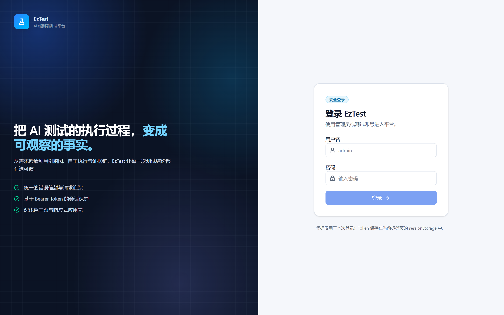

*登录：平台为单管理员 + 普通用户模型；浏览器 token 保存在 `sessionStorage`。*

### 版本列表

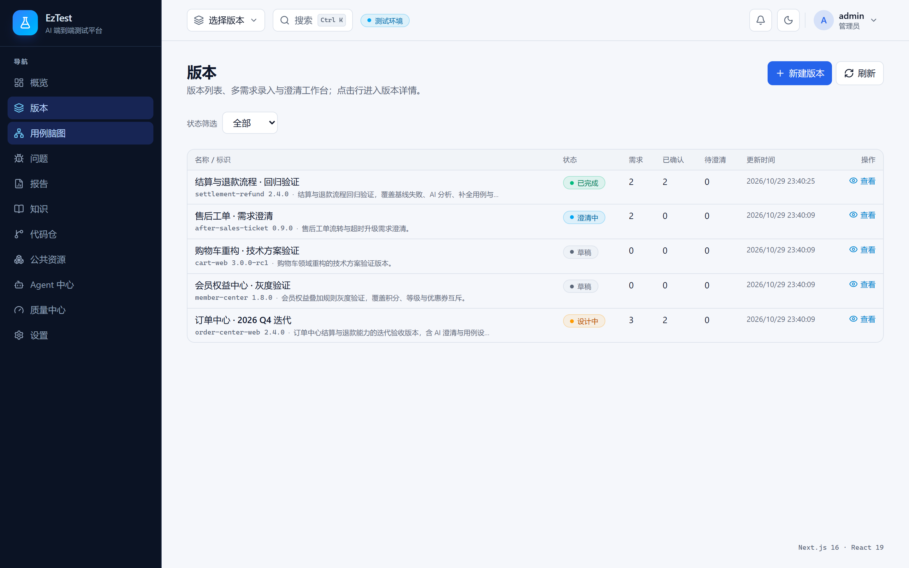

*版本列表：每个发布版本都是一个工作区，包含状态、需求与绑定的公共资源。*

### 版本总览

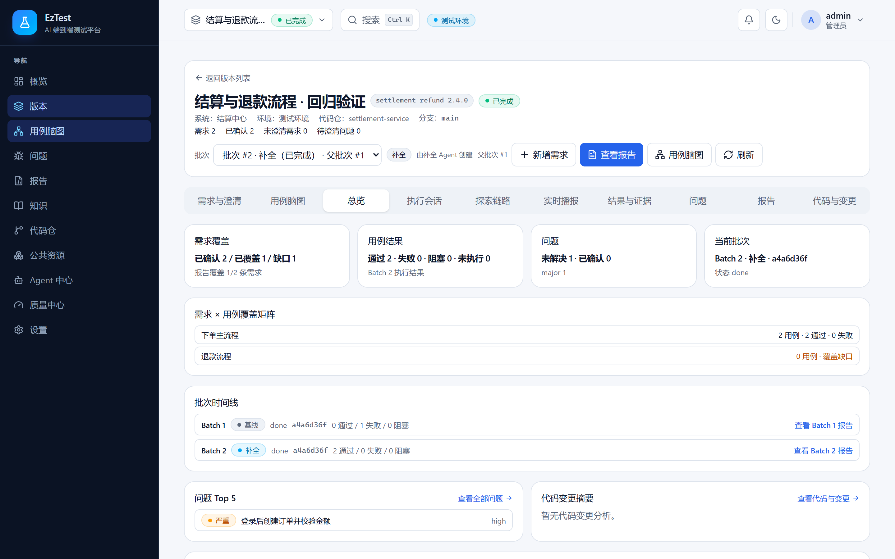

*版本总览：需求覆盖、用例结果、问题、当前批次时间线、覆盖矩阵与代码变更摘要。*

### 需求与澄清

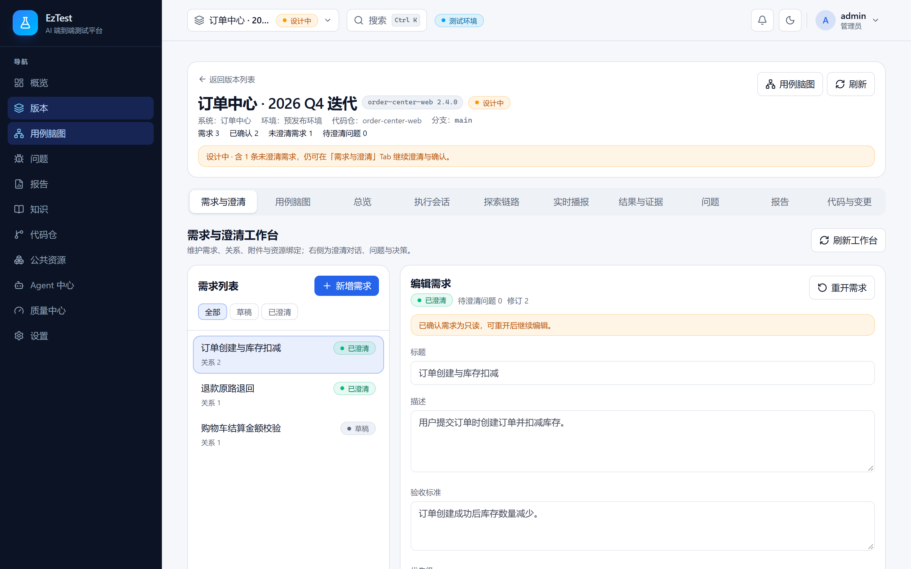

*需求工作台：多需求、验收标准、优先级、需求关系、附件以及版本的资源绑定。*

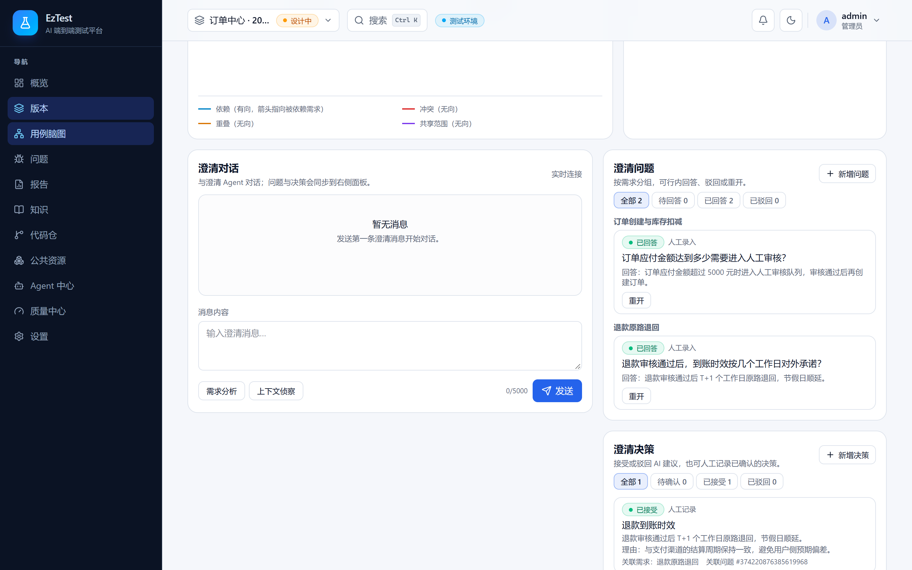

*AI 澄清：澄清对话、待回答问题与决策；需求在进入设计前从 `draft` 流转到 `clarified`。*

### 用例脑图评审

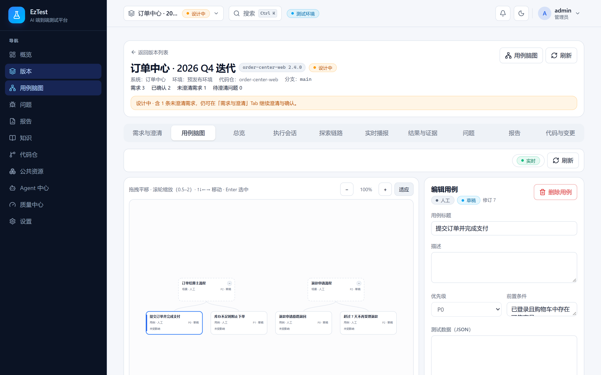

*用例脑图：场景、用例、步骤与断言，附需求来源与代码锚点。人工评审是唯一强制关卡，批准后基线冻结，
保证执行可复现。*

### 结果与证据

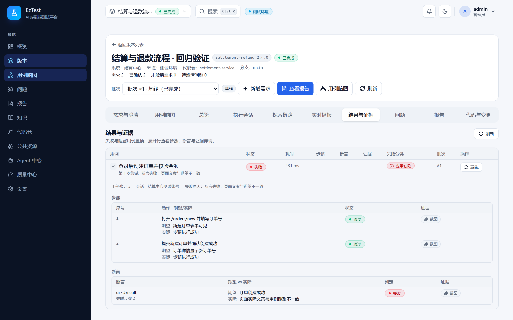

*结果与证据：按用例的四态结果与失败分类、步骤/断言下钻、批次选择。*

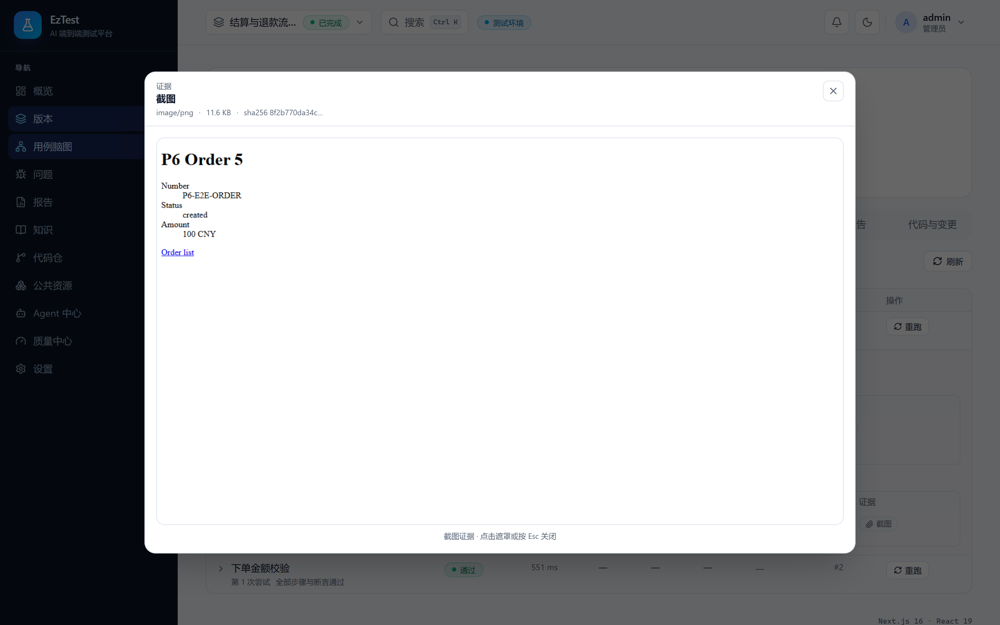

*证据查看器：Playwright 执行器采集的内容寻址截图与 sha256 元数据；每条结论都绑定步骤与不可变证据。*

### 探索链路

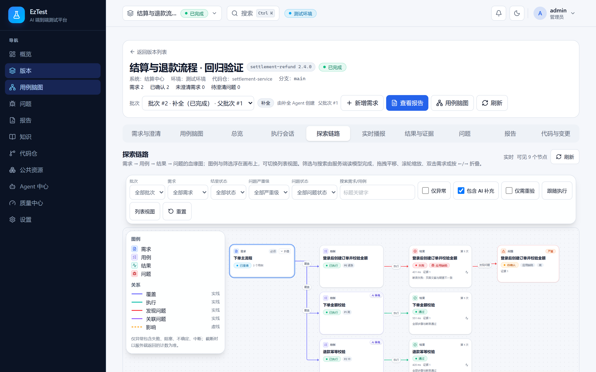

*探索链路：用 React Flow 呈现「需求 → 用例 → 最新结果 → 问题」的可交互关系图。*

### 问题

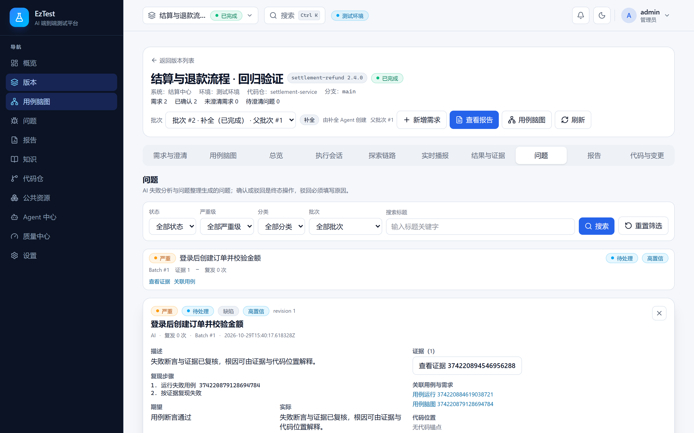

*问题：证据、期望/实际步骤、严重级、失败分类与 `file:line` 代码锚点。*

### 报告

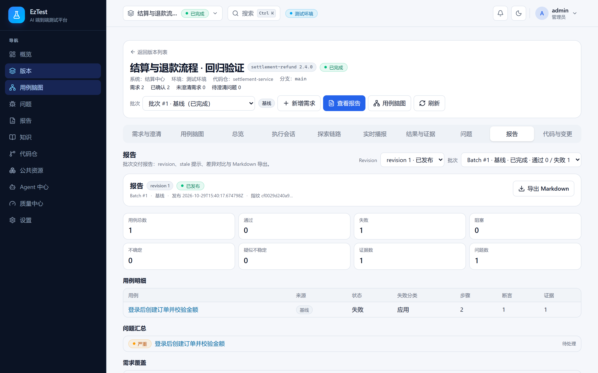

*按批次报告：不可变 revision、用例结果、覆盖率、风险与结论；输入变化时报告转为 `stale`，可重新生成
而不覆盖历史。*

### Agent 中心

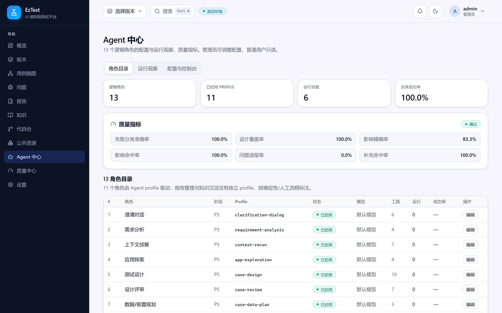

*Agent 中心：13 角色目录，含 profile、工具与成功率；所有登录用户可观察运行，仅管理员可修改提示词与
工具权限。*

### 公共资源

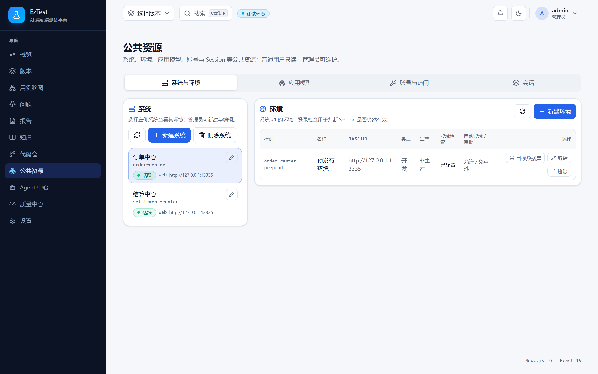

*公共资源：系统、环境、应用模型、账号、浏览器 Session 与只读本地 Git 代码仓。*

### 知识沉淀与质量中心（管理员）

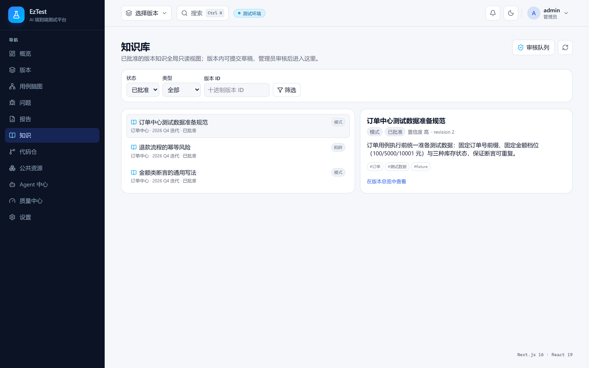

*知识沉淀：来自真实运行的版本内知识条目，经管理员审核后注入澄清与设计提示词。*

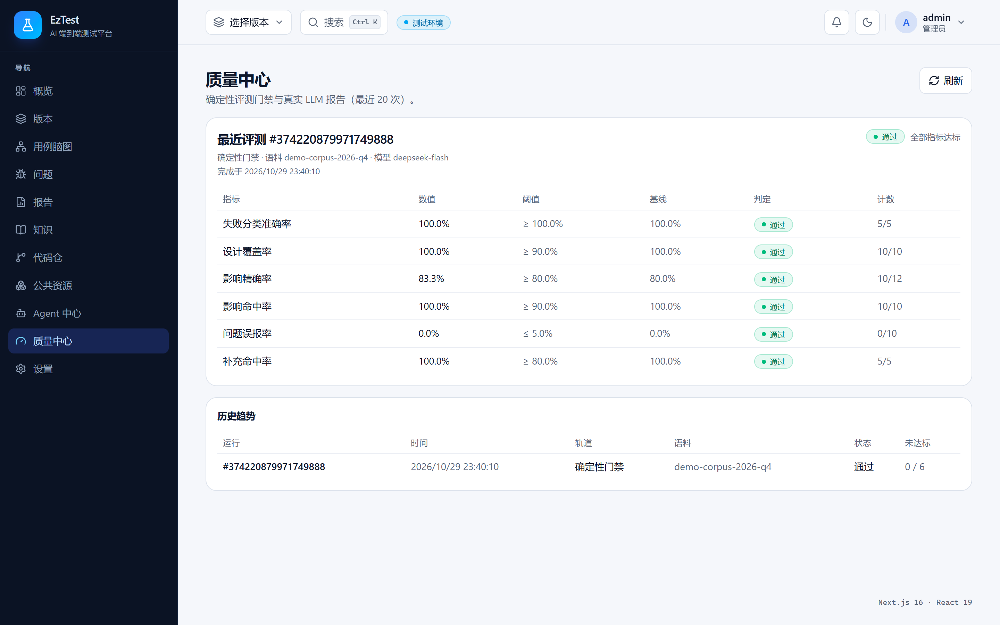

*质量中心：设计覆盖率、影响精确率/命中率、分类准确率、问题误报率、补全命中率等评测指标与阈值、
基线对比。*

---

## 使用方式

EzTest 以单机四组件方式运行：

| 组件 | 作用 | 默认端口 |
|---|---|---|
| `web` | Next.js 16 Web 应用 | 6868 |
| `api` | Go 1.24 REST + SSE API、迁移执行、后台 worker | 13333 |
| `postgres` | PostgreSQL 17 数据库 | 5433（宿主） |
| `executor` | Node + Playwright 浏览器执行服务 | 13336（仅内部） |

以下三种方式任选其一。三种方式都要求：PostgreSQL 17 数据库；执行器可用的 **Chromium 系浏览器**
（内置 Chromium，或已安装的 Google Chrome / Microsoft Edge）；以及用于 AI 能力的 OpenAI 兼容 LLM 端点。

### 方式一：Docker Compose

> Docker 是参考部署方式，但在 v0.1-preview 阶段，镜像只做过**静态校验**，维护者从未实际构建或启动过
> 该编排栈。用于重要环境前，请先在自己的环境中验证。

要求：Docker Engine 24+ 与 Compose v2、4 vCPU / 8 GiB 内存 / 20 GiB 磁盘，以及本仓库的检出
（Compose 的构建上下文是仓库根目录）。

```bash
# 1. 复制环境文件并填写必填项
cp .env.example .env

# 2. 构建并启动
docker compose --env-file .env -f deploy/docker-compose.yml up -d --build

# 3. 查看健康状态与 API 日志
docker compose --env-file .env -f deploy/docker-compose.yml ps
docker compose --env-file .env -f deploy/docker-compose.yml logs -f api
```

`.env` 中的必填项（完整注释模板见 `.env.example`）：

| 变量 | 用途 |
|---|---|
| `POSTGRES_USER` / `POSTGRES_PASSWORD` / `POSTGRES_DB` | Compose 各服务共用的数据库凭据 |
| `EZTEST_SECRET_KEYS` / `EZTEST_SECRET_KEY_ACTIVE` | 用于加密 LLM API Key 与自定义请求头的 AES-256-GCM 密钥环 —— 必须独立备份；丢失后已存凭据无法恢复 |
| `EZTEST_ADMIN_USERNAME` / `EZTEST_ADMIN_PASSWORD` | 首次启动种子的管理员账号（密码至少 10 个字符） |
| `EZTEST_EXECUTOR_TOKEN` | API 与执行器之间的共享 Bearer token |
| `EZTEST_WEB_ORIGIN` | CORS 允许的浏览器 origin（默认 `http://localhost:6868`） |
| `NEXT_PUBLIC_API_BASE_URL` | 前端构建时内联的浏览器 API origin（默认 `http://localhost:13333`） |

然后打开 <http://localhost:6868>，用种子管理员登录。API 健康检查：
<http://localhost:13333/api/health>。

停止：`docker compose --env-file .env -f deploy/docker-compose.yml down`（保留数据；`down -v` 会删除
数据卷）。

### 方式二：可运行包（Windows / Linux）

**0.1-preview** 发布页提供 **Windows x64** 与 **Linux x64** 的自包含可运行包。每个压缩包内含 API 二进制、
预构建的 Web 应用、Playwright 执行器、固定版本的 Playwright 浏览器与 Node.js 22 运行时，以及
启动 / 停止 / 状态 / 冒烟测试脚本：

| 平台 | 压缩包 | 下载体积 |
|---|---|---|
| Windows x64 | `eztest-0.1.0-preview.1-windows-x64.zip` | 约 400–450 MB |
| Linux x64 | `eztest-0.1.0-preview.1-linux-x64.tar.gz` | 约 400–450 MB |
| 校验和 | `SHA256SUMS.txt` | — |

外部前置条件：

- 机器可连通 **PostgreSQL 17** —— 包内不内置数据库服务；
- **仅 Linux：** 需要 Chromium 系统依赖库 —— 首次运行包内 `install-linux-deps.sh`（需要 sudo）；
  Windows 除解压包外无需额外依赖；
- 端口 **13333**（API）、**6868**（Web）、**13336**（执行器，仅回环）可用。

```powershell
# Windows（PowerShell）
Expand-Archive .\eztest-0.1.0-preview.1-windows-x64.zip -DestinationPath .\eztest
cd .\eztest
.\init-config.ps1 -DatabaseUrl "postgres://eztest:<password>@localhost:5433/eztest?sslmode=disable"
.\start-eztest.ps1        # 启动 API、执行器与 Web，并打印访问地址
```

```bash
# Linux（x64）
tar -xzf eztest-0.1.0-preview.1-linux-x64.tar.gz
cd eztest-0.1.0-preview.1-linux-x64
bash install-linux-deps.sh                                  # 仅首次，需要 sudo
bash init-config.sh --database-url "postgres://eztest:<password>@localhost:5433/eztest?sslmode=disable"
bash start-eztest.sh                                       # 或 chmod 后 ./start-eztest.sh
```

`init-config` 会生成 `.env`（绝对路径布局、随机 AES-256 密钥环、执行器 token 与管理员密码；密钥不会打印，
`EZTEST_ADMIN_PASSWORD` 写在 `.env` 中）。随后打开 <http://localhost:6868>。

| 项 | 包内内容 |
|---|---|
| API | `bin/eztest.exe`（Windows）/ `bin/eztest`（Linux） |
| Web | `web/` —— Next.js standalone 服务，使用内置 Node 运行时 |
| 执行器 | `executor/` —— Node + Playwright，浏览器固定在 `playwright-browsers/` |
| 运行时 | `runtime/node/` —— 官方 Node.js 22 LTS 运行时 |
| 文档 | `docs/openapi/api.yaml`、`PACKAGE.md`、`LICENSE`、`THIRD_PARTY_NOTICES.md`、`manifest.json` |
| 生命周期 | `start-eztest.*`、`stop-eztest.*`、`status-eztest.*`、`smoke-test.*` |
| 数据 | `data/{objects,version-attachments,evidence,reports,exports}` + 自备 PostgreSQL |
| 日志 / PID | `logs/`、`run/` |

> Web 包的浏览器 API origin 在构建时内联（默认 `http://localhost:13333`）。如需用其它主机/端口提供 UI，
> 需以对应的 `NEXT_PUBLIC_API_BASE_URL` 重新构建 Web 包；API 与执行器端口可通过 `.env` 调整。具体校验和与
> 包内容以对应 Release 的发布说明为准。

### 方式三：从源码运行

要求：

- Go **1.24.6**（`backend/go.mod` 声明的工具链版本）
- Node.js **22+** 与 pnpm **11**
- PostgreSQL **17**，建议两个库：`eztest`（应用）与 `eztest_test`（集成测试）
- 执行器可用的 Chromium 系浏览器（Playwright 内置 Chromium、Google Chrome 或 Microsoft Edge）

```bash
# 0. 仓库根目录
cp .env.example .env        # 填写数据库地址、密钥环与管理員凭据

# 1. API（首次启动自动执行嵌入迁移并种子管理员）
cd backend
go run ./cmd/eztest
#    监听 :13333；若从其它工作目录启动，请把 EZTEST_OPENAPI_PATH 设置为
#    docs/openapi/api.yaml 的绝对路径。

# 2. Web（新终端）
cd frontend
pnpm install
pnpm dev                    # http://localhost:6868

# 3. Playwright 执行器（新终端，执行用例时需要）
cd executor
pnpm install
pnpm exec playwright install chromium   # 或使用已安装的 Chrome/Edge
pnpm start                  # http://127.0.0.1:13336，由 EZTEST_EXECUTOR_TOKEN 保护
```

常用命令：

```bash
# Go 单元测试 / 集成测试（集成测试需要 EZTEST_TEST_DATABASE_URL）
cd backend && go test -count=1 ./... && go test -tags=integration -count=1 ./...

# 前端 lint / 类型检查 / 单元测试 / 生产构建
cd frontend && pnpm lint && pnpm typecheck && pnpm test && pnpm build

# 执行器测试
cd executor && pnpm test
```

### 首次配置

用管理员登录后：

1. **设置 → LLM 配置**：新增 OpenAI 兼容供应商（Base URL、API Key、模型），刷新模型目录并执行连通性
   测试。加密后的凭据不会回显。
2. **公共资源**：登记被测系统、环境、应用模型、测试账号与浏览器 Session（或登录配方），并登记希望 AI
   读取的本地 Git 仓库（只读路径、分支与排除规则）。
3. **在「版本」中新建版本**并录入需求，然后按「澄清 → 脑图评审 → 执行 → 问题/报告」推进。
4. *（可选）* **设置 → 用户**：为团队创建普通用户。只有管理员能修改配置；普通用户可处理版本、需求、
   脑图、执行、问题与报告。

### 端口与健康检查

| 端点 | 说明 |
|---|---|
| `GET http://localhost:13333/healthz` | 存活探针：进程可响应 |
| `GET http://localhost:13333/api/health` | 就绪探针：数据库 ping、构建版本/commit、是否存在可用的默认 LLM 配置、生效的限流与 GC 参数 |
| `GET http://localhost:13333/api/openapi.yaml` | 完整 OpenAPI 3.0 文档（223 个 operation） |
| `GET http://localhost:13336/healthz` | 执行器健康检查（仅内部；需要 Bearer token） |
| <http://localhost:6868> | Web 应用 |

> `/api/health` 返回 200 只说明 API 与数据库正常，**不**代表 LLM 端点可达或执行器健康（执行器在创建
> 批次时才会被探测）。

---

## 架构与技术路线

### 技术栈

| 层次 | 技术 |
|---|---|
| API / 服务 | Go 1.24.6、标准库 `net/http` 路由、`pgx/v5` 驱动、嵌入 SQL 迁移 |
| 领域建模 | 16 个限界上下文（domain / application / infrastructure / HTTP 接口层），单一装配根 |
| 数据 | PostgreSQL 17（67 张应用表、47 条只追加迁移）、文件系统内容目录 |
| 前端 | Next.js 16（App Router、standalone 输出）、React 19、TypeScript、Tailwind CSS 4、Radix、`@xyflow/react` 12 |
| 实时 | 服务端事件（SSE）：持久化频道序号、快照游标、`Last-Event-ID` 回放、20 秒心跳 |
| 执行 | 独立 Node.js + Playwright 1.64 服务；注入 `storageState` 的浏览器上下文、动作协议、截图、像素比对 |
| LLM | OpenAI 兼容 `chat_completions` / `responses` 协议，流式、工具调用、多模态、重试、模型目录 |
| 运维 | Docker Compose（api/web/postgres/executor）、健康探针、审计日志、按实例限流、证据 GC、备份恢复脚本 |

### 1. 系统架构

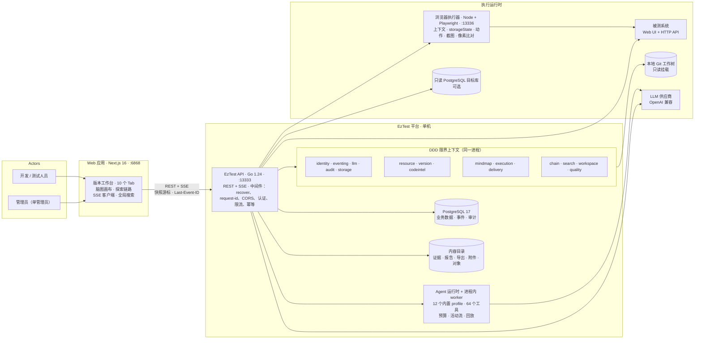

### 2. 端到端工作流

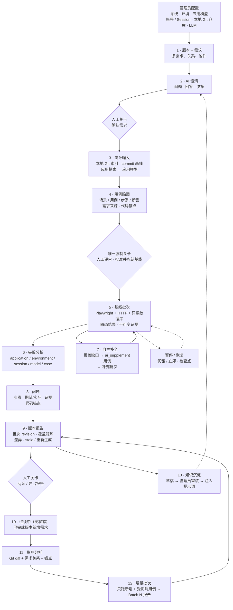

### 3. 版本生命周期

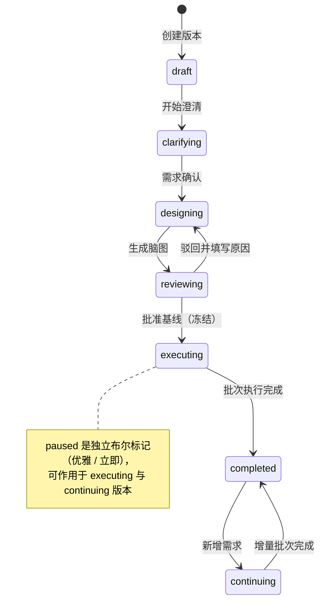

### 4. 关键设计决策

- **本地 Git 是唯一代码真源。** EzTest 只读管理员配置的工作树（不接线上 Git 供应商、不写 checkout、
  不执行仓库代码）。每个批次记录 `base` 与 `head` commit，使结果、证据、问题与报告可复现。
- **确定性核心，AI 在其上。** 状态机、覆盖率计算、报告内容、影响候选与证据哈希都是平台确定性代码；
  AI 提供结构化的澄清、设计、探索与分析结果，经校验后持久化使用。
- **结论必须绑定证据。** `passed` 要求用例快照中的全部断言通过，`failed` 要求确实存在失败断言；
  缺少证据支撑的失败会降级为 `inconclusive(case, evidence_missing)`，而不是被当成产品缺陷上报；
  证据本身是内容寻址且不可变的。
- **基线冻结。** 批准脑图会冻结 `case_baseline`；之后的 AI 补充是追加且带标记的，因此重跑仍可比较，
  报告可以按批次做差异。
- **四态结果。** `passed`、`failed`、`blocked`、`inconclusive` 严格区分；失败分类把产品缺陷与环境、
  Session、模型问题区分开。
- **只追加迁移。** 47 条 SQL 迁移嵌入二进制，在 PostgreSQL advisory lock 下执行并按校验和验证；
  回退依靠备份恢复，历史迁移文件永不修改。
- **执行器隔离。** Go API 不直接驱动浏览器：独立的 Playwright 服务负责浏览器上下文，并强制 host
  白名单、动作超时与敏感输入脱敏。执行器不健康时，创建批次会失败关闭（`503 executor_unavailable`）。
- **通过回放实现可观察。** 每次状态变化都是带频道序号的事件，因此 UI 在重连或刷新后能从断点精确恢复。
- **诚实降级。** 未配置 LLM 时确定性路径照常工作，AI 路径返回可重试的 `llm_not_configured` /
  `ai_unavailable` 错误，而不是让整个产品不可用。

### 5. 数据、标识与存储

- **ID**：应用生成的 64 位 Snowflake ID（41 位时间 + 10 位节点 + 12 位序列）。版本域、执行、交付与
  Agent 的 ID 在 JSON 中序列化为十进制**字符串**；遗留的资源/用户 ID 保持数字。
- **持久化**：PostgreSQL 17 保存全部业务状态、事件、审计与配置；内容目录保存证据、报告、导出、需求
  附件与内容寻址对象。备份时必须同时覆盖数据库与全部内容目录。
- **机密**：LLM API Key 与自定义请求头使用版本化密钥环（`EZTEST_SECRET_KEYS` /
  `EZTEST_SECRET_KEY_ACTIVE`）以 AES-256-GCM 加密。**仅 LLM 凭据加密** —— 资源访问凭据与浏览器
  `storageState` 按设计原样存储，请把数据库视为敏感资产。Bearer token 仅保存 SHA-256 哈希，有效期
  12 小时。

### 6. Agent 运行时与 LLM 网关

- 首次启动种子 12 个内置 Agent profile（澄清对话、需求分析、上下文侦察、应用探索、用例设计、用例评审、
  数据前置规划、补全、执行、失败分析、问题分诊、运行时诊断）。管理员可编辑提示词、工具白名单与模型预算。
- 代码中共 64 个工具定义，覆盖基础工具、代码读取、用例编辑、浏览器与 HTTP 动作、数据库断言、视觉断言
  与交付分析。每次工具调用、结果、错误与中止都会写审计。
- 运行有轮次、墙钟与硬超时预算，单次运行的工具体调用预算（默认 30，耗尽则以 `inconclusive` 结束）、
  单工具超时与全局并发上限；同一会话同时最多一个运行。
- 活动契约冻结为 `run_started`、`user_message`、`thinking`、`text`、`tool_use`、`tool_result`、
  `usage`、`decision`、`run_finished`；长文本分段流式推送并按 `(message_id, part)` 重组，完整内容
  懒加载。
- LLM 网关归一化流式增量、推理增量、工具调用、结束原因与用量；仅在第一个流事件之前重试；类型化错误
  （`llm_auth_failed`、`llm_rate_limited`、`llm_timeout` 等）不会泄漏上游响应正文。

---

## 项目结构

```text
backend/                 Go API：cmd/eztest（装配根）、internal/<context>（16 个 DDD 限界上下文）、
                         internal/db/migrations（47 条嵌入 SQL 迁移）、internal/platform
frontend/                Next.js 16 应用：app 路由、features、components、lib；Playwright E2E 用例
executor/                Node.js + Playwright 浏览器执行服务（HTTP 动作协议）
deploy/                  Docker Compose 编排与 API/Web Dockerfile
docs/openapi/api.yaml    OpenAPI 3.0 契约，运行时由 GET /api/openapi.yaml 提供
docs/assets/screenshots/ README 截图
.env.example             带注释的环境变量模板
LICENSE                  Apache License 2.0
```

---

## 许可证

基于 [Apache License 2.0](LICENSE) 授权。
