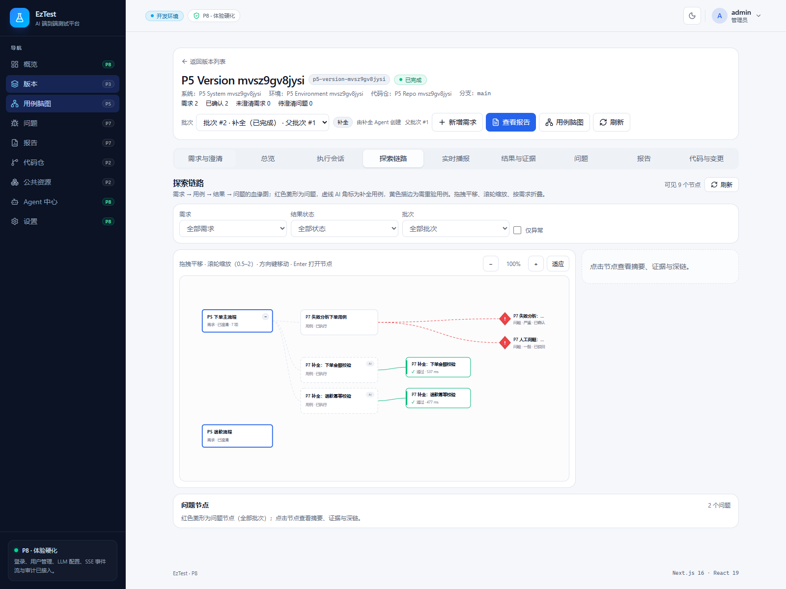
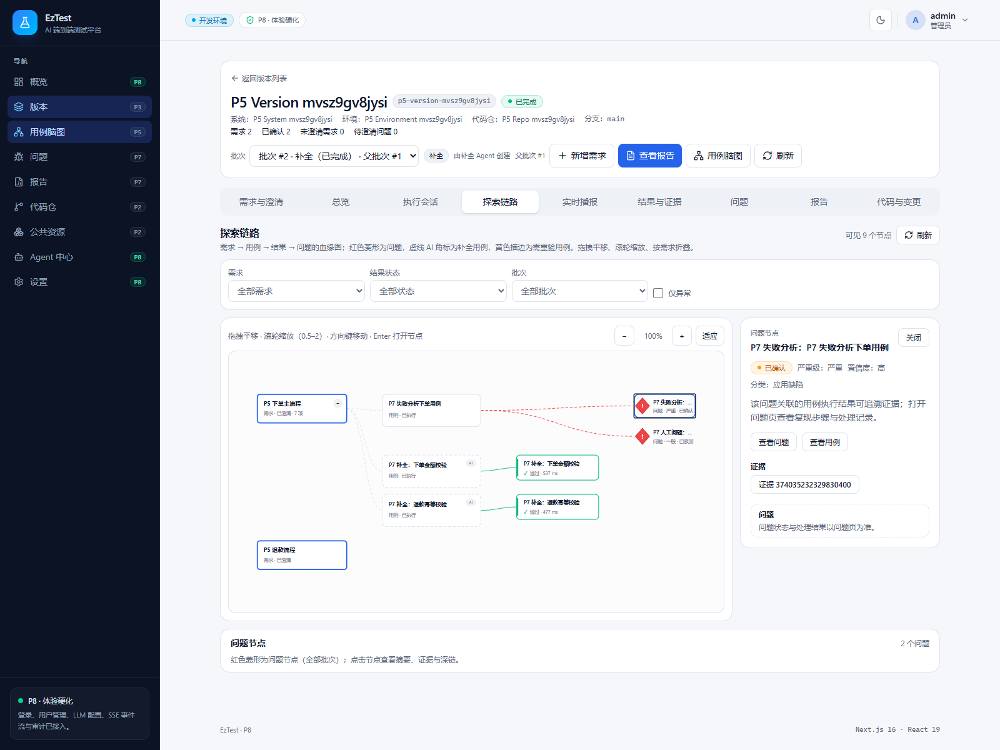

# P8 Task 4：重建产物 + 缺陷 #1（探索链路 limit 200→100）复验

- 验收时间：2026-10-29 11:20–11:25 +08:00
- 仓库/分支：`D:\Project_new\EzTest` / `dev`
- 基线 HEAD：`61d43b0f720817d54d5c7340300dbd80db48cb8c`（`fix(p8): finish P0 badges and nav tests`，2026-10-29 11:13:59 +08:00）
- 并行提交：验收期间 Task 2 的 CI 修复以 `f9945b76c1add616b9c46358f06cb6fee775160b`（`fix(p8): harden ci structural checker`）提交，仅改动 `.github/workflows/ci.yml` 与 `scripts/check-ci.ps1`；本任务未触碰这些文件，产品源码/构建输入与基线一致，本轮证据对当前 HEAD 仍成立。
- 验收范围：生产前端重建 + P7 链路 E2E + 真实 Chrome 浏览器复验
- 结论：**缺陷 #1 在当前 HEAD 重建的生产产物上不再复现**；旧产物早于修复提交，是缺陷复现的根因。

## 1. 旧产物与修复提交

| 项目 | 值 |
| --- | --- |
| 旧 `.next/BUILD_ID` | `f_zn4oz8tIkAAAaAwR_cU` |
| 旧构建时间 | `2026-10-28 19:30:58 +08:00` |
| 修复提交 | `586e1d3dea0e0a5cd59ed3d298a12e7e4f8060a8` `fix(p7): align exploration limits with API caps` |
| 修复提交时间 | `2026-10-29 02:27:36 +08:00` |

旧构建早于修复提交约 7 小时，因此旧生产 bundle 仍然包含 `REQUIREMENT_LIMIT = 200` / `ISSUE_LIMIT = 200` 的代码。

修复提交在 `frontend/src/features/execution/components/ExplorationTab.tsx` 中把两个常量从 200 改为 100，并把需求层/用例层/结果层的加载拆成独立错误（`Promise.all` → `Promise.allSettled`），一处失败不再丢弃其他图层的数据。

后端对列表 `limit` 的硬上限为 1–100：

- `backend/internal/version/interfaces/httpapi/helpers.go:168-171`：`limit must be an integer between 1 and 100`
- `backend/internal/delivery/interfaces/httpapi/routes.go:235-240`：问题列表同样的 1–100 约束（`backend/internal/delivery/interfaces/httpapi/handlers_issue_test.go:120-122` 覆盖 `limit=101` 的拒绝）

**根因**：旧产物请求 `?limit=200` → API 返回 400 → 旧代码的 `Promise.all` 整体 reject → 页面渲染 `加载探索链路失败`。旧产物未保留运行截图；根因由旧构建时间、修复 diff 与后端上限测试共同确定。

## 2. 当前 HEAD 源码常量

`git grep` 于 HEAD 的结果：

```text
frontend/src/features/execution/components/ExplorationTab.tsx:35:const REQUIREMENT_LIMIT = 100
frontend/src/features/execution/components/ExplorationTab.tsx:36:const ISSUE_LIMIT = 100
```

## 3. 重建生产产物

命令（`frontend/` 下）：

```powershell
pnpm build
```

结果：

- 退出码 `0`，`✓ Compiled successfully in 9.1s`，TypeScript / 静态页生成全部完成
- 新 `.next/BUILD_ID`：`QzRE1eSi48Fxd797s6Xq-`
- 新构建时间：`2026-10-29 11:21:53 +08:00`，**晚于**修复提交 `2026-10-29 02:27:36 +08:00`
- 构建日志：`.tmp/p8-w0-build.log`（SHA-256 `9d5851150cf0c6e2741ccf84de18a616fd0de15da696a53b3004e87260fe73b0`）

E2E 使用 `next dev`，Next 16 的 dev 产物位于 `.next/dev`，未覆盖生产 `.next`；E2E 结束后复核 `BUILD_ID` 仍为 `QzRE1eSi48Fxd797s6Xq-`，`standalone` 产物仍在。

## 4. P7 链路 E2E

命令（仓库根目录）：

```powershell
powershell.exe -NoProfile -ExecutionPolicy Bypass -File scripts\e2e.ps1 p7-issues-report
```

结果：

- `1 passed (21.0s)`，`==> E2E PASSED`，退出码 `0`
- 日志：`.tmp/p8-w0-e2e.log`（SHA-256 `d3c3f86e9eb886eb22968886156aca8b06eca9b9cf4a5d0ff8f364bf5f958caa`）
- 该 spec 的探索链路断言（`frontend/e2e/p7-issues-report.spec.ts:213-245`）显式断言：
  - `exploration-error` 数量为 0
  - `exploration-degraded` 数量为 0
  - `chain-issues-degraded` 数量为 0
  - 真实需求节点 `chain-node-{requirementId}` 可见、问题节点可见
- E2E 日志中无 `exploration-error` / `chain-issues-degraded` 失败记录。

E2E 会重置并填充 `eztest_e2e` 数据库。验收截图使用该库中由 spec 播种的真实数据（版本 `P5 Version mvsz9gv8jysi`，2 条需求、2 个问题）。

## 5. 真实 Chrome 浏览器复验（生产产物）

### 5.1 启动方式

- API：`go build -o .tmp\eztest-api.exe ./cmd/eztest`（Go 1.24.6），启动于 `:13333`，`EZTEST_DATABASE_URL` 的库名替换为 `eztest_e2e`，`EZTEST_OPENAPI_PATH` 指向仓库内绝对路径。
- Web：刚重建的 `.next`，`next start -p 6868`（即 `pnpm start` 语义），`:6868`。
- 浏览器：Playwright 1.64.1 + `chromium.launch({ channel: "chrome", headless: true })`，即主机已安装的真实 Google Chrome；viewport 1600×1200。
- 登录凭据从 `.env` 读取，仅用于登录，未打印。

实际流程：登录 admin → `/versions` 列表（1 个版本）→ 点击含数据版本行 → 点击「探索链路」Tab → 批量筛选切到「全部批次」（问题属于 baseline 批次）→ 等待真实 API 数据渲染 → 断言 → `fullPage` 截图。

### 5.2 断言与实测值

| 断言 | 期望 | 实测 |
| --- | --- | --- |
| 页面文本包含「加载探索链路失败」 | 否 | `false` |
| `data-testid=exploration-error` | 0 | `0` |
| `data-testid=exploration-degraded` | 0 | `0` |
| `data-testid=chain-issues-degraded` | 0 | `0` |
| 链路节点 `chain-node-*` | > 0 且可见 | `7` |
| 问题节点 `chain-issue-node-*` | > 0 且可见 | `2`（「2 个问题」） |
| 可见节点计数 | 与画布一致 | 「可见 9 个节点」 |
| 需求层请求 | `limit=100` 且 200 | `GET /api/versions/374035213791006720/requirements?limit=100` → `200`（2 次） |
| 问题层请求 | `limit=100` 且 200 | `GET /api/versions/374035213791006720/issues?limit=100` → `200`（2 次） |
| 仍使用 `limit=200` 的请求 | 0 | `0` |
| 用例图请求 | 200 | `GET /api/versions/374035213791006720/mindmap` → `200` |
| 浏览器 console error | 0 | `[]` |
| 问题节点抽屉 | 可打开 | `chain-drawer` 可见（第二张截图） |

被取消的两个请求为 `stream`（SSE，切换/关闭页面时主动 abort）和一次 `case-runs`（切换批次筛选时的旧请求 abort），均为 `net::ERR_ABORTED`，没有触发错误 UI，也没有 console error。

### 5.3 截图

主截图（探索链路，全部批次，9 个可见节点、2 个问题节点、无红色错误条）：



第二张截图（点击红色问题节点后打开的抽屉，含问题严重级、证据与「查看问题/查看用例」入口）：



| 文件 | 尺寸 | 字节 | SHA-256 |
| --- | --- | --- | --- |
| `exploration-fixed.png` | 1600×1200 | 140674 | `c9de34028ea81ba8e7f7b50f820bff07d23c58fad3bf236aef553527d74e531d` |
| `exploration-issue-node.png` | 1600×1200 | 158572 | `129a3f97502f7b9776cc029a660b0180f634e4a152736fe340e1439a76e73bf6` |

## 6. 结论

1. 重建的 HEAD 生产产物请求需求/问题时使用 `limit=100`，后端均返回 200，探索链路正常渲染 7 个链路节点 + 2 个问题节点。
2. 页面不存在 `加载探索链路失败`、`exploration-error`、`exploration-degraded`、`chain-issues-degraded`；浏览器 console 无 error。
3. E2E `p7-issues-report` 在 HEAD 上通过，其内建的探索链路零错误断言同时通过。
4. 缺陷 #1 的旧产物复现根因成立：旧 `.next`（2026-10-28 19:30:58）早于修复提交（2026-10-29 02:27:36），仍携带 `limit=200`，被后端 1–100 上限拒绝。当前 HEAD 已不包含该问题。

## 7. 环境与限制

- 主机 PostgreSQL I/O 偏慢已被预告，本次 E2E 实际 Playwright 用时 21.0s、整轮验收约 4 分钟，未触发 10+ 分钟级别的等待或超时；命令超时仍按 30–40 分钟预留。
- Next.js 16 在 `output: "standalone"` 下对 `next start` 打印 advisory 警告（建议 `node .next/standalone/server.js`）；本次 `next start` 实测正常返回 200、静态 chunk 200 且前端完成 hydration（登录、列表、Tab、筛选均可交互），截图确为重建生产产物渲染结果，不构成阻塞。
- E2E 库 `eztest_e2e` 为一次性验收库，由 `scripts/e2e.ps1` 重置；截图后 API/Web 进程已停止，端口 `13333`/`6868` 已释放。
- 未修改任何产品源码；E2E/构建改写的 `frontend/next-env.d.ts` 已在提交前 `git checkout --` 还原；`.next`、`.tmp` 脚本与日志均未提交。

## 8. 复现命令

```powershell
# 1) 重建生产前端
cd frontend; pnpm build

# 2) 链路 E2E（自动重置 eztest_e2e）
cd ..
powershell.exe -NoProfile -ExecutionPolicy Bypass -File scripts\e2e.ps1 p7-issues-report

# 3) API（使用 eztest_e2e，凭据来自 .env，不打印）
cd backend
go build -o ..\.tmp\eztest-api.exe .\cmd\eztest
# 设置 EZTEST_DATABASE_URL(库替换为 eztest_e2e)、EZTEST_HTTP_ADDR=:13333、
# EZTEST_OPENAPI_PATH=<repo>\docs\openapi\api.yaml、admin/secret 等 .env 键后运行:
..\.tmp\eztest-api.exe

# 4) 生产 Web
cd ..\frontend
pnpm start

# 5) 真实 Chrome 断言 + 截图
node ..\.tmp\p8-task4-screenshot.cjs
```

结构化浏览器结果保存在 `.tmp/p8-w0-browser-summary.json`（未提交）。
