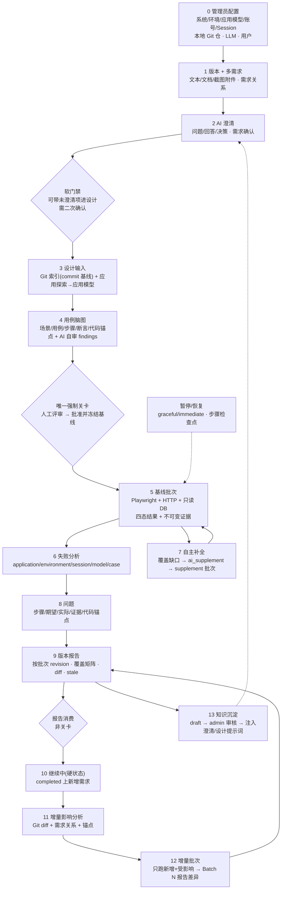
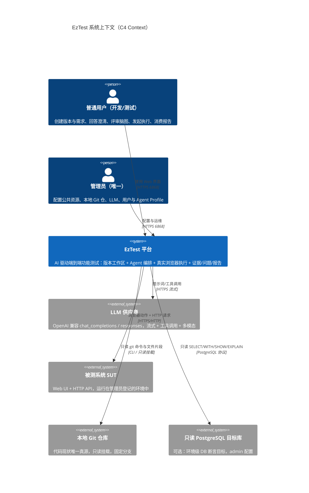
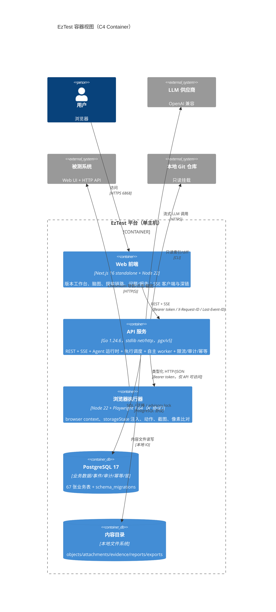
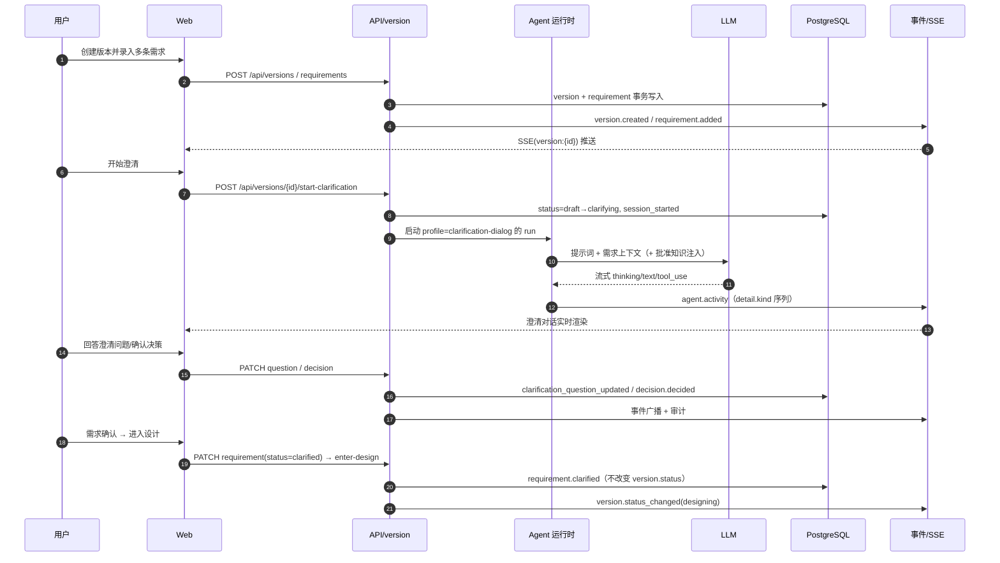
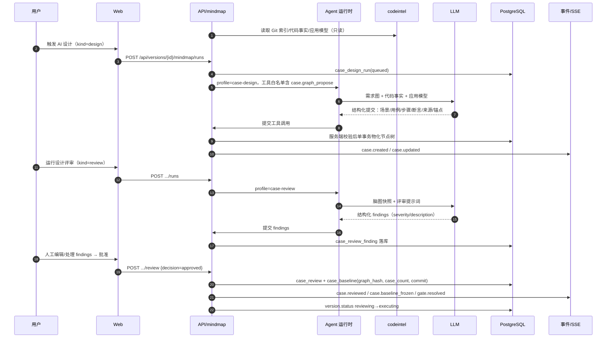
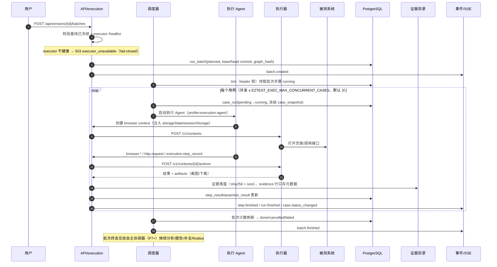
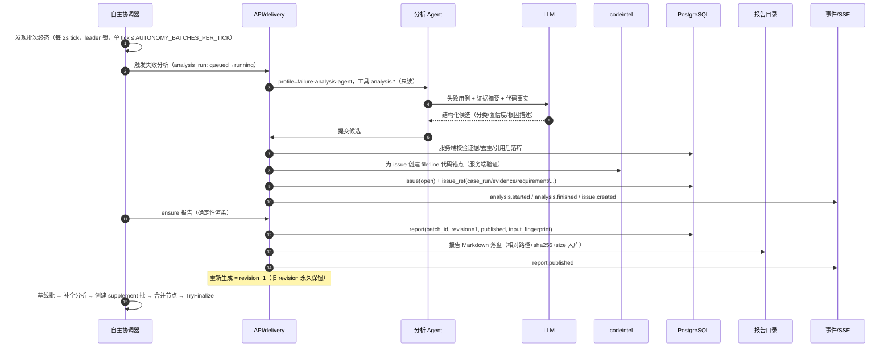
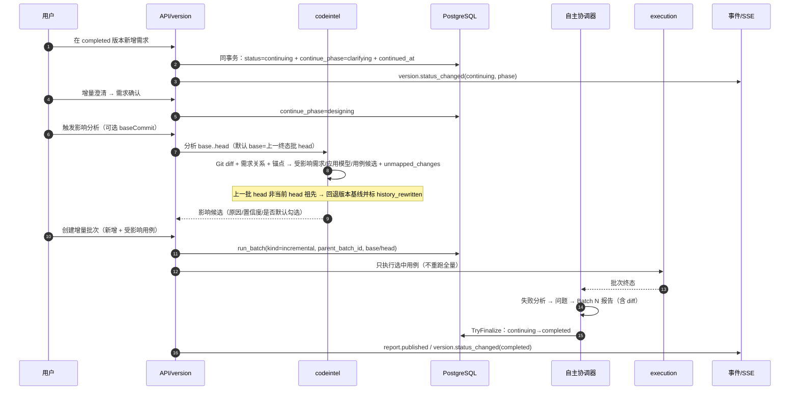
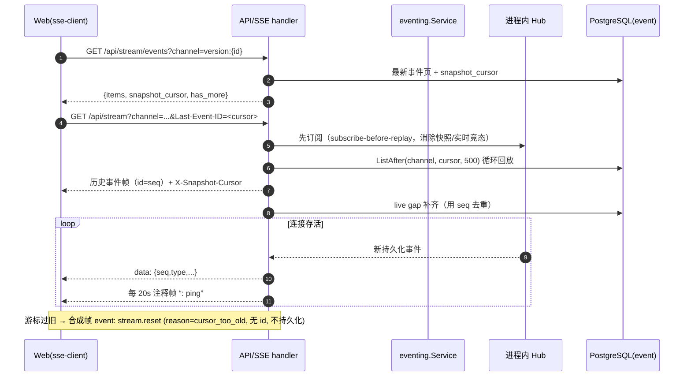

> **0.1 归档；0.2 权威文档见 [docs/version-V0.2/](version-V0.2/README.md) 与 [deploy/README.md](../deploy/README.md)。**

# EzTest 架构设计文档

> **文档性质**：软件工程标准架构设计文档（GB/T 8567 概要设计 + IEEE 42010 视角裁剪），面向工程评审、交接与"从设计思路讲到实现细节"的深度讲解。
> **权威依据**：设计要求以 `docs/design/system-blueprint.md`（v2.4）为唯一权威；本文是对**已落地代码与已记录验收证据**的架构归纳，不发明新设计。两者冲突时以蓝图为准（`Agent.md` §3）。`docs/design/system-overview.md` 已归档，仅作历史参考。
> **读者**：高级后端/架构面试官、接手本项目的工程师、架构评审人。
> **一句话**：EzTest 是一个面向 Web UI 与 HTTP API 的 AI 驱动端到端功能测试平台；本文解释它为什么这样分层、为什么把 AI 关进确定性框架、以及这些设计在代码中的精确落点与验证状态。

| 项 | 值 |
|---|---|
| 文档版本 | v1.0（2026-10-30） |
| 代码基线 | 分支 `dev`，HEAD `45e8d15`（跟踪文件无改动，仅有未跟踪文档）；发布标签 `v0.1.0-preview.1` 指向 `main` `ed93f0b` |
| 产品版本 | `0.1-preview`（前端/执行器 `package.json` 为 `0.1.0`；OpenAPI `info.version` 为 `0.9.0`，二者不等价） |
| 主要技术栈 | Go 1.24.6 + 标准库 `net/http` + `pgx/v5`；PostgreSQL 17；Next.js 16/React 19/TypeScript；Node 22 + Playwright 1.64 浏览器执行器；SSE |
| 数据规模口径 | 16 个限界上下文、67 张业务表（+`schema_migrations`=68）、47 个迁移、223 个 REST 路由模式、2,809 个 Go 测试函数 |
| 验证状态摘要 | 真实 LLM + 真实 Chrome 29/29、E2E 41、确定性评测 7/7、本机 SLO 6/6、备份恢复 174/174 + 恢复库应用 smoke 5/5、包内 smoke 10/10×2 OS；**Docker/Compose 与托管 CI 从未运行** |
| 标记约定 | `已实现` = 代码与测试存在；`已验证` = 有可复核运行记录（命令/证据路径）；`未验证` = 代码在但无真实环境运行；`未运行` = 从未执行过 |

---

## 1 引言

### 1.1 编写目的

本文回答三个问题：

1. **设计思路**：EzTest 为什么采用"确定性平台 + 受限 AI Agent"的架构，而不是让 LLM 自由驱动浏览器；为什么以本地 Git 作为代码现状唯一真源；为什么把 16 个限界上下文装进一个进程而不是拆成微服务。
2. **实现落点**：每个架构决策在代码中的位置（`backend/internal/<context>/{domain,application,infrastructure,interfaces}`、`executor/src/*.mjs`、`frontend/src/features/*`、`scripts/*`），使读者可以从文档直接跳到源码。
3. **验证边界**：哪些结论有真实环境证据，哪些只是"代码已实现但从未运行"。这是本文与营销文档的根本区别：**本文不把 SKIP 当 PASS，不把静态校验当部署验证**。

### 1.2 读者与阅读路径

| 读者 | 建议路径 | 阅读目标 |
|---|---|---|
| 架构面试官（30 分钟） | §2.1 → §3.1 → §3.2/§3.3 → §4.1 → §5.1/§5.2 → §8.2 | 讲清定位、边界、决策取舍与诚实边界 |
| 后端工程师（2 小时） | §3 全章 → §4.2 → §6 全章 → §10.2/§10.3 | 能改代码：状态机、事件、事务、迁移、权限 |
| 前端/全栈工程师 | §2.4 → §3.3 → §3.5 → §3.8.2 → §5.2 | 理解 10 个版本 Tab、SSE 游标与重连语义 |
| 运维/交付工程师 | §3.6 → §7.1/§7.2 → §8 → `docs/deployment.md` | 知道两种部署形态的已验证程度与前置条件 |

### 1.3 范围与非目标

**本文覆盖**：系统上下文与容器边界、16 个限界上下文的职责与表所有权、6 条关键动态链路、24 条架构决策、8 类质量属性、10 类横切关注点、构建/交付/验证架构、风险与技术债、P9 演进。

**本文不覆盖**：逐接口字段定义（以 `docs/openapi/api.yaml` 与 `docs/user-guide.md` 为准）、逐页交互细节（`docs/design/frontend-design.md`）、ARTEX 借鉴关系的完整考证（蓝图 §18）、历史阶段规格（`docs/superpowers/specs/`）。

### 1.4 术语与缩略语

| 术语 | 含义 | 说明 |
|---|---|---|
| 版本 Version | 一次迭代/发布范围，含多条需求 | 状态机见 §3.5；`continuing` 是硬状态 |
| 需求 Requirement | 版本下的可验证需求条目 | 状态 `draft→clarified` 已实现；`designed/verified/obsolete` 未实现流转 |
| 澄清 Clarification | AI 引导的多轮问答，产出问题与决策 | 会话/问题/决策三张表 |
| 用例脑图 Mindmap | 场景→用例→步骤→断言 的测试设计图 | 批准即冻结为基线（`case_baseline`） |
| 基线 Baseline | 人工批准后的冻结用例图 + 图哈希 + 代码 commit | 执行时不可变；AI 只能追加 `ai_supplement` |
| 批次 Batch | 一次执行轮次，`baseline/incremental/supplement` | 单版本同时只有一个活跃批次 |
| 用例执行 CaseRun | 一条用例的一次执行尝试 | 8 个状态，四态判定 |
| 四态判定 | `passed/failed/blocked/inconclusive` | `skipped/interrupted` 是过程态，不是结论 |
| 证据 Evidence | 不可变执行产物（截图/报文/控制台/DB 结果/视觉差异） | 文件系统 + sha256，行内只存元数据 |
| 继续中 Continuing | 已完成版本新增需求后的硬状态 | `continue_phase=clarifying/designing/executing` |
| 探索链路 Chain | 需求→用例→结果→问题 的服务端血缘读模型 | 单端点聚合，预算截断 |
| 人工接管 Takeover | 2FA/验证码无法自动化时的人工登录关卡 | waiting→completed/cancelled/expired |
| 限界上下文 Bounded Context | DDD 部署/建模边界 | 本项目 16 个，均在同一个 Go 二进制内 |
| SSE | Server-Sent Events，服务端单向事件流 | 持久化事件 + 快照游标 + `Last-Event-ID` |
| T0/T1 | T0 确定性 Git 文件级能力；T1 AI 代码理解（带证据） | 语言无关，**不做 parser** |

### 1.5 参考资料与权威顺序

**权威顺序**（`Agent.md` §3）：`docs/design/system-blueprint.md` > 详细设计（`code-intelligence.md`/`frontend-design.md`/`auth-session-model.md`）> 阶段规格（`docs/superpowers/specs/`，从属）> 研究/计划/归档（非权威）。本文的**事实依据**是代码与已提交验收记录，**设计依据**是蓝图与 `Agent.md` 的工程规则。

| 类别 | 资料 | 用途 |
|---|---|---|
| 设计权威 | [system-blueprint.md](design/system-blueprint.md)（v2.4）、[code-intelligence.md](design/code-intelligence.md)、[auth-session-model.md](design/auth-session-model.md)、[frontend-design.md](design/frontend-design.md) | 设计决策 D1–D69、领域模型、非功能要求 |
| 工程规则 | [Agent.md](../Agent.md) §3–§6（权威顺序、目录/导入方向、迁移、ID、文件存储、命名规约） | 架构约束的可执行版本 |
| 部署/运维 | [deployment.md](deployment.md)、[operations.md](operations.md)、[public/deploy-README.md](public/deploy-README.md) | Compose、备份/GC/SLO/审计/密钥轮换 |
| 开发 | [development.md](development.md)、[user-guide.md](user-guide.md) | 命令、测试、用户旅程 |
| 接口 | [openapi/api.yaml](openapi/api.yaml)（680,007 B，169 paths/223 operations，`info.version: 0.9.0`） | REST 契约 |
| 发布/验收 | [release-notes/0.1-preview.md](release-notes/0.1-preview.md)、[acceptance/p8/acceptance.md](acceptance/p8/acceptance.md)、[slo.md](acceptance/p8/slo.md)、[slo-chain.md](acceptance/p8/slo-chain.md)、[backup-drill.md](acceptance/p8/backup-drill.md)、[security-audit.md](acceptance/p8/security-audit.md) | 已验证事实与限制 |
| 公开说明 | [README.md](../README.md)、[README.zh-CN.md](../README.zh-CN.md)、[public/executor-README.md](public/executor-README.md) | 产品口径、executor 协议 |
| 内部评审输入 | `.tmp/review/backend-digest.md`、`product-digest.md`、`frontend-digest.md`、`delivery-digest.md`、`packaging-plan.md`（gitignored，基于 `009e8b6` 基线） | 数字交叉核对；**注意其基线早于当前 HEAD，发布/打包状态已更新** |

### 1.6 标记约定与验证口径

- **已实现**：代码存在且有单元/集成测试；不等于在真实环境跑通。
- **已验证**：有可复核运行记录（验收记录 / 提交的 JSON / 截图 / 日志路径）。本文引用时给出证据文件，例如 [acceptance/p8/acceptance.md](acceptance/p8/acceptance.md)。
- **未验证 / 未运行**：本文明确点名（Docker & Compose 栈、托管 CI、复合 `scripts/acceptance.ps1` 全量门禁、`eval.ps1 -RealLLM` 语料级真实评测、`govulncheck`）。
- **基线时间盒**：本文数字采集于 2026-10-30，HEAD `45e8d15`。内部 digest 的基线是 `009e8b6`，两者之间的 7 个提交完成了**公开 README/包构建/包 smoke 测试**（见 §7.2），因此凡是"打包是否验证"的判断以当前 HEAD 的发布说明为准。
- **引用格式**：代码用反引号路径（如 `backend/internal/eventing/interfaces/httpapi/sse.go`）；文档用相对链接；章节号引用为 `§x.y`。

---

## 2 系统概述

### 2.1 产品定位与一句话链路

> **输入一个版本及其中的多条相互关联需求**，AI 引导澄清 → 结合本地代码现状设计用例脑图 → **人工评审一次并批准基线** → AI 在真实浏览器与 HTTP API 上自主执行、采集不可变证据、分类失败、补全覆盖缺口 → 输出问题清单、按批次报告；版本完成后新增需求进入 **`continuing` 增量**，只跑"新增 + 受影响"用例。

一句话链路（源码与事件双重印证）：

```text
版本 + 多需求 → 澄清(questions/decisions) → reviewing(脑图+AI自审) →★人工批准冻结基线
  → executing(baseline 批次) → 失败分析 → 问题 → 报告(rev/stale)
  → 补全分析 → ai_supplement 用例 → supplement 批次 → 自主协调器 finalize
  → completed → 新增需求 ⇒ continuing → 增量澄清/影响分析 → incremental 批次 → Batch N 报告
```

差异化不在"用 LLM 生成用例"，而在四点：**代码感知**（本地 Git 唯一真源）、**证据绑定结论**（无证据不得判缺陷）、**唯一强制人工关卡**（脑图评审）、**批次/commit 可复现 + 继续中增量**。设计依据：蓝图 §1.1/§3.1；产品叙事见 [README.md](../README.md) "What makes EzTest different"。

### 2.2 用户、角色与人工关卡

| 角色 | 权限 | 主要动作 | 实现位置 |
|---|---|---|---|
| 管理员（全局唯一） | `role=admin`；DB 部分唯一索引保证最多一行 admin | 配置公共资源、Local Git 仓、LLM、用户、Agent profile；审计查看；GC；评测结果 | `backend/internal/identity`、`backend/internal/resource`、`backend/internal/server/server.go` |
| 普通用户 | `role=user` | 创建/编辑版本需求、回答澄清、评审脑图、发起/暂停执行、确认问题、生成/导出报告、只读资源与 Agent 中心 | 版本域写操作全员可写；资源/Agent/LLM/审计/评测 admin-only |

**只有 4 个人工介入点**（蓝图 §3.1）：澄清回答、脑图评审（**唯一强制关卡**）、登录接管（2FA/验证码例外）、报告消费。**升级仅 4 类**：需求矛盾/关键信息缺失、登录无法自动完成、范围外高危操作、其他必须由人决策。系统不提供"管理员审批每一步"的流程，这是刻意的产品取舍：把人工集中到判断点，其余交给 Agent 与确定性服务。

### 2.3 业务目标与质量口径

| 目标 | 衡量方式 | 系统机制 | 状态 |
|---|---|---|---|
| 减少手写 E2E 维护 | 用例由需求+代码生成，人工只评审一次 | 脑图设计 + 设计评审 findings + 冻结基线 | 已验证（真实 LLM：9 节点/7 可执行用例） |
| 结论可信 | 每条 passed/failed 绑定步骤与证据 | 四态判定 + 证据不可变 + 无证据降级 `inconclusive` | 已实现 + 真实 Chrome 验收 |
| 回归范围可控 | 代码 diff + 需求关系 + 锚点选出受影响用例 | codeintel 影响分析 + incremental 批次 | 已验证（真实 Chrome 增量批 diffRatio=0） |
| 长跑可观察/可干预 | 实时视图、暂停/恢复、检查点 | 持久化事件 + SSE 回放 + 暂停/恢复 | 已验证（E2E/真实 LLM 流程） |
| 质量可度量 | 6+1 项评测指标与阈值 | `quality` 上下文 + `scripts/eval.ps1` | 已验证（确定性 7/7 PASS；真实 LLM 语料级未跑） |

系统自身的质量口径沿用蓝图 §14.1：需求验收覆盖、用例结果分布、问题有效率、证据完整率、批次差异。平台侧质量门禁见 §7.3/§7.4。

### 2.4 关键业务流程（端到端 13 步）



前端承载：13 条页面路由（`frontend/src/app/**/page.tsx`，含 `/login` 与应用壳），版本详情 **10 个 Tab**（`requirements/mindmap/overview/sessions/exploration/broadcast/results/issues/report/code`，`frontend/src/features/versions/VersionTabs.tsx`），支持 `?tab=&batch=&issue=&report=&case=&abnormal=1` 深链。页面清单见 [README.md](../README.md#screenshots) 与 `frontend/src/app`。

### 2.5 约束与假设

| 编号 | 约束/假设 | 影响 | 依据 |
|---|---|---|---|
| C1 | 单团队、自托管、单实例为主 | SSE 广播、Agent runner、限流均为进程内；只对"定时任务"做 leader 单活 | `docs/operations.md` §限流/SLO、§多实例单活 |
| C2 | 单管理员 + 普通用户，无 RBAC/多租户 | 权限矩阵只有"admin-only"与"登录可读写"两档 | 蓝图 D14、`backend/internal/identity` |
| C3 | 被测系统代码 = 管理员配置的**本地 Git 仓库**，只读、固定分支 | 不接线上 Git；不切换分支/不改工作树；部署需挂载源码 | 蓝图 D17/D21/D22 |
| C4 | 仅 Web UI + HTTP API 的功能测试 | 不含性能/安全/移动端；断言类型 `ui/api/db/text/visual` | 蓝图 §1.4 |
| C5 | LLM 为 OpenAI 兼容上游（`chat_completions`/`responses`） | 上游差异由网关归一化；无 LLM 时 AI 路径降级 | `backend/internal/llm` |
| C6 | 内部/受控网络部署 | 部分凭据明文存储、CSP report-only、TLS 由部署方负责 | 蓝图 D28/D48、`frontend/next.config.ts` |
| C7 | PostgreSQL 17 为唯一数据库 | 迁移/锁/DB 断言均依赖 PG 特性（advisory lock、只读事务） | `backend/internal/db`、`backend/internal/resource/infrastructure/pgreadonly` |

### 2.6 非目标与边界

**非目标**（蓝图 §1.4、产品 digest §5.2，原文一致）：性能测试、安全测试、移动端/小程序/桌面端；线上代码仓（GitHub/GitLab API）接入；CI/工单/IM 集成；环境编排；多级审批；LLM 池/熔断/成本看板；多租户/复杂 RBAC；代码修改/构建/单测平台/函数级覆盖率；复杂缺陷生命周期；**不做 parser/静态语言解析器**（语言无关，AI 代码理解 + 证据校验）；不做录制回放型工具或无代码 SaaS。

**边界澄清**（本文档特别强调，避免过度承诺）：

- `archived` 版本状态是**枚举与 UI 徽章**，没有归档 API/动作 —— 状态图应止于 `completed/continuing`（蓝图 §5.6 图中有 `completed→archived`，但产品 digest §0 明确无实现；本文按代码事实处理）。
- `/api/health` 200 只证明 API + DB 可用；**不代表 LLM 或执行器可用**（执行器在创建批次时才被探测，健康端点不覆盖）。

### 2.7 交付成熟度矩阵（截至本文基线）

| 能力域 | 成熟度 | 证据/备注 |
|---|---|---|
| 身份/LLM 配置/SSE/存储/审计（P0） | **已验证** | E2E + 真实 LLM 运行；审计 live 安全矩阵 45 PASS |
| Agent 运行时（P1） | **已验证** | 真实 LLM 澄清/设计/执行全流程 29/29 |
| 公共资源与浏览器 Session（P2） | **已验证**（浏览器/资源 E2E）；凭据明文存储是有意边界 | `backend/internal/resource` |
| 版本/需求/澄清（P3） | **已验证** | 真实 LLM 澄清消息 84 字符回复 |
| 代码智能 v1（P4） | **已实现 + 已交付**；真实 LLM 的 Codeintel 专项不在最终 Task 35 主链 | T0 Git 确定性、T1 AI 事实；`unmapped_changes` |
| 脑图设计与评审（P5） | **已验证** | 真实 LLM 9 节点/7 用例；基线冻结 |
| 执行引擎与证据（P6） | **已验证** | 真实 Chrome 7/7 baseline passed；暂停/恢复 E2E |
| 自主闭环与交付（P7） | **已验证** | 真实 LLM 补全/问题/报告路径；增量批次 |
| 探索链路/搜索/待办/Agent 中心/知识/评测（P8） | **已验证** | 72 节点链路、6 指标、知识审批注入 |
| 视觉断言（P8/D62） | **已验证** | 真实 Chrome 基线/actual/diff 截图；**注**：蓝图 §19.8 与 `release-notes/p8.md` 仍写"真实浏览器验收待 Task 35"，已被 `acceptance/p8/acceptance.md` 取代（见 §8.4） |
| Docker Compose 形态 | **仅静态校验，未运行** | `deploy/docker-compose.yml`、`frontend/scripts/validate-compose.mjs` |
| 可运行包形态 | **已验证** | Windows/Linux 包内 smoke 10/10（见 §7.2、`docs/release-notes/0.1-preview.md`） |
| 托管 CI | **未运行** | `.github/workflows/ci.yml` 仅本地静态结构检查 |

---

## 3 架构总览

### 3.1 架构风格与设计原则

**风格画像**：`模块化单体（Modular Monolith）+ DDD 限界上下文 + 端口/适配器 + 事件驱动的读模型 + 外部执行运行时 + 确定性编排器`。

- **模块化单体**：16 个限界上下文编译进同一个 Go 二进制（`backend/internal/*`），共享一个装配根（`backend/cmd/eztest/main.go`）与一个 PostgreSQL。理由：产品是单团队自托管工具（C1/C2），跨上下文大量同步协作（版本↔脑图↔执行↔交付），拆微服务会把"事务内状态迁移"变成分布式一致性问题，收益为零、成本翻倍。
- **端口/适配器**：`application` 定义端口接口，`infrastructure` 实现；跨上下文依赖注入的是**提供方 application 接口**，物理实现放在提供方 `infrastructure/<消费方>` 包（如 `backend/internal/version/infrastructure/eventing`、`backend/internal/execution/infrastructure/mindmap`），因此上下文之间没有 import 环（`Agent.md` §6.2）。
- **事件驱动的读侧**：所有状态变更先落 `event` 表再广播 SSE；P8 的 `chain/search/workspace` 是只读聚合上下文，依赖各域暴露的 Provider 接口而非跨域读表（蓝图 D54–D56）。
- **外部执行运行时**：浏览器能力被隔离到独立 Node/Playwright 服务（A′ 协议），Go API 进程不装 Node/Chromium（D40）——这是唯一被物理拆出的运行时组件。
- **确定性编排器**：状态机、覆盖矩阵、报告正文、影响候选排序、证据哈希全部是确定性代码；AI 只提交**结构化候选**，由服务端校验后落库（原则 3）。

**十条设计原则**（蓝图 §3.1，落地验证列在右列）：

| # | 原则 | 本项目的具体化 | 代码/文档落点 |
|---|---|---|---|
| P1 | Agent 是核心资产 | 13 个逻辑角色 = 12 个 profile + 2 个 profile-less 角色（报告/知识），运行时能力（会话/工具/预算/活动流）不简化 | `backend/internal/agent`、`backend/internal/agent/application/center_catalog.go` |
| P2 | 最小人工参与 | 4 个人工点 + 4 类升级；其余全自主 | 蓝图 §3.1/§6.6 |
| P3 | AI 自证 | 结论必须绑定步骤与证据；无证据的 failed 降级 `inconclusive(case, evidence_missing)` | `backend/internal/execution/domain`（verdict/classification） |
| P4 | 自主补全 | 批次终态后补全分析 → `ai_supplement` 用例 → supplement 批次，基线不可变 | `backend/internal/mindmap/application/graph_supplement.go`、`backend/internal/execution/application`（autonomy） |
| P5 | 代码是关键资产 | 本地 Git 唯一真源；设计读代码；影响分析按 diff；问题带 `file:line` 锚点 | `backend/internal/codeintel` |
| P6 | 共享黑板 | 需求图/脑图/应用模型/代码图/执行证据/问题/知识 = 各上下文的**结构化持久化状态**，Agent 通过工具读写而非自由文本黑板 | 各上下文 application；工具注册在 `agent/tool_executor.go` 与各域 `application/agent_tool` |
| P7 | 可复现 | 每批绑定 `base_commit→head_commit`、冻结图哈希、证据 sha256；报告按 revision 留存 | `backend/internal/execution/domain`（batch）、`backend/internal/delivery/domain`（report） |
| P8 | 可观察/可干预/可回放 | 持久化事件 + SSE 回放；暂停/恢复；10 Tab + 探索链路画布 | `backend/internal/eventing`、`frontend/src/features/execution` |
| P9 | 平台简化 | 单管理员、公共资源、极简 LLM、无多租户 | `backend/internal/identity`、`backend/internal/resource` |
| P10 | 质量口径 | 覆盖/结果/问题有效率/证据完整率；6+1 评测指标 | `backend/internal/quality`、`eval/` |

**确定性与 AI 的分工**（面试最常被追问的一张表）：

| 环节 | 确定性（Go 代码） | AI（LLM + 工具） | 校验/兜底 |
|---|---|---|---|
| 需求澄清 | 状态机、关系枚举、权限、事件 | 提问、复述、关系建议 | 结构化提交 + 服务端字段校验 |
| 用例设计 | 图/步骤/断言 schema、排序、基线哈希、导出渲染 | 场景/用例/步骤生成、设计自审 | 单事务物化 + 证据存在性校验 |
| 代码理解 | T0 git（tree/blob/diff/commit） | T1 事实抽取（带 `path:line+sha256`） | 按 commit 内容复算证据；失败降级 low |
| 影响分析 | 候选集合/排序/默认勾选规则 | 变更语义与映射推理 | 低置信只作线索 + `unmapped_changes` |
| 执行 | 调度、并发、暂停、检查点、四态判定、证据落盘 | 执行 Agent 操作动作、写步骤结果 | 服务端判定优先；工具调用预算 |
| 失败/交付 | 分类映射、去重、问题状态机、报告正文、stale 指纹 | 失败根因描述、问题草稿、补全建议 | AI 只为 `failed(application)` 建单；服务端去重/锚点校验 |
| 知识/评测 | 阈值、基线、注入预算、指标计算 | 知识草稿 | admin 审核后注入 |

### 3.2 C4 上下文视图（System Context）



外部系统只有 4 个：LLM、被测系统、本地 Git 仓、可选只读 DB 目标。注意**没有** CI/Jira/IM/线上 Git——这是显式非目标，不是遗漏（蓝图 §1.4）。

### 3.3 C4 容器视图（Container）



容器层的三个工程要点：

1. **API 进程内还运行 6 类后台 worker**：codeintel 索引/分析 worker、execution 调度器、P7 自主协调器 + 分析 poller、mindmap run 协调器、P8 每日证据维护；它们由装配根随进程启停，不允许在 handler 或领域层启动常驻 goroutine（`Agent.md` §6.5）。
2. **executor 不访问业务 DB、不接触 LLM**：它只做 `context/动作/产物`，是"无状态浏览器容器服务"；`allowedHosts` 在路由层强制（`executor/src/security.mjs`、`docs/public/executor-README.md`）。
3. **内容目录与 DB 的边界**：所有二进制（证据、附件、报告 Markdown、导出物）只落文件系统，DB 存相对路径 + sha256 + size（`Agent.md` §6.8 / 蓝图 D30）。

### 3.4 组件视图：16 个限界上下文

目录形态固定为 `domain / application / infrastructure / interfaces/httpapi`（`Agent.md` §6.1）；`chain`、`search`、`workspace` 是 P8 只读读模型，只有 `application + interfaces`（16 个上下文中 13 个有 domain 层，本轮源码扫描可复核）。路由按依赖条件挂载：`server.Dependencies` 中某依赖为 nil，对应 API 面**整体不挂载**，因此"半装配进程"可运行且被测试覆盖（`backend/internal/server/server.go`）。

| 上下文 | 职责（一句话） | 表数 | 关键表 | HTTP 面 |
|---|---|---|---|---|
| `identity` | 用户/认证/Bearer token/管理员种子 | 2 | `user_account`（唯一 admin 部分索引）、`auth_token` | `/api/auth/*`、`/api/users` |
| `audit` | 只追加审计日志与查询 | 1 | `audit_log` | `GET /api/admin/audit` |
| `eventing` | 持久化事件、通道头、SSE、快照 | 2 | `event`、`event_channel` | `/api/stream*`、`/api/versions/{id}/stream`、`events` |
| `llm` | LLM 配置/网关/模型目录/连通性测试 | 1 | `llm_config` | `/api/admin/llm/configs*` |
| `storage` | 内容寻址对象存储（历史能力，冻结） | 1 | `storage_object` | `/api/admin/storage/objects*` |
| `agent` | Agent profile/session/run/message、工具管线、活动流 | 4 | `agent_profile`、`agent_session`、`agent_run`、`agent_message` | `/api/agents/*`、`/api/agent-center/*` |
| `resource` | 公共资源：系统/环境/应用模型/账号/访问/Session/接管/本地 Git 仓/登录配方/DB 目标 | 13 | `system`、`environment`、`account_system_access`、`session`、`session_snapshot`、`session_lease`、`manual_takeover`、`auth_flow`、`code_repository`、`db_target` 等 | `/api/resources/*`（53 个模式） |
| `version` | 版本/多需求/关系/附件/澄清/决策/版本内知识/变更快照 | 9（含由 codeintel 迁移创建的 `version_change`） | `version`、`requirement`、`clarification_question`、`decision`、`knowledge_entry`、`version_change` | `/api/versions*` 核心（40 个模式） |
| `codeintel` | T0 Git 索引、T1 AI 代码事实、影响分析、代码锚点、事实复核 | 10 | `code_entity`、`code_edge`、`code_change_set`、`code_anchor`、`code_fact_version`、`code_fact_review` | `/api/code/*`（13）+ `/api/versions/{id}/code/*`（8） |
| `mindmap` | 用例脑图/评审/基线/导出/探索/设计 run/视觉断言配置 | 10 | `case_node`、`case_step`、`case_assertion`、`case_visual_assertion`、`case_baseline`、`case_design_run`、`case_export` | `/api/versions/{id}/mindmap/*`（31 个模式） |
| `execution` | 批次/用例执行/步骤/断言/证据/暂停恢复/证据 GC | 6 | `run_batch`、`case_run`、`step_result`、`assertion_result`、`evidence`、`evidence_ref` | `/api/versions/{id}/batches*`、`case-runs`、`evidence`、`execution`、`report`（17） |
| `delivery` | 失败分析/问题整理/报告 revision/stale/差异 | 5 | `issue`、`issue_ref`、`report`、`report_ref`、`analysis_run` | `/api/versions/{id}/issues`、`reports`、`/api/issues`、`/api/reports`（16） |
| `chain` | 探索链路只读聚合（需求→用例→结果→问题） | 0 | 无表（Provider 聚合） | `GET /api/versions/{id}/exploration-chain` |
| `search` | 跨实体全局搜索只读聚合 | 0 | 无表 | `GET /api/search` |
| `workspace` | 待办中心只读聚合（review/takeover/gate） | 0 | 无表 | `GET /api/todos` |
| `quality` | 评测 run/指标/阈值/基线回归 | 2 | `eval_run`、`eval_metric` | `/api/quality/eval-runs*`（3，admin） |
| **合计** | 16 上下文 | **67** | 另 `schema_migrations` = 68 | 223 个路由模式（222 `/api` + `GET /healthz`） |

> 表数口径：按**迁移文件所属上下文**归属（`version_change` 由 `codeintel_0006_version_change.sql` 创建，但领域归属 `version`；`idempotency_key` 属平台共享能力，计入 `platform` 而非任何上下文）。`platform` 目录不是限界上下文，只提供错误信封/分页/JSON 校验/请求 ID/AES/Snowflake/幂等/leader 锁（`backend/internal/platform`）。

### 3.5 动态视图

#### 3.5.1 需求澄清（P3）



要点：**需求流水线与版本状态解耦**（D31）——新增/确认/重开需求永不回退 `Version.status`，唯一例外是 `completed` 上**成功创建需求**时同事务进入 `continuing`（D43，见 §3.5.5）。澄清是"软门禁"：允许带未澄清项进设计，但需 `acknowledgeUnclarified` 二次确认（蓝图 D31）。

#### 3.5.2 脑图设计、人工评审与基线冻结（P5）



关键不变量：**批准 = 冻结**（`case_baseline` 行、图哈希、节点内容不可改）；之后所有 AI 补全只能走两条受控写路径——追加 `source=ai_supplement` 新节点，或仅做允许的状态迁移（D44）。冻结节点内容编辑返回 409 `baseline_frozen`。导出（Markdown/Mermaid/OPML 服务端生成，PNG 前端光栅化）走 `EZTEST_EXPORT_DIR` 文件系统（D38）。

#### 3.5.3 批次执行与证据（P6）



执行语义：**暂停是独立布尔**（不占主状态）；优雅暂停在当前步骤后停，立即暂停中断当前动作并把用例置 `interrupted(cleanup_required=true)`；恢复从最后完成步骤的检查点续跑，`interrupted` 用例先 cleanup/seed。启动恢复把上个进程遗留的 `running` 用例标 `interrupted(restart)`、把批次置 `paused(immediate, restart)`、释放残留 session 租约，但**不自动拉起浏览器**；周期 `Sweep` 只回收残留租约（蓝图 §8.7 注记）。**单版本单活跃批次**由部分唯一索引 `uk_run_batch_active` 保证。

#### 3.5.4 失败分析 → 问题 → 报告（P7）



**AI 只产候选，不直接落库**：失败分析/问题整理只提交结构化草稿，服务端负责证据校验、去重（`sha256(version|caseNode|failureClass|normalizedReason)`）、代码锚点校验与问题状态机（D47/D51/D52）。**非应用类失败永不生成缺陷单**：`failed(environment/session/model/case)` 只用于分类与重跑决策。报告正文由确定性服务生成，因此**无 LLM 也能出报告**——这是"AI 失败不拖垮主流程"的关键设计。

#### 3.5.5 继续中（continuing）增量（P7）



边界：**增量脑图默认不再人工评审**（D5）；续中状态迁移与批号分配是幂等的（`batch_no` 只在建批时分配，进入继续中不自增，D43）；不修改在飞批次，补全用"紧随批次"实现（D45）。

#### 3.5.6 SSE 快照 + 回放（事件契约）



契约细节：事件 envelope 冻结为 V1（`seq, channel, type, version_id, batch_id, case_id, step_id, agent_role, session_id, ts, summary, detail(≤64 KiB), refs{evidence,case,requirement,code}`）；`Last-Event-ID` 优先于 `since`；回放每批 500 行；`agent:*` 通道在全局流上要求 admin（`server.go` 的 `agentChannelAdminOnly`）；`version:{id}/stream` 强制通道、忽略客户端 channel。实现：`backend/internal/eventing/interfaces/httpapi/sse.go`、`snapshot.go`。

### 3.6 部署视图

#### 3.6.1 Docker Compose 形态（**仅静态校验，从未运行**）

`deploy/docker-compose.yml` 定义 4 服务、6 命名卷；**维护者从未构建镜像或启动栈**，只通过 `frontend/scripts/validate-compose.mjs` 与 `scripts/check-docs.ps1`/`acceptance.ps1 -StaticOnly` 做结构校验（`deploy/README.md`、`docs/deployment.md` §10、`docs/release-notes/0.1-preview.md`）。

| 服务 | 端口 | 依赖/健康 | 卷 | 说明 |
|---|---|---|---|---|
| `postgres` | `5433:5432` 发布 | `pg_isready` | `pgdata` | `postgres:17`；`POSTGRES_PASSWORD` 必填 |
| `api` | `13333:13333` 发布 | `depends_on: postgres(healthy)`；`/healthz` | `objects`/`attachments`/`evidence`/`reports`/`exports` → `/data/*` | 多阶段构建 Go 二进制，非 root UID 10001，内置 OpenAPI |
| `executor` | 不发布端口，`expose 13336` | `node src/healthcheck.mjs`；`shm_size: 1gb` | 无 | 官方 Playwright 1.64.1-noble 镜像；Bearer token 必填 |
| `web` | `6868:6868` 发布 | `depends_on: api(healthy)`；`/login` | 无 | Next standalone；`NEXT_PUBLIC_API_BASE_URL` 构建时内联 |

生产建议（`docs/deployment.md` §5）：同一域名反代 `/ → web:6868`、`/api/ → api:13333`，反代负责 TLS/HSTS/安全头与 SSE 不缓冲（`proxy_buffering off`、读超时 > 20 s 心跳）；执行器与 PostgreSQL 端口不应暴露到办公网。本地 Git 仓通过 `-v <host>:/repos:ro` 只读挂载，管理员填容器内路径，且不要放进 `/data` 持久卷。

#### 3.6.2 可运行包形态（**已验证 smoke**）

`scripts/build-release.ps1`（2,174 行）产出自包含包：Go API 交叉编译（Windows/Linux，`CGO_ENABLED=0`，`-ldflags -X server.Version/Commit`）+ Next `standalone` 一次构建（OS 中立化，剔除 `sharp`/原生二进制）+ 执行器生产依赖 staging + 官方 Node 22 运行时 + 固定版本 Playwright 浏览器 + 空 `data/` 目录 + `init-config/start/stop/status/smoke` 双平台脚本；**PostgreSQL 17 是外部前置**（包不内嵌 DB）。

| 包 | 大小 | 已验证内容 |
|---|---|---|
| `eztest-0.1.0-preview.1-windows-x64.zip` | 365.4 MB | 包内 smoke 10/10 PASS（一次性 PG 17 + 内置 Chromium） |
| `eztest-0.1.0-preview.1-linux-x64.tar.gz` | 343.8 MB | 包内 smoke 10/10 PASS（WSL/Ubuntu 24.04 + 一次性 PG 17） |

smoke 检查 10 项：PG 可达、`/healthz`、`/api/health`（db=ok/version 匹配）、`/api/openapi.yaml`、未认证 401、admin 登录 + `/api/auth/me`、executor `/healthz` 含 `browserVersion`、executor context→goto→snapshot→screenshot→delete 往返、Web `/login` 200、5 个数据目录存在。证据：[release-notes/0.1-preview.md](release-notes/0.1-preview.md)、`scripts/package/smoke-test.ps1`、`scripts/package/smoke-test.sh`。**注意**：包 smoke 不代表 Docker 路径可用，两者是独立交付形态。

### 3.7 数据视图：存储所有权与一致性

**存储布局**：一个 PostgreSQL 17（68 表）+ 五个内容根目录 + 一个只读本地 Git 工作树。

| 存储 | 内容 | 所有权/规则 | 代码 |
|---|---|---|---|
| PostgreSQL | 业务实体、事件、审计、幂等记录、评测、迁移历史 | 每表有唯一"所属上下文"；跨上下文只逻辑引用**不建 FK** | `backend/internal/db`、各上下文 `infrastructure/postgres` |
| `EZTEST_STORAGE_DIR`（`.data/objects`） | 内容寻址对象（历史能力） | 对象 id = 小写 SHA-256；`ab/cd/<sha256>` 布局；冻结为既有能力 | `backend/internal/storage` |
| `EZTEST_VERSION_ATTACHMENT_DIR` | 需求附件 | 文件系统 + DB 元数据；根内校验/文件名清洗/原子 rename | `backend/internal/version/infrastructure/filestore` |
| `EZTEST_EVIDENCE_DIR` | 执行证据（截图/报文/控制台/DB 结果/视觉 actual+diff） | 布局 `{batch_id}/{case_run_id}/{evidence_id}.{ext}`；行存相对路径+sha256+size+mime；不可变，仅 P8 GC 可删文件 | `backend/internal/execution/infrastructure/filestore` |
| `EZTEST_REPORT_DIR` | 报告 Markdown | DB 存相对路径 + sha256 + size | `backend/internal/delivery/infrastructure/filestore` |
| `EZTEST_EXPORT_DIR` | 脑图导出（Markdown/Mermaid/OPML） | 服务端生成 + sha256；PNG 由前端光栅化不入库 | `backend/internal/mindmap/infrastructure/filestore` |
| 本地 Git 仓 | 被测代码（只读） | 只索引/读片段/算 diff，不写、不切分支、不改工作树 | `backend/internal/codeintel/infrastructure/gitx` |

**一致性策略**：

1. **强一致（单事务）**：同一上下文内的状态迁移 + 明细写入同事务（如需求确认、基线冻结、批次计数刷新）；跨上下文不共享写事务。
2. **同步事件 + 最终一致**：状态变更先提交本域事务，再写 `event` 表并广播（同进程同步调用，失败只告警不回滚业务——事件是投影，不是分布式事务）；`chain/search/workspace` 读模型、报告 stale 计算、UI 都是"最终一致读"。权威数据始终是各域表，事件只是 UI 投影（D27）。
3. **CAS/幂等补偿**：自主协调器用 `autonomy_done`、`supplement_attempted` 等 CAS 标记保证"重试不重复建批/不重复生成"；问题确认/报告发布/批控制均带状态前置条件，冲突返回 409 稳定 reason。
4. **唯一约束即业务不变量**：单活跃批次 `uk_run_batch_active`、单管理员部分唯一索引、问题去重键、报告 `(batch_id, revision)` 唯一、幂等 `(user, method, path, key)`。
5. **可复现锚点**：批次冻结 `case_snapshot`、`baseline_hash`/`graph_hash`、`base_commit→head_commit`；证据 sha256；报告 `input_fingerprint` 覆盖批次终态计数、每用例最新 attempt、关联/开放问题——证据或计数变化 → 报告 stale（只标记，不改旧 revision）。
6. **备份边界**：备份 = `pg_dump -Fc` + 五个内容目录 + sha256 manifest；**不含** `EZTEST_SECRET_KEYS`（必须独立保管，丢失则已加密 LLM 凭据不可恢复）。PITR/WAL 归档未实现（验收 §9-12）。

ID 双轨制（D29 的落地现状）：P3 起的实体使用应用层 Snowflake（41 bit 毫秒 + 10 bit 节点 + 12 bit 序列，`EZTEST_SNOWFLAKE_NODE_ID` 0–1023 默认 1），在 JSON/URL/工具参数中序列化为十进制字符串；P0–P2 的 `BIGSERIAL` 表（用户/资源 `id` 等）不回溯改造，仍是 JSON number。**因此对外 API 不存在统一的 ID 类型**——这是公开文档必须避免的错误陈述（见 §8.4）。

### 3.8 接口视图

#### 3.8.1 REST（223 个路由模式 / 169 paths）

- **成功信封**：`{"data": ...}`；列表附加不透明 `next_cursor` 与 `has_more`（默认 limit 20、最大 100，`backend/internal/platform/pagination.go`）。
- **错误信封**：`{"error":{"code","message","request_id","retryable","details"}}`；`code` 是封闭集合（见 §6.3），`details.reason` 承载稳定业务原因（如 `baseline_frozen`、`history_rewritten`、`db_target_missing`）。
- **版本域 ID 字符串**：`/api/versions/*`、执行/交付/Agent/评测的 ID 在 JSON 与 URL 中均为十进制字符串；资源/用户 ID 为 number。
- **权限**：全局 Bearer 中间件负责认证；admin-only 由 `identityhttp.RequireAdmin` 在路由上叠加（`/api/admin/*`、`/api/users`、`/api/agents/*` 写、`/api/quality/*`、资源写/动作）；其余登录可读写（版本域全员可写是产品决策）。
- **契约文件**：`docs/openapi/api.yaml`（`info.version: 0.9.0`）在 `GET /api/openapi.yaml` 原样提供；文件缺失返回 404 而非 500（`server.go`）。

#### 3.8.2 SSE 与事件契约

| 维度 | 契约 | 实现 |
|---|---|---|
| 事件 envelope | 冻结 V1：`seq/channel/type/version_id/batch_id/case_id/step_id/agent_role/session_id/ts/summary/detail(≤64KiB)/refs` | `backend/internal/eventing/domain/event.go` |
| 通道 | `system`、`version:{id}`、`agent:{session_id}`；`agent:*` 全局流需 admin | `server.go` `agentChannelAdminOnly` |
| 快照/回放 | `/api/stream/events` 快照 + `snapshot_cursor`；`/api/stream` 支持 `Last-Event-ID`/`since`，500 行/批，20 s 心跳，`stream.reset(cursor_too_old)` | `eventing/interfaces/httpapi/{snapshot,sse}.go` |
| 版本级 | `/api/versions/{id}/stream` 强制 `version:{id}`（忽略客户端 channel） | 同上 |
| 活动契约 | `agent.activity`，`detail.kind ∈ {run_started,user_message,thinking,text,tool_use,tool_result,usage,decision,run_finished}`；长文本 1500ms/1024 字符分段 + `final` 标记，按 `(message_id, part)` 重组 | `backend/internal/agent` 活动事件 |
| 事件类型 | 源码扫描到 **56** 个类型字面量（含测试用 `system.test` 与 `agent.activity`；内部 digest 计 54 个业务事件类型） | 各域 publisher + `backend/internal/eventing` |

#### 3.8.3 Executor 协议（A′）

`executor/src/server.mjs` 暴露 5 个端点、13 个动作：

| 端点 | 语义 |
|---|---|
| `GET /healthz` | 探针浏览器是否可启动（10 s 缓存）；不能启动 → 503 `degraded` |
| `POST /v1/contexts` | 创建 browser context：`{key, allowedHosts, baseUrl, storageState, sessionStorage, viewport, deviceScaleFactor}` |
| `POST /v1/contexts/{id}/actions` | `{action, args}` → `{ok, result, artifacts}` 或 `{ok:false, error:{code,message}}` |
| `POST /v1/contexts/{id}/cancel` | 取消进行中的动作（关闭并重建 page，保证导航被真正终止） |
| `DELETE /v1/contexts/{id}` | 关闭 context 并清理临时目录 |

动作：`goto/snapshot/click/fill/press/wait_for/screenshot/console/network/download/storage_state/visual.compare/close`。限制：请求体 ≤1 MB、artifact ≤10 MB、ARIA snapshot ≤12 KB（截断标记）、单动作 15 s（goto 30 s，硬上限 60 s + 250 ms 中止保护）、console/network 环形缓冲 500、`EZTEST_EXECUTOR_MAX_CONTEXTS` 默认 8（超限 409 `context_limit`）。安全：Bearer token（时序安全比较）、每 context 的 `allowedHosts` 通过 CDP `Fetch` 对每个请求/重定向/子资源强制、Service Worker 阻断、WebSocket 双白名单、`file:`/`javascript:` 拒绝、`data:text/html` 仅显式开启、secret fill 值从错误/console/network/snapshot/URL 中擦除。

#### 3.8.4 LLM 网关

- **协议**：`chat_completions` 与 `responses`（OpenAI 兼容），base URL 归一化到 `/v1`；DeepSeek 适配器（`backend/internal/llm/infrastructure/deepseek`）。
- **配置面**（admin）：base URL、API key、自定义 headers（保留头 `Authorization`/`Content-Type` 拒绝）、model、模型目录刷新、连通性测试（非流式 + 流式 + 视觉模型 1×1 PNG 探针）、重试 0–5（默认 2）/间隔 100–30000 ms（默认 500）、超时 1000–300000 ms（默认 60000）、流式与多模态开关、**恰好一个默认配置**。
- **归一化**：delta/reasoning delta/工具调用累积/finish reason/usage；重试只在**首个流事件之前**；≤4 MiB 非流式响应体、≤1 MiB SSE 行；typed errors `llm_not_configured|llm_auth_failed|llm_rate_limited|llm_bad_request|llm_upstream_error|llm_timeout|llm_invalid_response`，不透传上游响应体。
- **凭据**：AES-256-GCM（`nonce||ciphertext`，AAD 按字段绑定），keyring 支持轮换（`EZTEST_SECRET_KEYS`/`EZTEST_SECRET_KEY_ACTIVE`），解密尝试全部版本；key/headers 永不回显/记日志。

#### 3.8.5 内部端口与 Provider

| 端口类型 | 示例 | 方向 |
|---|---|---|
| 领域仓储端口 | `version/domain.Repository`、`execution/domain.BatchRepository` | application → domain 接口，infrastructure 实现 |
| 跨上下文端口 | `execution/domain.VersionPort`、`mindmap/domain.CodeIntelPort` | 消费方定义窄接口，提供方在 `infrastructure/<consumer>` 适配 |
| Agent 运行时端口 | `mindmap/application.AgentRuntime`、`execution/application.AgentRuntimePort` | 各域启动 Agent run，不直接依赖 `agent/infrastructure` |
| 只读 Provider（P8） | `chain` 的 5 类 Provider、`search` 的 4 类 Provider、`workspace` 的 review/takeover/gate Provider | 只读聚合；**禁止**跨域读表 |
| 外部系统端口 | `BrowserExecutor`（executor HTTP 客户端）、`LLMCompleter`（LLM 网关）、`GitReader`（只读 git） | infrastructure 适配外部协议 |

导入方向是硬约束（`Agent.md` §6.2）：`domain` 不 import pgx/HTTP/LLM SDK；`application` 不 import `infrastructure`/`interfaces`；`interfaces/httpapi` 只调 `application`；跨上下文只通过对方 application 接口或事件协作。缺少编译器强制时靠 review 与目录纪律，因此把规则写进 `Agent.md` 并作为新上下文接入清单（§6.5）。

---

## 4 关键架构决策（ADR）

### 4.1 决策索引（25 条）

> 状态口径：**已落地** = 代码+测试存在；**已验证** = 有真实环境运行记录；**有意边界** = 刻意接受的风险/限制。

| 编号 | 决策 | 背景与备选 | 结论 | 后果/代价 | 代码位置 | 状态 |
|---|---|---|---|---|---|---|
| A01 | **本地 Git 为代码现状唯一真源** | 测试设计要读真实代码、按 diff 选回归；备选：线上 Git API / 上传源码包 / 不读代码 | 管理员配置本地路径+固定分支+include/exclude，只读访问；版本/批次只记 commit，不切分支、不改工作树 | 部署必须挂载源码；无在线仓库集成（非目标）；跨 commit 历史回放能力弱 | `backend/internal/codeintel/infrastructure/gitx`；D17/D21/D22 | 已验证（真实 LLM 设计读取代码事实） |
| A02 | **模块化单体 + 16 限界上下文** | 备选：分层单体 / 微服务 / 事件驱动多进程 | 单二进制、单 PG、单装配根；每上下文 DDD 四层，导入方向强制 | 边界靠纪律与 review；进程内所有 worker 共享资源；上下文多导致目录深 | `backend/internal/*`；`Agent.md` §6.1/6.2；D26 | 已落地 |
| A03 | **单一装配根 + 依赖为 nil 即不挂载** | 需要支持半装配进程（测试/裁剪部署）与确定性启动顺序 | `cmd/eztest/main.go` 唯一 DI 点；`Dependencies` 字段 nil → 对应路由组不注册 | main 文件约 2,298 行；启动顺序即生命周期契约 | `backend/cmd/eztest/main.go`、`backend/internal/server/server.go` | 已落地 |
| A04 | **持久化事件 + 快照游标 + Last-Event-ID** | UI 不能丢进度；备选：轮询 / 纯内存广播 / 每客户端游标 | 事件先落 `event` 表（每通道单调 seq），SSE 先订阅再回放；`stream.reset` 处理游标过旧 | 事件表持续增长（无归档策略）；回放与实时拼接逻辑复杂；seq 写入是单点串行 | `backend/internal/eventing/{domain,infrastructure,interfaces}`；D42 | 已验证（E2E 断线重连用例） |
| A05 | **四态判定 + 证据降级** | 争议需要"证据自证"；备选：布尔通过/失败 / 三态 | `passed/failed/blocked/inconclusive` + `failure_class`；无证据的 failed 降级 `inconclusive(case,evidence_missing)`；非应用类失败不记缺陷 | 需要证据采集与一致性校验；报告/问题更复杂；`blocked/inconclusive` 需要人正确理解 | `backend/internal/execution/domain`（verdict/classification） | 已验证（真实 Chrome 基线 7/7） |
| A06 | **基线冻结 + 受控叠加层** | 需要"评审一次"又允许 AI 补全；备选：可变脑图 / 每批复制图 | `case_baseline` 冻结图/哈希/节点；只允许追加 `ai_supplement` 节点与白名单状态迁移；冻结内容编辑 409 | 需要受控 GraphService 写路径；旧"冻结即全 409"断言需按例外更新 | `backend/internal/mindmap/application/graph_supplement.go`；D5/D44 | 已验证 |
| A07 | **执行器隔离（A′）+ fail-closed** | 浏览器资源重、崩溃面大；备选：API 内嵌 Playwright / 远程浏览器网格 | 独立 Node 服务，API 以类型化 HTTP 驱动；executor 不健康 → 建批 503 `executor_unavailable` | 多一个进程/容器；协议与 token 需运维；单 executor 为单机瓶颈（未做水平扩展验证） | `executor/src/*.mjs`、`backend/internal/execution/infrastructure/browser`；D40 | 已验证（真实 Chrome） |
| A08 | **确定性内核 + AI 结构化提交 + 服务端校验** | LLM 输出不稳定、可能幻觉；备选：让 Agent 直接写业务库/自由文本产出 | 状态机/覆盖/报告/哈希确定性；AI 只提交结构化候选，服务端校验证据、引用、去重、锚点后落库 | 需要为每类 AI 产出设计提交工具与校验器；AI 能力被约束（接受） | 各 context `application/agent_tool`；D51 | 已验证（真实 LLM 补全/问题/报告） |
| A09 | **Snowflake ID + JSON 字符串序列化** | JS 精度丢失（2^53）；备选：UUID / 数据库自增 | 应用层生成 41+10+12 bit int64；P3 起新实体主键，JSON/URL/工具参数全部十进制字符串 | 无法直接按时间排序（需解码）；节点 ID 配置错误会导致多实例冲突 | `backend/internal/platform/id/snowflake.go`；D29 | 已落地 |
| A10 | **不回溯改造 P0–P2 主键（ID 双轨）** | P0–P2 已用 BIGSERIAL，改造风险高 | 只对新增实体用 Snowflake；旧表保持 BIGSERIAL + JSON number | API 无统一 ID 类型；前端需要对两类 ID 分别处理；文档必须显式说明 | 各迁移；D29 例外条款 | 已落地（有意边界） |
| A11 | **AES 只加密 LLM 凭据，资源/DB 凭据明文** | 内部工具场景；备选：全量加密（密钥管理与迁移成本） | AES-256-GCM keyring 只保护 LLM key/headers；P2 访问凭据、storageState、P7 DB 目标密码明文，靠权限/不回显/不入日志约束 | 数据库与备份必须视为敏感；泄露即凭据泄露（内部受控网络前提） | `backend/internal/platform/crypto/aesgcm.go`、`backend/internal/llm`；D28/D48 | 已落地（有意边界） |
| A12 | **追加式内嵌迁移 + checksum + 无 down** | 单二进制自升级；备选：外部迁移工具 / down migration | 47 个 SQL 内嵌；`order.txt` 决定全局顺序；advisory lock 4242；`schema_migrations` 校验 SHA-256；改历史文件启动失败；回滚=恢复备份 | 不能降级数据库；迁移设计一旦发版不可改；大表迁移需自行保证窗口 | `backend/internal/db/migrate.go`、`migrations/order.txt` | 已验证（启动迁移/备份恢复演练） |
| A13 | **PostgreSQL advisory lock 做定时任务单活** | 多实例部署不能重复调度；备选：ZooKeeper/Redis 锁 / 外部调度器 | 每 tick `pg_try_advisory_lock(base)`，三个派生 key（调度/自主/每日维护）；锁只覆盖 tick | 长跑 case runner 不在锁内；SSE/Agent runner 仍进程内；无真正多实例编排 | `backend/internal/platform/leader`、`main.go`；D67 | 已落地（单测双连接；多实例未运维验证） |
| A14 | **进程内令牌桶限流 + SSE 并发上限** | 防误用/过载；备选：网关级全局限流 | 每实例内存 token bucket（LRU 上限 10 万键）+ SSE 并发；429 + `Retry-After` | 多副本总速率 = 实例数 × 配置；不是集群额度 | `backend/internal/server/ratelimit.go`；D64 | 已验证（限流 E2E/安全矩阵） |
| A15 | **LLM 网关归一化 + 降级** | 多家 OpenAI 兼容上游差异大；AI 不可用时不能拖垮主流程 | 统一流式事件/工具调用/usage；首事件前可重试；typed errors；无可用配置时 AI 路径降级、确定性路径继续 | 无法使用上游专有特性；降级路径需要在每处显式实现并测试 | `backend/internal/llm`；D51 | 已验证（真实 DeepSeek 单模型） |
| A16 | **文件系统内容存储，二进制不入库** | 证据/附件体积大；备选：DB bytea / 对象存储 | 五个内容根目录 + DB 元数据（相对路径+sha256+size）；原子 rename、根内校验、权限 0600/0700 | 备份/迁移必须同时覆盖目录；跨主机需共享存储；孤儿文件需 GC | `Agent.md` §6.8；各域 `infrastructure/filestore`；D30 | 已落地 |
| A17 | **Idempotency-Key 幂等写入** | 网络重试/双击会重复建批、重复导出 | key 作用域 user+method+path；请求哈希不匹配 409 `idempotency_conflict`；成功响应缓存 24h（<1 MiB）；`Idempotent-Replayed` 头 | 只覆盖 JSON 小响应；大请求体绕过；需客户端配合传 key | `backend/internal/platform/idempotency` | 已落地（E2E 覆盖） |
| A18 | **Bearer token 哈希存储 + 两角色** | 小团队自托管；备选：OIDC/会话 cookie + CSRF | `ezt_`+32B 随机，仅存 SHA-256；12h TTL；logout/重置撤销；单管理员约束 + user 角色 | 无 RBAC/多租户/SSO；token 无刷新机制（到期重登） | `backend/internal/identity`；D14 | 已验证（安全矩阵 401/403/200） |
| A19 | **前端 token 存 sessionStorage + CSP report-only** | 无 BFF/无 HttpOnly 会话；备选：cookie+BFF / 服务端会话 | token 放 sessionStorage；Next 下发安全头，CSP 先 report-only | XSS 面依赖前端与反代；关页面即登出；CSP 未强制 | `frontend/src/lib/api-client.ts`、`frontend/next.config.ts` | 已落地（有意边界） |
| A20 | **报告 revision + input_fingerprint stale** | 报告要可追溯、证据变化要显性 | `report(batch_id,revision)` 唯一；分析终态自动发布 revision 1；读取时指纹变化 → stale（提示不删除）；重新生成 revision+1 保留旧版 | 指纹口径变化会导致升级后一次性 stale；报告体积随 revision 增长 | `backend/internal/delivery/{domain,application}`；D46/D59 | 已验证（真实 LLM 报告 revision 2） |
| A21 | **服务端只读聚合读模型（chain/search/workspace）** | 前端曾拼接 4 个快照，易错且慢；备选：前端聚合 / 跨域直查表 | 新增 3 个只读上下文，依赖 Provider 端口；链路由服务端一次聚合，`counts` 为截断前真实值并标 `truncated` | 读模型增加一层代码；Provider 接口随域演进需同步维护；查询预算需调参 | `backend/internal/chain`、`search`、`workspace`；D53–D56 | 已验证（200 节点/72 节点链路） |
| A22 | **语言无关代码智能（无 parser）** | 被测项目语言未知；备选：多语言 parser / 符号图 | T0 只读 Git 文件级 + T1 AI 事实（证据 `path:line+sha256` 按 commit 校验）；低置信只作线索；`unmapped_changes` 显式 | 无符号级调用图，影响精度有限；依赖 LLM 质量；事实需人工复核机制（P8 已加） | `backend/internal/codeintel`；D19/D32/D33 | 已实现；真实 LLM 专项非 Task 35 主链（如实标注） |
| A23 | **可运行包（无 Docker）作为一等交付物** | 维护者主机无 Docker；用户需要"解压即用" | 交叉编译 + Next standalone + 执行器 staging + Node 运行时 + pinned 浏览器 + PG 外部前置；包内 start/stop/status/smoke | 包体积 ~350 MB；跨 OS 需各自验证；API origin 构建时内联；Linux 需系统浏览器依赖 | `scripts/build-release.ps1`、`scripts/package/*`、`docs/release-notes/0.1-preview.md` | 已验证（Win/Linux smoke 10/10） |
| A24 | **UI 仅简体中文（无 i18n 框架）** | 首个内部预览；备选：双语 i18n | 硬编码 `zh-CN`；英文 README 作为翻译层 | 海外用户无法切换语言；文案改动无翻译流程 | `frontend/src/app/layout.tsx`、`frontend/src/features/*` | 已落地（有意边界） |
| A25 | **数据库命名规约 + rename 迁移** | 早期表名复数；统一规约需不改历史迁移 | 单数表名、`pk_/uk_/idx_` 索引前缀、`created_at/updated_at` 例外；历史表用新增 rename 迁移改名 | 阶段规格文档仍保留旧表名（阅读时需映射）；改名迁移增加启动时间 | `Agent.md` §6.9；`identity_0003_rename_tables.sql` 等；D34 | 已落地 |

### 4.2 代表性决策展开（讲清"为什么不选另一条路"）

**A01 为什么必须是"本地 Git 唯一真源"，而不是接 GitHub/GitLab？**
候选方案有三类：① 线上仓库 API；② 让用户上传源码包；③ 管理员配置本地只读工作树。方案①引入 OAuth/网络/限流/多租户凭据，与"单管理员内部工具"的定位冲突，且企业内网代码仓未必可联网；方案②无法保证"设计时读到的代码 = 执行时被测的代码"（上传即快照，容易过期）；方案③把"代码现状"交给运维挂载，平台只读，天然满足可复现（每批记 `base_commit→head_commit`）与安全（只读、固定分支、不改工作树）。代价是部署必须提供源码挂载——这个代价被写进部署前置条件，而不是隐藏。

**A04 为什么事件必须持久化，而不能只做内存广播？**
需求是"UI 刷新/断网后不丢进度、可回放执行过程"。纯内存广播在断线期间丢事件，前端只能重新拉全量；轮询则让"实时播报/执行会话"变成秒级延迟且放大 DB 压力。持久化事件表提供三个性质：**单调 seq**（去重/排序）、**快照游标**（首屏一次 REST + 从游标接 SSE，历史/实时无洞）、**Last-Event-ID 回放**（断线续传）。代价是事件表单调增长（当前无归档/GC 策略，属于技术债）与"先订阅再回放"的并发细节——后者在 `sse.go` 用 subscribe-before-replay 解决，并用 `stream.reset` 处理游标被淘汰的极端情况。

**A06 为什么基线冻结后还要留"受控叠加"而不是重新设计？**
如果补全要修改基线，历史批次的用例集合与报告就无法复现；如果补全完全另开一份图，又无法在同一个脑图里呈现覆盖增长。折中方案是**冻结基线 + 追加层**：新用例以 `source=ai_supplement` 追加，状态机只允许白名单迁移；执行时 `run_batch.graph_hash` 记录"当前工作图哈希"，报告按批次快照对比。这样"基线可比、补全可见、历史不可变"三者同时成立，代价是 GraphService 必须提供受控写路径而不是通用 CRUD。

**A08 为什么不允许 Agent 直接写业务表？**
LLM 输出是概率性的：它可能编造需求 ID、引用不存在的证据、生成冲突状态迁移。把"写库权"从 Agent 手里拿走之后，校验责任回到确定性代码：工具只提交候选，服务端逐项验证（证据存在性与 sha256、引用是否属于本版本、状态迁移是否合法、代码锚点 `file:line` 是否存在、问题去重键是否重复）。这也是"AI 失败不拖垮主流程"的结构性原因：分析 Agent 全挂了，确定性报告与问题去重仍然能跑。

**A23 为什么在 Docker 之外还要做可运行包？**
Docker 是参考部署，但维护者主机没有 Docker —— 如果只交付 Compose，等于交付一个**从未运行过**的部署形态。可运行包让"交付物"具备可执行验证路径：包内 smoke 测试会在一次性 PostgreSQL 17 上真实启动 API/Web/executor，验证迁移、登录、OpenAPI、浏览器往返。两个形态的关系是"Compose 面向容器化运维（静态校验）、可运行包面向单机评估（真实 smoke）"，互不替代，也都不宣称另一个形态可用。

---

## 5 质量属性设计

### 5.1 可用性与容错

| 场景 | 设计手段 | 当前状态 |
|---|---|---|
| LLM 不可用/未配置 | `/api/health` 报 `llm_configured:false`；AI 路径返回 typed error 或降级：codeintel → T0 确定性、失败分析 → `degraded`（T0 候选）、报告仍确定性生成、批次照基线执行 | 已实现；真实 LLM 正常路径已验证 |
| 执行器不可用 | 建批 fail-closed 503 `executor_unavailable`（不产生"假执行"） | 已实现；E2E 覆盖 |
| 进程崩溃/重启 | 启动恢复：agent run→`interrupted`、mindmap run→failed、P6 遗留 running case 置 `interrupted(restart)`、批次 `paused(immediate,restart)`、释放残留 session 租约；不自动拉起浏览器 | 已实现（恢复单测）；真实故障演练未做 |
| 请求取消/客户端断开 | `context.WithoutCancel` + 有界后台 context 完成证据落盘/GC 标记/报告文件写入，避免"标记完成但文件缺失" | 已实现（GC/报告路径有单测） |
| 优雅停机 | 取消请求 context（SSE 解阻塞）→ 停调度器（drain case runner）→ 停 P7 worker → Agent run service（5 s）→ `srv.Shutdown`（10 s，超时强制关闭）；顺序保证停机不误判用例结果 | 已实现（`main.go` 注释与测试） |
| 迁移/校验失败 | checksum 不匹配 → 启动失败（fail-closed）；advisory lock 保证并发启动串行 | 已验证（备份恢复演练 + 单测） |
| 读模型失败 | 链路的单 Provider 失败降级（部分数据 + 标记），不阻断主流程；搜索 Provider 失败组降级 | 已实现（P8 验收 W1） |

### 5.2 性能与容量

**确定性容量边界**（来自 `backend/internal/config/config.go` 与各域常量，均可通过环境变量调整，范围校验失败即启动失败）：

| 类别 | 默认值 | 范围/说明 |
|---|---|---|
| HTTP 请求体 | 1 MiB | JSON 解码拒绝未知字段与尾随数据（`platform/validation.go`） |
| 分页 | limit 20 / max 100 | 游标分页（`platform/pagination.go`） |
| SSE 并发 | 10/用户或 IP | `EZTEST_RATE_LIMIT_SSE_MAX` |
| 限流 | 50 rps / burst 100 | `RPS=0` 关闭普通桶；SSE 单独计数 |
| Agent 并发 | 4 个 run（全局） | 1–32；每 session 仅 1 个活跃 run |
| 执行并发 | 3 个 case | 1–8；case 超时 900 s；单批最多 200 case；工具调用预算 30（耗尽 `inconclusive(model)`） |
| 证据 | 单文件 ≤10 MiB；单用例 ≤100 条 | sha256 校验；artifact ≤10 MB（executor） |
| 代码索引 | 单文件 64 KiB、最多 5000 文件、diff 256 KiB、单次变更 20 文件、分析超时 180 s、并发 1 | `codeintel` 配置 |

**已测性能（本机单机口径，非生产 SLA）**——证据 [acceptance/p8/slo.md](acceptance/p8/slo.md)：

| SLO 项 | 阈值 | 实测 | 结论 |
|---|---|---|---|
| 版本总览首屏 API P95 | ≤2500 ms | 67.1 ms | PASS |
| 版本总览浏览器 navigation P95 | ≤2500 ms | 119.4 ms | PASS |
| 探索链路 API P95（250 节点/400 边） | ≤2500 ms | 95.9 ms | PASS |
| 代码变更集 API P95 | ≤2000 ms | 266.8 ms | PASS |
| 8 并发批次执行 | 0 错误 | 8/8 passed，observed max 8 | PASS |
| 代码分析非模型开销 | ≤5000 ms | 558.7 ms | PASS |

链路专项另有"画布可交互 P95 1109 ms"（`slo-chain.md`）。**注意**：SLO 6/6 是已提交的真实测量报告，但测量宿主与数据量均为开发机规模，不能外推为生产容量承诺。

### 5.3 安全

| 关注点 | 机制 | 验证/边界 |
|---|---|---|
| 认证 | Bearer `ezt_`+32B；仅存 SHA-256；12h TTL；last-seen 最多每 5 min 刷新；logout/禁用/重置撤销全部 token | 安全审计 live 矩阵 PASS |
| 授权 | 两角色；admin 路由显式守卫；`agent:*` 全局流 admin-only；版本域写操作对所有登录用户开放（产品决策） | 安全审计 401/403/200 矩阵 |
| 密码 | bcrypt cost 12；登录限流 5 次失败/分钟/IP+用户名 → 锁 1 分钟；管理员种子密码 ≥10 字符 | 已实现 |
| LLM 凭据 | AES-256-GCM + keyring 轮换；AAD 绑定字段；永不回显/日志；`/api/health` 只报"是否可解密" | 真实 LLM 运行 + secret scan 2784 文件 0 发现 |
| 资源凭据/会话态/DB 密码 | **明文存储（D28/D48 有意边界）**；API 不回显、不入事件/日志/证据/prompt；DB 断言只读三层约束（事务+角色+语句） | 文档披露；见 §8.2 |
| 输入/输出 | 请求体上限 + 未知字段拒绝；错误信封不泄露内部信息；限流日志不含 token/用户明文 | 已实现 |
| 浏览器隔离 | executor bearer token、host allow-list（CDP 强制）、SW 阻断、WS 双白名单、secret fill 擦除、`file:`/`javascript:` 拒绝 | 已实现（executor 单测） |
| 传输/头 | API 无 TLS/HSTS（反代负责）；Next 安全头 + CSP report-only；token 在 sessionStorage | 有意边界；反代未真实验证 |
| 审计 | 只追加；actor/IP/UA/request_id；过滤+CSV/Markdown 前端导出；不含凭据/正文 | 已验证（live 审计 45 PASS） |
| 依赖/漏洞 | 直接依赖 29 个在许可白名单；`govulncheck` SKIP（未安装） | 验收 §9-7 |

### 5.4 可观测性

- **结构化日志**：JSON slog → stdout；字段含 `request_id`、method/path/status、耗时、错误；不记录密码/token/LLM key/storageState/SQL 结果/证据正文/prompt/文件路径（`docs/operations.md` §日志）。
- **请求关联**：`X-Request-ID`（客户端值仅在 `^[A-Za-z0-9_-]{8,128}$` 时复用）贯穿日志、错误信封、审计；访问日志不含请求体/头。
- **健康**：`/healthz`（存活，无依赖）、`/api/health`（DB ping 2 s + 版本/commit + `llm_configured` + 生效限流/GC 参数）。
- **运行观测**：SSE 执行会话、实时播报、探索链路、批次计数、Agent run 活动流；审计查看器；Agent 中心只读运行观察；质量中心评测结果。

### 5.5 可维护性

| 手段 | 说明 |
|---|---|
| 目录与导入约束 | `Agent.md` §6 是可执行的工程契约；新上下文接入有 6 步清单 |
| 决策记录 | 蓝图 D1–D69 记录背景/结论/代价；本文 §4 做架构级索引与展开 |
| 事件/API 契约 | 事件 envelope V1 冻结；`agent.activity` 契约冻结；OpenAPI 手维护并随代码评审 |

### 5.6 可测试性

- **Go**：485 个源文件中 384 个测试文件、2,809 个 `Test/Benchmark/Fuzz` 函数、73 个 `//go:build integration` 集成测试文件；端口/适配器使基础设施可替换（集成测试用真实 PG）。
- **确定性 AI 测试**：`scripts/fake-llm.cjs` 提供 P4–P8 场景模式的假 LLM，使 E2E/评测不依赖真实模型；真实 LLM 验收用 `EZTEST_RUN_REAL_LLM=1` gate 单独跑。
- **前端**：Vitest 138 文件 / 1,183 tests（含 a11y axe）；Playwright 30 个 E2E spec（真实 API + 真实 executor + fake LLM）。
- **执行器**：`executor/test/*.test.mjs` 8 个文件，`node:test` + 本地 fixture + 真实 headless Chromium。

### 5.7 可移植性与部署

| 形态 | 可移植性手段 | 验证状态 |
|---|---|---|
| 源码运行 | Windows/Linux + 便携 Go/PostgreSQL 工具链脚本 | 已验证（开发机 Windows + WSL） |
| 可运行包 | 交叉编译静态二进制 + Next standalone OS 中立化 + 官方 Node 运行时 + pinned 浏览器 | 已验证（Win/Linux smoke 10/10） |
| Docker Compose | 多阶段镜像、非 root、健康检查、命名卷 | **未运行**（仅静态校验） |
| DB 依赖 | 仅 PostgreSQL 17（advisory lock/只读事务依赖） | 已验证（PG 17.6） |
| 浏览器 | 优先 pinned Chromium，回退缓存版本/系统 Chrome/Edge | 已验证（宿主 Chrome channel） |

### 5.8 成本与资源

- **LLM 成本控制**：事实优先 + 按需下钻（不整仓塞上下文）；工具结果截断 32 KiB；run 预算（turns/秒/硬超时/工具调用）；分析单 run 限制（≤20 case）、补全单 run ≤5 新增用例；重试仅在首事件前。**无** token/成本看板（非目标）。
- **资源占用**：单机 4 vCPU/8 GiB 起步（Compose 文档建议）；Chromium 每 context 约 1 GB 级内存；executor `shm_size: 1gb`；Playwright 浏览器 ~330 MB/OS；包体积 ~350 MB。

### 5.9 质量属性权衡

| 权衡 | 选择 | 放弃/代价 |
|---|---|---|
| 正确性 vs 自动化率 | 四态 + 唯一人工关卡 | 人工必须评审一次脑图；不能全自动无人值守 |
| 可复现 vs 灵活 | 基线冻结 + commit 绑定 | 运行中改需求/改代码不打断当前批（D23），但需要开新批次 |
| 开发速度 vs 安全 | 单管理员/明文凭据/sessionStorage | 生产级安全由部署方补（TLS/RBAC/密钥管理） |
| 部署简单 vs 环境完整 | 单二进制 + 单 PG + 外部 executor | executor 是额外进程；单机瓶颈 |
| AI 能力 vs 稳定 | 结构化提交 + 服务端校验 | LLM 自由度受限；校验器随功能增长 |
| 一致读 vs 耦合 | 事件投影 + 只读 Provider | 读侧最终一致；读模型代码量增加 |

---

## 6 横切关注点

### 6.1 认证与授权矩阵

全局中间件顺序（外→内）：`panic recover → X-Request-ID → JSON access log → CORS → Bearer auth → rate limiter → idempotency → routes`（`backend/internal/server/server.go`）。公开例外：`/healthz`、`/api/health`、`/api/openapi.yaml`、`/api/auth/*`（login 公开；me/logout 在 handler 内认证）。

| 资源面 | 匿名 | 普通用户 | 管理员 | 说明 |
|---|---|---|---|---|
| `/healthz`、`/api/health`、`/api/openapi.yaml` | ✅ | ✅ | ✅ | 探针与契约发现 |
| `/api/auth/login` | ✅ | ✅ | ✅ | 登录限流 5 次/分钟 |
| `/api/users`（增改/禁用/重置密码） | ❌ | ❌ | ✅ | |
| `/api/admin/llm/configs`、`/api/admin/storage/objects`、`/api/admin/audit`、`/api/admin/gc`、`/api/admin/stream/test-events` | ❌ | ❌ | ✅ | 测试发布器仅 `EZTEST_ENABLE_TEST_ENDPOINTS=true` 时挂载 |
| `/api/agents/*`（profile 编辑、会话、run 控制、工具目录） | ❌ | ❌ | ✅ | |
| `/api/agent-center/*`（角色目录/运行观察/质量） | ❌ | ✅（只读） | ✅ | 不返回 prompt/transcript |
| `/api/resources/*` GET | ❌ | ✅ | ✅ | |
| `/api/resources/*` 写/动作（含接管、db-target、auth-flow） | ❌ | ❌ | ✅ | |
| `/api/versions/*`（版本/需求/澄清/脑图/执行/问题/报告/changes） | ❌ | ✅（读写） | ✅ | 版本域全员可写是产品决策 |
| `/api/code/*` 索引触发 / 其余读 | ❌ | 读 ✅ / 写 ❌ | ✅ | 仓库配置/索引 admin |
| `/api/issues`、`/api/reports`、`/api/search`、`/api/todos`、`/exploration-chain` | ❌ | ✅（只读） | ✅ | 全局中心只读；todos 对 admin 额外返回 takeover/gate |
| `/api/quality/eval-runs` | ❌ | ❌ | ✅ | 评测 admin-only |
| `/api/versions/{id}/stream` | ❌ | ✅ | ✅ | 服务端强制 channel=`version:{id}` |

### 6.2 审计

- **模型**：`audit_log` 只追加，领域端口只有 `Record` 与查询，**没有 update/delete**（`backend/internal/audit/domain/repository.go`）；`GET /api/admin/audit` 按时间倒序 ID 游标分页，支持 actor/action/from/to 过滤。
- **字段**：actor、action、target、request_id、IP、user-agent、非敏感 metadata、时间；**永不记录**密码/token/storageState/LLM key/SQL 结果/证据正文/prompt/知识正文（`docs/operations.md` §审计）。请求元数据由中间件注入（`auditRequestContext`）。
- **动作命名**：`<context>.<verb>` 稳定契约，如 `auth.login_succeeded`、`user.created`、`llm.config_created`、`version.requirement_confirmed`、`mindmap.tool.invoked`、`execution.batch.paused`、`execution.evidence.gc`、`delivery.issue.created`、`delivery.report.published`、`agent.tool.invoked`、`sse.test_published`、`storage.object_created`、`code.read/analyze/review`、`resource.*`。
- **覆盖**：源码扫描到 50+ 个动作常量（内部 digest 计 55 个；本文扫描含 `execution.evidence.gc` 等共 58 个候选）。P8 已补齐资源/Session/版本/脑图写路径审计；**已知未接审计**的链路是 mindmap 评审批准（`ReviewDeps` 无 audit sink，`docs/operations.md` 明确标注），属技术债。
- **best-effort**：审计 sink 故障只记日志，不回滚业务；GC 审计失败不会把已完成的清理反报为失败。

### 6.3 错误模型与错误信封

所有错误统一为 `{"error":{"code","message","request_id","retryable","details"}}`（`backend/internal/platform/errors.go`）；`code` 是封闭集合，业务细分放在 `details.reason`（稳定字符串，前端/验收脚本可断言）。

| HTTP | `code` | 典型场景 | 可重试 |
|---|---|---|---|
| 400 | `invalid_argument` | 字段/JSON/游标非法；`details.reason` 给出具体原因 | 否 |
| 401 | `unauthenticated` | 缺失/过期/撤销的 Bearer token | 重新登录 |
| 403 | `forbidden` | 非 admin 访问 admin 面 | 否 |
| 404 | `not_found` | 资源不存在；跨版本/不存在批次统一 404 `batch_not_found` | 否 |
| 409 | `conflict` | 状态冲突（`baseline_frozen`、`version_not_continuable`、`run_in_progress`、`report_stale`、GC 未开启等） | 视 reason |
| 409 | `idempotency_conflict` | 同 key 不同请求体 | 否 |
| 429 | `rate_limited` | 限流/SSE 并发/队列满（`details.reason`= `requests_per_second`/`sse_concurrency`/`analysis_queue_full`） | 按 `Retry-After` |
| 500 | `internal` | 未预期错误（不泄露内部细节） | 视情况 |
| 503 | `unavailable` | DB down、`executor_unavailable`、`ai_unavailable`、`analysis_active` 等 | 部分可重试 |
| 4xx/5xx | `llm_*` | 7 类 LLM 错误（见 §3.8.4），带 `retryable` | 视类型 |

设计要点：**错误码不随实现变化**（前端与验收脚本依赖）；**上游响应体永不透传**；`request_id` 同时出现在错误信封、日志、审计中，支持按 ID 串起一次请求的全部证据。

### 6.4 幂等

- 触发条件：写请求携带 `Idempotency-Key`（`^[A-Za-z0-9_-]{8,128}$`）；作用域 = `user + method + path`。
- 行为：首次执行后缓存成功响应（JSON、<1 MiB）24 h；同 key 同请求体 → 重放并返回 `Idempotent-Replayed: true`；同 key 不同请求体 → 409 `idempotency_conflict`；同 key 并发重试在进程内串行化。
- 限制：请求体 >10 MiB 绕过缓存；非 JSON 响应不缓存；缓存失败不阻塞业务（只丢重放能力）。

### 6.5 事务、并发与锁

| 机制 | 用途 | 落点 |
|---|---|---|
| 单上下文事务 | 状态迁移 + 明细/计数同事务；跨上下文不共享写事务 | 各 `infrastructure/postgres` repository |
| 迁移 advisory lock `4242` | 多实例并发启动时串行执行迁移 | `backend/internal/db/migrate.go` |
| leader advisory lock（会话级） | 执行调度 tick / 自主 worker tick / 每日维护单活；派生 key = base、base+1、base+2，锁只覆盖 tick | `backend/internal/platform/leader`、`main.go` |
| 部分唯一索引 | 单版本单活跃批次（`uk_run_batch_active`）、单 admin、报告 `(batch_id,revision)`、问题去重 | 迁移 SQL |
| CAS/状态前置条件 | 问题确认/驳回、报告发布/重生成、批次暂停/恢复/取消、自主协调器 `autonomy_done`/`supplement_attempted` | `delivery/mindmap/execution` application |
| Agent run 互斥 | 每 session 仅一个活跃 run；全局并发上限 | `backend/internal/agent` |
| Session 租约 | 账号×系统×环境互斥；冲突留 `pending` 不判失败 | `backend/internal/resource`（session_lease） |
| SSE 订阅顺序 | subscribe-before-replay 消除快照/实时竞态 | `eventing/interfaces/httpapi/sse.go` |

### 6.6 事件契约

事件 envelope 为**冻结 V1**（字段见 §3.8.2）。追加约束：

- `detail` ≤64 KiB，只放 ID/计数/状态/置信度/降级标记等摘要，**不放**证据正文、凭据、storageState、SQL 结果、报告正文、LLM 原文。
- 通道：`system`（平台）、`version:{id}`（版本域全部状态变化）、`agent:{session_id}`（Agent 活动，全局流 admin-only）；P3 起澄清会话可把 `activity_channel` 指向 `version:{id}`。
- 类型命名空间：`version.*`、`requirement.*`、`clarification.*`、`decision.*`、`attachment.*`、`case.*`、`gate.*`、`batch.*`、`run.*`、`step.*`、`evidence.created`、`human.requested`、`issue.*`、`report.*`、`analysis.*`、`knowledge.*`、`code.*`、`agent.activity`、`system.test`；源码扫描 56 个字面量（§10.3 列出代表集合）。
- Agent 活动契约：`agent.activity` 为 UI 投影，`agent_messages` 才是 LLM 上下文权威来源（D27）；`detail.kind` 9 类，长文本分段 + `final` 标记，按 `(message_id, part)` 重组。

### 6.7 配置管理

- **加载**：`config.Load(os.Getenv)` 一次性解析 + 校验，任何范围错误 → 启动失败（fail-fast）；`llm_*` 三个小写变量是历史种子变量。
- **规模**：`backend/internal/config/config.go` 解析 **53 个 `EZTEST_*`**；另有 2 个在运行时读取（`EZTEST_KNOWLEDGE_MAX_INJECT`/`MAX_BYTES`，默认 5 / 4096，未做启动校验）；`.env.example` 有 70 个键（含 Compose/包专用项）。
- **必填**：`EZTEST_DATABASE_URL`、`EZTEST_SECRET_KEYS`、`EZTEST_SECRET_KEY_ACTIVE`；首次启动需要 `EZTEST_ADMIN_USERNAME`+`EZTEST_ADMIN_PASSWORD`。
- **默认端口/路径**：API `:13333`、Web origin `http://localhost:6868`、executor `http://127.0.0.1:13336`、内容目录 `.data/*`、OpenAPI `docs/openapi/api.yaml`（CWD 相对，部署时应用绝对路径）。
- **未接线变量（文档登记但代码不读）**：`EZTEST_MINDMAP_MAX_CASES`、`EZTEST_EXPLORE_MAX_REQUESTS`、`EZTEST_EXPLORE_TIMEOUT_MS`（`.env.example` 登记；实际硬编码 60/40/60 s）、`EZTEST_CHAIN_MAX_NODES`、`EZTEST_SEARCH_MAX_RESULTS_PER_TYPE`、`EZTEST_TODOS_MAX`、`EZTEST_VISUAL_DIFF_THRESHOLD`（阈值按每条 visual 断言配置）。**不要把上述变量写成可调项**。
- **部署覆盖**：Compose 覆盖 DB URL、内容目录为 `/data/*`、OpenAPI 路径、executor URL；包脚本用 `init-config.*` 生成绝对路径与随机密钥（不打印）。

### 6.8 日志与请求追踪

JSON 结构化日志（log/slog）→ stdout；访问日志字段为 method/path/status/耗时/request_id/peer，不含 body/headers；错误日志不含敏感值。`X-Request-ID`：客户端值仅在合法格式时复用，否则服务端生成；响应头回显；同一 ID 出现在访问日志、错误信封与审计。启动/退出日志带 `instance_id`、`leader_lock_key`、`env`；限流命中是 warn（含 path/scope/reason/limit/retry_after）；leader 未获锁是 debug；GC/维护完成只记计数与阈值。

### 6.9 限流

进程内令牌桶 + SSE 并发槽位（`backend/internal/server/ratelimit.go`）：认证后按用户、公开路由按 IP；RPS 默认 50（0 关闭）、burst 100、SSE 并发 10；豁免 `/healthz`、`/api/health`、`/api/openapi.yaml`、静态资源与 CORS 预检；SSE 心跳不计普通桶。超限 429 + `Retry-After` + `details{scope,reason,limit,retry_after_seconds}`。**多副本不聚合**——这是已披露边界（`docs/operations.md`）。

### 6.10 取消、超时与关机

| 层 | 机制 |
|---|---|
| HTTP server | `ReadHeaderTimeout: 10s`；不设 WriteTimeout（SSE 长连接）；`BaseContext` 派生自可取消根 context，关机时取消使 SSE 立即返回 |
| 请求级 | 业务 handler 用 `r.Context()`；内容写入/GC 标记使用 `context.WithoutCancel` + 有界后台 context（如 30 s），保证"响应已返回但文件已落盘" |
| AI run | `run_seconds`（30–3600）、硬超时（预算 + 60 s 兜底）、per-tool 超时（默认 10 s）、工具调用预算（执行类默认 30）；stop 中止流式/工具并保留部分内容 |
| executor | 单动作 15 s（goto 30 s，硬上限 60 s + 250 ms 保护）；cancel 关闭并重建 page；context 关闭清理临时目录 |
| LLM | 配置级 timeout（默认 60 s）；重试仅首事件前；rate-limit/timeout 等 typed error |
| 关机 | 顺序：取消请求 context → 停调度器（drain case runner）→ 停 P7 worker → Agent run service（5 s）→ `srv.Shutdown`（10 s，超时 force close）；顺序保证"停机"不被误判为用例失败 |

---

## 7 构建、交付与验证架构

### 7.1 仓库布局与分支/发布策略

```text
EzTest/
├─ backend/        Go API：cmd/eztest（唯一装配根）+ internal/<16 contexts> + db/migrations(47) + platform + server
├─ frontend/       Next.js 16 App Router：app/ 路由 + features/ 业务 + lib/{api-client,sse-client} + e2e/(30 specs)
├─ executor/       Node 22 + Playwright 1.64 执行器（src/ 8 个 mjs；test/ 8 个 node:test）
├─ deploy/ docs/ scripts/ .tools/ .tmp/   部署清单、文档/验收证据、36 个脚本、便携工具链、临时产物（后两者 gitignored）
```

| 分支/引用 | 状态（`git branch -vv`/`git tag` 实测） | 用途 |
|---|---|---|
| `main` | `ed93f0b` "release: EzTest 0.1.0-preview.1 public source"，跟踪 `origin/main`，在 `.tmp/main-work` 工作树检出 | 公开源码发布线；tag `v0.1.0-preview.1` 指向此提交 |
| `dev` | `45e8d15`，**无 upstream**，跟踪文件无改动（未跟踪文档除外） | 集成开发线（本文基线） |
| `feat/p3-…`…`feat/p7-…` | 各自阶段分支（已合并内容保留） | 阶段开发历史 |
| `v0.1.0-preview.1` | 唯一 tag | 公开预览发布 |

发布机制：`scripts/prepare-main-release.ps1` 从 `dev` 生成公开子集（排除 `docs/superpowers/**`、`docs/acceptance/**`、内部设计文档、`.tmp`/`.tools`/`.env`），公开文档用根 README + `docs/`（中文）+ `docs/public/`；`scripts/build-release.ps1` 产出两个可运行包。`dev` 与 `main` 是两条独立历史线，引用相对链接时以当前分支实际存在为准。

### 7.2 构建与打包流水线（`scripts/build-release.ps1`，已验证）

| 阶段 | 动作 | 验证/产物 |
|---|---|---|
| 0 前置守卫 | 检查 go/node/pnpm/OpenAPI；检测 6868 端口与 `next dev/build` 进程占用（避免与前端开发冲突） | 失败即中止 |
| 1 API 交叉编译 | `GOOS=windows 与 linux`、`CGO_ENABLED=0`、`-trimpath -ldflags "-s -w -X .../server.Version/Commit"` | 2 个静态二进制（~18.8–19.2 MB） |
| 2 Web 构建 | `NEXT_PUBLIC_API_BASE_URL` 内联；`pnpm build` → `.next/standalone` + `.next/static`；扫描/剔除 `sharp` 等原生依赖，断言 OS 中立 | `web/server.js` 存在才继续 |
| 3 执行器依赖 | `pnpm install --prod --frozen-lockfile --node-linker=hoisted`；断言 0 symlink / 0 原生二进制 | ~18.6 MB |
| 4 浏览器 | 下载 pinned Playwright 1.64.1（chromium/headless shell/ffmpeg，revision 1248）到 `playwright-browsers/`，写 `INSTALLATION_COMPLETE` | ~330 MB/OS |
| 5 Node 运行时 | 官方 Node 22.23.4 Windows zip / Linux tar.xz，仅取 `node.exe`/`bin/node` + LICENSE | ~87/119 MB |
| 6 组装 | 包骨架：`VERSION`、`manifest.json`、`PACKAGE.md`、`LICENSE`、`THIRD_PARTY_NOTICES.md`、`.env.example`、`docs/openapi/api.yaml`、`data/`、7 个生命周期脚本 | 两个 staging 树 |
| 7 归档 | Windows zip / Linux tar.gz + `SHA256SUMS.txt` | 365.4 MB / 343.8 MB |
| 8 smoke | 一次性 PostgreSQL 17 + 包脚本启动 + 10 项检查（§3.6.2）；Windows 原生与 WSL Linux 各一遍 | **10/10 × 2 PASS** |

包内布局：`bin/eztest(.exe)`、`web/`（standalone + static）、`executor/`（src + prod node_modules）、`playwright-browsers/`、`runtime/node/`、`data/{objects,version-attachments,evidence,reports,exports}`、`docs/openapi/api.yaml`、`init-config/start/stop/status/smoke` 双平台脚本。外部前置只有 PostgreSQL 17（Linux 另需 Chromium 系统库，包内 `install-linux-deps.sh` 提供 apt 列表）。

### 7.3 测试金字塔与门禁

| 层 | 规模（实测） | 命令/脚本 | 门禁地位 |
|---|---|---|---|
| Go 单元 | 485 源文件 / 384 测试文件 / 2,809 测试函数 | `scripts/test.ps1`（Go unit） | 硬门禁 |
| Go 集成 | 73 个 `//go:build integration` 文件（需 `EZTEST_TEST_DATABASE_URL`，DB 名必须含 `_test`/`_e2e`） | `scripts/test.ps1` | 硬门禁 |
| 执行器 | `executor/test/*.test.mjs` 8 个（真实 headless Chromium） | `pnpm test`（`node --test`） | 硬门禁 |
| 前端单元/a11y | Vitest 138 文件 / 1,183 tests | `pnpm lint`/`tsc --noEmit`/`pnpm test` | 硬门禁 |
| E2E | Playwright 30 specs（真实 API + PG + executor + fake LLM + fixture；workers=1） | `scripts/e2e.ps1` | 发布前 |
| 静态验收 | 34 passed / 0 failed / 34 skipped（`-StaticOnly`） | `scripts/acceptance.ps1 -StaticOnly` | 发布前 |
| 复合验收 | 全量 P0–P8 串行 | `scripts/acceptance.ps1` | **未跑绿**（本机负载超时，见 §7.4） |
| 评测 | 确定性 6 指标 + 视觉分类准确率，阈值+基线回归 | `scripts/eval.ps1` | 质量门禁 |
| 安全 | 静态 + live 权限/秘密/依赖审计 | `scripts/security-audit.ps1` | 发布前 |
| 备份恢复 | 174 断言 + 恢复库应用 smoke | `scripts/test-backup.ps1 -Keep` | 发布前 |
| SLO | 6 项本机测量 | `scripts/slo.ps1` | 发布前（本地口径） |
| 包 smoke | Windows/Linux 各 10 项 | `scripts/package/smoke-test.*` | 发布前（已验证） |
| CI | 2 个 job（Ubuntu test / windows-latest static-acceptance） | `.github/workflows/ci.yml` | **从未在托管 runner 运行** |

`scripts/` 共 36 个文件（30 个 PowerShell + 6 个 Node CJS），核心包括：`acceptance.ps1`（复合门禁）、`e2e.ps1`、`test.ps1`、`db.ps1`、`dev-*.ps1`、`eval.ps1`、`slo.ps1`/`slo-chain.ps1`、`backup.ps1`/`restore.ps1`/`test-backup.ps1`、`security-audit.ps1`、`check-docs.ps1`、`check-ci.ps1`、`check-clean.ps1`、`fake-llm.cjs`、`fixture-*.cjs/ps1`、`build-release.ps1`、`prepare-main-release.ps1`。所有脚本 PowerShell 5.1 兼容并可从仓库根执行。

### 7.4 验收记录与未验证项

**已记录的真实验收**（2026-10-29，Windows 11 单机；证据 [acceptance/p8/acceptance.md](acceptance/p8/acceptance.md)）：

| 检查 | 结果 | 证据 |
|---|---|---|
| `scripts/test.ps1` 全量 | PASS（Go unit+integration、executor 89、P7 fake 17、P6 fake 16、frontend 138 files/1,183 tests、lint/typecheck） | `.tmp/p8-final-20261029-192239/test.log`（gitignored） |
| 静态验收 | 34 passed / 0 failed / 34 skipped | acceptance §2.1 |
| 全量 Playwright E2E（workers=1） | 41 passed（26+9+5+1） | acceptance §2.1 |
| 真实 LLM + 真实 Chrome | 29/29 checks、17 截图、0 console error、0 秘密泄露；`deepseek-flash` 单次运行 | `docs/acceptance/p8/real-llm/result.json`、`real-llm-01..17*.png` |
| 确定性评测 | 6 门禁指标 + 视觉指标 PASS | `docs/acceptance/p8/`、`.tmp/p8-eval/result.json` |
| 本机 SLO | 6/6 PASSED（数值见 §5.2） | [slo.md](acceptance/p8/slo.md)、`slo-metrics.json` |
| 备份/恢复 | 174/174 断言；恢复库应用 smoke 5/5 | [backup-drill.md](acceptance/p8/backup-drill.md) |
| 安全审计 | live 45 PASS/1 SKIP/0 FAIL；静态 32 PASS/2 SKIP | [security-audit.md](acceptance/p8/security-audit.md) |
| 可运行包 smoke | Windows 10/10、Linux 10/10（内置 Chromium + 一次性 PG 17） | [release-notes/0.1-preview.md](release-notes/0.1-preview.md) |

**显式未验证/未运行项**（不把解释当 PASS）：

1. **Docker/Compose**：镜像从未构建、栈从未启动；仅 `validate-compose.mjs` + `check-docs.ps1`/`acceptance.ps1 -StaticOnly` 静态校验。
2. **托管 CI**：`.github/workflows/ci.yml` 从未在 GitHub Actions 运行；本地只做 `check-ci.ps1` 结构检查。
3. **复合 `scripts/acceptance.ps1`**：未获得完整绿色运行（宿主负载导致 Go 集成包 600 s 超时、3 个 lazy-load 前端组件测试超时；另有一次磁盘写满导致 PG 崩溃恢复）。每个组成套件单独通过。
4. **`eval.ps1 -RealLLM`**：语料级真实 LLM 评测报告未生成（真实链路由 `acceptance-p8-llm.ps1` 的 29/29 覆盖，但只有单模型单次运行）。
5. **`govulncheck`**：未安装 → Go 依赖漏洞未实测（安全审计唯一 SKIP）。
6. **多实例运维**：leader 锁只做单测（双连接/双实例），滚动升级、真实锁抢占、限流合计未验证。
7. **备份 RPO/RTO**：本机小规模演练；无 PITR/WAL 归档；未按生产数据量测算 RTO。

---

## 8 风险、限制与技术债

### 8.1 架构风险与对策

| 风险 | 影响 | 现状/对策 | 残余风险 |
|---|---|---|---|
| AI 设计覆盖不足/幻觉 | 漏测、误报 | 设计评审 findings + 代码锚点 + 覆盖矩阵 + 人工批准基线；问题必须证据自证 | 真实 LLM 单模型单次验证，质量随模型/提示词波动 |
| 执行不稳定（flaky/环境） | 误报缺陷 | 四态分类 + 失败分类 + Session/环境指纹 + 证据；非应用类不记缺陷 | flaky 只是派生展示，未落地自动重跑策略 |
| AI 代码理解不准 | 影响分析失真 | 证据存在性校验 + 置信度 + 低置信只作线索 + `unmapped_changes` + 人工复核 | 无 parser/符号图，跨文件调用关系精度有限 |
| 登录 2FA/验证码 | 自动化阻塞 | 人工接管卡 + Session 复用/租约 | 接管仍需人工在场；无通知系统 |
| Agent 长跑成本/上下文 | 成本/质量 | 事实优先 + 预算 + 结果截断 + 评测 | 无成本看板/熔断（非目标） |
| 明文凭据泄露 | 高 | 内部受控网络 + admin-only + 不回显/不入日志/不入 prompt + 安全审计 | 数据库泄露 = 凭据泄露（有意边界） |
| 单实例瓶颈 | 容量 | 限流保护 + leader 单活避免重复任务 | SSE/Agent runner/限流非集群级；多实例未运维验证 |
| 文档漂移 | 误导部署/验收 | 本文 §8.4 集中列出；验收记录优先于发布说明 | 多个用户文档仍含过期"待 Task 35"表述 |

### 8.2 已知限制（预览版必须披露）

1. **预览质量**：单团队、自托管、单管理员 + 普通用户；无多租户、无 RBAC、无按用户的数据隔离。
2. **安全边界**：资源访问凭据、浏览器 `storageState`、P7 DB 目标密码**明文存储**（D28/D48 有意决策）；token 在浏览器 `sessionStorage`；CSP report-only；API 不内置 TLS/HSTS，需反代；仅 LLM key/headers 加密。
3. **部署未验证**：Docker 镜像与 Compose 栈从未构建/启动；托管 CI 从未运行；复合验收脚本未跑绿。
4. **GC 仅证据文件**：导出、附件、报告 Markdown、孤儿文件不自动清理；发布/过期报告不参与证据保护（报告快照不含 evidence id）。
5. **报告/问题轻量**：Markdown + 脑图导出（无 PDF/HTML）；问题终态不可重开/合并/同步外部工单；人工创建的问题默认 0 证据引用（产品语义）。
6. **AI 能力有界**：无 parser/符号级调用图；应用探索仅 HTTP 只读；DB 断言仅 PostgreSQL 只读；真实 LLM 验收为单模型单次运行。
7. **浏览器/会话**：Chromium 优先（验收用宿主 Chrome）；无全浏览器矩阵；2FA/验证码需人工接管；`EZTEST_EXEC_ALLOWED_HOSTS` 默认仅 loopback（远程 WebSocket 目标需显式配置）。
8. **运维**：迁移只追加、无 down（回滚=恢复备份）；丢 `EZTEST_SECRET_KEYS` 则已加密 LLM 凭据不可恢复；无 PITR/WAL 归档。
9. **多实例**：只有定时任务单活锁；SSE/Agent runner 进程内；限流按实例内存计数；无多实例编排（P9）。
10. **UI 语言**：仅简体中文，无 i18n 切换；英文 README 是翻译层。
11. **配置未接线**：见 §6.7 的 7 个变量；不要在生产依赖。
12. **健康语义**：`/api/health` 200 不代表 LLM/executor 可用；端到端可用需 executor 健康 + 可解密的 LLM（AI 路径）。

### 8.3 技术债清单

| # | 债务 | 影响 | 建议 | 来源 |
|---|---|---|---|---|
| T1 | 装配根 `main.go` ~2,298 行 | 阅读/合并成本高 | 按子系统拆 `wire_*.go` 文件，保持单根 | 本轮扫描 |
| T2 | 事件表无归档/保留策略 | 长期运行膨胀 | 增加事件保留/归档任务（与证据 GC 类似的安全判定） | `backend/internal/eventing` |
| T3 | 复合 `acceptance.ps1` 未跑绿 | 发布门禁不可自动化复现 | 拆分长跑集成包、隔离宿主负载、加超时分级 | `docs/acceptance/p8/acceptance.md` §2.2 |
| T4 | Docker/Compose 从未运行 | 容器部署路径未知 | 在真实 Docker 主机构建并跑包 smoke 等价检查 | `docs/deployment.md` §10 |
| T5 | 托管 CI 未运行 | 回归保护缺失 | 推送后观察 CI，修复环境差异 | `.github/workflows/ci.yml` |
| T6 | mindmap 评审批准链路无审计 | 审计覆盖缺口 | 注入 audit sink 并补测试 | `docs/operations.md` §审计 |
| T7 | 视觉断言真实浏览器验收记录分散 | 文档状态不一致 | 更新 p8.md/operations/deployment 的过期"待 Task 35" | §8.4 |
| T8 | 配置未接线（7 个变量） | 用户误以为可调 | 接线路由或从模板移除 | `.env.example`、`docs/deployment.md` |
| T9 | 真实 LLM 评测语料未跑 | 质量趋势不可比较 | 生成 `eval.ps1 -RealLLM` 报告并纳入发布 | acceptance §9-4 |
| T10 | 无 Prometheus/追踪/告警 | 生产可观测性弱 | 暴露指标端点或日志驱动采集 | 非目标，P9 候选 |

### 8.4 文档一致性问题（本轮架构审计发现）

> 以下差异会直接影响"架构是否已验证"的判断，建议在发布/交接前修复。本文已按"代码 + 较新验收记录优先"处理，但用户文档仍可能误导。

| # | 问题 | 证据 | 影响/建议 |
|---|---|---|---|
| D1 | `docs/release-notes/p8.md`、`docs/design/implementation-phases.md` 文末、`docs/design/system-blueprint.md` §19.8 仍写"视觉断言真实浏览器验收待 Task 35 / 全量 SLO 待最终验收"，而 [acceptance/p8/acceptance.md](acceptance/p8/acceptance.md)（更晚提交）记录 Task 35 已完成（29/29、SLO 6/6、恢复库 smoke 5/5） | `implementation-phases.md` 文末 v1.2 说明；`system-blueprint.md` §19.1 D64/§19.8；`release-notes/p8.md` §4/§已知限制 | 交接者可能误判功能未验收；建议统一以 acceptance.md 为准并回写旧文档 |
| D2 | `docs/operations.md` 仍写 SLO 真实测量 SKIP、`slo.md` 为 `STATIC-CHECK-PASSED-MEASUREMENTS-SKIPPED`；`docs/deployment.md` 仍写恢复库应用 smoke "defer Task 35" | `operations.md` L294–L298/L319/L430；`deployment.md` L210/L285；实际 [slo.md](acceptance/p8/slo.md) 已 PASSED 6/6、acceptance §8 记录 R33 5/5 | 运维误判；建议刷新两处 |
| D3 | 备份断言数 `175/175`（`deployment.md` L210）与 `174/174`（acceptance §8）不一致 | acceptance §8 明确解释"fix round 1 的 175 断言记录与本次 174 断言因表/文件数量变化而计数不同，均 PASS" | 引用时需带版本；建议文档写"174/174（2026-10-29 最终演练）" |
| D4 | 蓝图 §12.2 写"版本详情 Tab（11）"并含"资源与会话"，但实际 UI 为 10 个 Tab（无资源与会话；`VersionTabs.tsx` 注释与数组均为 10），P8 D57 也写回 10 | `docs/design/system-blueprint.md` §12.2 vs `frontend/src/features/versions/VersionTabs.tsx` | 面试/评审时以 10 Tab 为准 |
| D5 | `.env.example` 登记 `EZTEST_MINDMAP_MAX_CASES`/`EZTEST_EXPLORE_MAX_REQUESTS`/`EZTEST_EXPLORE_TIMEOUT_MS`，但代码硬编码 60/40/60 s；`docs/deployment.md` §2.3 的"未接线变量"备注未提及这三个 | `.env.example` L84/L87/L90；`backend/internal/mindmap/application/{materialize,explore_service}.go` | 用户改了不生效；建议接线或移除 |
| D6 | `docs/release-notes/0.1-preview.md` 两处链接 `README.md#status--limitations`，但根 README/README.zh-CN 当前没有 "Status & limitations" 章节 | `docs/release-notes/0.1-preview.md` L12/L104 vs `README.md`/`README.zh-CN.md` 标题扫描 | 公开链接 404；建议补章节或改链接 |
| D7 | OpenAPI 路径数：内部 digest 记 168 paths，本轮 YAML 扫描为 **169 paths / 223 operations**（operations 一致） | `docs/openapi/api.yaml`（`^  /` 扫描） | 引用时用 169/223；digest 的口径差异需记录 |
| D8 | 蓝图 §11.2 列 P6 事件含 `step.started`、`evidence.created`，代码实际只发布 `step.finished`，未发现 `evidence.created`（证据通过结果/证据查询与其它事件体现） | `backend/internal/execution/application/*` 字面量扫描；56 类型清单 §10.3 | 做事件订阅/统计时不要假设该两类型存在 |
| D9 | 内部 digest 基线（`009e8b6`）称 `main` 仅 LICENSE、`dev` 未推送、无 tag、`scripts/` 34 个文件、打包仅为计划；当前 HEAD 事实是 `main`=`ed93f0b` 公开源 + tag `v0.1.0-preview.1`、`scripts/` 36 个文件、两个可运行包已构建并通过 smoke | `git branch -vv`/`git tag`；[release-notes/0.1-preview.md](release-notes/0.1-preview.md)；`scripts/` 文件计数 | 本文所有"发布/打包"结论以当前 HEAD 为准 |
| D10 | `docs/design/system-blueprint.md` 状态图中含 `completed → archived`，但产品 digest §0 明确 `archived` 只有枚举/徽章、无 API/动作 | 蓝图 §5.6 vs 产品评审结论 | 对外状态图应止于 `completed/continuing` |

---

## 9 演进路线

### 9.1 P9 候选（有明确产品意图，均需先澄清/独立规格）

| 候选 | 动机 | 依赖/前置 | 设计状态 |
|---|---|---|---|
| 报告 PDF/HTML 导出 | 对外分享/归档 | 渲染管线或前端打印；Markdown 已有 | 未设计 |
| 问题重开/合并/外部工单同步 | 缺陷生命周期完整性 | 状态机扩展 + 外部系统集成 | 未设计 |
| 非 PostgreSQL DB 断言目标 | 覆盖更多系统 | 只读驱动抽象 + 安全边界 | 未设计 |
| 多用户协作/通知 | 团队协作与评审提醒 | 权限模型扩展（超出两角色） | 未设计 |
| 多实例运维编排 | 容量/高可用 | 分布式 SSE/Agent runner/限流 + leader 选举 | 未设计 |
| 事件保留/归档、GC 覆盖导出/附件/报告 | 长期运行存储治理 | 安全引用判定 + 保留策略 | 工程项 |

（来源：`docs/design/implementation-phases.md` §5/P9 章节、`docs/design/system-blueprint.md` §15 P8 遗留、`docs/acceptance/p8/acceptance.md` §9、`docs/operations.md` 已知限制。）

### 9.2 架构演进原则

1. **先加证据再加能力**：新 AI 能力必须先定义结构化提交工具、校验规则与降级路径，否则不进入主链路（沿用 D51 模式）。
2. **边界先于代码**：新上下文/新模块先更新 `Agent.md` §6 目录与蓝图模块边界，再实现（§6.5 清单）。
3. **只追加、可回滚**：迁移只追加；新能力用事件/读模型扩展，不改历史契约；对外兼容以 OpenAPI 与事件 envelope 为准。
4. **诚实交付**：每个新形态（容器/包/云）必须有其可执行验证路径，否则不宣称可用（A23 的直接教训）。

---

## 10 附录

### 10.1 源码与文档索引

| 关注点 | 路径 |
|---|---|
| 装配根/启动顺序/worker/关机 | `backend/cmd/eztest/main.go` |
| 路由/中间件/限流 | `backend/internal/server/{server,ratelimit}.go` |
| 迁移执行器/顺序 | `backend/internal/db/migrate.go`、`backend/internal/db/migrations/order.txt` |
| 领域上下文（16 个） | `backend/internal/{identity,eventing,llm,storage,audit,agent,resource,version,codeintel,mindmap,execution,delivery,chain,search,workspace,quality}` |
| 浏览器执行器 | `executor/src/*.mjs`、`docs/public/executor-README.md` |
| 前端框架/页面/SSE 客户端 | `frontend/src/{app,features,lib/{api-client,sse-client}.ts}`、`frontend/next.config.ts` |
| 部署/打包/发布 | `deploy/*`、`scripts/build-release.ps1`、`scripts/package/*`、`scripts/prepare-main-release.ps1` |
| 测试/验收/评测/运维脚本 | `scripts/*.ps1`、`scripts/*.cjs` |
| 设计权威/工程规则 | `docs/design/system-blueprint.md`、`Agent.md` |

### 10.2 数据表索引（67 张，按上下文归属）

```text
identity(2): user_account, auth_token          audit(1): audit_log
platform(1): idempotency_key                   eventing(2): event, event_channel
llm(1): llm_config                              storage(1): storage_object
agent(4): agent_profile, agent_session, agent_run, agent_message
resource(13): company, system, environment, app_model_node, account, account_system_access,
  session, session_snapshot, session_lease, manual_takeover, auth_flow, code_repository, db_target
version(9): version, requirement, requirement_relation, requirement_attachment,
  clarification_session, clarification_question, decision, knowledge_entry,
  version_change（codeintel_0006 创建，领域归属 version）
codeintel(10): code_change_set, code_index_run, code_entity, code_edge, code_fact_version,
  code_analysis_cache, code_analysis, code_impact_candidate, code_anchor, code_fact_review
mindmap(10): case_node, case_step, case_assertion, case_visual_assertion, case_source,
  case_review, case_review_finding, case_baseline, case_design_run, case_export
execution(6): run_batch, case_run, step_result, assertion_result, evidence, evidence_ref
delivery(5): issue, issue_ref, report, report_ref, analysis_run
quality(2): eval_run, eval_metric
合计 67；另 schema_migrations → 68（与备份演练记录一致）
```

### 10.3 事件类型索引（源码扫描 56 个）

```text
version(3): created, updated, status_changed
requirement(8): added, clarified, updated, deleted, reopened, relation_added, relation_updated, relation_removed
clarification(4): session_started, session_completed, question_updated, context_updated
decision(2): proposed, decided          attachment(2): added, removed
case(12): created, updated, deleted, reviewed, baseline_frozen, run_started, run_finished,
  export_ready, supplemented, revalidation_marked, status_changed, visual_baseline_approved
gate(2): pending, resolved              batch(5): created, started, paused, resumed, finished
run(4): started, paused, resumed, finished;  step(1): finished（蓝图列 step.started 未实现）
evidence(0): 蓝图列 evidence.created 未实现；issue(2): created, updated
report(2): published, stale             analysis(2): started, finished
knowledge(2): created, reviewed         code(2): changed, impact_computed
human(1): human.requested               agent(1): agent.activity
system(1): system.test（测试发布器）
```

### 10.4 审计动作索引（代表集合）

```text
auth.*: login_succeeded, login_failed, logout;  user.*: created, updated, password_reset
llm.*: config_created/updated/deleted, test_succeeded/failed;  storage.object_created, sse.test_published
version.*: created, updated, completed, continued, requirement_created/updated/deleted/confirmed/reopened
mindmap.*: case_created/updated/deleted/reordered, steps_updated, tool.invoked;  case.export.created
execution.*: batch.created/paused/resumed/cancelled, case.finished, db_assert.executed, evidence.gc
delivery.*: issue.created, report.published, report.exported, analysis.started/finished
agent.*: tool.invoked, profile.updated, run.aborted, session.deleted;  code.*: read, analyze, review
resource.*: session_imported/validated/confirmed/invalidated/revoked, takeover_requested/completed/cancelled,
  db_target.upserted/tested/deleted
```

> 内部 digest 计 55 个动作名；本轮较宽扫描（含装配根 GC 动作）约 58 个候选，差异主要在 `agent.*`/GC 归类。动作名是持久化契约，新增写操作沿用 `<context>.<verb>` 并补测试。

### 10.5 错误码与稳定 reason 索引

```text
HTTP code（封闭集合）: invalid_argument, unauthenticated, forbidden, not_found, conflict,
  idempotency_conflict, rate_limited, internal, unavailable, storage_corrupted,
  llm_not_configured, llm_auth_failed, llm_rate_limited, llm_bad_request,
  llm_upstream_error, llm_timeout, llm_invalid_response
关键 details.reason: baseline_frozen, version_not_continuable, continuing_batch_conflict, no_incremental_cases,
  invalid_case_ids, invalid_batch_kind, invalid_parent_batch, autonomy_pending, supplement_unavailable,
  supplement_batch_automatic, supplement_limit_reached, run_in_progress, analysis_active,
  analysis_not_applicable, issue_state_conflict, issue_dismiss_reason_required, issue_ref_invalid,
  report_not_publishable, report_export_failed, report_stale, invalid_base_commit, history_rewritten,
  db_target_invalid, db_target_missing, db_connection_failed, db_query_failed, db_readonly_violation,
  db_result_truncated, db_expected_invalid, unsupported_subject_kind, batch_not_found,
  evidence_missing, tool_call_budget_exhausted, analysis_queue_full, cursor_too_old
```

### 10.6 文档索引（相对本文的链接）

| 文档 | 用途 |
|---|---|
| [README.md](../README.md)、[README.zh-CN.md](../README.zh-CN.md) | 产品介绍与使用方式（双语） |
| [design/system-blueprint.md](design/system-blueprint.md)、[design/code-intelligence.md](design/code-intelligence.md)、[design/auth-session-model.md](design/auth-session-model.md)、[design/frontend-design.md](design/frontend-design.md)、[design/implementation-phases.md](design/implementation-phases.md) | 设计权威与分领域详细设计 |
| [deployment.md](deployment.md)、[operations.md](operations.md)、[development.md](development.md)、[user-guide.md](user-guide.md) | 部署/运维/开发/用户手册 |
| [release-notes/0.1-preview.md](release-notes/0.1-preview.md)、[release-notes/p8.md](release-notes/p8.md) | 发布说明（p8.md 部分状态已过期，见 §8.4） |
| [acceptance/p8/acceptance.md](acceptance/p8/acceptance.md)、[backup-drill.md](acceptance/p8/backup-drill.md)、[security-audit.md](acceptance/p8/security-audit.md)、[slo.md](acceptance/p8/slo.md)、[slo-chain.md](acceptance/p8/slo-chain.md) | 验收证据 |
| [public/deploy-README.md](public/deploy-README.md)、[public/executor-README.md](public/executor-README.md) | 公开部署/执行器说明 |

### 10.7 本文关键数字的复核命令（PowerShell 7，仓库根执行）

```powershell
Get-ChildItem backend\internal -Directory | Where-Object { Test-Path (Join-Path $_.FullName 'interfaces\httpapi') }  # 16 个上下文
(Get-ChildItem backend\internal\db\migrations -Filter *.sql).Count  # 47
$mig = Get-ChildItem backend\internal\db\migrations -Filter *.sql
$created = foreach ($x in $mig) { [regex]::Matches((Get-Content $x.FullName -Raw), '(?im)^\s*CREATE TABLE (?:IF NOT EXISTS )?(?:public\.)?([a-z_]+)') | ForEach-Object { $_.Groups[1].Value } }
($created | Sort-Object -Unique).Count  # 67（另 schema_migrations = 68）
$go = Get-ChildItem backend\internal -Recurse -Filter *.go | Where-Object { $_.Name -notlike '*_test.go' }
($go | ForEach-Object { [regex]::Matches((Get-Content $_.FullName -Raw), 'mux\.Handle(?:Func)?\("(GET|POST|PUT|PATCH|DELETE) ') } | Measure-Object).Count  # 223
$y = Get-Content docs\openapi\api.yaml; $inP=$false; $p=0; $o=0
foreach ($l in $y) { if ($l -match '^paths:') { $inP=$true; continue }; if ($inP -and $l -match '^[a-zA-Z]') { $inP=$false }; if ($inP -and $l -match '^  /') { $p++ }; if ($inP -and $l -match '^    (get|post|put|patch|delete):') { $o++ } }
"paths=$p ops=$o bytes=$((Get-Item docs\openapi\api.yaml).Length)"  # 169 / 223 / 680007
((Get-Content backend\internal\config\config.go -Raw | Select-String -Pattern '"(EZTEST_[A-Z0-9_]+)"' -AllMatches).Matches.Value | Sort-Object -Unique).Count  # 53
$g = Get-ChildItem backend -Recurse -Filter *.go
"src=$(($g | Where-Object { $_.Name -notlike '*_test.go' }).Count) test=$(($g | Where-Object { $_.Name -like '*_test.go' }).Count)"  # 485 / 384
($g | Where-Object { $_.Name -like '*_test.go' } | Select-String -Pattern '^func (Test|Benchmark|Fuzz)' | Measure-Object).Count  # 2809
```

> 事件类型（56）与审计动作（约 58）：分别按 `Event*`/`Type: "ns.name"`/`publish(...)` 字面量与 `*Action* = "ns.name"`/`Action: "ns.name"` 扫描（详见内部评审 digest 的方法说明）。

### 10.8 本文自检记录

- 链接：[1.5](#15-参考资料与权威顺序) 与 10.6 中相对链接的目标文件已逐一确认存在。
- 数字：与 `backend-digest.md`（`009e8b6` 基线）交叉核对；与当前 HEAD 的差异已按代码/发布记录修正并在 §8.4 列出。
