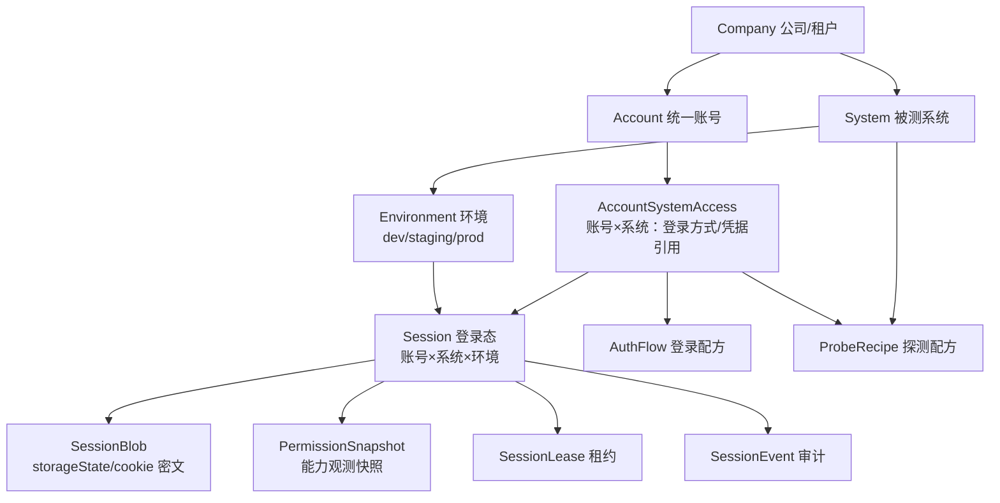
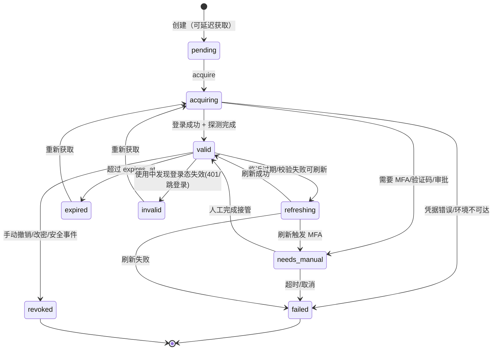
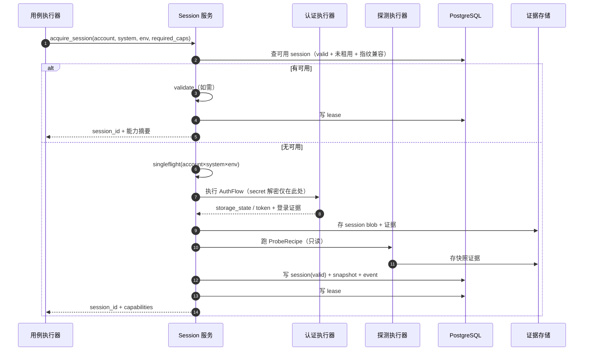
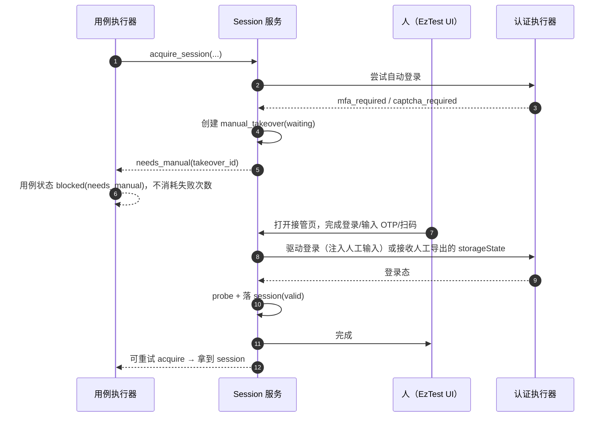

# EzTest 账号 / 会话 / 权限观测 设计（v0.1）

> **状态**：draft（待评审）
> **决策记录**：账号模型采用「统一账号 + 按系统配置登录方式」；不建模角色/RBAC 切换（权限是各被测系统自己的事实）；启用**权限探测快照**（方案 B）。
> **假设**：后端 Go + PostgreSQL，前端 Next.js（与 ARTEX 同类技术栈；若 EzTest 技术栈不同，DDL 与 API 可平移）。
> **目标读者**：EzTest 后端/前端/测试系统设计者。
> **关联**：`docs/Pre-Research/ARTEX-技术点清单-面向AI半自主E2E测试系统.md`（下文简称"ARTEX 报告"）。

---

## P2 实施口径（D28）

> P2 不实现本文完整形态，按 `system-blueprint.md` D28 裁剪：被测系统凭据并入 `account_system_accesses.credential`，Session 状态（storageState/token）并入 `sessions.storage_state`；不建 `secrets` / `session_blobs` / `session_events`；凭据与 storageState **明文存储**，不加密、不脱敏、不写 `audit_logs`。P2 只做人工导入 + 只读 HTTP login_check + 人工确认，不做自动登录、ProbeRecipe、漂移检测、Session 事件流。本文其余章节为 P6+ 目标形态，与 P2 冲突处以本节与 D28 为准。

---

## 0. 结论摘要（TL;DR）

1. **账号与会话分离**：`Account` 是公司级身份；`AccountSystemAccess` 只回答"这个账号怎么登进这个系统"；`Session` 是"账号 × 系统 × 环境"的运行时登录态资产。
2. **不建模角色**：不存 role、不做角色切换、不把权限绑到账号配置上。一个账号在某系统里有什么权限，是该系统的事实，EzTest 只登录、观测、记录。
3. **权限 = 观测快照，不是配置**：登录后按可运营的「探测配方」采集该账号在该系统的能力事实（菜单/接口返回/开关），存不可变快照 + `permission_hash`，用于执行前上下文、漂移告警、报告指纹；用例的"预期能力"写在测试用例里，不从账号配置推导。
4. **秘密与会话不进入 LLM 上下文**：Agent 只拿 `session_id`（handle）与能力摘要；cookie/storageState 由执行器注入；日志/activity/报告全程脱敏。
5. **半自主的关键落点**：验证码/2FA/审批 → 阻塞式「人工接管」checkpoint → 人工完成 → 回写 Session → 用例继续；Session 失效/权限漂移自动检测、可刷新、可撤销。
6. **并发安全**：Session 租约（lease）保证同一会话同一时刻只被一个用例运行使用；账号级并发上限与登录失败退避，避免互踢/锁号。

---

## 1. 目标与非目标

### 1.1 目标

- 支持"一家公司一个统一账号，登录多个系统、每个系统一个 Session"。
- 账号配置一次，运行期按 `(账号, 系统, 环境)` 自动获取/复用/刷新登录态。
- 登录失败可分类：凭据错、需要 2FA/验证码、环境不可达、需要审批、权限前置不满足——**不同原因对应不同的用例结果，不混为"测试失败"**。
- 提供权限观测：执行前知道该账号在该系统能做什么，执行后能解释"为什么这步 403 不算应用缺陷"。
- 全链路可审计：谁在什么时候用哪个账号/会话执行了哪条用例，证据可回溯。
- 为半自主测试提供人工介入点（登录接管、审批、Session 手动导入）。

### 1.2 非目标（本版明确不做）

- ❌ 不建模 RBAC / 角色 / 权限组 / 角色切换。EzTest 不管理被测系统的授权体系。
- ❌ 不做"跨系统权限统一"或权限同步（SSO 只作为登录方式接入）。
- ❌ 不把密码/cookie 暴露给模型或前端明文接口。
- ❌ 不做通用 IAM（只服务测试执行）。
- ❌ 不在本版做 SSO 的父子会话级联（字段预留，AS-M2 实现）。

### 1.3 关键不变量（实现时必须守住）

1. 一个 `Session` 只属于 `(account_id, system_id, environment_id)` 三元组；跨环境绝不复用。
2. 任意时刻一个 Session 最多一个有效 lease（部分唯一索引保证）。
3. `secrets` 与 `session_blobs` 只存密文；任何 API/日志/提示词不得出现明文秘密。
4. 探测配方必须**无副作用**（只读）；任何写操作走正常用例 + 审批门。
5. 用例结果必须记录 `session_id + snapshot_id`（若做了能力校验），否则不可复现。
6. 权限缺失/切换属于"前置不满足"（blocked），**不能判成应用失败**；只有"预期权限内功能不可用"或"预期外可访问"才是缺陷候选。

---

## 2. 概念模型



### 2.1 对象职责

| 对象 | 职责 | 不负责 |
|---|---|---|
| `Company` | 租户/客户边界 | 不直接挂账号权限 |
| `System` + `Environment` | 被测目标、地址、环境类型、允许主机、版本指纹 | 不描述"谁能测" |
| `Account` | 公司级统一身份（人/服务） | 不挂凭据、不挂权限、不挂角色 |
| `AccountSystemAccess` | 账号在该系统的登录方式（password/sso/token/apikey/basic/manual）、凭据引用、并发上限、备注 | **不绑定角色、不定义权限** |
| `AuthFlow` | 可版本化的登录配方（表单/API/SSO 步骤） | 不存秘密 |
| `ProbeRecipe` | 可版本化的权限探测配方（只读） | 不做授权判断 |
| `Session` | 一次有效登录态 + 生命周期 + 获取方式 + 环境指纹 | 不承载业务语义 |
| `PermissionSnapshot` | 某时刻观测到的能力事实（不可变） | 不是账号配置、不是角色 |
| `SessionLease` | 并发使用控制 | —— |
| `SessionEvent` | 审计与排障 | —— |

### 2.2 与 ARTEX 的对应

| ARTEX | EzTest | 取舍 |
|---|---|---|
| `assets.auth jsonb[]`（凭据/认证信息挂在 service 资产上） | 拆成 Access（配置）+ Secret（密文）+ Session（运行时） | 借"资产可追溯"，不借字段结构 |
| 账号密码写进任务描述 → 进 prompt | 账号配置 + secret 引用，Agent 只拿 session handle | **反向学习**：ARTEX 做法不可复现/不安全 |
| evidence snapshot（内容寻址+不可变+版本） | SessionBlob / PermissionSnapshot 同构 | 借 |
| 复测冻结 snapshot | 复测冻结 session + snapshot + 环境指纹 | 借 |
| intercept 审批门（两阶段审计） | 生产账号获取/敏感探测的人工确认 | 借 |
| triggers 水位触发 | Session 过期/权限漂移 → 刷新任务/通知 | 借 |
| 幂等迁移（embedded schema + advisory lock） | 本设计 DDL 同样可重入 | 借 |

---

## 3. 数据模型（PostgreSQL DDL 草案）

> 约定：所有时间用 `TIMESTAMPTZ`；状态用 `TEXT + CHECK`（便于加值，不用 PG ENUM）；DDL 全部 `IF NOT EXISTS` 可重入；表名前缀不强制，部署时可按 schema 隔离。

> **P2 按 D28 裁剪**：P2 `resource` 上下文只建 11 表，`secrets`（§3.2）、`session_blobs`（§3.5）、`session_events`（§3.6）不在 P2 实施；凭据在 `account_system_accesses.credential`，storageState 在 `sessions.storage_state`。

### 3.1 基础域

```sql
CREATE TABLE IF NOT EXISTS companies (
    id          BIGSERIAL PRIMARY KEY,
    key         TEXT NOT NULL UNIQUE,
    name        TEXT NOT NULL,
    status      TEXT NOT NULL DEFAULT 'active' CHECK (status IN ('active','disabled')),
    created_at  TIMESTAMPTZ NOT NULL DEFAULT now(),
    updated_at  TIMESTAMPTZ NOT NULL DEFAULT now()
);

CREATE TABLE IF NOT EXISTS systems (
    id          BIGSERIAL PRIMARY KEY,
    company_id  BIGINT NOT NULL REFERENCES companies(id) ON DELETE CASCADE,
    key         TEXT NOT NULL,
    name        TEXT NOT NULL,
    kind        TEXT NOT NULL DEFAULT 'web' CHECK (kind IN ('web','api','app')),
    base_url    TEXT,
    notes       TEXT,
    status      TEXT NOT NULL DEFAULT 'active' CHECK (status IN ('active','disabled')),
    created_at  TIMESTAMPTZ NOT NULL DEFAULT now(),
    updated_at  TIMESTAMPTZ NOT NULL DEFAULT now(),
    UNIQUE (company_id, key)
);

CREATE TABLE IF NOT EXISTS environments (
    id                   BIGSERIAL PRIMARY KEY,
    system_id            BIGINT NOT NULL REFERENCES systems(id) ON DELETE CASCADE,
    key                  TEXT NOT NULL,
    name                 TEXT NOT NULL,
    base_url             TEXT NOT NULL,
    kind                 TEXT NOT NULL DEFAULT 'staging' CHECK (kind IN ('dev','staging','prod','other')),
    is_prod              BOOLEAN NOT NULL DEFAULT FALSE,
    fingerprint          JSONB NOT NULL DEFAULT '{}'::jsonb,  -- build/commit/version/UA 等
    allowed_hosts        TEXT[] NOT NULL DEFAULT '{}',        -- 执行/探测只允许访问这些 host（空=取 base_url host）
    allow_auto_login     BOOLEAN NOT NULL DEFAULT TRUE,
    require_approval     BOOLEAN NOT NULL DEFAULT FALSE,      -- 获取/使用会话前需审批（建议 prod 置 true）
    created_at           TIMESTAMPTZ NOT NULL DEFAULT now(),
    updated_at           TIMESTAMPTZ NOT NULL DEFAULT now(),
    UNIQUE (system_id, key)
);

CREATE TABLE IF NOT EXISTS accounts (
    id          BIGSERIAL PRIMARY KEY,
    company_id  BIGINT NOT NULL REFERENCES companies(id) ON DELETE CASCADE,
    key         TEXT NOT NULL,
    label       TEXT NOT NULL,
    username    TEXT,
    kind        TEXT NOT NULL DEFAULT 'human' CHECK (kind IN ('human','service')),
    status      TEXT NOT NULL DEFAULT 'active' CHECK (status IN ('active','disabled')),
    notes       TEXT,
    created_at  TIMESTAMPTZ NOT NULL DEFAULT now(),
    updated_at  TIMESTAMPTZ NOT NULL DEFAULT now(),
    UNIQUE (company_id, key)
);
```

### 3.2 秘密（只存密文）

```sql
CREATE TABLE IF NOT EXISTS secrets (
    id           BIGSERIAL PRIMARY KEY,
    ciphertext   BYTEA NOT NULL,
    nonce        BYTEA NOT NULL,
    key_version  INTEGER NOT NULL DEFAULT 1,
    hint         TEXT,           -- 仅供人识别，如 "末4位 8f2a"，不可还原
    created_at   TIMESTAMPTZ NOT NULL DEFAULT now(),
    rotated_at   TIMESTAMPTZ
);
```

> 实现：AES-256-GCM，密钥来自环境变量/OS keyring/KMS（不进库）；解密只发生在登录执行器/浏览器注入处。API 永不返回 `ciphertext/nonce`，列表只回 `hint`。

### 3.3 登录配方与权限探测配方（可运营、可版本化）

```sql
CREATE TABLE IF NOT EXISTS auth_flows (
    id              BIGSERIAL PRIMARY KEY,
    system_id       BIGINT NOT NULL REFERENCES systems(id) ON DELETE CASCADE,
    environment_id  BIGINT REFERENCES environments(id) ON DELETE CASCADE, -- NULL=该系统通用
    name            TEXT NOT NULL,
    kind            TEXT NOT NULL CHECK (kind IN ('form','api','sso','oauth','custom')),
    version         INTEGER NOT NULL DEFAULT 1,
    definition      JSONB NOT NULL,   -- 步骤/选择器/接口/OTP 策略
    enabled         BOOLEAN NOT NULL DEFAULT TRUE,
    created_at      TIMESTAMPTZ NOT NULL DEFAULT now(),
    updated_at      TIMESTAMPTZ NOT NULL DEFAULT now()
);

CREATE TABLE IF NOT EXISTS probe_recipes (
    id              BIGSERIAL PRIMARY KEY,
    system_id       BIGINT NOT NULL REFERENCES systems(id) ON DELETE CASCADE,
    environment_id  BIGINT REFERENCES environments(id) ON DELETE CASCADE,
    name            TEXT NOT NULL,
    version         INTEGER NOT NULL DEFAULT 1,
    definition      JSONB NOT NULL,   -- 只读探测项列表
    enabled         BOOLEAN NOT NULL DEFAULT TRUE,
    created_at      TIMESTAMPTZ NOT NULL DEFAULT now(),
    updated_at      TIMESTAMPTZ NOT NULL DEFAULT now()
);
```

### 3.4 账号 × 系统访问配置

```sql
CREATE TABLE IF NOT EXISTS account_system_accesses (
    id                 BIGSERIAL PRIMARY KEY,
    account_id         BIGINT NOT NULL REFERENCES accounts(id) ON DELETE CASCADE,
    system_id          BIGINT NOT NULL REFERENCES systems(id) ON DELETE CASCADE,
    auth_type          TEXT NOT NULL CHECK (auth_type IN ('password','sso','token','apikey','basic','manual')),
    secret_id          BIGINT REFERENCES secrets(id) ON DELETE SET NULL,
    username_override  TEXT,        -- 与账号 username 不同时使用
    login_url          TEXT,        -- 可选：登录入口
    login_flow_id      BIGINT REFERENCES auth_flows(id) ON DELETE SET NULL,
    probe_recipe_id    BIGINT REFERENCES probe_recipes(id) ON DELETE SET NULL,
    enabled            BOOLEAN NOT NULL DEFAULT TRUE,
    permission_note    TEXT,        -- 人工备注（给人看，系统不解析）
    concurrency_limit  INTEGER NOT NULL DEFAULT 1,  -- 同账号同系统并发 session 上限
    session_ttl_seconds INTEGER,    -- 空=用系统默认
    created_at         TIMESTAMPTZ NOT NULL DEFAULT now(),
    updated_at         TIMESTAMPTZ NOT NULL DEFAULT now(),
    UNIQUE (account_id, system_id)
);
```

> 注意：**没有 role 字段**。`permission_note` 只是人工说明；权限事实只来自运行时 `PermissionSnapshot`。

### 3.5 会话、快照、Blob

```sql
CREATE TABLE IF NOT EXISTS session_blobs (
    hash         TEXT PRIMARY KEY,   -- sha256(ciphertext) 或业务 hash
    kind         TEXT NOT NULL CHECK (kind IN ('storage_state','cookie_jar','token','other')),
    ciphertext   BYTEA NOT NULL,
    nonce        BYTEA NOT NULL,
    key_version  INTEGER NOT NULL DEFAULT 1,
    size         INTEGER NOT NULL,
    created_at   TIMESTAMPTZ NOT NULL DEFAULT now()
);

CREATE TABLE IF NOT EXISTS sessions (
    id                BIGSERIAL PRIMARY KEY,
    account_id        BIGINT NOT NULL REFERENCES accounts(id) ON DELETE CASCADE,
    system_id         BIGINT NOT NULL REFERENCES systems(id) ON DELETE CASCADE,
    environment_id    BIGINT NOT NULL REFERENCES environments(id) ON DELETE CASCADE,
    access_id         BIGINT NOT NULL REFERENCES account_system_accesses(id) ON DELETE CASCADE,
    parent_session_id BIGINT REFERENCES sessions(id) ON DELETE SET NULL,  -- SSO IdP 父会话（AS-M2）
    state             TEXT NOT NULL CHECK (state IN (
                        'pending','acquiring','needs_manual','valid','refreshing',
                        'expired','invalid','revoked','failed')),
    acquisition       TEXT NOT NULL CHECK (acquisition IN ('auto','manual','imported')),
    storage_blob      TEXT REFERENCES session_blobs(hash) ON DELETE SET NULL,
    auth_flow_id      BIGINT REFERENCES auth_flows(id) ON DELETE SET NULL,
    probe_recipe_id   BIGINT REFERENCES probe_recipes(id) ON DELETE SET NULL,
    last_snapshot_id  BIGINT,        -- → session_snapshots.id（后建，避免循环引用）
    fingerprint       JSONB NOT NULL DEFAULT '{}'::jsonb,  -- 获取时的环境指纹快照
    issued_at         TIMESTAMPTZ,
    expires_at        TIMESTAMPTZ,
    last_validated_at TIMESTAMPTZ,
    last_used_at      TIMESTAMPTZ,
    session_version   INTEGER NOT NULL DEFAULT 1,
    failure_reason    TEXT,          -- login_failed | mfa_required | captcha_required |
                                     -- approval_required | env_unreachable | probe_failed
    invalidated_reason TEXT,
    created_by        TEXT NOT NULL DEFAULT 'system',
    created_at        TIMESTAMPTZ NOT NULL DEFAULT now(),
    updated_at        TIMESTAMPTZ NOT NULL DEFAULT now()
);

CREATE TABLE IF NOT EXISTS session_snapshots (
    id               BIGSERIAL PRIMARY KEY,
    session_id       BIGINT NOT NULL REFERENCES sessions(id) ON DELETE CASCADE,
    probe_recipe_id  BIGINT REFERENCES probe_recipes(id) ON DELETE SET NULL,
    probe_version    INTEGER NOT NULL,
    permission_hash  TEXT NOT NULL,          -- 规范化后的能力集合 hash（漂移检测用）
    items            JSONB NOT NULL DEFAULT '[]'::jsonb,
    summary          JSONB NOT NULL DEFAULT '{}'::jsonb, -- 计数：visible/denied/error 等
    evidence_ref     TEXT,                   -- 内容寻址证据（截图/HTTP 报文）
    captured_at      TIMESTAMPTZ NOT NULL DEFAULT now()
);
```

### 3.6 租约与审计

```sql
CREATE TABLE IF NOT EXISTS session_leases (
    id              BIGSERIAL PRIMARY KEY,
    session_id      BIGINT NOT NULL REFERENCES sessions(id) ON DELETE CASCADE,
    holder          TEXT NOT NULL,          -- run_id / case_run_id
    case_run_id     BIGINT,
    acquired_at     TIMESTAMPTZ NOT NULL DEFAULT now(),
    expires_at      TIMESTAMPTZ NOT NULL,
    released_at     TIMESTAMPTZ,
    released_reason TEXT
);

-- 同一 Session 同时只允许一个未释放租约
CREATE UNIQUE INDEX IF NOT EXISTS uq_session_active_lease
    ON session_leases(session_id) WHERE released_at IS NULL;

CREATE TABLE IF NOT EXISTS session_events (
    id            BIGSERIAL PRIMARY KEY,
    session_id    BIGINT,
    account_id    BIGINT,
    system_id     BIGINT,
    environment_id BIGINT,
    action        TEXT NOT NULL,   -- acquire_start/acquire_ok/acquire_fail/validate/
                                   -- probe/lease/release/invalidate/expire/manual_takeover/
                                   -- permission_drift/revoke
    actor         TEXT NOT NULL DEFAULT 'system',  -- user:<id> / agent:worker / system
    detail        JSONB NOT NULL DEFAULT '{}'::jsonb,
    evidence_ref  TEXT,
    at            TIMESTAMPTZ NOT NULL DEFAULT now()
);

CREATE TABLE IF NOT EXISTS manual_takeovers (
    id              BIGSERIAL PRIMARY KEY,
    session_id      BIGINT REFERENCES sessions(id) ON DELETE SET NULL,
    account_id      BIGINT NOT NULL,
    system_id       BIGINT NOT NULL,
    environment_id  BIGINT NOT NULL,
    reason          TEXT NOT NULL CHECK (reason IN ('mfa','captcha','approval','login_unknown','other')),
    status          TEXT NOT NULL DEFAULT 'waiting' CHECK (status IN ('waiting','completed','cancelled','expired')),
    instructions    JSONB NOT NULL DEFAULT '{}'::jsonb,
    requested_by    TEXT NOT NULL DEFAULT 'system',
    requested_at    TIMESTAMPTZ NOT NULL DEFAULT now(),
    expires_at      TIMESTAMPTZ NOT NULL,
    completed_at    TIMESTAMPTZ
);
```

### 3.7 索引

```sql
CREATE INDEX IF NOT EXISTS idx_sessions_lookup
    ON sessions(account_id, system_id, environment_id, state);
CREATE INDEX IF NOT EXISTS idx_sessions_expiry
    ON sessions(state, expires_at) WHERE state = 'valid';
CREATE INDEX IF NOT EXISTS idx_snapshots_session
    ON session_snapshots(session_id, captured_at DESC);
CREATE INDEX IF NOT EXISTS idx_events_session
    ON session_events(session_id, at DESC);
CREATE INDEX IF NOT EXISTS idx_events_action_time
    ON session_events(action, at DESC);
CREATE INDEX IF NOT EXISTS idx_leases_expiry
    ON session_leases(expires_at) WHERE released_at IS NULL;
CREATE INDEX IF NOT EXISTS idx_takeovers_status
    ON manual_takeovers(status, expires_at) WHERE status = 'waiting';
```

### 3.8 与测试域的关系（本文件不展开，只给引用约定）

- 用例/前置条件引用 `account_id` + `system_id` + `expected_capabilities`（能力 key 数组，见 §6.4）。
- `case_run` 必须落 `session_id`、`session_snapshot_id`（可空，未探测时）、`environment_fingerprint`。
- 缺陷（finding）与回归复测引用 `case_run`，从而间接可回溯到 Session/快照；复测额外冻结一份快照（借鉴 ARTEX 的 `finding_retests.snapshot`）。

---

## 4. Session 生命周期

### 4.1 状态机



**派生状态**（不落库，读取时算）：
- `expiring`：`state=valid AND expires_at - now() < refresh_headroom`（默认 10% TTL 或 5 分钟，取大者）。
- `stale_permissions`：`last_snapshot.captured_at` 超过探测保鲜期（默认 24h）或 `probe_recipe.version` 变了。

### 4.2 获取决策表（`acquire_session` 核心算法）

```text
输入: account, system, env, options{fresh?, required_capabilities?, reuse_policy?}

1. 校验 Access 存在且 enabled；否则 → access_disabled
2. 校验 env 可达/允许（allowed_hosts）；prod && require_approval && 无有效审批 → approval_required
3. 查找可用 Session（同一 account×system×env）：
   - state=valid
   - 未过期（expires_at 未到）
   - 无未释放 lease（或系统支持多会话且未达 concurrency_limit）
   - 环境指纹兼容（fingerprint.base_url/build 等按策略比对）
   → 若 last_validated_at 超过 validate_ttl：先 validate_session
   → 通过则 lease 并返回
4. 若无可用 Session：
   a. 能自动登录（auth_type ≠ manual、有 secret、env.allow_auto_login）：
      - 单飞（singleflight）该 account×system×env，避免并发重复登录
      - 执行 AuthFlow → 登录成功判定（login_check）→ 保存 storage_state → probe（若配置）
      - 成功 → valid → lease 并返回
      - 失败 → 按错误分类：credential_invalid / mfa_required / captcha_required /
                rate_limited / env_unreachable / login_flow_outdated
   b. 不能自动登录（manual/需要 MFA）：
      - 创建 manual_takeover（waiting）→ 返回 needs_manual + takeover_id + 操作指引
5. 幂等：同一 account×system×env 的 acquisition 用单飞 + 短 TTL 缓存，重复调用不重复登录
6. 失败分类映射到用例结果：precondition 类 → blocked；infra 类 → blocked(infra)；非应用失败
```

### 4.3 租约（lease）

- `holder` = `run_id` 或 `case_run_id`；获取时写租约，完成/失败/取消时释放。
- 租约默认 TTL = min(30min, 剩余 Session 有效期)；用例运行可续租。
- 进程崩溃残留租约：由后台回收（`expires_at < now()` 且未释放 → 释放并记事件）。
- 释放策略：默认"运行级租用"（一条用例运行结束即释放，Session 留在池里可复用）；也可配 `invalidate_after_use`（高风险环境用）。

### 4.4 失效与刷新

| 触发 | 检测方式 | 动作 |
|---|---|---|
| 使用中 401/302 跳登录 | HTTP 工具/浏览器工具拦截 + login_check | `invalid` + 事件；按策略自动重获取或返回 blocked |
| 临近过期 | `expiring` 派生状态 | 后台刷新任务 / 获取前刷新 |
| 环境指纹不兼容 | 获取时比对 | 不复用，重新登录 |
| 密码/配置变更 | 管理侧更新 Access 时 | 撤销该 Access 下所有 Session（事件 + 通知） |
| 人工撤销/安全事件 | API | `revoked`，删除/保留 blob（按保留策略） |
| 权限漂移 | 周期性 probe 对比 hash | 事件 + 通知 + 标记依赖该能力的用例"结论可能过期" |

---

## 5. 权限探测（方案 B）

### 5.1 定位

- **观测，不是配置**：探测结果是"某次登录后，这个账号在这个系统里实际能触达什么"的事实快照。
- **只读、无副作用**：探测配方只允许读操作；写操作属于正常用例 + 审批门。
- **用途**：① 执行前上下文（避免把 403 当缺陷）；② 漂移检测；③ 报告指纹。
- **不是授权依据**：用例的预期写在用例里；探测只帮助判断"前置是否满足 / 是否值得怀疑"。

### 5.2 探测配方（ProbeRecipe）示例

```json
{
  "version": 1,
  "login_check": { "kind": "url_regex", "pattern": "/(dashboard|home|index)" },
  "limits": { "timeout_ms": 5000, "max_items": 50 },
  "items": [
    { "key": "api.me",            "kind": "api", "method": "GET", "path": "/api/me", "observe": "status" },
    { "key": "api.orders.list",   "kind": "api", "method": "GET", "path": "/api/orders?page=1", "observe": "status" },
    { "key": "api.refund",        "kind": "api", "method": "POST", "path": "/api/refund", "safe_probe": true, "observe": "status" },
    { "key": "nav.admin",         "kind": "dom", "selector": "[data-testid=nav-admin]", "observe": "visible" },
    { "key": "page.users",        "kind": "page", "path": "/users", "observe": "status" }
  ]
}
```

约束：

- `kind` 仅 `api | page | dom`；`method` 仅 `GET/HEAD/OPTIONS`，除非 `safe_probe=true` 且系统配置允许（默认禁止写探测）。
- `path` 只允许 `allowed_hosts` 内的相对路径；禁止跨域。
- 每项有 key（系统级稳定标识，人工维护），不是全局角色体系。
- 配方与版本一起入 `probe_recipes`；修改产生新 `version`，旧快照保留（可解释历史结论）。

### 5.3 快照结构

```json
{
  "probe_version": 1,
  "captured_at": "2026-10-26T01:40:00+08:00",
  "login": { "ok": true, "final_url": "https://crm.example.com/dashboard", "evidence_ref": "ev_01J..." },
  "items": [
    { "key": "api.me",          "kind": "api", "observed": "allowed", "status": 200 },
    { "key": "api.refund",      "kind": "api", "observed": "denied",  "status": 403 },
    { "key": "nav.admin",       "kind": "dom", "observed": "hidden" },
    { "key": "page.users",      "kind": "page", "observed": "allowed", "status": 200 }
  ],
  "summary": { "total": 4, "allowed": 2, "denied": 1, "hidden": 1, "errors": 0 },
  "errors": []
}
```

- `observed` 枚举：`allowed | denied | hidden | missing | error`。
- `permission_hash = sha256(normalize(sort(items[key, observed]))`，**不含时间/证据引用**，用于漂移比较。
- `evidence_ref` 指向内容寻址证据（请求/响应/截图），复用 ARTEX 的不可变证据思路。

### 5.4 期望能力与判定（用例侧）

用例/前置条件声明：

```yaml
preconditions:
  - type: session
    account: corp-admin
    system: Billing
    environment: staging
    expected_capabilities:
      - billing.orders.view: allowed
      - billing.refund: denied
```

执行前对照：

| 情况 | 判定 | 处理 |
|---|---|---|
| expected 全部满足 | 前置通过 | 正常执行；记录 snapshot_id |
| 有 expected 未满足（observed ≠ expected） | **前置不满足** | `blocked(precondition)`，写明差异；提示修配置/人工确认 |
| observed 出现 expected 之外的 allowed（且用例关注越权） | 可疑 | 继续执行但也标记 `permission_suspicious`，作为越权测试线索 |
| 探测本身失败（环境不可达/配方错） | 探测失败 | 降级：仅校验登录有效，显式警告"能力未验证" |
| 未配置探测配方 | 未探测 | 同上（degraded 模式，报告标注） |

### 5.5 漂移检测

- 调度器周期性（默认 24h，可配）对活跃 Session 重跑 probe。
- `permission_hash` 变化 → `permission_drift` 事件 + 通知（复用 ARTEX 的水位/通知思路）。
- 触发"结论可能过期"标记：依赖该能力 key 的历史用例结果/缺陷在 UI 上显示"权限已变更"。
- 权限变化**不等于缺陷**：它是环境/配置事实；是否算 bug 由人/用例判定。

---

## 6. 获取 / 复用 / 人工接管时序

### 6.1 自动获取（正常路径）



### 6.2 人工接管（2FA/验证码/审批）



**三种人工接管形态**（MVP 推荐 A）：

- **A（MVP）人工导入**：EzTest 生成一次性登录指引/脚本，用户在自己浏览器登录后导出 `storageState` 上传（或使用 `playwright-cli state-save`），服务端校验后存为 Session（`acquisition=manual`）。
- **B（v1.1）OTP 原地接管**：自动化驱动登录到 OTP 步骤，UI 弹输入框收集 OTP，继续完成登录（短信/邮箱/TOTP 均可）。
- **C（AS-M2）内嵌远程浏览器**：托管 Playwright + noVNC/CDP 推流，人在 EzTest 里直接操作登录窗口；实现复杂、资源开销大。

### 6.3 伪造/无效处理

- 登录校验失败（`login_check` 不通过）→ 不落 `valid`，记 `failure_reason`；若可分类为"配方过期"→ 通知维护者。
- 已存在 Session 但使用中 401 → `invalid`；同一次运行内可尝试重新获取一次（避免 flaky），仍失败则 `blocked`。
- 不允许把"登录失败"直接计为应用用例失败；用四态（通过/失败/阻塞/未完成）区分。

---

## 7. 使用 Session：秘密永不进模型

### 7.1 原则

1. Agent 只拿 `session_id` + 能力摘要（keys/可见性），拿不到 cookie/token 明文。
2. 执行通道按 session 注入：
   - **HTTP 工具**：`http_request(session_id, method, url, ...)` → 服务端注入 Cookie/Header，只允许 `allowed_hosts`。
   - **浏览器工具**：`browser_open(session_id, url)` / 动作序列 → Playwright `storage_state` 注入独立 context；每 Session 一个 context，用完销毁。
   - **Bash**：v1 仅允许用于本地/无鉴权任务；需要鉴权的请求走 HTTP/浏览器工具。
3. **v1.1 可选：Session 出口代理**：给 Bash 注入一个本地代理（`http_proxy`），代理按当前 session 自动附加 Cookie/Header、只放行 allowed_hosts、全量留证据（类似 ARTEX 的 MITM 记录 + 注入）。这样自定义脚本（curl/python）也能用登录态，且秘密不落 agent 文件系统。
4. 任何导出（报告/证据包）只含能力摘要/快照 hash，不含 cookie。

### 7.2 Agent 工具契约（草案）

| 工具 | 入参 | 返回（不含秘密） |
|---|---|---|
| `list_accounts` | `company_id?`, `system_id?`, `q?` | 账号标签/状态/各系统 access 摘要 |
| `list_sessions` | `account_id?`, `system_id?`, `env_id?`, `state?` | id/状态/有效期/租约/能力摘要 |
| `acquire_session` | `account_id`, `system_id`, `env_id`, `fresh?`, `required_capabilities?` | `session_id/state/expires_at/capabilities/needs_manual?` |
| `validate_session` | `session_id`, `check_permissions?` | `alive/final_url/snapshot_id/permission_diff?` |
| `list_capabilities` | `session_id` | 能力 items + summary + 快照时间 |
| `request_manual_takeover` | `account_id/system_id/env_id`, `reason` | `takeover_id/instructions/expires_at` |
| `release_session` | `session_id` | `ok` |
| `invalidate_session` | `session_id`, `reason` | `ok` |

错误码（typed，供 agent/用例分类）：

```text
access_disabled | credentials_missing | login_failed | mfa_required | captcha_required |
approval_required | env_unreachable | login_flow_outdated | probe_failed |
lease_timeout | session_invalid | scope_violation | precondition_unmet
```

### 7.3 REST（管理面，摘要）

```text
GET/POST        /api/companies
GET/POST        /api/systems              PATCH/DELETE /api/systems/{id}
GET/POST        /api/systems/{id}/environments
GET/POST        /api/accounts             PATCH/DELETE /api/accounts/{id}
GET/POST        /api/accounts/{id}/accesses            # 含 auth_type/secret hint
POST            /api/accounts/{id}/accesses/{aid}/test-login   # 管理员手动验证
GET/POST        /api/systems/{id}/auth-flows
GET/POST        /api/systems/{id}/probe-recipes
GET             /api/sessions             ?account_id=&system_id=&state=
POST            /api/sessions/acquire
POST            /api/sessions/{id}/validate
POST            /api/sessions/{id}/probe
POST            /api/sessions/{id}/release
POST            /api/sessions/{id}/invalidate
GET             /api/sessions/{id}/snapshots
GET             /api/sessions/{id}/events
GET/POST        /api/manual-takeovers
POST            /api/manual-takeovers/{id}/complete|cancel
```

---

## 8. 前端信息架构

### 8.1 账号配置页（核心）

```text
公司: Acme
┌──────────────┬───────────────────────────┬──────────────────────────────┐
│ 统一账号      │ CRM                       │ Billing                      │
├──────────────┼───────────────────────────┼──────────────────────────────┤
│ corp-admin    │ password · ✓ 有效         │ sso · ⚠ 需人工接管           │
│               │ 能力: 订单✓ 退款✗          │ 能力: 账单查看✓ 退款✗        │
│ qa-user       │ password · ✗ 已过期       │ —                            │
│ svc-automation│ —                         │ apikey · ✓ 有效              │
└──────────────┴───────────────────────────┴──────────────────────────────┘
[新增账号] [新增系统] 行点击→详情；格子点击→Session 面板
```

- 账号详情：基本信息 / 各系统 Access 配置（登录方式、secret 引用、并发上限、权限备注）/ 历史 Session。
- Session 面板：状态、有效期、最后校验、租约持有者、能力快照（可展开 diff）、操作（验证/探测/撤销/人工接管）。
- 人工接管中心：等待中的接管任务列表 + 计时 + 操作指引 + 完成按钮。
- 配方管理（高级）：AuthFlow / ProbeRecipe 编辑器（JSON 或表单），带版本、试运行。

### 8.2 用例/执行视图

- 用例设计：选择 `账号 + 系统 + 环境`，填写 **预期能力**（可选，从探测快照里勾选 key）。
- 执行前 preflight 卡：`环境 ✓ / 会话 ✓（有效期至 ...）/ 能力 ✓（快照 hash ...）`，三者任一失败即 blocked。
- 执行中：会话胶囊（账号标签 + 系统 + 角色无关摘要），点击看快照。
- 结果/报告：Session 指纹（account/system/env/fingerprint/snapshot hash）；失败分类区块。

---

## 9. 与主流程挂接

| 阶段 | 需要做的事 | 产物/字段 |
|---|---|---|
| 需求澄清 | 问清涉及哪些系统、每个系统用哪个账号；该账号"应该能做什么"作为验收预期 | 权限矩阵草案（账号×系统×预期能力） |
| 用例设计 | 用例声明 actor(account) + system/env + expected_capabilities | case.preconditions |
| 执行前置 | acquire → validate → probe → 对照 expected | `case_run.session_id/snapshot_id`；失败→blocked |
| 执行中 | HTTP/浏览器工具按 session 注入；401 归因 | activity 记录 session_id；失效→重取/blocked |
| 缺陷/报告 | 缺陷带 Session 指纹与能力快照 | finding.session_fingerprint |
| 回归复测 | 冻结 session 快照（账号/系统/环境/能力/指纹） | retest.snapshot（借鉴 ARTEX） |
| 覆盖统计 | 账号×系统维度：哪些组合被哪些用例覆盖 | coverage(account,system) |
| 自动化 | Session 过期刷新、权限漂移检测、人工接管超时提醒 | 定时任务/通知 |

---

## 10. 安全、审计与合规

> **P2 按 D28 裁剪**：P2 凭据/Session 明文存储，不做加密、脱敏、审计（不写 `audit_logs`）；本节为 P6/P8 目标形态。

1. **加密**：secret 与 session blob 均 AES-256-GCM 加密，密钥不入库；支持 key_version 轮换。
2. **最小暴露**：API 不回明文；agent 只拿 handle；日志/activity/提示词/报告脱敏（复用 ARTEX 的 mask/redaction 思路）。
3. **审批**：`environments.require_approval`（建议 prod=true）→ 获取/使用前走审批（可复用 ARTEX intercept 式的两阶段审计：申请 → 决策 → 执行 → 结果）。
4. **范围限制**：环境 `allowed_hosts` 在 HTTP/浏览器工具层强制校验；防止 SSRF/越界（借鉴 ARTEX notify 的拨号层校验思路，但允许测试目标 localhost/内网——用环境白名单而非全局拒绝）。
5. **审计**：session_events 全量记录（谁/何时/为什么获取/使用/撤销）；管理面操作另记操作审计。
6. **保留与回收**：revoked/expired session 的 blob 按保留期（默认 30 天）后 GC；证据快照长期保留（可引用）。
7. **应急**：一键 revoke（按账号/系统/环境批量）→ 通知并标记受影响的运行；支持"紧急冻结"某账号在该公司的所有会话。

---

## 11. MVP 拆解与验收

> **P2 按 D28 裁剪**：AS-M0 的 P2 部分不含 `secrets`/`session_blobs`/`session_events` 与加密/审计；本文里程碑保留完整目标形态。

### 11.1 里程碑

| 里程碑 | 内容 |
|---|---|
| **AS-M0（MVP；实施 P2+P6）** | 基础域 5 表 + secrets + `account_system_accesses` + sessions/session_blobs/events/leases；手工导入 storageState 获取 Session；HTTP 工具按 session 注入；简单 `login_check`（URL 正则/页面特征）；执行前 preflight（登录有效）；Session 列表/状态 UI；case_run 记录 session_id |
| **AS-M1（实施 P6/P7/P8）** | AuthFlow 自动登录（form/api + TOTP）；ProbeRecipe + 快照 + 漂移检测；人工接管（形态 A + OTP 形态 B）；租约/并发上限/失败退避；prod 审批；定时刷新/通知；能力对照与 blocked 分类；报告指纹 |
| **AS-M2（P8 之后）** | SSO 父子会话与级联失效；Session 出口代理（自定义脚本 + 证据全留）；会话池预热；多租户/权限；探测配方回归 |

> 实施阶段映射：AS-M0 覆盖实施 P2（人工导入/管理）与 P6（执行注入）；AS-M1 以 P6 为主，部分归入 P7/P8；AS-M2 为 P8 之后。

### 11.2 验收场景（AS-M0/AS-M1 必须能跑）

1. 配置公司/系统/环境/账号/Access，手工导入 Session 后状态 `valid`。
2. 同一 Session 被两条用例复用（串行）；并发时第二条排队/另取。
3. Session 过期后自动重新获取（有凭据时）。
4. 2FA 账号触发 `needs_manual`，人工接管完成后用例继续。
5. 探测采集能力快照；用例 expected 缺失 → `blocked(precondition)` 而非 failed。
6. 管理员改动账号权限 → 周期探测产生 `permission_drift` 事件并标记历史结论。
7. 生产环境未审批时 acquire 返回 `approval_required`。
8. 任何 API/日志/activity/报告中的秘密字段被脱敏（测试断言）。
9. 用例 401 → 归类为会话失效并重取，不误报应用缺陷。
10. 报告能展示 Session 指纹（账号/系统/环境/快照 hash）。

---

## 12. 未决问题（需要拍板）

1. **人工接管形态**：MVP 采用 A（导入 storageState）是否可接受？还是必须内嵌浏览器（C）？
2. **探测生产可用性**：探测请求会打真实系统（虽只读）；生产环境是否允许探测，还是仅允许"登录有效性校验"？
3. **Session 复用策略**：默认"运行级租用、可复用至过期"是否合适？高风险环境是否默认用后即焚？
4. **SSO 优先级**：公司统一账号是否主要走 SSO？若是，MVP（AS-M0）就要考虑 IdP 会话（否则每个系统都要独立登录）。
5. **执行器形态**：浏览器执行器是独立 Playwright 服务（推荐，隔离/可扩）还是进程内嵌？
6. **多租户/权限**：谁能看/改 secret、谁能审批 prod、谁能人工接管——需要公司的角色/审批配置。
7. **能力 key 的治理**：ProbeRecipe 由谁维护、改版后历史快照如何解释（建议保留 recipe version + 变更日志）。
8. **账号锁定策略**：登录失败多少次触发账号级熔断/通知；是否自动停用 Access。

---

## 13. 附录

### 13.1 枚举字典

- `auth_type`：`password | sso | token | apikey | basic | manual`
- `session.state`：`pending | acquiring | needs_manual | valid | refreshing | expired | invalid | revoked | failed`
- `failure_reason`：`login_failed | mfa_required | captcha_required | approval_required | env_unreachable | login_flow_outdated | probe_failed | credential_invalid | rate_limited`
- `session.acquisition`：`auto | manual | imported`
- `observed`：`allowed | denied | hidden | missing | error`
- `session_events.action`：见 §3.6 注释

### 13.2 数据保留建议

| 数据 | 保留 | 说明 |
|---|---|---|
| session_blobs | Session 进入 revoked/expired 后 30 天 | 过期后 GC，审计记录保留 |
| session_events | 1 年（可配） | 审计/排障 |
| session_snapshots | 长期（随运行/缺陷引用） | 不可变，报告可引用 |
| manual_takeovers | 1 年 | 审计 |

### 13.3 迁移与实现约定（借鉴 ARTEX）

- schema 用 `go:embed` 幂等执行；只做加法式 DDL；租约/唯一索引使用 `CREATE ... IF NOT EXISTS`。
- 状态转换全部走单条 `UPDATE ... WHERE id=$1 AND state=$2`（CAS），避免并发覆盖。
- 事件与状态写在同一事务内；外部副作用（登录/探测）成功后先落库再返回。
- 秘密解密/登录执行集中在单一 `auth-executor` 组件，禁止散落。

---

*文档版本：v0.1（2026-10-26）；待评审。评审重点：§12 未决问题 + §7 工具契约 + §11 里程碑。*
