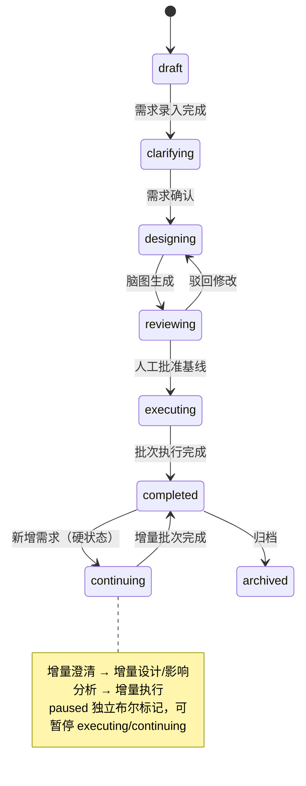

# EzTest 系统整体设计蓝图（v2.2 · 设计冻结候选）

> **文档性质**：本轮设计会话的**主交付物**。用于多阶段迭代开发的唯一"总设计稿"；详细实现规格按阶段拆出，但本蓝图定义系统边界、架构、领域模型、Agent 体系、生命周期、数据/API 轮廓、前端形态、非功能要求与迭代路线。
> **配套详细设计**：`frontend-design.md`（前端细节）、`code-intelligence.md`（本地 Git 代码仓/影响分析）、`auth-session-model.md`（账号/会话/权限观测）；`system-overview.md` v1.1 为早期版本，内容已并入本文。
> **技术假设**：Go 后端 + PostgreSQL + Next.js 前端；Playwright 执行器；SSE 实时流；单机 Docker 优先；LLM 多模态。
> **合规**：借鉴 ARTEX 的设计思想（双图、事件驱动、探索链路、实时执行视图、人环干预），**不复制其源码**（AGPL-3.0）。

---

## 0. 文档地图与阅读顺序

| 顺序 | 文档 | 内容 | 读者 |
|---|---|---|---|
| 1 | **本文（蓝图）** | 产品/架构/领域/Agent/生命周期/数据API轮廓/前端/非功能/路线图 | 所有人 |
| 2 | `code-intelligence.md` | 本地 Git 代码仓、代码图、diff、影响分析 | 后端/Agent/前端 |
| 3 | `frontend-design.md` | 页面/交互/实时协议/组件 | 前端 |
| 4 | `auth-session-model.md` | 账号/Access/Session/权限快照/人工接管 | 后端/前端 |
| 5 | 阶段规格（迭代中产出） | 每个 Phase 的接口/DDL/任务拆解 | 开发者 |

**术语**：版本（Version，一次迭代/发布范围）、需求（Requirement，版本下多条且有关联）、用例（Case）、批次（Batch，一次执行轮次）、继续中（continuing，硬状态）、脑图（用例图）、探索链路（需求→用例→结果→问题 的血缘图）、证据（Evidence，不可变）、问题（Issue/Defect）、代码锚点（case/issue ↔ 代码位置）。

---

## 1. 产品定义

### 1.1 定位

> **AI 全自主端到端功能测试系统（Web + API）**：输入一个版本（含多个相互关联的需求）→ AI 引导澄清 → 生成用例脑图 → 人工评审一次 → AI 全自主执行（执行中自主补全场景、发现遗漏）→ 输出问题清单、版本报告与可交付脑图。人只在必要节点参与。

### 1.2 用户与场景

- **用户**：开发（自测）、测试（正式功能测试）；系统不区分场景，功能对两者通用。
- **管理员（唯一）**：配置公共资源（系统/环境/账号/Session、本地 Git 代码仓）、Agent 配置、LLM、用户。
- **普通用户**：创建版本/需求、回答澄清、评审脑图、发起执行/暂停/新增需求、查看问题与报告。
- 所有产出面向开发/测试：用例脑图、执行结果、证据、问题单、版本报告。

### 1.3 范围（In Scope）

1. **版本级多需求澄清**：一个版本多条需求，需求之间可能有依赖/冲突/重叠/共享范围；AI 引导式澄清（头脑风暴式追问）。
2. **用例脑图**：基于需求 + 本地代码现状 + 应用模型生成；人评审一次形成基线；执行中 AI 可补全并回填。
3. **AI 全自主执行**：Web UI + HTTP API 功能测试；登录/Session 自动获取；数据准备；断言；截图/报文取证；失败分类；自主补全场景。
4. **暂停/恢复**：优雅暂停 + 立即暂停；步骤检查点续跑。
5. **完成后新增需求 → 继续中（硬状态）**：增量澄清 → 增量设计/影响分析 → 增量执行 → 新批次报告。
6. **代码关键资产**：本地 Git 仓库索引、代码图、变更 diff、代码级影响分析（选回归/增量用例），代码锚点进入用例/问题/报告。
7. **交付物**：问题清单、版本报告（按批次）、用例脑图（可导出）、证据链。
8. **实时执行视图**：ARTEX 级可观察/可干预/可回放（探索链路、多 Agent 会话、实时播报、证据）。

### 1.4 非目标（Out of Scope）

- 性能测试、安全测试、移动端/小程序/桌面端。
- 线上代码仓（GitHub/GitLab 等 API）接入；只认管理员配置的**本地 Git 仓库**。
- **不限定被测项目语言/技术栈**，不做语言白名单/解析器门槛（AI 代码理解为主，**不设计 parser**）。
- CI/工单/IM 集成、环境编排、多级审批、LLM 池/熔断/成本看板、多租户/复杂 RBAC。
- 代码修改、构建、单测平台、函数级覆盖率。
- 复杂缺陷生命周期（triage/retest 状态机）；问题清单保持轻量。

### 1.5 关键约束

- 单管理员 + 普通用户；公共资源共享。
- LLM 网关极简：模型/地址/Key/自定义请求头/重试次数/重试间隔/默认多模态。
- 代码仓只读挂载；固定分支；不联网。
- Web + API 功能测试；桌面浏览器优先（Chromium）。

---

## 2. 核心链路与用户旅程

### 2.1 核心链路

```text
版本 + 多需求（文本/文档/截图）
  → 澄清（多轮，人参与）→ 需求图 + 关系 + 决策
  → 本地 Git 代码索引（代码图/commit 基线）+ 应用探索（应用模型）
  → 用例脑图（基于需求 + 代码现状）→ AI 自审 → ★人评审脑图（唯一强制关卡）
  → 全自主执行（批次）：
       执行用例 → 结果/证据 → 失败分析（分类/重跑/问题）
                   └→ 补全分析（覆盖缺口/遗漏）→ 新增用例 → 回填脑图 → 继续执行
  → 问题整理 → 版本报告 + 脑图导出 →（知识沉淀）
  → 完成后新增需求 → 继续中（硬状态；增量批次；代码 diff + 需求关系影响分析）→ …
```

### 2.2 旅程 A：新版本

1. 用户创建版本，录入多条需求（可上传 PRD/截图）。
2. AI 澄清：歧义、验收标准、范围、约束、需求间关系；人回答；需求确认。
3. AI 索引本地代码仓、探索应用（页面/接口），生成脑图 → 人评审/编辑 → 批准。
4. AI 全自主执行（Batch 1）：实时可见每步；AI 补全场景；产出结果、证据、问题。
5. 完成后查看版本报告（含需求覆盖、用例结果、问题、commit、证据）。

### 2.3 旅程 B：暂停/恢复

- 执行中 → 暂停（优雅：当前步骤后停；立即：中断当前步骤，用例 `interrupted`）→ 查看现场 → 恢复：从检查点续跑。

### 2.4 旅程 C：完成后新增需求（继续中）

- 已完成版本 → 新增需求（可多条）→ 状态变 `continuing`（硬状态）→ 增量澄清 → 增量脑图 + 影响分析（代码 diff + 需求关系 + 锚点）→ 默认自动执行增量批次（新增 + 受影响用例）→ 完成，报告出现 Batch N 与差异。

### 2.5 旅程 D：例外人工介入

- 登录 2FA/验证码 → 人工接管卡 → 完成后自动继续。
- 需求矛盾/关键信息缺失/范围外高危/必须决策 → 编排 Agent 打包上下文升级给人 → 人决策后继续。

---

## 3. 设计原则与决策记录

### 3.1 原则

1. **Agent 是核心资产**：13 个逻辑角色的感知/理解/规划/执行/记忆/自校验/协作/治理能力不简化；平台围绕 Agent 简化。
2. **最小人工参与**：4 个人工点（澄清、脑图评审、登录接管、报告阅读）+ 4 类升级；其余全自主。
3. **AI 自证**：通过/失败/问题必须绑定步骤与证据；无证据只能"待确认"。
4. **自主补全**：执行不止于基线，AI 持续分析覆盖缺口并补用例。
5. **代码是关键资产**：本地 Git 为唯一真源；设计读代码、影响分析按代码 diff 选用例、问题可定位代码。
6. **共享黑板**：Agent 通过结构化黑板协作（需求图/脑图/应用模型/代码图/执行证据/问题/知识）。
7. **可复现**：每批次绑定 `base_commit → head_commit`；用例/证据/问题/报告均可回溯。
8. **可观察/可干预/可回放**：前端不简化。
9. **平台简化**：账号/LLM/集成/部署尽量少。
10. **质量口径**：需求验收覆盖 + 用例结果 + 问题有效率 + 证据完整率。

### 3.2 决策记录（Decision Log）

| # | 决策 |
|---|---|
| D1 | 13 个 Agent 逻辑角色；职责不合并，部署可合并 |
| D2 | 管理员可配置 Agent（提示词/工具/模型/技能）；普通用户只选版本与资源 |
| D3 | 执行中 AI 可补用例并回填脑图（`ai_supplement`）；不改基线；需求缺失升级给人 |
| D4 | 知识沉淀（实施 P8 起步；版本内复用 + 人工审核入库） |
| D5 | 基线脑图评审一次；AI 补充用例自动并入；**增量脑图默认不评审** |
| D6 | 失败分析 + 问题整理默认直出问题单（置信度标注），人可修正 |
| D7 | 多模态：需求理解 + 执行取证必须；视觉断言（实施 P8） |
| D8 | Agent 评测（实施 P8；覆盖率/误报率/补充命中率） |
| D9 | 应用探索可主动爬取/枚举（只读，环境白名单） |
| D10 | 人工升级仅四类（需求矛盾/登录/范围外高危/必须决策） |
| D11 | 前端不简化（ARTEX 级） |
| D12 | 暂停/恢复 + 完成后新增需求 → 继续中 + 批次报告 |
| D13 | 仅 Web + API 功能测试 |
| D14 | 平台简化（单管理员/公共资源/极简 LLM/无多租户/无 CI/工单/环境编排） |
| D15 | **继续中 = 硬状态 `continuing`**；`paused` 为独立布尔标记；`continue_phase` 表示增量子阶段 |
| D16 | **允许立即暂停**（中断当前步骤，用例 `interrupted`） |
| D17 | **本地 Git 代码仓为代码现状唯一真源**；影响分析 = 代码 diff + 需求关系 + 应用模型锚点 |
| D18 | 前端首版 Tab（跨实施阶段交付，见 D25）：总览/执行会话/探索链路/实时播报/结果与证据/问题/报告/代码与变更 |
| D19 | **语言无关**：系统不限定被测项目语言/技术栈，不设白名单；AI 代码理解为主；**不设计 parser/静态语言解析器**；T0 通用 Git 层确定性兜底 |
| D20 | 支持**一仓库多项目（monorepo）**；实施 P4 支持多目录文件级，路由/接口映射按子项目配置演进 |
| D21 | **固定分支**；版本/批次只记录 commit，不切换分支、不改工作树 |
| D22 | **代码仓只读挂载**；仅只读 git 访问 |
| D23 | 执行期间代码变更属低频：**不自动打断**；检测到 head 变化提示"代码有更新"，由用户决定是否开新批次 |
| D24 | 代码全文检索为后续增强；实施 P4 只做路径/符号/路由/接口查询 + 按需读片段 |
| D25 | **阶段编号唯一化与前端交付归属**：`implementation-phases.md` 独占 P0–P8；其他详细设计的局部里程碑改用 `CI-Mx`（代码智能）、`AS-Mx`（账号会话）等独立前缀，不得复用 P0–P8。D18 的 8 个版本详情 Tab 是前端首版目标形态，按实施阶段 P3（容器/总览/需求与澄清）、P4（代码与变更）、P6（执行类 Tab）、P7（问题/报告）交付；实施 P0 只做平台地基与最小设置页（用户/LLM），不含版本/需求/用例等领域实体。 |
| D26 | **仓库结构与 DDD 边界**：采用 ARTEX 式按能力分包 + 每个限界上下文 DDD 四层（domain/application/infrastructure/interfaces/httpapi）；`cmd/eztest` 为唯一组装根；导入方向、迁移命名、前端目录与 ARTEX 合规边界见 `Agent.md` §6。 |
| D27 | P1 内置的「诊断 Agent」= **运行时验证夹具**（key=`runtime-diagnostic`），不进入 §6.1 十三角色；提示词/模型/思考强度/预算/工具白名单管理员可配；工具仅只读白名单（文件只读、HTTP 只读、测试工具）；活动事件统一为 `agent.activity`（`detail.kind` 区分 run_started/user_message/thinking/text/tool_use/tool_result/usage/decision/run_finished）；`agent_messages` 为 LLM 上下文权威来源，`events` 为其 UI 投影；P2 起由业务 Agent 替换，不改变运行时契约。 |
| D28 | **P2 公共资源与身份：单 `resource` 上下文、明文存储、无审计/加密**。P2 新增 `resource` 限界上下文，承载 System/Environment/AppModel/Account/Access/Session/Snapshot/Lease/Takeover/LocalGitRepo；单公司种子，不做公司 CRUD。被测系统凭据（`account_system_accesses.credential`）与 Session 状态（`sessions.storage_state`）**明文存储**；P2 不实现加密、脱敏、审计（不写 `audit_logs`，不建 `session_events`/`secrets`/`session_blobs`）。Session 状态采用 auth-session-model 完整枚举 + 派生 `expiring`；快照表名 `session_snapshots`；API 统一 `/api/resources/*`；`System.kind` 仅 `web\|api`。P2 不做自动登录、ProbeRecipe、代码索引、Session 执行注入。理由：内部工具场景，被测系统凭据非生产秘密；先交付资源管理闭环，安全能力在需要时再引入。 |
| D29 | **全项目主键统一雪花 ID**：自 P3 起所有新增实体/表的主键使用 64-bit 雪花 ID（41bit 毫秒 + 10bit 节点 + 12bit 序列），由 `platform/id` 在应用层生成；**禁止新增 `BIGSERIAL`/自增主键**。64-bit ID 在 JSON/工具参数/URL 中一律十进制字符串（避免 JS 精度丢失）；节点 ID 由 `EZTEST_SNOWFLAKE_NODE_ID` 配置（0–1023，单实例默认 1）。既有 P0–P2 的 `BIGSERIAL` 表不回溯改造；如需统一，单独立项迁移并记录 D#。 |
| D30 | **全项目文件存储走文件系统**：业务附件与用户文件（需求附件、证据、截图、导出等）统一文件系统存储，**禁止二进制（含 base64/data URL）写入 PostgreSQL**；禁止新增对 P0 `storage` 内容寻址对象存储的依赖（该上下文冻结为既有能力/历史兼容，例外须记录 D#）。文件根目录可配置，路径由应用生成并做根内校验、拒绝 `..`/绝对路径/symlink 逃逸、文件名清洗、临时文件 + 原子 rename、文件 0600/目录 0700、大小/数量上限；删除采用 DB 元数据 + best-effort 文件删除，孤儿由 GC/保留策略处理。 |

---

## 4. 总体架构

### 4.1 分层架构

```text
┌─────────────────────────────────────────────────────────────────────────────┐
│ 前端（Next.js）：版本列表/工作台 · 版本详情(多 Tab) · 用例脑图 ·            │
│   执行实时视图 · 问题/报告 · 代码与变更 · 公共资源 · Agent 中心 · 设置       │
└───────────────────────────────┬─────────────────────────────────────────────┘
                                │ REST + SSE（快照游标 + 事件流）
┌───────────────────────────────▼─────────────────────────────────────────────┐
│ API/服务层：版本/需求/脑图/执行/证据/问题/报告/资源/Agent 配置               │
│ 代码智能服务：本地 Git 索引 · 代码图 · 变更 diff · 影响分析                   │
├─────────────────────────────────────────────────────────────────────────────┤
│ 编排 Agent（阶段推进/任务分派/人工关卡/预算/升级）                           │
├───────────────┬───────────────────┬───────────────────┬─────────────────────┤
│ 澄清团队       │ 设计团队           │ 执行团队           │ 交付团队             │
│ 澄清对话       │ 应用探索           │ 执行 Agent×N       │ 失败分析/分诊        │
│ 需求分析       │ 测试设计           │ 探索/补全          │ 问题整理             │
│ 上下文侦察     │ 设计评审           │                    │ 报告生成             │
│               │ 数据/前置规划       │                    │ 知识沉淀(P8)         │
├───────────────┴───────────────────┴───────────────────┴─────────────────────┤
│ 共享黑板：版本需求图 · 用例脑图 · 应用模型图 · 代码图/变更 · 执行/证据 ·     │
│           决策/反馈 · 知识库                                                  │
├─────────────────────────────────────────────────────────────────────────────┤
│ Agent 运行时：会话/记忆/压缩 · 工具(Playwright/HTTP/DB/截图/代码检索/MCP/技能)│
│ 规划重规划 · 自校验 · 多模态 · 协作消息/交接 · 预算收尾 · 活动流/回放        │
├─────────────────────────────────────────────────────────────────────────────┤
│ 支撑平台：公共资源 · 单管理员+用户 · 极简 LLM · PostgreSQL+证据存储 · 日志   │
└─────────────────────────────────────────────────────────────────────────────┘
外部：被测系统(Web/API) · 本地 Git 代码仓（只读挂载）· LLM 供应商
```

### 4.2 部署形态

- 单机 Docker Compose：EzTest 服务 + PostgreSQL + 执行器（Playwright/Chromium）。
- **本地 Git 仓库只读挂载**进容器（如 `-v /data/repos:/repos:ro`）；管理员配置路径/分支/排除规则。
- 被测系统为外部已登记环境（不负责编排/部署被测系统）。
- 执行器可横向扩展（实施 P6 之后）；首版单机内多 worker 进程/协程。

### 4.3 技术选型（建议）

| 层 | 选择 |
|---|---|
| 后端 | Go（net/http，统一 JSON API） |
| 前端 | Next.js + React + Tailwind + 组件库；React Flow 承载图 |
| 存储 | PostgreSQL（业务/图/执行/会话/审计）+ 文件系统（业务附件/证据/截图/导出；按上下文配置根目录，D30） |
| 执行 | Playwright（Chromium）+ HTTP 客户端 + DB 断言（可选只读连接） |
| 实时 | SSE（快照游标 + seq 去重 + Last-Event-ID） |
| 代码理解 | 只读 git CLI（T0）+ AI 代码理解（语言无关，T1）；**不设计 parser** |
| LLM | 极简网关：多模态、重试次数/间隔、自定义请求头 |

### 4.4 模块边界（8 域 + 1 服务）

M1 资源域（系统/环境/应用模型/代码仓/账号/Session 公共资源管理）
M2 版本与需求域（版本、多需求、关系、澄清会话、决策）
M3 用例与脑图域（用例图、步骤/断言、评审、AI 补充、导出）
M4 执行域（批次/运行/用例执行/暂停/检查点/失败分类/补全循环）
M5 证据与结果域（步骤结果、不可变证据、四态判定）
M6 问题与报告域（问题清单、报告版本、批次差异、导出）
M7 代码智能服务（索引/代码图/diff/影响分析）
M8 平台域（用户/管理员、LLM、Agent 配置、审计、部署、备份）
M9 前端（见第 12 章）

---

## 5. 领域模型

### 5.1 资源域（公共资源，管理员配置）

```text
Company（单公司/单租户，可简化）─< System ─< Environment
                                        └─< AppModel(page/route/api/component)
CodeRepository（本地 Git 路径/分支/排除规则）─< CodeEntity / CodeChangeSet
Account ─< AccountSystemAccess ─< Session ─< PermissionSnapshot
```

> P2（D28）资源域固定 11 表：`companies / systems / environments / app_model_nodes / accounts / account_system_accesses / sessions / session_snapshots / session_leases / manual_takeovers / code_repositories`；不建 `secrets` / `session_blobs` / `session_events`，凭据与 storageState 明文存储。

### 5.2 验证域（版本工作区）

```text
Version（status/paused/batch_no/continue_phase）
 ├─< Requirement × N ─< RequirementRelation（依赖/冲突/重叠/共享范围）
 │        └─< ClarificationSession / Decision
 └─< CaseGraph（脑图）─< CaseNode ─< Step / Assertion
          └─ source: user_input / ai_generated / ai_supplement（回填）
```

### 5.3 执行与交付域

```text
RunBatch（batch_no, base_commit, head_commit）─< CaseRun ─< StepResult ─< Evidence
                                                    └─< Issue（含 code_refs）
Version ─< Report（按批次 Revision，可 stale）
Version ─< VersionChange（新增需求/影响面/批次差异）
```

### 5.4 锚点（可追溯的最小关系）

- `需求/用例/问题 ↔ 应用模型（页面/路由/接口/组件）`
- `用例/问题 ↔ 代码实体（file:line / symbol / route / api）`
- `API 契约：前端调用点 ↔ 后端接口端点（method + 归一化 path）`
- `证据 ↔ 用例步骤/问题/代码位置`
- `报告 ↔ 批次/用例/问题/证据/commit`

### 5.5 核心状态机

| 对象 | 状态 |
|---|---|
| Version.status | draft / clarifying / designing / reviewing / executing / **continuing** / completed / archived |
| Version 标志 | `paused`（bool）、`pause_mode`（graceful/immediate）、`batch_no`、`continue_phase`、`code_baseline_commit` |
| Requirement | draft（候选）→ clarified（已确认）→ designed → verified / obsolete |
| CaseNode | draft → reviewed（基线）→ executed；AI 补充：supplemented → merged/rejected；受影响：needs_revalidation |
| RunBatch | planned → running → paused(标记) → done / failed / cancelled |
| CaseRun | pending → running → passed / failed / blocked / inconclusive / skipped / interrupted |
| Session | pending / acquiring / needs_manual / valid / refreshing / expired / invalid / revoked / failed；`expiring` 为派生值，不落库（详见 auth-session-model） |
| Issue | open → confirmed / dismissed |
| Report | draft → published → stale（证据/结论变更） |

### 5.6 版本生命周期（含暂停与继续中）



暂停语义：优雅暂停（当前步骤后停）或立即暂停（中断当前步骤，用例 `interrupted`）；恢复从步骤检查点续跑，interrupted 用例先 cleanup/seed。每批次记录 `base_commit → head_commit`，报告按批次生成 Revision。

---

## 6. Agent 体系（系统核心）

### 6.1 13 个逻辑角色

| 团队 | Agent | 核心使命 | 关键产出 |
|---|---|---|---|
| 澄清 | 澄清对话 | 版本级多需求引导式澄清、复述确认 | 结构化需求、问题清单、决策 |
| 澄清 | 需求分析 | 需求关系/冲突/可测性/验收完整性 | 需求关系图、可测性报告 |
| 澄清 | 上下文侦察 | 文档/截图/本地代码/OpenAPI 抽业务规则 | 上下文包、规则/术语 |
| 设计 | 应用探索 | 探索 Web/API 建应用模型 | 页面/路由/接口/组件模型 |
| 设计 | 测试设计 | 需求+关系+应用模型+代码现状 → 用例脑图 | 脑图、覆盖矩阵、优先级 |
| 设计 | 设计评审 | AI 自审：覆盖/断言/可执行性/重复 | 评审意见、待补清单 |
| 设计 | 数据/前置规划 | 数据/账号/Session 前置、seed/cleanup | 数据计划、前置条件 |
| 执行 | 执行 Agent×N | 执行单条用例、断言、取证、写回 | 步骤结果、证据、失败候选 |
| 执行 | 探索/补全 | 覆盖缺口/遗漏分析、补用例、回填脑图 | 补充用例、覆盖分析 |
| 执行 | 失败分析 | 根因分类、去重、置信度、重跑建议 | 失败分类、问题候选 |
| 交付 | 问题整理 | 整理可复现问题单（含代码位置） | 问题单 |
| 交付 | 报告 | 版本报告 + 脑图导出 + 批次差异 | 报告 |
| 交付 | 知识沉淀(P8) | 用例/问题模式/经验/技能沉淀 | 知识库 |
| 编排 | 编排 Agent | 阶段推进/任务分派/人工关卡/预算/升级 | 计划、任务分配、升级请求 |

部署可合并（同进程/同模型不同提示词），但职责、工具权限、I/O 契约分开。

**代码理解（语言无关）**：由 **AI 代码分析（子 Agent/工具）** 承担——按需读取变更/相关代码，产出带证据与置信度的结构化事实；**T0 通用 Git 层**（文件树/diff/锚点）确定性兜底；**不设计 parser/静态语言解析器**。供上下文侦察、测试设计、失败分析、问题整理使用。详见 `code-intelligence.md`。

### 6.2 Agent 能力模型（8 维）

感知（DOM/截图多模态/报文/日志/代码/文档）· 理解（需求/关系/可测性/代码语义）· 规划（设计方法/执行计划/重规划/覆盖缺口）· 执行（浏览器/HTTP/DB/会话/恢复）· 记忆（工作/版本/长期知识/压缩）· 自校验（证据绑定/自检/置信度/失败分类）· 协作（黑板/消息/交接/子 Agent）· 治理（范围/危险操作/预算/升级/审计）。

### 6.3 运行时底座（不简化）

- Agent 会话与上下文管理；记忆/压缩（长跑不丢 mandate）。
- 工具注册与权限（Playwright/HTTP/DB/截图/文件/代码检索/MCP/技能）。
- 规划/重规划、待办/依赖链。
- 证据化自校验（结论必须带证据引用）。
- 多 Agent 消息/交接/子 Agent；共享计划。
- 预算（步数/时长/成本可选）、收尾（写回后结束）。
- 活动流与回放（每步 thinking/tool/result/evidence）。
- Agent 配置（提示词/工具/模型/技能，管理员可配）。
- Agent 质量评测（实施 P8）。

P1 提供一个**不进入 §6.1 十三角色**的运行时验证 Agent（key=`runtime-diagnostic`），仅用于验收运行时（会话/工具/活动流/预算/中止），P2 起由业务 Agent 替换（D27）。

### 6.4 共享黑板

需求图 / 用例脑图 / 应用模型 / 代码图与变更 / 执行状态与证据 / 问题清单 / 决策与人工反馈 / 知识库。Agent 通过发布-订阅事件 + 结构化交接包协作；编排 Agent 维护共享计划；冲突与范围内决策由编排/人工收敛。

### 6.5 四个工作回路

1. 澄清回路：澄清对话 ⇄ 人 → 需求分析更新关系 → 上下文侦察补规则 → 待澄清清零 → 人确认。
2. 设计回路：代码索引 → 应用探索 → 测试设计 → 设计评审 → 数据前置规划 → 人评审基线。
3. 执行回路：影响分析 → 执行 Agent → 失败分析 → 补全分析 → 新增用例 → 继续执行 → 覆盖达标/预算耗尽/无新发现。
4. 交付回路：问题整理 → 报告 → 知识沉淀 → 下一版本复用。

### 6.6 人工参与与升级

4 个点：澄清回答、脑图评审（唯一强制关卡）、登录接管（例外）、报告阅读；升级仅四类（需求矛盾/登录/范围外高危/必须决策），由编排打包上下文。

---

## 7. 代码智能（关键资产，语言无关）

### 7.1 定位与真源

- **本地 Git 仓库是"代码现状"唯一真源**（D17）；不接线上仓。
- 管理员配置：本地路径、固定分支、include/exclude globs；**只读挂载、只读 git 访问**（D22）。
- **语言无关（D19）**：不限定被测项目语言/技术栈；任何语言都走 T0 通用层 + AI 代码理解；**不设计 parser/静态语言解析器**。
- 支持**一仓库多项目（monorepo）**：按目录区分项目；版本/批次固定 commit 基线；不切分支、不改工作树。

### 7.2 两层代码智能

```text
T0 通用层（确定性，语言无关）：commit / 文件树 / 文件级 diff / 锚点
T1 AI 代码理解（核心，语言无关）：读 diff/相关文件 → 结构化事实 + 证据 + 置信度 + 缓存
```

AI 事实必须带证据（file:line 片段 + 摘录哈希）并通过证据存在性校验与置信度分级；按 `(commit, file_hash, 模型, 提示词版本)` 缓存与版本化；AI 失败/预算不足 → 降级 T0（文件级影响 + 人工确认）。

### 7.3 变更与影响分析（语言无关）

```text
git diff base..head（T0 文件级）
  → AI 读变更/相关文件 → 路由/接口/页面/组件/逻辑事实（T1）
  → 映射 AppModel + 锚点反查 用例/需求/历史问题
  → 需求关系扩展 + AI 影响推理 → 受影响用例（原因/置信度/证据）
  → 未映射变更（unmapped_changes）显式提示
```

**跨栈 API 契约**：前端调用点 ↔ 后端接口端点由 AI/启发式识别（不假设语言），任一侧变更可沿契约传播影响。

实施 P4 用 T0+T1；后续按 CI-M1 提升 AI 对依赖/调用关系的理解与影响精度（仍然不做 parser）。影响分析结果进入"代码与变更"Tab、增量批次计划、报告；人工可调整。

### 7.4 事实与源码下钻原则

- 默认给 Agent **结构化代码事实**（路由/接口/组件/符号/diff/影响面 + 稳定 code_ref），低 token、可引用、可复现、跨 Agent 一致。
- 需要理解具体逻辑时用 `code_read` 读指定片段（限长、审计），不整仓塞上下文。
- 事实由 T0（确定性）+ T1（AI，带证据）产出；低置信只作线索；`unmapped_changes` 显式暴露，不静默漏。
- 度量：每用例 token、下钻率、影响分析命中/漏报、同 commit 影响面一致性。

### 7.5 Agent 代码工具（只读，语言无关）

`code_repos / code_search / code_read / code_tree / code_diff / code_analyze / code_routes / code_apis / code_impact / code_anchors`；返回摘要，按需下钻。

详细设计见 `code-intelligence.md`。

---

## 8. 执行引擎

### 8.1 批次与运行

- 版本 → RunBatch（初始/增量）→ CaseRun（基线 + AI 补充 + 受影响重跑）→ StepResult。
- 批次计划来源：人工批准基线 / 增量确认；执行顺序按依赖与优先级。
- 每批固定 commit；证据/结果/问题/报告引用 commit。

### 8.2 调度与并发

- 编排 Agent 生成执行计划；调度器按并发上限分发到执行 Agent 池（N 可配）。
- 用例级串行链（前置、数据依赖）按依赖调度；无依赖可并行。
- 环境/账号/Session 资源冲突由调度器排队（见 auth-session-model 租约）。

### 8.3 暂停/恢复/检查点

- `paused` 独立标记；优雅/立即两种模式；每步开始前检查暂停。
- 步骤检查点：完成步骤落库；恢复从最后完成步骤继续；`interrupted` 用例重跑前 cleanup/seed。
- 暂停期间可查看实时视图、证据、代码变更；可新增需求（澄清后恢复增量）。

### 8.4 执行能力/工具

Playwright 浏览器（导航、DOM/A11y、点击输入、快照、截图、storageState）、HTTP/API 客户端、DB 断言（只读连接，可选）、日志/控制台、文件/下载、测试数据夹具（seed/cleanup，受控）、Mock（可选）。所有请求受环境 `allowed_hosts` 约束。

### 8.5 失败分类与重试

- 分类：应用缺陷 / 环境 / 会话失效 / 模型或工具 / 用例问题 / flaky。
- 非应用类 → 不记缺陷；可重试/重获 Session/换法；应用类 → 问题候选。
- 四态结果：passed / failed / blocked / inconclusive；预算耗尽 → 未完成（不判失败）。
- flaky 判定与重跑策略（实施 P6 起，P8 完善）。

### 8.6 自主补全循环

执行 → 覆盖缺口/遗漏分析 → 新增用例（`ai_supplement`，回填脑图）→ 执行 → …；直到需求覆盖达标/预算耗尽/无新发现；补全范围受需求/环境约束，不改基线；重大需求缺失升级给人。

### 8.7 证据

步骤级证据（截图/HTTP 请求响应/日志/控制台）；不可变、带哈希、可引用；报告/问题/复测引用证据版本；证据变更 → 报告 stale。

---

## 9. 账号与会话（摘要）

- 统一账号（公司级）+ 每系统登录方式（password/sso/token/apikey/basic/manual）+ Session（账号×系统×环境）。
- 不建模角色；权限是各系统事实，登录后做**权限快照观测**（P2 仅 login_check 最小快照 `session_snapshots`；ProbeRecipe/漂移在 P6+），用于上下文/报告指纹。
- Session 生命周期、租约、人工接管（2FA/验证码）、环境白名单；**P2 按 D28 明文存储凭据（`account_system_accesses.credential`）与 Session（`sessions.storage_state`），不加密、不脱敏、不写审计（`audit_logs`），且不做自动登录**。
- 详见 `auth-session-model.md`（P2 按 D28 裁剪）。

---

## 10. 数据设计（概念）

### 10.1 存储布局

- PostgreSQL：业务/图/执行/会话/审计/代码索引/报告元数据。
- 文件系统（D30）：证据（截图/报文/日志）、脑图导出、报告附件、需求附件；按上下文配置根目录，sha256 校验完整性 + 不可变/保留策略；禁止二进制入库，不新增对象存储依赖。
- 本地 Git 仓库：只读挂载，不进业务文件存储根（只存索引与锚点）。

### 10.2 核心表分组（概念，DDL 在阶段规格中细化）

| 组 | 表（示例） |
|---|---|
| 资源 | companies / systems / environments / app_model_nodes / accounts / account_system_accesses / sessions / session_snapshots / session_leases / manual_takeovers / code_repositories（P2 共 11 表；`secrets` / `session_blobs` / `session_events` / `auth_flows` / `probe_recipes` 等 P6 需要时追加） |
| 版本需求 | versions / requirements / requirement_relations / clarification_sessions / decisions / version_changes |
| 用例脑图 | case_graph_nodes / case_steps / assertions / case_sources / case_reviews |
| 执行 | run_batches / case_runs / step_results / run_events(activity) / evidence / evidence_refs |
| 问题报告 | issues / issue_refs / reports / report_refs |
| 代码 | code_repositories / code_index_runs / code_entities / code_edges / code_change_sets / code_anchors |
| 平台 | users / admin_config / llm_configs / agent_profiles / audit_logs |

### 10.3 版本与报告一致性

- 报告记录引用的用例结果/问题/证据/commit 版本；证据或结果变更 → 报告 stale。
- 批次 Revision：Batch 1..N；报告可切换批次看差异。
- 删除/归档：版本归档保留只读；证据按保留期 GC（引用中的证据不可删）。

### 10.4 迁移与备份

- 幂等迁移（embedded schema / IF NOT EXISTS 式）；禁止隐式破坏性变更。
- 备份：PostgreSQL + 证据目录 + 配置；恢复演练纳入 Phase 8 硬化。

---

## 11. API 与实时协议（轮廓）

### 11.1 REST 资源（分组）

```text
/api/resources/{systems,environments,app-models,accounts,sessions,code-repos}
/api/versions/{id}/{requirements,relations,clarification,decisions}
/api/versions/{id}/mindmap/{nodes,steps,assertions,review,export}
/api/versions/{id}/batches / runs / case-runs / step-results
/api/versions/{id}/issues / reports / changes
/api/code/{repos,index,search,read,routes,apis,diff,impact}
/api/agents / agent-profiles / llm-configs
/api/auth / users / admin
/api/versions/{id}/stream   ← SSE
```

> P2（D28）：公共资源与身份统一使用 `/api/resources/*`（含 `accesses`、`takeovers`）；GET 任意登录用户，写/动作 admin。

### 11.2 实时事件（SSE）

- 端点：`GET /api/versions/{id}/stream?since={cursor}`。
- 快照游标：首屏 REST 拿最新事件页 + snapshot_cursor；SSE 从游标起，历史≤cursor、实时>cursor，无洞。
- 事件字段：seq、type、version_id、batch_id、case_id、step_id、agent_role、session_id、ts、summary、detail、refs(evidence/case/requirement/code)。
- 事件类型：version.status_changed、batch.started/finished、requirement.added/clarified/updated、case.created/updated/status_changed/reviewed/supplemented/revalidation_marked、run.started/paused/resumed/finished、step.started/finished、agent.activity、evidence.created、issue.created/updated、gate.pending/resolved、human.requested、report.published/stale、code.indexed/code.changed/code.impact_computed。
- 断线重连：Last-Event-ID；去重按 seq；20s 心跳；前端显示"重连中"。
- 鉴权：单管理员 + 普通用户；会话 token；资源级只读控制。

### 11.3 错误与幂等

统一 JSON 错误；创建/控制类接口幂等（request_id）；阻塞/冲突（如版本状态不允许）返回明确错误码与可重试提示。

---

## 12. 前端（摘要，详见 frontend-design.md）

### 12.1 页面

版本列表 / 版本工作台（需求+澄清）/ 版本详情（多 Tab）/ 用例脑图 / 问题中心 / 报告中心 / 本地代码仓（管理员）/ 公共资源（管理员）/ Agent 中心 / 设置。

### 12.2 版本详情 Tab（11）

总览 · 需求与澄清 · 探索链路 · 执行会话 · 实时播报 · 用例脑图 · 结果与证据 · 问题 · 报告 · 代码与变更 · 资源与会话。前 8 个按 D18 顺序，分阶段交付（P3 容器/总览、P4 代码与变更、P6 执行类、P7 问题/报告）；实施 P0 只交付应用壳与最小设置页。

### 12.3 核心交互

- 暂停（优雅/立即）/恢复；"继续中（第 N 批）"硬状态可见；新增需求入口常驻（含 completed）。
- 探索链路图（需求→用例→结果→问题，AI 补充/受影响高亮）。
- 执行会话（多 Agent 分组 transcript、工具调用折叠、证据内嵌、人工关卡卡）。
- 代码与变更（commit diff、影响用例、未映射变更、批次时间线）。
- 人工接管/升级卡片；报告批次切换与差异。

### 12.4 实时与性能

SSE + 快照游标 + seq 去重 + Last-Event-ID；图结构签名防抖；历史分页；长列表虚拟化；明确实时/重连状态。

---

## 13. 非功能需求

| 维度 | 要求 |
|---|---|
| 性能 | 单版本并发执行可配（默认 3–5 Agent）；SSE 首屏 <2s；图大图按需展开；索引异步不阻塞页面 |
| 可靠性 | 步骤检查点、暂停/恢复、批次可重试；崩溃后未完成用例标 interrupted/blocked；报告与证据不被静默改写 |
| 安全 | 秘密/会话加密；代码仓只读挂载；工具范围白名单；审计（谁在何时用哪个 Session/查看代码）；普通用户权限限制 |
| 可观测 | 活动流/日志/关键指标（执行数、通过率、问题数、token/时长可选、索引状态）；错误可追踪 |
| 可维护 | 模块边界清晰；Agent 配置化；事件/API 契约稳定；DDL 幂等迁移 |
| 兼容 | 桌面 Chromium 优先；后端 API 版本化（/api）；前端单页应用 |
| 部署 | 单机 Docker Compose 优先；只读挂载代码仓；备份/恢复流程 |
| 合规 | 借鉴 AGPL 项目设计不复制代码；不主动联网（除 LLM/被测系统） |

---

## 14. 质量保障（系统质量 + 测试质量）

### 14.1 测试质量口径（面向用户）

- 需求验收覆盖：已确认需求中"有通过用例证明"的比例。
- 用例结果：passed/failed/blocked/inconclusive 分布。
- 问题有效性：确认/可疑/误报比例（人可修正）。
- 证据完整率：结论带证据的比例。
- 批次差异：新增/修复/回归。

### 14.2 Agent 评测（实施 P8）

最小评测集：固定需求 + 代码仓 + 环境，评估设计覆盖率、影响分析命中率、失败分类准确率、问题误报率、补充用例命中率；变更提示词/模型后回归。

### 14.3 系统自身测试

- 后端单元/集成测试（状态机、事件、权限、索引、影响分析规则）。
- 端到端冒烟：创建版本→澄清→脑图→执行（mock 环境）→报告。
- 前端快照/交互测试（关键页）。
- 验收场景在各 Phase 的"Definition of Done"中定义（见 `implementation-phases.md`）。

---

## 15. 实施阶段规划

> **权威实施计划**：[implementation-phases.md](implementation-phases.md)（Phase 0–8，从工程与 Agent 运行时基础层开始，含依赖、并行、里程碑与退出标准）。
> 本蓝图只保留阶段摘要；进度与阶段范围以该文档为准。

| Phase | 主题 | 产出摘要 |
|---|---|---|
| P0 | 工程与运行基础 | 脚手架/迁移/存储/认证/API 骨架/SSE/极简 LLM/前端壳+最小设置页 |
| P1 | Agent 运行时地基 | 会话/工具/活动流/上下文/预算；诊断 Agent 实时跑通（诊断 Agent = 运行时验证夹具，见 D27） |
| P2 | 公共资源与身份 | 系统/环境/应用模型/账号/Session/本地 Git 仓库 + 管理 UI |
| P3 | 版本 / 多需求 / 澄清 | 版本、多需求、关系、澄清对话、决策、确认 |
| P4 | 代码理解与影响分析 v1 | 本地 Git T0 + AI 代码理解 + 证据校验 + 影响候选 |
| P5 | 用例脑图与评审 | 应用探索/测试设计/评审；脑图、评审、导出 |
| P6 | 执行引擎与证据 | 批次/用例/步骤、工具、暂停/恢复、证据、实时视图 |
| P7 | 全自主闭环与交付 | AI 补全、失败分析、问题/报告、继续中增量批次 |
| P8 | 体验完善与硬化 | 前端完整、Agent 中心、评测、性能/备份/审计 |

> 每个 Phase 的 Definition of Done、依赖、并行建议、风险与里程碑见 `implementation-phases.md`。

---

## 16. 风险与对策

| 风险 | 影响 | 对策 |
|---|---|---|
| AI 设计覆盖不足/幻觉 | 漏测、误报 | 设计评审 Agent + 代码锚点 + 覆盖矩阵 + 人评审基线；问题自证证据 |
| 执行不稳定（flaky/环境） | 误报 | 失败分类 + 重跑策略 + Session/环境指纹 + 证据；非应用类不记问题 |
| AI 代码理解不准/遗漏 | 影响分析失真 | 证据存在性校验 + 置信度门槛 + 低置信只作线索 + unmapped_changes + 人工可调 + 事实质量评估 |
| 大仓库性能 | 索引/影响分析慢 | 排除目录 + 增量索引 + 异步 + 按需查询 |
| 登录 2FA/验证码 | 自动化阻塞 | 人工接管 checkpoint + Session 复用/租借 |
| Agent 长跑成本/上下文 | 成本/质量 | 事实优先 + 按需下钻 + 预算/收尾 + 评测 |
| 秘密/代码安全 | 泄露 | 加密/脱敏/只读/审计/范围白名单 |
| 平台简化过度 | 无法应对真实流程 | 本蓝图明确非目标；按阶段回补（如 CI/工单为后续增强） |

---

## 17. 开放问题（待你确认后进入阶段规格）

1. **monorepo 子项目映射**：多项目目录如何归属（按构建配置/人工配置）？P2 先人工配置子项目根目录即可？
2. **被测系统与环境清单**：P2 接入哪几个系统/环境？（影响探索/账号/Session 配置）
3. **执行并发规模**：单版本默认几个执行 Agent？同时几个版本？
4. **报告/脑图导出格式优先级**：Markdown + Mermaid/PNG 是否足够？XMind 是否必须？
5. **是否需要多用户同时操作同一版本**（协作编辑/评审）？首版可先单用户操作 + 读写锁。
6. **问题单是否需要导出到外部系统**（后续是否接 Jira/禅道）？本轮不做，但要预留字段/接口。
7. **AI 代码分析预算**：每次影响分析/设计读多少文件、token 上限？（默认：变更文件 + 相关检索文件，限长）

---

## 18. 附录：与 ARTEX 的设计对应（借鉴关系）

| ARTEX 机制 | EzTest 对应 | 说明 |
|---|---|---|
| 双图（资产图/探索图）+ 锚点 | 应用模型/代码图 + 验证图（需求→用例→结果→问题）+ 锚点 | 同构迁移 |
| planner/worker 事件驱动 | 编排/设计/执行 Agent + 批次 | 同构，增加批次/暂停/继续中 |
| activity 事件流 + SSE 游标 | run_events + SSE | 同构（快照游标/seq/重连） |
| 探索链路图 | 需求→用例→结果→问题 血缘图 | 语义替换 |
| intercept 审批/接管 | 登录接管/升级卡（最小化） | 简化，保留必要人工点 |
| cold digest/大输出落盘/截断 | 事实优先 + 按需下钻 + 上下文压缩 | 同原则 |
| Agent 提示词/工具/模型可配置 | Agent 中心 | 同构 |
| 幂等迁移/证据版本/stale | 迁移框架 + 证据/报告版本 | 同构 |

---

*文档版本：v2.2（2026-10-26，设计冻结候选）：代码智能**语言无关**（AI 代码理解为主，**不设计 parser/静态解析器**，不设语言白名单）。本蓝图覆盖系统全貌，用于多阶段迭代；每个 Phase 开始时据此产出阶段规格（接口/DDL/任务/验收），实施顺序见 `implementation-phases.md`。*
