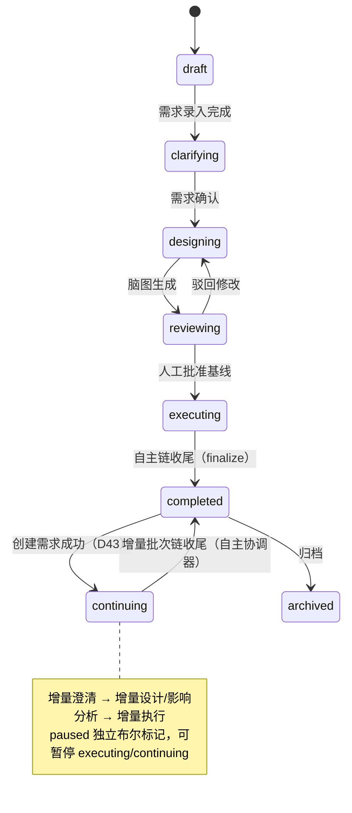

# EzTest 系统整体设计蓝图（v2.4 · P8 同步）

> **文档性质**：本轮设计会话的**主交付物**。用于多阶段迭代开发的唯一"总设计稿"；详细实现规格按阶段拆出，但本蓝图定义系统边界、架构、领域模型、Agent 体系、生命周期、数据/API 轮廓、前端形态、非功能要求与迭代路线。
> **配套详细设计**：`frontend-design.md`（前端细节）、`code-intelligence.md`（本地 Git 代码仓/影响分析）、`auth-session-model.md`（账号/会话/权限观测）；`system-overview.md` v1.1 为早期版本，内容已并入本文。
> **技术假设**：Go 后端 + PostgreSQL + Next.js 前端；Playwright 执行器；SSE 实时流；单机 Docker 优先；LLM 多模态。
> **合规**：借鉴 ARTEX 的设计思想（双图、事件驱动、探索链路、实时执行视图、人环干预），**不复制其源码**（AGPL-3.0）。

---

## 0. 文档地图与阅读顺序

| 顺序 | 文档 | 内容 | 读者 |
|---|---|---|---|
| 1 | **本文（蓝图）** | 产品/架构/领域/Agent/生命周期/数据API轮廓/前端/非功能/路线图 | 所有人 |
| 2 | `code-intelligence.md` | 本地 Git 代码仓、代码图、diff、影响分析 | 后端/Agent/前端 |
| 3 | `frontend-design.md` | 页面/交互/实时协议/组件 | 前端 |
| 4 | `auth-session-model.md` | 账号/Access/Session/权限快照/人工接管 | 后端/前端 |
| 5 | 阶段规格（迭代中产出） | 每个 Phase 的接口/DDL/任务拆解 | 开发者 |

**术语**：版本（Version，一次迭代/发布范围）、需求（Requirement，版本下多条且有关联）、用例（Case）、批次（Batch，一次执行轮次）、继续中（continuing，硬状态）、脑图（用例图）、探索链路（需求→用例→结果→问题 的血缘图）、证据（Evidence，不可变）、问题（Issue/Defect）、代码锚点（case/issue ↔ 代码位置）。

---

## 1. 产品定义

### 1.1 定位

> **AI 全自主端到端功能测试系统（Web + API）**：输入一个版本（含多个相互关联的需求）→ AI 引导澄清 → 生成用例脑图 → 人工评审一次 → AI 全自主执行（执行中自主补全场景、发现遗漏）→ 输出问题清单、版本报告与可交付脑图。人只在必要节点参与。

### 1.2 用户与场景

- **用户**：开发（自测）、测试（正式功能测试）；系统不区分场景，功能对两者通用。
- **管理员（唯一）**：配置公共资源（系统/环境/账号/Session、本地 Git 代码仓）、Agent 配置、LLM、用户。
- **普通用户**：创建版本/需求、回答澄清、评审脑图、发起执行/暂停/新增需求、查看问题与报告。
- 所有产出面向开发/测试：用例脑图、执行结果、证据、问题单、版本报告。

### 1.3 范围（In Scope）

1. **版本级多需求澄清**：一个版本多条需求，需求之间可能有依赖/冲突/重叠/共享范围；AI 引导式澄清（头脑风暴式追问）。
2. **用例脑图**：基于需求 + 本地代码现状 + 应用模型生成；人评审一次形成基线；执行中 AI 可补全并回填。
3. **AI 全自主执行**：Web UI + HTTP API 功能测试；登录/Session 自动获取；数据准备；断言；截图/报文取证；失败分类；自主补全场景。
4. **暂停/恢复**：优雅暂停 + 立即暂停；步骤检查点续跑。
5. **完成后新增需求 → 继续中（硬状态）**：增量澄清 → 增量设计/影响分析 → 增量执行 → 新批次报告。
6. **代码关键资产**：本地 Git 仓库索引、代码图、变更 diff、代码级影响分析（选回归/增量用例），代码锚点进入用例/问题/报告。
7. **交付物**：问题清单、版本报告（按批次）、用例脑图（可导出）、证据链。
8. **实时执行视图**：ARTEX 级可观察/可干预/可回放（探索链路、多 Agent 会话、实时播报、证据）。

### 1.4 非目标（Out of Scope）

- 性能测试、安全测试、移动端/小程序/桌面端。
- 线上代码仓（GitHub/GitLab 等 API）接入；只认管理员配置的**本地 Git 仓库**。
- **不限定被测项目语言/技术栈**，不做语言白名单/解析器门槛（AI 代码理解为主，**不设计 parser**）。
- CI/工单/IM 集成、环境编排、多级审批、LLM 池/熔断/成本看板、多租户/复杂 RBAC。
- 代码修改、构建、单测平台、函数级覆盖率。
- 复杂缺陷生命周期（triage/retest 状态机）；问题清单保持轻量。

### 1.5 关键约束

- 单管理员 + 普通用户；公共资源共享。
- LLM 网关极简：模型/地址/Key/自定义请求头/重试次数/重试间隔/默认多模态。
- 代码仓只读挂载；固定分支；不联网。
- Web + API 功能测试；桌面浏览器优先（Chromium）。

---

## 2. 核心链路与用户旅程

### 2.1 核心链路

```text
版本 + 多需求（文本/文档/截图）
  → 澄清（多轮，人参与）→ 需求图 + 关系 + 决策
  → 本地 Git 代码索引（代码图/commit 基线）+ 应用探索（应用模型）
  → 用例脑图（基于需求 + 代码现状）→ AI 自审 → ★人评审脑图（唯一强制关卡）
  → 全自主执行（批次）：
       执行用例 → 结果/证据 → 失败分析（分类/重跑/问题）
                   └→ 补全分析（覆盖缺口/遗漏）→ 新增用例 → 回填脑图 → 继续执行
  → 问题整理 → 版本报告 + 脑图导出 →（知识沉淀）
  → 完成后新增需求 → 继续中（硬状态；增量批次；代码 diff + 需求关系影响分析）→ …
```

### 2.2 旅程 A：新版本

1. 用户创建版本，录入多条需求（可上传 PRD/截图）。
2. AI 澄清：歧义、验收标准、范围、约束、需求间关系；人回答；需求确认。
3. AI 索引本地代码仓、探索应用（页面/接口），生成脑图 → 人评审/编辑 → 批准。
4. AI 全自主执行（Batch 1）：实时可见每步；AI 补全场景；产出结果、证据、问题。
5. 完成后查看版本报告（含需求覆盖、用例结果、问题、commit、证据）。

### 2.3 旅程 B：暂停/恢复

- 执行中 → 暂停（优雅：当前步骤后停；立即：中断当前步骤，用例 `interrupted`）→ 查看现场 → 恢复：从检查点续跑。

### 2.4 旅程 C：完成后新增需求（继续中）

- 已完成版本 → 新增需求（可多条）→ 状态变 `continuing`（硬状态）→ 增量澄清 → 增量脑图 + 影响分析（代码 diff + 需求关系 + 锚点）→ 默认自动执行增量批次（新增 + 受影响用例）→ 完成，报告出现 Batch N 与差异。

### 2.5 旅程 D：例外人工介入

- 登录 2FA/验证码 → 人工接管卡 → 完成后自动继续。
- 需求矛盾/关键信息缺失/范围外高危/必须决策 → 编排 Agent 打包上下文升级给人 → 人决策后继续。

---

## 3. 设计原则与决策记录

### 3.1 原则

1. **Agent 是核心资产**：13 个逻辑角色的感知/理解/规划/执行/记忆/自校验/协作/治理能力不简化；平台围绕 Agent 简化。
2. **最小人工参与**：4 个人工点（澄清、脑图评审、登录接管、报告阅读）+ 4 类升级；其余全自主。
3. **AI 自证**：通过/失败/问题必须绑定步骤与证据；无证据只能"待确认"。
4. **自主补全**：执行不止于基线，AI 持续分析覆盖缺口并补用例。
5. **代码是关键资产**：本地 Git 为唯一真源；设计读代码、影响分析按代码 diff 选用例、问题可定位代码。
6. **共享黑板**：Agent 通过结构化黑板协作（需求图/脑图/应用模型/代码图/执行证据/问题/知识）。
7. **可复现**：每批次绑定 `base_commit → head_commit`；用例/证据/问题/报告均可回溯。
8. **可观察/可干预/可回放**：前端不简化。
9. **平台简化**：账号/LLM/集成/部署尽量少。
10. **质量口径**：需求验收覆盖 + 用例结果 + 问题有效率 + 证据完整率。

### 3.2 决策记录（Decision Log）

| # | 决策 |
|---|---|
| D1 | 13 个 Agent 逻辑角色；职责不合并，部署可合并 |
| D2 | 管理员可配置 Agent（提示词/工具/模型/技能）；普通用户只选版本与资源 |
| D3 | 执行中 AI 可补用例并回填脑图（`ai_supplement`）；不改基线；需求缺失升级给人 |
| D4 | 知识沉淀（实施 P8 起步；版本内复用 + 人工审核入库） |
| D5 | 基线脑图评审一次；AI 补充用例自动并入；**增量脑图默认不评审** |
| D6 | 失败分析 + 问题整理默认直出问题单（置信度标注），人可修正 |
| D7 | 多模态：需求理解 + 执行取证必须；视觉断言（实施 P8） |
| D8 | Agent 评测（实施 P8；覆盖率/误报率/补充命中率） |
| D9 | 应用探索可主动爬取/枚举（只读，环境白名单） |
| D10 | 人工升级仅四类（需求矛盾/登录/范围外高危/必须决策） |
| D11 | 前端不简化（ARTEX 级） |
| D12 | 暂停/恢复 + 完成后新增需求 → 继续中 + 批次报告 |
| D13 | 仅 Web + API 功能测试 |
| D14 | 平台简化（单管理员/公共资源/极简 LLM/无多租户/无 CI/工单/环境编排） |
| D15 | **继续中 = 硬状态 `continuing`**；`paused` 为独立布尔标记；`continue_phase` 表示增量子阶段 |
| D16 | **允许立即暂停**（中断当前步骤，用例 `interrupted`） |
| D17 | **本地 Git 代码仓为代码现状唯一真源**；影响分析 = 代码 diff + 需求关系 + 应用模型锚点 |
| D18 | 前端首版 Tab（跨实施阶段交付，见 D25）：总览/执行会话/探索链路/实时播报/结果与证据/问题/报告/代码与变更 |
| D19 | **语言无关**：系统不限定被测项目语言/技术栈，不设白名单；AI 代码理解为主；**不设计 parser/静态语言解析器**；T0 通用 Git 层确定性兜底 |
| D20 | 支持**一仓库多项目（monorepo）**；实施 P4 支持多目录文件级，路由/接口映射按子项目配置演进 |
| D21 | **固定分支**；版本/批次只记录 commit，不切换分支、不改工作树 |
| D22 | **代码仓只读挂载**；仅只读 git 访问 |
| D23 | 执行期间代码变更属低频：**不自动打断**；检测到 head 变化提示"代码有更新"，由用户决定是否开新批次 |
| D24 | 代码全文检索为后续增强；实施 P4 只做路径/符号/路由/接口查询 + 按需读片段 |
| D25 | **阶段编号唯一化与前端交付归属**：`implementation-phases.md` 独占 P0–P8；其他详细设计的局部里程碑改用 `CI-Mx`（代码智能）、`AS-Mx`（账号会话）等独立前缀，不得复用 P0–P8。D18 的 8 个版本详情 Tab 是前端首版目标形态，按实施阶段 P3（容器/总览/需求与澄清）、P4（代码与变更）、P6（执行类 Tab）、P7（问题/报告）交付；实施 P0 只做平台地基与最小设置页（用户/LLM），不含版本/需求/用例等领域实体。 |
| D26 | **仓库结构与 DDD 边界**：采用 ARTEX 式按能力分包 + 每个限界上下文 DDD 四层（domain/application/infrastructure/interfaces/httpapi）；`cmd/eztest` 为唯一组装根；导入方向、迁移命名、前端目录与 ARTEX 合规边界见 `Agent.md` §6。 |
| D27 | P1 内置的「诊断 Agent」= **运行时验证夹具**（key=`runtime-diagnostic`），不进入 §6.1 十三角色；提示词/模型/思考强度/预算/工具白名单管理员可配；工具仅只读白名单（文件只读、HTTP 只读、测试工具）；活动事件统一为 `agent.activity`（`detail.kind` 区分 run_started/user_message/thinking/text/tool_use/tool_result/usage/decision/run_finished）；`agent_messages` 为 LLM 上下文权威来源，`events` 为其 UI 投影；P2 起由业务 Agent 替换，不改变运行时契约。 |
| D28 | **P2 公共资源与身份：单 `resource` 上下文、明文存储、无审计/加密**。P2 新增 `resource` 限界上下文，承载 System/Environment/AppModel/Account/Access/Session/Snapshot/Lease/Takeover/LocalGitRepo；单公司种子，不做公司 CRUD。被测系统凭据（`account_system_accesses.credential`）与 Session 状态（`sessions.storage_state`）**明文存储**；P2 不实现加密、脱敏、审计（不写 `audit_logs`，不建 `session_events`/`secrets`/`session_blobs`）。Session 状态采用 auth-session-model 完整枚举 + 派生 `expiring`；快照表名 `session_snapshots`；API 统一 `/api/resources/*`；`System.kind` 仅 `web\|api`。P2 不做自动登录、ProbeRecipe、代码索引、Session 执行注入。理由：内部工具场景，被测系统凭据非生产秘密；先交付资源管理闭环，安全能力在需要时再引入。 |
| D29 | **全项目主键统一雪花 ID**：自 P3 起所有新增实体/表的主键使用 64-bit 雪花 ID（41bit 毫秒 + 10bit 节点 + 12bit 序列），由 `platform/id` 在应用层生成；**禁止新增 `BIGSERIAL`/自增主键**。64-bit ID 在 JSON/工具参数/URL 中一律十进制字符串（避免 JS 精度丢失）；节点 ID 由 `EZTEST_SNOWFLAKE_NODE_ID` 配置（0–1023，单实例默认 1）。既有 P0–P2 的 `BIGSERIAL` 表不回溯改造；如需统一，单独立项迁移并记录 D#。 |
| D30 | **全项目文件存储走文件系统**：业务附件与用户文件（需求附件、证据、截图、导出等）统一文件系统存储，**禁止二进制（含 base64/data URL）写入 PostgreSQL**；禁止新增对 P0 `storage` 内容寻址对象存储的依赖（该上下文冻结为既有能力/历史兼容，例外须记录 D#）。文件根目录可配置，路径由应用生成并做根内校验、拒绝 `..`/绝对路径/symlink 逃逸、文件名清洗、临时文件 + 原子 rename、文件 0600/目录 0700、大小/数量上限；删除采用 DB 元数据 + best-effort 文件删除，孤儿由 GC/保留策略处理。 |
| D31 | P3 版本/多需求/澄清采用「Version 粗粒度容器 + Requirement 独立流水线」。新增/确认/重开需求**永不**改变或回退 `Version.status`；P3 只实现 `draft→clarifying→designing` 与 `Requirement draft→clarified`；`designing` 下仍可独立澄清/确认需求。版本「进入设计」允许带未澄清需求，但需 `acknowledgeUnclarified` 二次确认。新需求重新走「澄清→设计→评审→执行」；执行中的批次不因新增需求中断，受影响用例由 P7 的 AI 补全/修改（D3/D17）。P3 新增 `version` 上下文 7 表（versions/requirements/requirement_relations/requirement_attachments/clarification_sessions/clarification_questions/decisions）与 `agent_0002_activity_channel`；主键遵循 D29 雪花 ID（JSON 字符串序列化）；澄清 SSE 走 `version:{id}` 通道，Agent 会话可选 `activity_channel`（默认 `agent:{session_id}` 不变）。所有登录用户可写版本域；附件支持文本+截图并遵循 D30 文件系统存储，截图以 `image_ref` 注入、data URL 仅 LLM 调用瞬态生成，PDF/DOCX 不做。P3 不实现 P4/P5/P6/P7 能力。 |
| D32 | **D32 P4 代码理解与影响分析 v1**：新增 `codeintel` 限界上下文（DDD 四层，`Agent.md` §6.1 登记），复用 P2 `code_repositories`（BIGSERIAL，API number），新增 9 表（雪花 ID：`code_change_sets`/`code_index_runs`/`code_entities`/`code_edges`/`code_fact_versions`/`code_analysis_cache`/`code_analyses`/`code_impact_candidates`/`code_anchors`），`repo_id`/`version_id`/`requirement_id`/`app_model_id` 均为逻辑引用、不建跨上下文 FK。T0 只读 Git 文件级能力（tree/blob hash/文件级 diff/按需 unified diff/行读取/commit/HEAD；不含 parser）；T1 服务化：应用服务直调 P0 LLM 网关（chat 协议 + JSON 提示词 + 严格解析 + 证据校验），异步 run（202/轮询/SSE；单实例进程内 worker，默认并发 1）；**不新增 Agent profile**，仅注册 `code_*` 只读工具薄壳（P3 `code.tree`/`code.read` 契约不变）。证据必须为 `path + start/end line + 摘录 sha256`，按 **commit 内容**校验；失败降为 low 线索，不参与自动影响。影响分析 v1 输出受影响**需求/应用模型**与 `unmapped_changes`；`affected.cases` 结构保留、P5 接入（P4 无 case/issue 实体）。跨栈契约存 `code_edges.rel='route_to_api'`（method + 归一化 path）。API 为 `/api/code/*`（仓库级）与 `/api/versions/{id}/code/*`（版本级）；仓库配置/索引 admin，其余登录用户。版本分析完成发 `code.changed`/`code.impact_computed`（`version:{id}`，仅摘要）。AI 不可用 → `done + degraded`，T0-only，HTTP 2xx 不阻塞。明确不做 parser/符号级/字段级分析、用例锚点实体、批次、全仓 AI 分析、线上仓、monorepo 子项目配置。 |
| D33 | **D33 P4 缓存与版本化**：文件级分析缓存键 = `(repo, commit, path, file_hash, model, prompt_version)`（file_hash 为 `git-sha1:<40hex>` 或内容 `sha256:<hex>`）；命中不调 LLM。事实按 `fact_key` 版本化：`code_fact_versions` 保存历史，body 语义相同则复用，不同则 `version+1` 并写旧版 `superseded_at`；`code_entities` 仅保存当前版本。影响分析同 `(version, base, head, model, prompt_version, fact 版本集)` 默认复用（`reused=true`）；`force` 或模型/提示词变化新建 `analysis_version`，不覆盖旧记录。候选集合/顺序/默认勾选确定性：source 优先级 direct > contract > relation > ai，再按 confidence、subject kind/id；low 默认不选中但可人工选中。证据摘录哈希 `sha256`，按 commit 内容复算；同 commit 重跑影响结果一致。P4 不提供事实人工修正与版本对比 UI（CI-M1）。 |
| D34 | **D34（数据库命名规约）**：全项目表名/索引名遵循阿里《Java 开发手册》数据库规约并做 PostgreSQL 适配——表名单数、小写+下划线、禁保留字、推荐 `业务_作用`；索引 `pk_<表>/uk_<表>_<列>/idx_<表>_<列>`；P5 起新表沿用 `created_at/updated_at`（对“id/gmt_create/gmt_modified 三字段”的显式例外）；历史表以新增 rename 迁移改名，字段/约束/既有索引名不变，`schema_migrations` 为框架表例外；规约同步 `Agent.md` §6.9 与蓝图 §10.2。 |
| D35 | **D35（P5 用例脑图与评审）**：新增 `mindmap` 限界上下文（`Agent.md` §6.1 登记）与 9 张 `case_*` 表；树/步骤/断言/来源/评审/基线/run/导出模型按本规格 §5–§7；状态流转 `designing→reviewing→executing`，驳回回 `designing`，基线冻结后只读且只评审一次（D5）；4 个 Agent 采用"P1 运行时 + 单一结构化提交工具 + 服务端校验单事务物化"，不新增配置面；评审 blocker 批准需显式确认；导出见 D38；`affected.cases` 在 P5 只读映射，正式接入归 P6/P7。 |
| D36 | **D36（应用探索边界）**：应用探索仅 HTTP 只读（GET/HEAD）、环境白名单、请求/深度/超时上限、跳过状态变更链接；管理员触发；产物 `app_model_nodes.source='explored'`（扩宽 CHECK + `AppModelInput.Source`）；LLM 不可用时确定性 BFS 降级；浏览器探索与 Session 注入归 P6。 |
| D37 | **D37（锚点主体扩展 case）**：`code_anchors.subject_kind` 扩宽至含 `case`；P4 规格中"case 预留"正式接入；不改既有字段/唯一索引/其他主体行为；锚点经 codeintel `AnchorService` 创建/删除，由 mindmap 调用。 |
| D38 | **D38（脑图导出）**：服务端 Markdown/Mermaid/OPML 三格式落文件系统（D30）+ sha256 + 元数据；PNG 由前端对 SVG 画布光栅化下载（不入库）；关闭蓝图 §17.4（XMind 非必需，OPML 为通用导入格式）。 |
| D39 | **D39（P6 执行引擎与证据）**：新增 `execution` 限界上下文与 6 表（`run_batch`/`case_run`/`step_result`/`assertion_result`/`evidence`/`evidence_ref`，雪花 ID D29）；执行 = 确定性引擎 + 执行 Agent 单一结构化提交 + 服务端校验；批次绑定冻结基线哈希与 commit，单版本单活跃批次；`paused` 独立布尔，优雅/立即暂停、步骤检查点、interrupted cleanup/seed、重启不自动拉起；四态 passed/failed/blocked/inconclusive（+skipped/interrupted 过程态）与失败分类 v1；证据文件系统（D30）+ sha256 + 不可变；Batch 1 报告派生不建表。P6 不做 AI 补全/失败分析/问题/完整报告/继续中/视觉断言；DB 断言（只读）归 P7。 |
| D40 | **D40（浏览器执行器）**：Playwright 浏览器由独立 Node 长驻执行器（A′）承担，Go 通过 `BrowserExecutor` 接口以类型化 HTTP/JSON 调用；执行器不访问业务 DB，只做 context/动作/产物；API 镜像不装 Node/Chromium；执行器钉 Playwright 1.64.x、独立容器与官方镜像；每用例一个 context、Session storageState 服务端注入、`allowed_hosts` 在路由层强制、动作级取消/超时。 |
| D41 | **D41（Session 补齐）**：P6 新增 `auth_flow`（kind=form，最小配方：登录 URL/账号密码提交选择器/成功与失败判定）与 `account_system_access.login_flow_id`；自动登录仅 password，单飞、成功后写 storageState（含 sessionStorage）并 login_check；失效同用例重取一次；MFA/验证码/审批转人工接管（表单 A：导入 storageState，复用 P2 接口，完成后自动继续）；凭据/存储态仍明文（D28），但事件/日志/证据/前端不展示。 |
| D42 | **D42（事件与表复用）**：`RunEvent` 复用 P0 `event` 表（已含 batch_id/case_id/step_id/refs.evidence），不新增 `run_event`；`StepRun` 折叠为 `step_result`（pending/running/passed/failed/interrupted）；Batch 1 报告由批次/用例/证据派生并流式导出，`report/report_ref/revision/stale` 归 P7；前端新增「登录配方配置」并登记到 `implementation-phases` §2.9 P6 行。 |

> **P7 决策记录（D43–D52，原文照抄 P7 设计规格 §2）**

| D# | 决策 | 理由 | 代价/约束 |
|---|---|---|---|
| **D43** | `completed` 版本上 **创建需求成功即自动进入 `continuing`**：同事务置 `status=continuing`、`continue_phase=clarifying`、`continued_at=now()`，发布 `version.status_changed`。这是 D31"需求操作不改 Version.status"的**唯一例外**；确认/重开需求仍不改状态。`batch_no` 只在建批时分配，不在进入继续中时自增。`continuing→completed` 由自主协调器在增量批次链结束后触发。 | 同时满足前端旅程 C 与 D31 的主语义；状态变更可追溯、可幂等。 | D31 需新增例外说明；需求创建路径必须与版本状态同事务；并发创建需求只允许一次状态迁移。 |
| **D44** | **基线永久只读 + 受控叠加层**：`case_baseline` 行、`graph_hash`、冻结节点内容不可改；P7 只开两条写路径：① 追加 `source=ai_supplement` 的新节点（含步骤/断言/来源）；② 仅状态迁移 `supplemented→merged/rejected`、`reviewed→needs_revalidation`、`merged/needs_revalidation→executed`。冻结节点的内容编辑仍 409 `baseline_frozen`。`case_run.source`、快照 `origin`、`run_batch.graph_hash` 记录来源与当前工作图哈希。 | 保留 P5 冻结语义与基线可审计；补全可回填且不破坏历史。 | 需要新的受控 GraphService 方法；所有旧测试中"冻结即全部 409"的断言需按两条例外更新。 |
| **D45** | **链式批次**：`run_batch.kind ∈ {baseline, incremental, supplement}`，`parent_batch_id`；不修改在飞批次；基线批终态后自动跑补全分析，产出新用例后自动创建紧随的 supplement 批；`continuing` 下的批为 incremental。单版本单活跃批次不变；版本完成由自主协调器在"分析→问题→报告→补全→补充批"链结束后判定，取代 P6 的无条件 `CompleteExecution`。每批最多 1 个补全周期、每周期最多 5 条新用例。 | 避免在飞批次追加导致的计数/快照/报告不变量破坏；"继续执行"用紧随批次实现，基线执行不被阻塞。 | P6 scheduler 完成路径、批次门禁、Version 完成时机均需改造；P6 的"批次完成即版本完成"测试需更新。 |
| **D46** | **每批一报告 + Revision**：`report` 按 `(batch_id, revision)` 唯一；分析终态后自动生成并发布 revision 1；读取时用 `input_fingerprint` 判断 stale；重新生成 → revision+1；支持批次差异与 Markdown 导出。P6 的 `GET /batches/{id}/report` 派生端点保持原样，P7 新增版本级报告 API。`version_change` 不建表，`/changes` 由需求/批次/报告/问题读时派生（P8 再建表）。 | 报告可复现、可追溯、不破坏 P6 契约；差异按报告快照计算。 | 需新增报告文件存储根与 stale 计算；P6 报告与 P7 报告并存，前端 P7 使用新端点。 |
| **D47** | **Issue 模型**：`issue` + `issue_ref`；状态 `open→confirmed/dismissed`（终态，不重开）；AI 只为 `failed(application)` 与需求缺口建单，环境/会话/模型/用例失败不生成缺陷；AI 单按 `sha256(version\|caseNode\|failureClass\|normalizedReason)` 去重；任意登录用户可确认/驳回，驳回必填原因；`code_anchor(subject_kind='issue')` 由服务端验证 `file:line` 后创建。 | 问题必须可追溯、可去重、不误报环境问题；权限与 P3 版本域一致。 | 重复失败只追加引用/复发计数，不重开已驳回单；跨批次语义合并依赖问题整理 Agent，服务端仍做硬去重。 |
| **D48** | **DB 断言目标库**：环境级 `db_target`（一环境一目标），admin-only；**密码明文存储**（D28 同类例外，admin-only、API 永不回显、不进入 prompt/事件/日志/证据）；仅 PostgreSQL；Go API 侧执行，只读事务 + 仅 SELECT/WITH/SHOW/EXPLAIN + 单语句 + 超时/行数/字节上限；结果落 `db_result` 证据；连接/权限失败 → `blocked(environment)`，SQL/只读/截断错误 → `inconclusive(case)`，绝不判应用缺陷。 | 复用本机 PG 与 D28 的明文存储惯例；只读由事务+角色+语句三层强制；执行器不接触业务 DB（D40）。 | 明文凭据是安全风险点，必须在 admin 权限、日志/事件/证据脱敏、UI 不回显上严格约束；只支持 PostgreSQL。 |
| **D49** | **增量影响 base**：增量批 base = 上一终态批的 `head_commit`（无历史批用版本 `code_baseline_commit`）；head = 建批时固定分支 HEAD；若上一批 head 不是当前 head 的祖先（rebase/强推），回退版本基线并在批次/报告标 `history_rewritten`。P4 影响分析请求新增可选 `baseCommit`（默认版本基线），缓存/唯一键包含 base。 | 只分析上次已测以来的新变更，避免增量批越跑越宽；非祖先时安全回退。 | 需改 P4 分析服务/HTTP 请求；批次需记录 `base/head` 与回退标记。 |
| **D50** | `version_change` 表 P7 不建；`GET /api/versions/{id}/changes` 由需求创建时间、批次、报告、问题读时派生；建表与事件回放留 P8。 | 避免无明确字段的表；P7 前端只需要变更列表/时间线。 | `/changes` 无持久快照，历史时点不可复现（P8 补）。 |
| **D51** | **3 个 LLM Profile + 确定性交付**：`supplement-agent`（覆盖缺口 + 增量设计/AI 受影响用例）、`failure-analysis-agent`、`issue-triage-agent`；报告由确定性服务生成。AI 不可用时：分析/补全 marked degraded，受影响用例降级为 `case_source` 确定性映射，批次仍按基线执行。所有 Agent run 预算 MaxTurns 20 / 600s；每批最多 3 个分析类 run。 | 用户确认 3 Agent 方案；报告可复现；AI 失败不拖垮主流程。 | 新增 3 个 profile/工具/run 表；issue 文本来自 LLM，落库/去重/锚点仍服务端校验。 |
| **D52** | **权限/审计/事件**：版本域写操作（问题确认/驳回、报告生成/导出、增量设计触发、补全批）任意登录用户；DB 目标配置 admin；审计动作 `delivery.issue.created/confirmed/dismissed`、`delivery.report.published/exported`、`delivery.analysis.started/finished`、`resource.db_target.upserted/tested`、`version.continued/completed`；新增事件 ID 一律十进制字符串；新增原因码以 §7.11 为准。 | 与 P3/P5/P6 的版本域权限一致；审计可追溯；避免 JS 精度问题。 | 不审计凭据/SQL 结果/证据正文/prompt；全局问题/报告中心只读。 |

---

## 4. 总体架构

### 4.1 分层架构

```text
┌─────────────────────────────────────────────────────────────────────────────┐
│ 前端（Next.js）：版本列表/工作台 · 版本详情(多 Tab) · 用例脑图 ·            │
│   执行实时视图 · 问题/报告 · 代码与变更 · 公共资源 · Agent 中心 · 设置       │
└───────────────────────────────┬─────────────────────────────────────────────┘
                                │ REST + SSE（快照游标 + 事件流）
┌───────────────────────────────▼─────────────────────────────────────────────┐
│ API/服务层：版本/需求/脑图/执行/证据/问题/报告/资源/Agent 配置               │
│ 代码智能服务：本地 Git 索引 · 代码图 · 变更 diff · 影响分析                   │
├─────────────────────────────────────────────────────────────────────────────┤
│ 编排 Agent（阶段推进/任务分派/人工关卡/预算/升级）                           │
├───────────────┬───────────────────┬───────────────────┬─────────────────────┤
│ 澄清团队       │ 设计团队           │ 执行团队           │ 交付团队             │
│ 澄清对话       │ 应用探索           │ 执行 Agent×N       │ 失败分析/分诊        │
│ 需求分析       │ 测试设计           │ 探索/补全          │ 问题整理             │
│ 上下文侦察     │ 设计评审           │                    │ 报告生成             │
│               │ 数据/前置规划       │                    │ 知识沉淀(P8)         │
├───────────────┴───────────────────┴───────────────────┴─────────────────────┤
│ 共享黑板：版本需求图 · 用例脑图 · 应用模型图 · 代码图/变更 · 执行/证据 ·     │
│           决策/反馈 · 知识库                                                  │
├─────────────────────────────────────────────────────────────────────────────┤
│ Agent 运行时：会话/记忆/压缩 · 工具(Playwright/HTTP/DB/截图/代码检索/MCP/技能)│
│ 规划重规划 · 自校验 · 多模态 · 协作消息/交接 · 预算收尾 · 活动流/回放        │
├─────────────────────────────────────────────────────────────────────────────┤
│ 支撑平台：公共资源 · 单管理员+用户 · 极简 LLM · PostgreSQL+证据存储 · 日志   │
└─────────────────────────────────────────────────────────────────────────────┘
外部：被测系统(Web/API) · 本地 Git 代码仓（只读挂载）· LLM 供应商
```

### 4.2 部署形态

- 单机 Docker Compose：EzTest 服务 + PostgreSQL + 执行器（Playwright/Chromium）。
- **本地 Git 仓库只读挂载**进容器（如 `-v /data/repos:/repos:ro`）；管理员配置路径/分支/排除规则。
- 被测系统为外部已登记环境（不负责编排/部署被测系统）。
- 执行器可横向扩展（实施 P6 之后）；首版单机内多 worker 进程/协程。

### 4.3 技术选型（建议）

| 层 | 选择 |
|---|---|
| 后端 | Go（net/http，统一 JSON API） |
| 前端 | Next.js + React + Tailwind + 组件库；React Flow 承载图 |
| 存储 | PostgreSQL（业务/图/执行/会话/审计）+ 文件系统（业务附件/证据/截图/导出；按上下文配置根目录，D30） |
| 执行 | Playwright（Chromium）+ HTTP 客户端 + DB 断言（只读连接，P7） |
| 实时 | SSE（快照游标 + seq 去重 + Last-Event-ID） |
| 代码理解 | 只读 git CLI（T0）+ AI 代码理解（语言无关，T1）；**不设计 parser** |
| LLM | 极简网关：多模态、重试次数/间隔、自定义请求头 |

### 4.4 模块边界（8 域 + 1 服务）

M1 资源域（系统/环境/应用模型/代码仓/账号/Session 公共资源管理）
M2 版本与需求域（版本、多需求、关系、澄清会话、决策）
M3 用例与脑图域（用例图、步骤/断言、评审、AI 补充、导出）
M4 执行域（批次/运行/用例执行/暂停/检查点/失败分类/补全循环）
M5 证据与结果域（步骤结果、不可变证据、四态判定）
M6 问题与报告域（问题清单、报告版本、批次差异、导出）
M7 代码智能服务（索引/代码图/diff/影响分析）
M8 平台域（用户/管理员、LLM、Agent 配置、审计、部署、备份）
M9 前端（见第 12 章）

---

## 5. 领域模型

### 5.1 资源域（公共资源，管理员配置）

```text
Company（单公司/单租户，可简化）─< System ─< Environment
                                        └─< AppModel(page/route/api/component)
CodeRepository（本地 Git 路径/分支/排除规则）─< CodeEntity / CodeChangeSet
Account ─< AccountSystemAccess ─< Session ─< PermissionSnapshot
```

> P2（D28）资源域固定 11 表：`companies / systems / environments / app_model_nodes / accounts / account_system_accesses / sessions / session_snapshots / session_leases / manual_takeovers / code_repositories`；不建 `secrets` / `session_blobs` / `session_events`，凭据与 storageState 明文存储。

### 5.2 验证域（版本工作区）

```text
Version（status/paused/batch_no/continue_phase）
 ├─< Requirement × N ─< RequirementRelation（依赖/冲突/重叠/共享范围）
 │        └─< ClarificationSession / Decision
 └─< CaseGraph（脑图）─< CaseNode ─< Step / Assertion
          └─ source: user_input / ai_generated / ai_supplement（回填）
```

> P5（D35）细化：`CaseGraph` = `case_node` 树，`kind ∈ {scenario, case}`（`scenario` 最多嵌套 2 层，`case` 为叶子）；每个 `case` 下挂 `case_step`（action/expected/data，seq 从 1 连续）与 `case_assertion`（ui/api/db/text）；来源存 `case_source`（`requirement/app_model/ai_run/manual`，需求来源必须属于本版本且 `clarified`）；`CaseNode.status` 在 P5 只实现 `draft→reviewed`（批准冻结），`executed`/`supplemented`/`merged`/`rejected`/`needs_revalidation` 为 P6/P7 预留；用例代码锚点复用 codeintel `code_anchor(subject_kind='case')`（D37）。

### 5.3 执行与交付域

```text
RunBatch（batch_no, kind, parent_batch_id, base_commit, head_commit）─< CaseRun ─< StepResult ─< Evidence
                                                    └─< Issue ─< IssueRef
Version ─< Report（按批次 Revision，可 stale）─< ReportRef
Version ─< AnalysisRun（failure / issue_triage）
Version ─< VersionChange（读时派生；P7 不建表，D50）
```

> P6（D39/D42）细化：执行与交付域已落地 `execution` 上下文 6 表 `run_batch / case_run / step_result / assertion_result / evidence / evidence_ref`；`RunBatch.status ∈ {planned,running,done,failed,cancelled}` 且 `paused/pause_mode` 独立于 status；`CaseRun.status` 8 值（四态 passed/failed/blocked/inconclusive + pending/running/skipped/interrupted），`failure_class ∈ {application,environment,session,model,case}`（flaky 为派生展示，不落库）；`step_result.status` 5 值（pending/running/passed/failed/interrupted）；`case_snapshot` 建批后不可变。`RunEvent` 复用 P0 `event` 表（`batch_id/case_id/step_id/refs.evidence`），不新增 `run_event`；`StepRun` 折叠为 `step_result`。`Issue`/`Report` 实体与表不在 P6 落地，Batch 1 报告由批次/用例/证据派生并流式导出。

> P7（D43–D52）实现注记：新增 `delivery` 上下文 5 表 `issue / issue_ref / report / report_ref / analysis_run`；`resource` 追加 `db_target`；`version` 追加 `continue_phase / continued_at`；`execution.run_batch` 追加 `kind / parent_batch_id / base_fallback_reason / graph_hash / supplement_attempted / autonomy_done`，`case_run` 追加 `source`，`evidence.kind` 追加 `db_result`；`mindmap.case_design_run` 追加 `supplement / incremental_design` 两类 kind 与 `batch_id`；`codeintel.code_anchor.subject_kind` 放开 `issue`。`Issue.status ∈ {open,confirmed,dismissed}`（终态，不重开），`source ∈ {ai,human}`，`category ∈ {defect,requirement_gap,other}`，`severity ∈ {blocker,major,minor,info}`，`confidence ∈ {high,medium,low}`；AI 只为 `failed(application)` 与需求缺口建单。`Report.status ∈ {draft,published,stale}`，`(batch_id,revision)` 唯一，旧 revision 保留；`Report.content` 为确定性快照，`input_fingerprint` 覆盖批次终态计数、每用例最新 attempt 与关联/开放问题；报告 Markdown 落 `EZTEST_REPORT_DIR`（默认 `.data/reports`），DB 只存相对路径 + sha256 + size。`AnalysisRun.kind ∈ {failure,issue_triage}`、`status ∈ {queued,running,done,failed,degraded}`，同批同 kind 单活跃 run。`VersionChange` 仍不建表（D50），`/changes` 由需求/批次/报告/问题读时派生；`code_changed` 留 P8。

### 5.4 锚点（可追溯的最小关系）

- `需求/用例/问题 ↔ 应用模型（页面/路由/接口/组件）`
- `用例/问题 ↔ 代码实体（file:line / symbol / route / api）`
- `用例 ↔ 需求 / 代码 / 应用模型（P5/D37）`：用例经 `case_source` 关联已确认需求与应用模型节点，经 codeintel `code_anchor(subject_kind='case')` 关联 `file:line` / route / api；删除用例时同步清理其锚点。
- `问题 ↔ 用例 / 证据 / 代码（P7/D47）`：`issue_ref` 指向 `case_run / case_node / step_result / evidence / requirement / batch / commit`；`code_anchor(subject_kind='issue')` 由服务端校验 `file:line` 与问题归属后创建，列表失败降级为空数组，不阻断问题查询。
- `API 契约：前端调用点 ↔ 后端接口端点（method + 归一化 path）`
- `证据 ↔ 用例步骤/问题/代码位置`
- `报告 ↔ 批次/用例/问题/证据/commit + report_ref（P7/D46）`

### 5.5 核心状态机

| 对象 | 状态 |
|---|---|
| Version.status | draft / clarifying / designing / reviewing / executing / **continuing** / completed / archived |
| Version 标志 | `paused`（bool）、`pause_mode`（graceful/immediate）、`batch_no`、`continue_phase`、`continued_at`、`code_baseline_commit` |
| Requirement | draft（候选）→ clarified（已确认）→ designed → verified / obsolete |
| CaseNode | draft → reviewed（基线）→ executed；AI 补充：supplemented → merged/rejected；受影响：needs_revalidation。P5 只实现 `draft→reviewed`（批准冻结）；P7 落地受控写路径 `supplemented→merged/rejected`、`reviewed→needs_revalidation`、`merged/needs_revalidation→executed`，冻结节点内容仍不可改 |
| RunBatch | planned → running → paused(标记) → done / failed / cancelled；`kind ∈ {baseline,incremental,supplement}`，supplement 必须有 parent |
| CaseRun | pending → running → passed / failed / blocked / inconclusive / skipped / interrupted；`source ∈ {baseline,ai_supplement}` |
| AnalysisRun | queued → running → done / failed / degraded（kind=failure / issue_triage，同批同 kind 单活跃） |
| Session | pending / acquiring / needs_manual / valid / refreshing / expired / invalid / revoked / failed；`expiring` 为派生值，不落库（详见 auth-session-model） |
| Issue | open → confirmed / dismissed（终态，不重开） |
| Report | draft → published → stale（证据/结论变更） |

> P6（D39）实现注记：`run_batch` 增加 `paused/pause_mode/pause_reason/baseline_hash/code_baseline_commit/head_commit` 与 `case_count/passed_count/failed_count/blocked_count/inconclusive_count/skipped_count/interrupted_count`；`case_run` 增加 `attempt/case_revision/case_hash/case_snapshot/session_id/session_snapshot_id/agent_session_id/agent_run_id/retry_of_case_run_id/cleanup_required/interrupted_step_seq`；`assertion_result.verdict ∈ {passed,failed,not_run}`；`evidence.kind ∈ {screenshot,http_exchange,console_log,network_log,download}`，`evidence_ref.ref_kind ∈ {step_result,assertion_result,case_run,batch,report,issue}`。版本侧只增 `paused/pause_mode/batch_no`（活跃批次不并入 Version DTO，由前端从批次列表合并）。

> P7（D43–D52）实现注记：`version` 追加 `continue_phase`（仅 `continuing` 时有值）与 `continued_at`；`run_batch` 追加 `kind/parent_batch_id/base_fallback_reason/graph_hash/supplement_attempted/autonomy_done`，`case_run` 追加 `source`，`evidence.kind` 追加 `db_result`，`case_node` 的 P7 状态迁移仅经受控 GraphService；`issue` 的状态/去重/引用与 `report` 的 revision/stale 见 §5.3。版本 DTO 兼容 P6 的 snake_case 字段 `paused/pause_mode/batch_no`，P7 新增 `continuePhase/continuedAt` 为 camelCase（前端统一经类型转换使用）。

### 5.6 版本生命周期（含暂停与继续中）



暂停语义：优雅暂停（当前步骤后停）或立即暂停（中断当前步骤，用例 `interrupted`）；恢复从步骤检查点续跑，interrupted 用例先 cleanup/seed。每批次记录 `base_commit → head_commit`，报告按批次生成 Revision。

> **P6 状态流注记**：`executing → completed` 只由批次完成触发，不由人工按钮驱动——批次内全部 `case_run` 进入终态、无等待中的人工接管、且批次未暂停时，调度器刷新计数并把 `run_batch` 置 `done`，随后经 `VersionPort.CompleteExecution` 将版本从 `executing` 置 `completed`；若版本已因并发操作离开 `executing`，批次仍完成但不强改版本状态。`paused` 是独立布尔标记，暂停不改变 `Version.status`。

> **D31 备注（P3 起）**：Version 状态是**粗粒度容器**，与需求流水线解耦——新增/确认/重开需求**永不**改变或回退 `Version.status`；`designing` 下仍可独立澄清/确认需求；新增需求不中断执行中的批次，受影响用例由 P7 的 AI 补全/修改（D3/D17）。P3 只实现 `draft→clarifying→designing` 与 `Requirement draft→clarified`。

> **P7 状态流注记（D43/D45/D49）**：`executing → completed` 不再由单批完成直接触发——批次终态后由自主协调器依次推进失败分析、问题整理、报告、补全/补充批，增量批次链收尾后经 `TryFinalize` 将 `executing/continuing` 置 `completed`；P6 的无条件 `CompleteExecution` 由该 finalize 取代。`completed → continuing` 是 **D31 的唯一例外**：仅在 `completed` 版本上“成功创建需求”时于同事务置 `continuing + continue_phase=clarifying + continued_at`，确认/重开需求仍不改状态；`batch_no` 只在建批时分配，进入继续中不自增。并发创建需求只允许一次状态迁移（幂等）。

---

## 6. Agent 体系（系统核心）

### 6.1 13 个逻辑角色

| 团队 | Agent | 核心使命 | 关键产出 |
|---|---|---|---|
| 澄清 | 澄清对话 | 版本级多需求引导式澄清、复述确认 | 结构化需求、问题清单、决策 |
| 澄清 | 需求分析 | 需求关系/冲突/可测性/验收完整性 | 需求关系图、可测性报告 |
| 澄清 | 上下文侦察 | 文档/截图/本地代码/OpenAPI 抽业务规则 | 上下文包、规则/术语 |
| 设计 | 应用探索 | 探索 Web/API 建应用模型 | 页面/路由/接口/组件模型 |
| 设计 | 测试设计 | 需求+关系+应用模型+代码现状 → 用例脑图 | 脑图、覆盖矩阵、优先级 |
| 设计 | 设计评审 | AI 自审：覆盖/断言/可执行性/重复 | 评审意见、待补清单 |
| 设计 | 数据/前置规划 | 数据/账号/Session 前置、seed/cleanup | 数据计划、前置条件 |
| 执行 | 执行 Agent×N | 执行单条用例、断言、取证、写回 | 步骤结果、证据、失败候选 |
| 执行 | 探索/补全 | 覆盖缺口/遗漏分析、补用例、回填脑图 | 补充用例、覆盖分析 |
| 执行 | 失败分析 | 根因分类、去重、置信度、重跑建议 | 失败分类、问题候选 |
| 交付 | 问题整理 | 整理可复现问题单（含代码位置） | 问题单 |
| 交付 | 报告 | 版本报告 + 脑图导出 + 批次差异 | 报告 |
| 交付 | 知识沉淀(P8) | 用例/问题模式/经验/技能沉淀 | 知识库 |
| 编排 | 编排 Agent | 阶段推进/任务分派/人工关卡/预算/升级 | 计划、任务分配、升级请求 |

部署可合并（同进程/同模型不同提示词），但职责、工具权限、I/O 契约分开。

**代码理解（语言无关）**：由 **AI 代码分析（子 Agent/工具）** 承担——按需读取变更/相关代码，产出带证据与置信度的结构化事实；**T0 通用 Git 层**（文件树/diff/锚点）确定性兜底；**不设计 parser/静态语言解析器**。供上下文侦察、测试设计、失败分析、问题整理使用。详见 `code-intelligence.md`。

### 6.2 Agent 能力模型（8 维）

感知（DOM/截图多模态/报文/日志/代码/文档）· 理解（需求/关系/可测性/代码语义）· 规划（设计方法/执行计划/重规划/覆盖缺口）· 执行（浏览器/HTTP/DB/会话/恢复）· 记忆（工作/版本/长期知识/压缩）· 自校验（证据绑定/自检/置信度/失败分类）· 协作（黑板/消息/交接/子 Agent）· 治理（范围/危险操作/预算/升级/审计）。

### 6.3 运行时底座（不简化）

- Agent 会话与上下文管理；记忆/压缩（长跑不丢 mandate）。
- 工具注册与权限（Playwright/HTTP/DB/截图/文件/代码检索/MCP/技能）。
- 规划/重规划、待办/依赖链。
- 证据化自校验（结论必须带证据引用）。
- 多 Agent 消息/交接/子 Agent；共享计划。
- 预算（步数/时长/成本可选）、收尾（写回后结束）。
- 活动流与回放（每步 thinking/tool/result/evidence）。
- Agent 配置（提示词/工具/模型/技能，管理员可配）。
- Agent 质量评测（实施 P8）。

P1 提供一个**不进入 §6.1 十三角色**的运行时验证 Agent（key=`runtime-diagnostic`），仅用于验收运行时（会话/工具/活动流/预算/中止），P2 起由业务 Agent 替换（D27）。

### 6.4 共享黑板

需求图 / 用例脑图 / 应用模型 / 代码图与变更 / 执行状态与证据 / 问题清单 / 决策与人工反馈 / 知识库。Agent 通过发布-订阅事件 + 结构化交接包协作；编排 Agent 维护共享计划；冲突与范围内决策由编排/人工收敛。

### 6.5 四个工作回路

1. 澄清回路：澄清对话 ⇄ 人 → 需求分析更新关系 → 上下文侦察补规则 → 待澄清清零 → 人确认。
2. 设计回路：代码索引 → 应用探索 → 测试设计 → 设计评审 → 数据前置规划 → 人评审基线。
3. 执行回路：影响分析 → 执行 Agent → 失败分析 → 补全分析 → 新增用例 → 继续执行 → 覆盖达标/预算耗尽/无新发现。
4. 交付回路：问题整理 → 报告 → 知识沉淀 → 下一版本复用。

### 6.6 人工参与与升级

4 个点：澄清回答、脑图评审（唯一强制关卡）、登录接管（例外）、报告阅读；升级仅四类（需求矛盾/登录/范围外高危/必须决策），由编排打包上下文。

---

## 7. 代码智能（关键资产，语言无关）

### 7.1 定位与真源

- **本地 Git 仓库是"代码现状"唯一真源**（D17）；不接线上仓。
- 管理员配置：本地路径、固定分支、include/exclude globs；**只读挂载、只读 git 访问**（D22）。
- **语言无关（D19）**：不限定被测项目语言/技术栈；任何语言都走 T0 通用层 + AI 代码理解；**不设计 parser/静态语言解析器**。
- 支持**一仓库多项目（monorepo）**：按目录区分项目；版本/批次固定 commit 基线；不切分支、不改工作树。

### 7.2 两层代码智能

```text
T0 通用层（确定性，语言无关）：commit / 文件树 / 文件级 diff / 锚点
T1 AI 代码理解（核心，语言无关）：读 diff/相关文件 → 结构化事实 + 证据 + 置信度 + 缓存
```

AI 事实必须带证据（file:line 片段 + 摘录哈希）并通过证据存在性校验与置信度分级；按 `(commit, file_hash, 模型, 提示词版本)` 缓存与版本化；AI 失败/预算不足 → 降级 T0（文件级影响 + 人工确认）。

### 7.3 变更与影响分析（语言无关）

```text
git diff base..head（T0 文件级）
  → AI 读变更/相关文件 → 路由/接口/页面/组件/逻辑事实（T1）
  → 映射 AppModel + 锚点反查 用例/需求/历史问题
  → 需求关系扩展 + AI 影响推理 → 受影响用例（原因/置信度/证据）
  → 未映射变更（unmapped_changes）显式提示
```

**跨栈 API 契约**：前端调用点 ↔ 后端接口端点由 AI/启发式识别（不假设语言），任一侧变更可沿契约传播影响。

实施 P4 用 T0+T1；后续按 CI-M1 提升 AI 对依赖/调用关系的理解与影响精度（仍然不做 parser）。影响分析结果进入"代码与变更"Tab、增量批次计划、报告；人工可调整。

**P4 实施落点（D32/D33）**：影响分析 v1 以版本 `code_baseline_commit` 为 base、固定分支 tip（或显式 head）为 head，输出受影响**需求**、**应用模型节点**与 `unmapped_changes`（`affected.cases` 仅保留结构，P5 接入）；分析/索引为异步 run（`POST` 返回 202，前端轮询 + `version:{id}` 的 `code.changed`/`code.impact_computed` 摘要事件，单实例进程内 worker）。API 分仓库级 `/api/code/*` 与版本级 `/api/versions/{id}/code/*`；事实证据按 **commit 内容**校验，缓存/版本语义见 D33。AI 不可用/超预算时 `done + degraded`（T0-only，HTTP 2xx），不阻塞版本流程。

### 7.4 事实与源码下钻原则

- 默认给 Agent **结构化代码事实**（路由/接口/组件/符号/diff/影响面 + 稳定 code_ref），低 token、可引用、可复现、跨 Agent 一致。
- 需要理解具体逻辑时用 `code_read` 读指定片段（限长、审计），不整仓塞上下文。
- 事实由 T0（确定性）+ T1（AI，带证据）产出；低置信只作线索；`unmapped_changes` 显式暴露，不静默漏。
- 度量：每用例 token、下钻率、影响分析命中/漏报、同 commit 影响面一致性。

### 7.5 Agent 代码工具（只读，语言无关）

`code_repos / code_search / code_read / code_tree / code_diff / code_analyze / code_routes / code_apis / code_impact / code_anchors`；返回摘要，按需下钻。

详细设计见 `code-intelligence.md`。

---

## 8. 执行引擎

### 8.1 批次与运行

- 版本 → RunBatch（初始/增量）→ CaseRun（基线 + AI 补充 + 受影响重跑）→ StepResult。
- 批次计划来源：人工批准基线 / 增量确认；执行顺序按依赖与优先级。
- 每批固定 commit；证据/结果/问题/报告引用 commit。

### 8.2 调度与并发

- 编排 Agent 生成执行计划；调度器按并发上限分发到执行 Agent 池（N 可配）。
- 用例级串行链（前置、数据依赖）按依赖调度；无依赖可并行。
- 环境/账号/Session 资源冲突由调度器排队（见 auth-session-model 租约）。

### 8.3 暂停/恢复/检查点

- `paused` 独立标记；优雅/立即两种模式；每步开始前检查暂停。
- 步骤检查点：完成步骤落库；恢复从最后完成步骤继续；`interrupted` 用例重跑前 cleanup/seed。
- 暂停期间可查看实时视图、证据、代码变更；可新增需求（澄清后恢复增量）。

### 8.4 执行能力/工具

Playwright 浏览器（导航、DOM/A11y、点击输入、快照、截图、storageState）、HTTP/API 客户端、DB 断言（只读连接，P7）、日志/控制台、文件/下载、测试数据夹具（seed/cleanup，受控）、Mock（可选）。所有请求受环境 `allowed_hosts` 约束。

### 8.5 失败分类与重试

- 分类：应用缺陷 / 环境 / 会话失效 / 模型或工具 / 用例问题 / flaky。
- 非应用类 → 不记缺陷；可重试/重获 Session/换法；应用类 → 问题候选。
- 四态结果：passed / failed / blocked / inconclusive；预算耗尽 → 未完成（不判失败）。
- flaky 判定与重跑策略（实施 P6 起，P8 完善）。

### 8.6 自主补全循环

执行 → 覆盖缺口/遗漏分析 → 新增用例（`ai_supplement`，回填脑图）→ 执行 → …；直到需求覆盖达标/预算耗尽/无新发现；补全范围受需求/环境约束，不改基线；重大需求缺失升级给人。

### 8.7 证据

步骤级证据（截图/HTTP 请求响应/日志/控制台）；不可变、带哈希、可引用；报告/问题/复测引用证据版本；证据变更 → 报告 stale。

> **P6 实现注记（D39/D40/D42）**
> - **实体**：`run_batch`（baseline_hash/code_baseline_commit/head_commit、六类计数、paused/pause_mode）→ `case_run`（8 状态、attempt、不可变 `case_snapshot`、会话/Agent 引用、检查点字段）→ `step_result`/`assertion_result` → `evidence`/`evidence_ref`；`StepRun` 折叠进 `step_result`，`RunEvent` 复用 `event` 表。
> - **调度**：单进程；`EZTEST_EXEC_MAX_CONCURRENT_CASES` 默认 3（1–8），按优先级 P0>P1>P2>P3 再按 `case_node_id` 升序确定性派发；每用例 1 agent run + 1 executor context + 1 session 租约；Session 冲突留 `pending` 不计失败。
> - **执行器（A′）**：独立 Node 长驻服务（`executor/`，Playwright 1.64.x，默认 `127.0.0.1:13336`、Bearer token），Go 以 `BrowserExecutor` HTTP/JSON 调用；执行器不访问业务 DB，每 context 单 page；`allowed_hosts` 在 `context.route` 强制；动作级超时/取消。
> - **暂停/恢复**：`paused` 独立标记；优雅暂停把运行用例回 `pending`（保留已完成步骤），立即暂停置 `interrupted(cleanup_required=true, interrupted_step_seq)`；恢复时 interrupted 同 attempt 续跑并先 cleanup/seed。启动恢复：running→interrupted(restart)、批次 `paused(immediate,restart)`、版本镜像同步、释放残留租约，不自动拉起浏览器；周期 `Sweep` 只回收残留租约。
> - **证据**：文件系统根 `EZTEST_EVIDENCE_DIR`（默认 `.data/evidence`），路径 `{batch_id}/{case_run_id}/{evidence_id}.{ext}`；`evidence` 只存相对路径 + sha256 + 大小 + MIME，字节不入库；单证据默认 ≤10MB、单用例默认 ≤100 条；读取校验 sha256 与版本归属，不暴露路径。

> **P7（D43–D52）实现注记**
> - **批次链**：`run_batch.kind ∈ {baseline,incremental,supplement}`，`parent_batch_id` 仅 supplement 必填；incremental 的 base=上一终态批 `head_commit`（无历史批用版本 `code_baseline_commit`），head=建批时固定分支 HEAD；上一批 head 非当前 head 祖先（rebase/强推）时回退版本基线并标 `base_fallback_reason=history_rewritten`。不修改在飞批次；单版本单活跃批次；每批最多 1 个补全周期、每周期最多 5 条新用例。
> - **自主协调器**：单进程 worker 每 2s tick，单 tick 最多处理 `EZTEST_AUTONOMY_BATCHES_PER_TICK`（默认 4）个终态批与继续中版本；顺序为失败分析（仅 `failed(application)`）→ 问题整理 → 报告 ensure/发布与 stale 重生成 → 基线批补全分析 → 创建 supplement 批并 merge 节点 → `TryFinalize`。`autonomy_done` / `supplement_attempted` CAS 保证幂等，重试不重复建批；补全/分析失败标记 degraded，不回滚已完成的基线批次。
> - **失败分析/问题整理**：三个 profile `supplement-agent`、`failure-analysis-agent`、`issue-triage-agent`，MaxTurns 20 / RunSeconds 600；只提交结构化候选/草稿，服务端校验证据、引用、去重与代码锚点后落库；`failed(environment/session/model/case)` 永不生成缺陷单。
> - **DB 断言边界（D48）**：环境级 `db_target` 仅 admin 配置，仅 PostgreSQL；Go API 侧在只读事务中执行单条 `SELECT/WITH/SHOW/EXPLAIN`，受超时、行数、SQL 字节与结果字节上限约束；密码明文存储是 D28 同类例外，但 API/DTO/事件/审计/日志/证据/报告/LLM prompt 永不出现。连接、认证、DNS、权限失败 → `blocked(environment)`；SQL 语法、只读、截断等错误 → `inconclusive(case)`，绝不判应用缺陷。`db_result` 作为证据落文件系统。
> - **报告**：分析终态后自动 ensure + publish revision 1；读取时按 `input_fingerprint` 判 stale 并只发一次 `report.stale`；重新生成 revision+1，旧 revision 保留（有新 revision 时返回最新 200，否则新建 201）；支持批次差异与 Markdown 导出。P6 `GET /batches/{id}/report` 派生端点保持原样。
> - **D49 已知差异（T23/P8）**：增量回退标记当前仅在批次 DTO `baseFallbackReason` 与增量计划 `warnings` 可见；报告快照 `content.batch` 不包含 `base_fallback_reason`/`history_rewritten`。D49“报告标该标记”的规格尚未实现，记录为 T23 复核 OpenAPI/规格一致性、P8 补齐报告快照的待办，不影响 P7 批次/报告生成与 stale。

---

## 9. 账号与会话（摘要）

- 统一账号（公司级）+ 每系统登录方式（password/sso/token/apikey/basic/manual）+ Session（账号×系统×环境）。
- 不建模角色；权限是各系统事实，登录后做**权限快照观测**（P2 仅 login_check 最小快照 `session_snapshots`；ProbeRecipe/漂移在 P6+），用于上下文/报告指纹。
- Session 生命周期、租约、人工接管（2FA/验证码）、环境白名单；**P2 按 D28 明文存储凭据（`account_system_accesses.credential`）与 Session（`sessions.storage_state`），不加密、不脱敏、不写审计（`audit_logs`），且不做自动登录**。
- 详见 `auth-session-model.md`（P2 按 D28 裁剪）。

> **P6（D41）实现注记**：新增 `auth_flow`（kind=form：登录 URL、用户名/密码/提交选择器、成功与失败判定、超时）与 `account_system_access.login_flow_id`。自动登录仅 `auth_type=password`，单飞键 `(account,system,environment)`；成功后写 `storageState`（含 sessionStorage）并可选 `login_check`。401/会话失效 → 同一用例内重取一次，再失败 `blocked(session)`；MFA/验证码/审批 → `blocked(session)` + waiting takeover，管理员导入 storageState 后自动重排新 attempt。`SessionRef` 暴露 `sessionId/snapshotId/storageStateKind/storageState/sessionStorage/headers/expiresAt`：`storageStateKind=storage_state` 时注入浏览器，`token`（含 apikey/basic）只注入 `http.request` 头、不建浏览器 context。凭据/存储态仍明文（D28），事件/日志/证据/前端不展示。

---

## 10. 数据设计（概念）

### 10.1 存储布局

- PostgreSQL：业务/图/执行/会话/审计/代码索引/报告元数据。
- 文件系统（D30）：证据（截图/报文/日志）、脑图导出、报告附件、需求附件；按上下文配置根目录，sha256 校验完整性 + 不可变/保留策略；禁止二进制入库，不新增对象存储依赖。
- 本地 Git 仓库：只读挂载，不进业务文件存储根（只存索引与锚点）。

### 10.2 核心表分组（概念，DDL 在阶段规格中细化）

| 组 | 表（示例） |
|---|---|
| 资源 | company / system / environment / app_model_node / account / account_system_access / session / session_snapshot / session_lease / manual_takeover / code_repository（P2 共 11 表；P6 追加 `auth_flow` 与 `account_system_access.login_flow_id`；P7 追加环境级 `db_target`，密码明文仅 admin 可读、API 永不回显；`secrets` / `session_blobs` / `session_events` / `probe_recipes` 等需要时再追加） |
| 版本需求 | version / requirement / requirement_relation / requirement_attachment / clarification_session / clarification_question / decision（P3 交付 `version` 上下文 7 表；P7 追加 `version.continue_phase/continued_at`；`version_change` **P7 不建**，`/changes` 读时派生，D50） |
| 用例脑图 | case_node / case_step / case_assertion / case_source / case_review / case_review_finding / case_baseline / case_design_run / case_export（P5 交付 `mindmap` 上下文 9 表；P7 扩展 `case_design_run` 的 `supplement/incremental_design` kind 与 `batch_id`；雪花主键 D29，审计列 `created_at/updated_at` 按 D34 例外） |
| 执行 | run_batch / case_run / step_result / assertion_result / evidence / evidence_ref（P6 交付 `execution` 上下文 6 表；P7 追加 `run_batch.kind/parent_batch_id/base_fallback_reason/graph_hash/supplement_attempted/autonomy_done`、`case_run.source`、`evidence.kind=db_result`；`RunEvent` 复用 `event` 表、不建 `run_event`；`StepRun` 折叠为 `step_result`） |
| 问题报告 | issue / issue_ref / report / report_ref / analysis_run（P7 交付 `delivery` 上下文 5 表；报告 Markdown 走 `EZTEST_REPORT_DIR`，DB 只存相对路径 + sha256 + size；`db_result` 是 `evidence.kind`，不新增表） |
| 代码 | code_repository / code_index_run / code_entity / code_edge / code_change_set / code_anchor |
| 平台 | user_account / admin_config / llm_config / agent_profile / audit_log |

> 表名遵循 D34（单数、小写+下划线、禁保留字）；P5 起 P2/P3/P4 的旧复数表已由 rename 迁移改为上表规范名（字段/约束/既有索引名不变），历史阶段规格（P2/P3/P4 spec）作为交付记录保留旧名，`schema_migrations` 为框架表例外。

### 10.3 版本与报告一致性

- 报告记录引用的用例结果/问题/证据/commit 版本；证据或结果变更 → 报告 stale。
- 批次 Revision：Batch 1..N；报告可切换批次看差异。P7 `report` 以 `(batch_id,revision)` 唯一，自动发布 revision 1，重生成 revision+1；`input_fingerprint` 判 stale，stale 只提示不删除。
- P7 问题与报告均为版本域读模型：`issue_ref`/`report_ref` 只存逻辑引用（跨上下文不建 FK），`/changes` 由需求/批次/报告/问题读时派生（D50）。
- 删除/归档：版本归档保留只读；证据按保留期 GC（引用中的证据不可删）。P7 不做证据 GC，留 P8。

### 10.4 迁移与备份

- 幂等迁移（embedded schema / IF NOT EXISTS 式）；禁止隐式破坏性变更。
- 备份：PostgreSQL + 证据目录 + 配置；恢复演练纳入 Phase 8 硬化。

---

## 11. API 与实时协议（轮廓）

### 11.1 REST 资源（分组）

```text
/api/resources/{systems,environments,app-models,accounts,sessions,code-repos}
/api/versions                      ← 集合：列表/创建
/api/versions/{id}                 ← 详情/元数据（PATCH）
/api/versions/{id}/{bindings,start-clarification,enter-design}
/api/versions/{id}/{requirements,relations,clarification,decisions}
/api/versions/{id}/requirements/{rid}/attachments
/api/versions/{versionId}/mindmap/{nodes,steps,assertions,sources,anchors,order,runs,submit-review,review,reviews,findings,exports}
/api/versions/{id}/batches / runs / case-runs / step-results
/api/versions/{id}/batches/{batchId}/analysis
/api/versions/{id}/issues / reports / changes
/api/issues / reports                  ← 全局只读中心（跨版本）
/api/resources/environments/{id}/db-target
/api/code/{repos,index,search,read,routes,apis,diff,impact}
/api/agents / agent-profiles / llm-configs
/api/auth / users / admin
/api/versions/{id}/events          ← 事件快照分页
/api/versions/{id}/stream          ← SSE
```

> P2（D28）：公共资源与身份统一使用 `/api/resources/*`（含 `accesses`、`takeovers`）；GET 任意登录用户，写/动作 admin。

> P3（D31）：`/api/versions/*` 集合/详情/动作/绑定/附件/事件/流；全部登录用户可写；P3 自有 ID 在 JSON/URL 中为十进制字符串（D29）。

> P5（D35）：`/api/versions/{versionId}/mindmap/*` 共 27 个端点（图读取、节点/步骤/断言/来源/锚点 CRUD、排序、4 类 run、提交评审、批准/驳回、评审历史、发现项处置、导出历史与下载）；ID 在 JSON/URL 中为十进制字符串（D29），`POST runs`/`review`/`export`/`submit-review` 支持 `Idempotency-Key`，事件走既有 `version:{id}` 通道。

> P6（D39）：新增 `/api/versions/{id}/batches*`（建批、列表、详情、暂停/恢复/取消、case-runs、rerun、report、report/export）、`/api/versions/{id}/evidence/{evidenceId}`（字节）与 `/meta`、`/api/versions/{id}/execution/sessions`；登录配方为 `/api/resources/auth-flows`（admin）。建批/控制类支持 `Idempotency-Key`；所有 execution ID 在 JSON/URL 中为十进制字符串（D29）；版本详情 `GET /api/versions/{id}` 增补 `paused/pause_mode/batch_no`，活跃批次不并入 version DTO。

> P7（D43–D52）：新增 `/api/versions/{id}/issues`（列表/人工建单/详情/PATCH 确认/驳回）、`/api/versions/{id}/reports`（列表/ensure/详情/publish/regenerate/export/diff）、`/api/versions/{id}/batches/{batchId}/analysis`（列表/详情/手动失败分析重试）、`/api/versions/{id}/mindmap/incremental-plan`、`PATCH /api/versions/{id}/mindmap/nodes/{nodeId}/supplement`、`/api/resources/environments/{id}/db-target`（admin；GET/PUT/DELETE/test）；全局只读中心 `GET /api/issues`、`GET /api/reports`；`/api/versions/{id}/changes` 读时派生；`POST /code/analyses` 增可选 `baseCommit`，`code_anchor.subject_kind` 增 `issue`。批 DTO 增 `kind/parentBatchId/graphHash/baseFallbackReason`；版本 DTO 的 `paused/pause_mode/batch_no` 仍为 P6 snake_case，P7 新增 `continuePhase/continuedAt` 为 camelCase。所有 P7 ID 在 JSON/URL/事件中为十进制字符串（D29）；`report` 重生成新 revision 返回 201、已有更新 revision 返回 200。全局中心为只读列表，不做批量确认/导出；跨版本查询适配由 T17b 接线并挂载（未挂载时该组不注册，前端显示错误态）。

### 11.2 实时事件（SSE）

- 端点：`GET /api/versions/{id}/stream?since={cursor}`。
- 快照游标：首屏 REST 拿最新事件页 + snapshot_cursor；SSE 从游标起，历史≤cursor、实时>cursor，无洞。
- 事件字段：seq、type、version_id、batch_id、case_id、step_id、agent_role、session_id、ts、summary、detail、refs(evidence/case/requirement/code)。
- 事件类型：version.status_changed、batch.started/finished、requirement.added/clarified/updated、case.created/updated/status_changed/reviewed/supplemented/revalidation_marked、run.started/paused/resumed/finished、step.started/finished、agent.activity、evidence.created、issue.created/updated、analysis.started/finished、gate.pending/resolved、human.requested、report.published/stale、code.indexed/code.changed/code.impact_computed。
- P3 事件（channel=`version:{id}`，version_id 必填）：新增 version.created/version.updated、requirement.reopened/deleted、requirement.relation_added/relation_updated/relation_removed、clarification.session_started/session_completed、clarification.question_updated、decision.proposed/decided、attachment.added/removed；原有 version.status_changed、requirement.added/clarified/updated、agent.activity 语义不变。需求事件永不改变或回退 Version.status（D31）。
- P5 事件（D35，channel=`version:{id}`，version_id 必填）：新增 `case.created`/`case.updated`/`case.deleted`、`case.reviewed`、`case.baseline_frozen`、`case.run_started`/`case.run_finished`、`case.export_ready` 共 8 个；复用既有 `gate.pending`/`gate.resolved`（`gate=mindmap_review`，进入 reviewing / 批准或驳回）。`refs.case` 携带节点 ID（≤20），detail 只放 id/计数/状态摘要（≤64 KiB），不放脑图正文、LLM 输入输出或导出内容。
- P6 事件（D39/D42，channel=`version:{id}`）：新增 16 个——`batch.created`/`batch.started`/`batch.paused`/`batch.resumed`/`batch.finished`、`run.started`/`run.paused`/`run.resumed`/`run.finished`、`step.started`/`step.finished`、`evidence.created`、`case.status_changed`、`human.requested`、`gate.pending`、`gate.resolved`。复用 P0 `event` 表（不加 `run_event`），detail 只放 id/计数/状态/哈希摘要，不放证据正文、凭据或 LLM 原文；`agent.activity` 经 `activity_channel=version:{id}` 进入同一通道。
- P7 事件（D43–D52，channel=`version:{id}`）：新增 8 个——`case.supplemented`、`case.revalidation_marked`、`issue.created`、`issue.updated`、`report.published`、`report.stale`、`analysis.started`、`analysis.finished`；ID 一律十进制字符串（D29），detail 只放 id/状态/计数/置信度/降级标记，不放凭据、storageState、证据正文、SQL 结果、报告正文或 LLM 原文。`version.status_changed` 在继续中/完成时增 `phase` 与 `reason`；`issue.updated` 同时覆盖确认/驳回/复发，不新增 `issue.confirmed`/`issue.dismissed`。
- P3 通道：澄清 SSE 固定广播到 `version:{id}`（客户端不可覆盖）；P1 Agent 会话可选 `activity_channel=version:{id}`，默认 `agent:{session_id}` 不变。
- 断线重连：Last-Event-ID；去重按 seq；20s 心跳；前端显示"重连中"。
- 鉴权：单管理员 + 普通用户；会话 token；资源级只读控制。

### 11.3 错误与幂等

统一 JSON 错误；创建/控制类接口幂等（request_id）；阻塞/冲突（如版本状态不允许）返回明确错误码与可重试提示。

> P7（D52）新增稳定 `details.reason`（完整表见 P7 设计规格 §7.11）：`version_not_continuable`、`continuing_batch_conflict`、`no_incremental_cases`、`invalid_case_ids`、`invalid_batch_kind`、`invalid_parent_batch`、`autonomy_pending`、`supplement_unavailable`、`supplement_batch_automatic`、`supplement_limit_reached`、`run_in_progress`、`analysis_active`、`analysis_not_applicable`、`issue_state_conflict`、`issue_dismiss_reason_required`、`issue_ref_invalid`、`report_not_publishable`、`report_export_failed`、`report_stale`、`invalid_base_commit`、`db_target_invalid`、`db_target_missing`、`db_connection_failed`、`db_query_failed`、`db_readonly_violation`、`db_result_truncated`、`db_expected_invalid`、`unsupported_subject_kind`；跨版本/不存在批次统一 404 `batch_not_found`。`db_connection_failed` 为 503 且 retryable，其余按 P7 规格映射；message 不回显 SQL 结果或凭据。

---

## 12. 前端（摘要，详见 frontend-design.md）

### 12.1 页面

版本列表 / 版本工作台（需求+澄清）/ 版本详情（多 Tab）/ 用例脑图 / 问题中心 / 报告中心 / 本地代码仓（管理员）/ 公共资源（管理员）/ Agent 中心 / 设置。

### 12.2 版本详情 Tab（11）

总览 · 需求与澄清 · 探索链路 · 执行会话 · 实时播报 · 用例脑图 · 结果与证据 · 问题 · 报告 · 代码与变更 · 资源与会话。其中「需求与澄清」为 P3 新增工作台；D18 的 8 个 Tab 分阶段交付（P3 容器/总览、P4 代码与变更、P6 执行类、P7 问题/报告）；「用例脑图」「资源与会话」为独立入口（P5/P2）；实施 P0 只交付应用壳与最小设置页。

> P3 Tab 为 **9 项**：**需求与澄清**（默认工作台，功能）+ D18 的 8 Tab（总览为骨架，执行会话/探索链路/实时播报/结果与证据/问题/报告/代码与变更均为占位并标注归属阶段）；「用例脑图」「资源与会话」仍为独立入口（P5/P2），P3 不放进 Tab 集合（D18；见 P3 阶段规格 §9.1）。

> P5（D35）：用例脑图全屏页已交付（`/versions/{id}/mindmap`），为独立入口（不计入上述 9 个 Tab），从 `VersionHeader` 与版本列表进入。

> P6（D39）：执行会话 / 探索链路 / 实时播报 / 结果与证据 / 报告 5 个执行类 Tab 已由占位替换为真实实现（`frontend/src/features/execution/`），「问题」仍为 P7 占位；Tab 集合仍为 9 项，不新增全屏执行路由。探索链路的问题节点在 P6 显示 P7 空态（不抓取问题数据）。

> P7（D43–D52）：问题 / 报告 Tab 由占位替换为真实实现（`frontend/src/features/delivery/`）；总览补齐指标卡、报告覆盖矩阵、批次时间线与问题 Top；探索链路接入问题节点、AI 补充与 `needs_revalidation` 高亮；版本页新增继续中徽章/横幅、增量计划面板与 admin-only DB 目标配置；新增全局只读中心 `/issues`、`/reports`，深链 `?tab=issues&issue=`、`?tab=report&report=`。Tab 集合仍为 9 项（不新增业务 Tab），`/issues`、`/reports` 为侧边栏独立入口。

### 12.3 核心交互

- 暂停（优雅/立即）/恢复；"继续中（第 N 批）"硬状态可见；新增需求入口常驻（含 completed）。
- 探索链路图（需求→用例→结果→问题，AI 补充/受影响高亮）；P6 只渲染需求→用例→结果，P7 接入问题节点、AI 补充角标与 `needs_revalidation` 黄框，可深链问题/证据/代码。
- 执行会话（多 Agent 分组 transcript、工具调用折叠、证据内嵌、人工关卡卡）。
- 代码与变更（commit diff、影响用例、未映射变更、批次时间线）。
- 人工接管/升级卡片；报告批次切换、revision/stale、差异与 Markdown 导出。
- 继续中：徽章/横幅（阶段 + 暂停）、增量计划（新用例/受影响用例/默认勾选/降级 warning）、创建增量批；问题确认/驳回（CAS）与全局中心深链。

### 12.4 实时与性能

SSE + 快照游标 + seq 去重 + Last-Event-ID；图结构签名防抖；历史分页；长列表虚拟化；明确实时/重连状态。

---

## 13. 非功能需求

| 维度 | 要求 |
|---|---|
| 性能 | 单版本并发执行可配（默认 3–5 Agent）；SSE 首屏 <2s；图大图按需展开；索引异步不阻塞页面 |
| 可靠性 | 步骤检查点、暂停/恢复、批次可重试；崩溃后未完成用例标 interrupted/blocked；报告与证据不被静默改写 |
| 安全 | 秘密/会话加密；代码仓只读挂载；工具范围白名单；审计（谁在何时用哪个 Session/查看代码）；普通用户权限限制 |
| 可观测 | 活动流/日志/关键指标（执行数、通过率、问题数、token/时长可选、索引状态）；错误可追踪 |
| 可维护 | 模块边界清晰；Agent 配置化；事件/API 契约稳定；DDL 幂等迁移 |
| 兼容 | 桌面 Chromium 优先；后端 API 版本化（/api）；前端单页应用 |
| 部署 | 单机 Docker Compose 优先；只读挂载代码仓；备份/恢复流程 |
| 合规 | 借鉴 AGPL 项目设计不复制代码；不主动联网（除 LLM/被测系统） |

---

## 14. 质量保障（系统质量 + 测试质量）

### 14.1 测试质量口径（面向用户）

- 需求验收覆盖：已确认需求中"有通过用例证明"的比例。
- 用例结果：passed/failed/blocked/inconclusive 分布。
- 问题有效性：确认/可疑/误报比例（人可修正）。
- 证据完整率：结论带证据的比例。
- 批次差异：新增/修复/回归。

### 14.2 Agent 评测（实施 P8）

最小评测集：固定需求 + 代码仓 + 环境，评估设计覆盖率、影响分析命中率、失败分类准确率、问题误报率、补充用例命中率；变更提示词/模型后回归。

### 14.3 系统自身测试

- 后端单元/集成测试（状态机、事件、权限、索引、影响分析规则）。
- 端到端冒烟：创建版本→澄清→脑图→执行（mock 环境）→报告。
- 前端快照/交互测试（关键页）。
- 验收场景在各 Phase 的"Definition of Done"中定义（见 `implementation-phases.md`）。

---

## 15. 实施阶段规划

> **权威实施计划**：[implementation-phases.md](implementation-phases.md)（Phase 0–8，从工程与 Agent 运行时基础层开始，含依赖、并行、里程碑与退出标准）。
> 本蓝图只保留阶段摘要；进度与阶段范围以该文档为准。

| Phase | 主题 | 产出摘要 |
|---|---|---|
| P0 | 工程与运行基础 | 脚手架/迁移/存储/认证/API 骨架/SSE/极简 LLM/前端壳+最小设置页 |
| P1 | Agent 运行时地基 | 会话/工具/活动流/上下文/预算；诊断 Agent 实时跑通（诊断 Agent = 运行时验证夹具，见 D27） |
| P2 | 公共资源与身份 | 系统/环境/应用模型/账号/Session/本地 Git 仓库 + 管理 UI |
| P3 | 版本 / 多需求 / 澄清 | 版本、多需求、关系、澄清对话、决策、确认 |
| P4 | 代码理解与影响分析 v1 | 本地 Git T0 + AI 代码理解 + 证据校验 + 影响候选 |
| P5 | 用例脑图与评审 | 应用探索/测试设计/评审；脑图、评审、导出 |
| P6 | 执行引擎与证据 | 批次/用例/步骤、工具、暂停/恢复、证据、实时视图 |
| P7 | 全自主闭环与交付 | AI 补全、失败分析、问题/报告、继续中增量批次 |
| P8 | 体验完善与硬化 | 前端完整、Agent 中心、评测、性能/备份/审计 |

> **P7 实现注记（D43–D52）**：P7 已按本阶段规格交付 `delivery` 上下文（`issue/issue_ref/report/report_ref/analysis_run`）、`db_target`、继续中（`continue_phase/continued_at`）、链式批次（kind/parent/autonomy 字段）、受控补全写路径、版本级报告/问题/分析 API、全局只读中心与 P7 前端 Tab/深链。三个 P7 profile 与确定性报告服务、只读 DB 断言、`baseCommit` 影响分析与 `history_rewritten` 回退均已落地；`version_change` 不建表、`code_changed` 不在 `/changes` 返回。P7 的最终门禁按 P7 规格 §13 执行（静态/单元/集成/P7 E2E/gated 真实 LLM 与真实 DB）。

> **P8 遗留（P7 明确不做）**：① `version_change` 表、`code_changed` 变更项与历史时点回放；② 证据 GC 与报告 stale 的联动；③ 多实例自主 worker 的 leader 选举/分布式锁；④ 报告 PDF 与问题外部工单同步；⑤ 问题重开/合并语义与跨批次语义去重增强；⑥ 非 PostgreSQL 目标库；⑦ P6 遗留的 `EXEC_MAX_TOOL_CALLS` 强制、WS 白名单、executor timeout 后台完成；⑧ 知识沉淀/评测/视觉断言；⑨ 报告快照 `content.batch` 补齐 D49 的 `history_rewritten`/`base_fallback_reason`（批次 DTO 与增量计划 `warnings` 已有；T23 复核规格/OpenAPI，P8 实现）。另：P7 全局中心为轻量只读列表，跨版本查询适配与 `IssuesTab` 单文件拆分作为内部余项，不影响上述功能口径。

> 每个 Phase 的 Definition of Done、依赖、并行建议、风险与里程碑见 `implementation-phases.md`。

---

## 16. 风险与对策

| 风险 | 影响 | 对策 |
|---|---|---|
| AI 设计覆盖不足/幻觉 | 漏测、误报 | 设计评审 Agent + 代码锚点 + 覆盖矩阵 + 人评审基线；问题自证证据 |
| 执行不稳定（flaky/环境） | 误报 | 失败分类 + 重跑策略 + Session/环境指纹 + 证据；非应用类不记问题 |
| AI 代码理解不准/遗漏 | 影响分析失真 | 证据存在性校验 + 置信度门槛 + 低置信只作线索 + unmapped_changes + 人工可调 + 事实质量评估 |
| 大仓库性能 | 索引/影响分析慢 | 排除目录 + 增量索引 + 异步 + 按需查询 |
| 登录 2FA/验证码 | 自动化阻塞 | 人工接管 checkpoint + Session 复用/租借 |
| Agent 长跑成本/上下文 | 成本/质量 | 事实优先 + 按需下钻 + 预算/收尾 + 评测 |
| 秘密/代码安全 | 泄露 | 加密/脱敏/只读/审计/范围白名单 |
| 平台简化过度 | 无法应对真实流程 | 本蓝图明确非目标；按阶段回补（如 CI/工单为后续增强） |

---

## 17. 开放问题（待你确认后进入阶段规格）

1. **monorepo 子项目映射**：多项目目录如何归属（按构建配置/人工配置）？P2 先人工配置子项目根目录即可？
2. **被测系统与环境清单**：P2 接入哪几个系统/环境？（影响探索/账号/Session 配置）
3. **执行并发规模**：单版本默认几个执行 Agent？同时几个版本？
4. **报告/脑图导出格式优先级**：Markdown + Mermaid/PNG 是否足够？XMind 是否必须？（已由 D38 关闭：Markdown/Mermaid/OPML 服务端生成，PNG 前端对 SVG 画布光栅化；XMind 非必需，OPML 为通用导入格式）
5. **是否需要多用户同时操作同一版本**（协作编辑/评审）？首版可先单用户操作 + 读写锁。
6. **问题单是否需要导出到外部系统**（后续是否接 Jira/禅道）？本轮不做，但要预留字段/接口。
7. **AI 代码分析预算**：每次影响分析/设计读多少文件、token 上限？（默认：变更文件 + 相关检索文件，限长）

---

## 18. 附录：与 ARTEX 的设计对应（借鉴关系）

| ARTEX 机制 | EzTest 对应 | 说明 |
|---|---|---|
| 双图（资产图/探索图）+ 锚点 | 应用模型/代码图 + 验证图（需求→用例→结果→问题）+ 锚点 | 同构迁移 |
| planner/worker 事件驱动 | 编排/设计/执行 Agent + 批次 | 同构，增加批次/暂停/继续中 |
| activity 事件流 + SSE 游标 | run_events + SSE | 同构（快照游标/seq/重连） |
| 探索链路图 | 需求→用例→结果→问题 血缘图 | 语义替换 |
| intercept 审批/接管 | 登录接管/升级卡（最小化） | 简化，保留必要人工点 |
| cold digest/大输出落盘/截断 | 事实优先 + 按需下钻 + 上下文压缩 | 同原则 |
| Agent 提示词/工具/模型可配置 | Agent 中心 | 同构 |
| 幂等迁移/证据版本/stale | 迁移框架 + 证据/报告版本 | 同构 |

---

## 19. P8 实现注记（D53–D69，2026-10-29）

> 本节记录 P8“体验完善与硬化”的落地口径，与 P8 设计规格 §2/§10/§11 配套。P8 **不新增业务域**；视觉断言（D62）已接线，真实浏览器/executor 端到端验收仍归 Task 35，文中已单独标注。

### 19.1 决策落地（D53–D69）

| # | 决策 | 落地/影响 |
|---|---|---|
| **D53** | 探索链路画布改用 `@xyflow/react` 12，保留 `chain-layout`/ARIA/数据 hook；显式修订 P6“不引图库” | 已交付：`features/execution/chain`；React Flow 自带键盘导航被禁用，保留自有 roving focus/ARIA；链路 Tab 懒加载。 |
| **D54** | 新增服务端链路只读聚合 `GET /api/versions/{id}/exploration-chain`，现有 4 个 REST 端点保留 | 已交付：`internal/chain` 只读读模型，五类 Provider，服务端完成最新 attempt/问题映射/证据计数/覆盖缺口/影响面与预算截断。 |
| **D55** | 全局搜索用跨上下文只读 Provider；不直接跨域读表 | 已交付：`internal/search`；版本/需求/用例/问题四组，ILIKE，per-type 上限，Provider 失败降级。 |
| **D56** | 待办中心只读聚合；管理员可见 takeover/gate | 已交付：`internal/workspace` + `/api/todos`；review 全员可见，takeover/gate 服务端按管理员过滤。 |
| **D57** | 脑图回版本详情 Tab，同时保留 `/versions/{id}/mindmap` 全屏与 `?case=` | 已交付：10 Tab；Tab 与全屏共享 `MindmapPage`，`?tab=mindmap&case=` 深链。 |
| **D58** | 新增 `version_change` 表与 `code_changed`；`/changes` 优先快照、缺失回退派生 | 已交付：`codeintel_0006_version_change.sql`；`/code/changes` 增加 `batchTimeline`，`code_changed` 事件已发布。 |
| **D59** | 报告 revision 选择器、D49 快照字段、证据计数入指纹并 stale | 已交付：`ReportsTab` revision 选择器；快照写 `baseFallbackReason/historyRewritten`；只读时指纹变化 → stale + 一次 `report.stale`。 |
| **D60** | Agent 中心 = 13 角色目录 + 现有 profile 配置 + 运行观察 + 质量指标；只读接口登录可读，写配置仍 admin-only | 已交付：`/agents` 三角色视图；报告/知识角色标注确定性/人工审核，不伪造 profile。 |
| **D61** | 评测双轨：确定性 fake LLM 为门禁，真实 LLM 只报告 | 已交付：`internal/quality`、`scripts/eval.ps1`、`eval/`；确定性阈值+基线回归，真实 LLM 报告不阻断。 |
| **D62** | 视觉断言：`visual` 类型 + 独立表 + 人工审批基线 + pixelmatch 比对 + 四态分类 | **已接线（真实浏览器验收待 Task 35）**：迁移、mindmap 参数/审批、`main/config` 装配、executor `visual.compare`、`execution.visual_assert`、四态分类、前端编辑/审批/查看器、评测语料与 OpenAPI 已提交；两条 `/visual` 路由已挂载。真实 Chromium 的 Go→executor 端到端与浏览器验收尚未执行；`EZTEST_VISUAL_DIFF_THRESHOLD` 未读取。 |
| **D63** | 知识沉淀版本内闭环：提交→人工审核→批准→注入澄清/设计提示词 | 已交付：`version_0006_knowledge.sql`、`/knowledge`、版本概览提交面板、管理员审核抽屉；注入记录 `knowledgeRefs`，超出预算记 `knowledge_truncated`。 |
| **D64** | 全局限流 + SLO 测量 | 限流已交付（429+Retry-After+SSE 并发）；SLO 脚本已交付，链路专项实测 PASS，全量 `slo.ps1` 仍为 dry-run SKIP（待最终验收）。 |
| **D65** | GC/保留：证据/导出/附件/报告/孤儿按保留期清理，引用保护 + dry-run | **已交付但 re-scope**：自动清理只覆盖执行证据文件；导出、附件、报告 Markdown、无 DB 行孤儿文件不自动删除（缺安全引用判定）。默认 dry-run。 |
| **D66** | 备份恢复：`pg_dump` + 内容目录 + sha256 清单 + 恢复校验 | 已交付：`scripts/backup.ps1`/`restore.ps1`/`test-backup.ps1`；175/175 断言、RPO/RTO 记录；恢复库应用 smoke 未做（defer Task 35）。 |
| **D67** | 多实例单活：advisory lock + 实例 ID；执行器硬化 | 已交付：`platform/leader`、三个派生 key、每日维护；单实例默认不变；SSE/Agent runner 仍进程内。 |
| **D68** | 安全审计与覆盖：秘密/依赖/权限脚本 + 审计查看器 + 资源/Session/版本/脑图审计 + 安全头 | 已交付：`security-audit.ps1`、审计筛选/导出、Next 安全头（CSP report-only）、审计覆盖补齐。 |
| **D69** | 新增 P9 阶段，只承接有明确产品意图的业务候选 | 已在 `implementation-phases.md` 登记 P9；P8 不新增业务能力。 |

### 19.2 架构变化

```
                    ┌───────────────────────────────┐
                    │ cmd/eztest（唯一组装根）        │
                    │  config → db → migrate → seed  │
                    │  → workers/leader → HTTP       │
                    └──────────────┬────────────────┘
       ┌───────────────────────────┼────────────────────────────┐
       │                           │                            │
  P8 只读聚合                  业务上下文                  P8 硬化
  chain / search / workspace   version/knowledge            ratelimit
  （Provider 端口）             execution/evidence GC       leader lock
  quality（评测）               codeintel/version_change    security headers
                               mindmap/delivery/report      backup/restore
```

- `chain`/`search`/`workspace` 只依赖各上下文暴露的只读 Provider，不导入他域 infra；`quality` 只读自己的评测表。
- 限流在认证之后、业务之前；多实例下是每实例内存计数，不是集群额度。
- 执行调度、自主 worker、每日维护各用派生 advisory lock key；锁只覆盖 tick，不覆盖长跑 case runner。
- 迁移仍启动时在 advisory lock 下执行；P8 只追加迁移。

### 19.3 数据模型增量（P8）

| 迁移 | 内容 |
|---|---|
| `codeintel_0006_version_change.sql` | `version_change` 批次代码变更快照（base/head/history_rewritten/changed_files/impacted_cases/items 等）。 |
| `codeintel_0007_fact_review.sql` | `code_fact_review` 事实人工修正（correct/incorrect + reason，按 repo/fact/commit）。 |
| `version_0006_knowledge.sql` | `knowledge_entry` 版本内知识（kind/status/confidence/tags/source_refs/revision）。 |
| `quality_0001_eval.sql` | `eval_run` + `eval_metric`（确定性/真实 LLM 双轨、阈值/基线判定）。 |
| `execution_0004_evidence_purge.sql` | `evidence.purged_at/purged_reason`（GC 保留元数据，不删行）。 |
| `mindmap_0003_visual.sql` / `execution_0005_visual_evidence.sql` | 视觉断言的 DDL（已提交并随启动执行；`visual` kind、`case_visual_assertion`、三类 visual 证据 kind）。 |

### 19.4 探索链路（D53/D54）

- 服务端一次聚合：版本/批次 → 需求 → 用例（含补充/受影响）→ 每用例最新 attempt → 问题 → 影响边；前端不再做 4 快照拼接。
- 节点预算 roots-first（需求→用例→结果→问题），`counts` 始终是截断前真实值，`truncated` 标记被裁层；前端用横幅提示，不静默丢失。
- 画布：React Flow pan/zoom/fit、MiniMap、点阵 Background、自定义节点/带标签边、视口裁剪；图例/Sheet/筛选/跟随执行/空错重连；自有 ARIA tree/roving focus，禁用 React Flow 键盘导航。
- 深链：`?tab=exploration`、用例/问题/证据深链；问题节点可打开问题详情，受影响用例显示 `needs_revalidation`。
- 读端点 `Cache-Control: no-store`；查询边界 50–2000 节点/1–500 需求根。

### 19.5 质量与知识（D61/D63）

- 评测：固定语料 + fake LLM/fixture executor 的确定性轨道为硬门禁；六项指标、阈值、基线回归（>0.05 失败）；真实 LLM 轨道只报告。质量中心 `/quality` admin-only，结果通过 admin API 写入。
- 知识：版本内草稿 → 管理员批准/驳回 → 批准的条目注入本版本澄清/分析/侦察与脑图设计提示词；注入条数/字节预算，运行记录 `knowledgeRefs`；草稿/驳回不注入；跨版本复用归 P9。
- 代码质量：证据通过率、无效事实、置信度分布、人工复核计数、评测影响精确率/召回率、缓存命中率；缺失数据源显示不可用，不伪造。

### 19.6 硬化与运维（D64–D68）

- 限流：用户/IP 令牌桶 + SSE 并发；429 `rate_limited` + `Retry-After`；健康检查/静态资源/OpenAPI 豁免。
- GC：默认 dry-run；保护最近 N 批、运行中批次、未关闭问题引用、视觉基线、已清除行；删除前复核 sha256/引用；删除/回滚用 `context.WithoutCancel` 有界后台 context；审计只含计数。
- 备份：`pg_dump -Fc` + 五个内容目录 tar + manifest sha256/行数；恢复拒绝非空目标/危险库名；manifest 不含密钥。
- 多实例：`EZTEST_INSTANCE_ID`/`EZTEST_LEADER_LOCK_KEY`，每 tick 抢锁；单实例行为不变；执行器工具调用上限/WS 白名单/超时收尾。
- 安全：秘密/依赖/权限审计、审计查看器筛选/导出、资源/Session/版本/脑图写审计、Next 安全响应头（CSP report-only）。

### 19.7 事件与 API

- 事件（`version:{id}`）：新增 `knowledge.created`/`knowledge.reviewed`；`code.changed` 由 `version_change`/分析发布；`report.stale` 增加 `reason`。detail 只放 ID/状态/计数，不放正文/凭据。
- P8 API：链路、搜索、待办、Agent 中心只读、知识 CRUD/审核/全局、代码质量/事实修正、评测、GC；`/code/changes` 增加 `batchTimeline`；`/api/health` 增加 `rate_limit`/`gc` 投影。完整契约见 `docs/openapi/api.yaml`。

### 19.8 交付状态与已知限制

- **已交付**：D53–D61、D63–D69，以及 P8 前端壳/移动导航/报告 revision/证据对比。
- **已接线、真实验收待 Task 35**：D62 视觉断言（迁移/服务/executor/前端/语料/main/config/agent tool/eval runner 均已提交；两条 `/visual` 路由已挂载，`case.visual_baseline_approved` 事件生效；真实 Chromium 端到端与浏览器验收待 Task 35）。全量 SLO 真实测量、恢复库应用 smoke、最终真实验收（Task 35）未完成。
- **re-scope**：GC 只自动清理执行证据文件；导出/附件/报告/孤儿文件留给 P9/后续（需安全引用判定）。
- **报告保护边界**：报告快照不含 evidence id，`report_ref(ref_kind='evidence')` 无生产写入，因此发布/过期报告不参与证据保护。
- **配置未接线**：`EZTEST_ANALYSIS_MAX_CASES`/`EZTEST_SUPPLEMENT_MAX_CASES`、`EZTEST_CHAIN_MAX_NODES`/`EZTEST_SEARCH_MAX_RESULTS_PER_TYPE`/`EZTEST_TODOS_MAX` 当前未被构建读取，使用代码默认/请求上限。
- **多实例**：只做单活锁与执行器硬化；SSE/Agent runner、限流仍非集群级；多实例运维编排归 P9。
- **安全边界**：token 存 `sessionStorage`，无 HttpOnly 会话；CSP report-only；TLS/反代由部署方负责。

---

*文档版本：v2.4（2026-10-29，P8 同步）：代码智能**语言无关**（AI 代码理解为主，**不设计 parser/静态解析器**，不设语言白名单）。本蓝图覆盖系统全貌，用于多阶段迭代；每个 Phase 开始时据此产出阶段规格（接口/DDL/任务/验收），实施顺序见 `implementation-phases.md`。*
