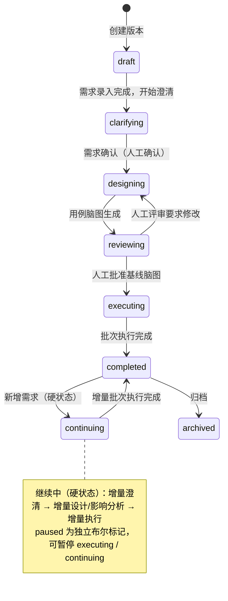

# EzTest 系统全景设计 v1.1（已确认启动版）

> **状态**：已确认（D1–D18；含前端 UI、暂停/继续中生命周期、本地 Git 代码资产）
> **定位**：AI 半自主 → 全自主端到端功能测试系统（Web + API）
> **用户**：开发（自测）与测试（正式功能测试），不区分场景；所有产出面向开发/测试
> **关联文档**：`code-intelligence.md`（本地 Git 代码仓/代码图/影响分析）、`auth-session-model.md`（账号/会话/权限观测）、`frontend-design.md`（前端详细设计）
> **技术假设**：后端 Go + PostgreSQL，前端 Next.js；单机 Docker 优先；LLM 多模态。
> **参考项目**：ARTEX（借鉴双图/事件流/探索链路/Agent 管理/审批与接管/实时执行视图的设计思想，不复制源码，AGPL 合规）。

---

## 0. 已确认决策记录（Decision Log）

| # | 决策 | 结论 |
|---|---|---|
| D1 | Agent 角色 | 13 个逻辑角色（职责不合并）；部署可合并，但 I/O 契约与工具权限分开 |
| D2 | Agent 可配置 | 管理员可配置提示词/工具/模型/技能；普通用户只选版本与资源 |
| D3 | AI 补全边界 | 执行中可新增用例并回填脑图（标记 `ai_supplement`）；不改已评审基线；需求缺失升级给人 |
| D4 | 知识沉淀 | P1 起步：版本内复用 + 人工审核入库；跨版本长期知识库为增量 |
| D5 | 人工评审节奏 | 基线脑图人工评审一次；AI 补充用例自动并入并标记，不做二次评审；**增量脑图默认不评审** |
| D6 | 问题确认 | 失败分析 + 问题整理默认直出问题单（置信度标注），人可事后修正 |
| D7 | 多模态 | 需求理解（截图/原型）+ 执行取证（截图）为必须；视觉断言 P1 |
| D8 | Agent 评测 | P1 建最小评测集：设计覆盖率、误报率、补充命中率等 |
| D9 | 应用探索范围 | 允许主动爬取/枚举接口（只读），受环境白名单约束 |
| D10 | 人工升级阈值 | 仅四类：需求矛盾/关键信息缺失、登录无法自动完成、范围外高危、其他必须决策 |
| D11 | 前端 UI | **不简化**：ARTEX 级可观察/可干预/可回放（执行过程、探索链路、会话、证据、实时流） |
| D12 | 生命周期 | 支持**人工暂停/恢复**；支持**完成后新增需求 → 继续中 → 增量设计/执行**；按批次出报告 |
| D13 | 范围 | 仅 Web + API 功能测试；性能/安全/移动端不做 |
| D14 | 平台简化 | 单管理员 + 普通用户；公共资源；极简 LLM 配置；不做多租户/CI/工单/环境编排 |
| **D15** | **继续中 = 硬状态** | 版本状态枚举含 `continuing`；增量子阶段用 `continue_phase`（clarifying/designing/executing）表示；`paused` 为独立布尔标记 |
| **D16** | **暂停** | `paused` 独立布尔标记（不占主状态）；**允许立即暂停**（中断当前步骤，用例标 `interrupted`） |
| **D17** | **代码资产** | **本地 Git 代码仓是代码现状唯一真源**（不接线上仓）；影响分析 = 代码 diff + 需求关系 + 应用模型锚点 |
| **D18** | **前端 P0 Tab** | 总览 / 执行会话 / 探索链路 / 实时播报 / 结果与证据 / 问题 / 报告 / **代码与变更** |

---

## 1. 定位与范围

### 1.1 一句话定位

> 输入一个**版本（含多个相互关联的需求）**，AI 引导完成澄清 → 产出**用例脑图**交由人评审 → 随后 **AI 全自主执行 Web/API 功能测试**（执行中自主补全场景、发现遗漏）→ 输出**问题清单 + 版本报告 + 可交付脑图**；人只在必要节点参与。

### 1.2 范围

- ✅ 版本级多需求澄清（含需求间依赖/冲突/重叠/共享范围）
- ✅ 用例脑图生成、人工评审、AI 执行中补全与回填
- ✅ Web UI 与 HTTP API 的功能测试（含登录/Session、数据准备、断言、取证）
- ✅ 问题清单、版本报告、按批次（batches）的报告版本
- ✅ 暂停/恢复、完成后新增需求触发"继续中"增量执行
- ✅ 实时执行视图（AI 过程、探索链路、会话、证据）
- ✅ **本地 Git 代码仓接入**：代码图、变更 diff、代码级影响分析（代码是关键资产）
- ❌ 性能测试、安全测试、移动端/小程序、桌面端
- ❌ **线上代码仓接入**（GitHub/GitLab 等 API；只认管理员配置的本地仓库）
- ❌ 多租户、复杂 RBAC、CI/工单/IM 集成、环境编排、多级审批、LLM 池/熔断/成本看板

### 1.3 用户与公共资源

- **管理员（唯一）**：配置系统/环境/应用模型/测试账号/Session、**本地 Git 代码仓**、Agent 配置、LLM。
- **普通用户（开发/测试）**：创建版本与需求、回答澄清、评审脑图、发起执行/暂停/新增需求、查看报告与问题；公共资源只读可用。
- **公共资源**：被测系统（System）、环境（Environment）、测试账号与 Session（见 auth-session-model.md）、**本地 Git 代码仓（路径/分支/排除规则）**，不区分租户。

---

## 2. 设计原则

1. **Agent 是核心资产**：感知/理解/规划/执行/记忆/自校验/协作/治理八维能力不简化；平台围绕 Agent 简化。
2. **最小人工参与**：只有 4 个人工点（澄清回答、脑图评审、登录接管、报告消费）+ 4 类升级；其它全自主。
3. **AI 自证**：任何"通过/失败/问题"必须绑定证据与步骤；无证据只能进"待确认"。
4. **自主补全**：执行不是"跑完基线就结束"，AI 持续做覆盖缺口与遗漏分析，自主新增用例继续测。
5. **代码是关键资产**：用例设计必须读本地代码现状；回归/增量必须按代码 diff 选受影响用例。
6. **共享黑板**：Agent 之间通过结构化黑板协作（需求图/脑图/应用模型/代码图/执行证据/问题/知识）。
7. **平台简化**：账号/LLM/集成/部署尽量少；把复杂度留给 Agent 能力。
8. **可观察/可干预/可回放**（前端）：每步可看、可暂停、可恢复、可追溯。
9. **质量口径**：需求验收覆盖 + 用例结果 + 问题有效率 + 证据完整率。

---

## 3. 总体架构

```text
┌─────────────────────────────────────────────────────────────────────────────┐
│ 前端（Next.js）：版本工作台 · 版本详情(多 Tab) · 用例脑图 · 执行实时视图 ·  │
│        问题/报告 · 代码与变更 · 公共资源 · Agent 中心 · 设置                  │
└───────────────────────────────┬─────────────────────────────────────────────┘
                                │ REST + SSE（快照游标 + 事件流）
┌───────────────────────────────▼─────────────────────────────────────────────┐
│ API/服务层：版本/需求/脑图/执行/证据/问题/报告/资源/Agent 配置               │
│ 代码智能服务：本地 Git 索引 · 代码图 · 变更 diff · 影响分析                   │
├─────────────────────────────────────────────────────────────────────────────┤
│ 编排 Agent（阶段推进/分派/人工关卡/预算/升级）                               │
├───────────────┬───────────────────┬───────────────────┬─────────────────────┤
│ 澄清团队       │ 设计团队           │ 执行团队           │ 交付团队             │
│ 澄清对话       │ 应用探索           │ 执行 Agent×N       │ 失败分析/分诊        │
│ 需求分析       │ 测试设计           │ 探索/补全          │ 问题整理             │
│ 上下文侦察     │ 设计评审           │                    │ 报告生成             │
│               │ 数据/前置规划       │                    │ 知识沉淀(P1)         │
├───────────────┴───────────────────┴───────────────────┴─────────────────────┤
│ 共享黑板：版本需求图 · 用例脑图 · 应用模型图 · 代码图/变更 · 执行/证据 ·     │
│           决策/反馈 · 知识库                                                  │
├─────────────────────────────────────────────────────────────────────────────┤
│ Agent 运行时：会话/记忆/压缩 · 工具(Playwright/HTTP/DB/截图/代码检索/MCP/技能)│
│ 规划重规划 · 自校验 · 多模态 · 协作消息/交接 · 预算收尾 · 活动流/回放        │
├─────────────────────────────────────────────────────────────────────────────┤
│ 支撑平台：公共资源 · 单管理员+用户 · 极简 LLM · PostgreSQL+证据存储 · 日志   │
└─────────────────────────────────────────────────────────────────────────────┘
外部：被测系统(Web/API) · 本地 Git 代码仓 · LLM 供应商
```

---

## 4. 版本生命周期（硬状态"继续中" + 暂停标记）

### 4.1 版本状态机



字段与状态：

| 字段/状态 | 说明 |
|---|---|
| `status` | `draft / clarifying / designing / reviewing / executing / continuing / completed / archived` |
| `paused` | 布尔；独立于 status，可作用于 executing / continuing（UI 显示"已暂停"） |
| `pause_mode` | `graceful`（默认）/ `immediate`；`paused_at` / `pause_reason` |
| `batch_no` | 当前批次（Batch 1 初始；新增需求 +1） |
| `continue_phase` | `continuing` 期间的子阶段：`clarifying / designing / executing` |
| `code_baseline_commit` | 当前批次参考的本地 Git 仓库 commit |

状态含义：

| 状态 | 含义 | 可执行动作 |
|---|---|---|
| draft | 版本已建，需求录入中 | 编辑需求、开始澄清 |
| clarifying | AI 引导澄清（多需求+关系） | 回答、编辑需求、新增需求 |
| designing | AI 生成/更新用例脑图 | 查看进度 |
| reviewing | 等待人工评审脑图 | 编辑、通过、驳回 |
| executing | AI 全自主执行（当前批次） | 暂停、新增需求、看实时过程 |
| **continuing** | **继续中（硬状态）**：完成后新增需求，正在增量澄清/设计/执行 | 暂停、查看增量、看实时过程 |
| completed | 批次执行完成，报告可看 | 新增需求（→ continuing）、归档、导出 |
| archived | 归档 | 只读 |

### 4.2 "继续中"（completed → 新增需求）流程

```text
用户在 completed 版本点"新增需求"
   │  ① 录入新需求（文本/文档/截图；可多条）
   ▼
status = continuing（硬状态）；continue_phase = clarifying；batch_no+1；记录 base/head commit
   │  ② 澄清 Agent 只针对新增需求 + 与既有需求的关系提问（复用已有需求图）
   │  ③ 需求分析 Agent 更新关系：依赖/冲突/重叠/影响范围
   ▼
continue_phase = designing（增量）
   │  ④ 测试设计 Agent 增量扩展脑图：新增用例 + 标注受影响旧用例（needs_revalidation）
   │  ⑤ 影响分析：代码 diff（本地仓库 base..head）+ 需求关系 + 应用模型锚点 → 受影响用例集合
   ▼
continue_phase = executing（增量批次 Batch N）
   │  ⑥ 执行 Agent 只跑新增用例 + 受影响用例（不重跑全部）
   │  ⑦ 补全 Agent 继续做覆盖缺口分析（可再补用例）
   ▼
status = completed（报告出现 Batch N 版本/差异）
```

要点：

- **不是重跑**：按批次增量执行；旧批次结果保留，报告展示差异（新增问题、已修复、回归结果）。
- **影响分析三源合一**：**代码 diff（本地 Git 仓库）** + 需求关系 + 应用模型锚点；代码变更时按 diff 选回归用例（详见 `code-intelligence.md`）。
- **默认不再人工评审增量脑图**（人已通过澄清确认需求）；版本设置可开"增量执行前查看脑图"。
- **暂停期间新增需求**：澄清完成后，若希望继续则恢复执行增量批次（UI 明确提示"将恢复执行"）。
- **代码基线可复现**：每批记录 base/head commit，用例执行、证据、问题、报告都带 commit。

### 4.3 暂停/恢复语义

| 项 | 设计 |
|---|---|
| 暂停表示 | `paused` 为**独立布尔标记**（不改主状态），可作用于 executing / continuing |
| 暂停入口 | 版本详情顶部"暂停"；执行器每步开始前检查暂停信号 |
| 暂停模式 | **优雅暂停（默认）**：当前步骤跑完即停；**立即暂停（允许）**：中断当前步骤/工具调用 |
| 立即暂停 | 取消进行中的浏览器动作/HTTP 请求；用例标记 `interrupted`；保存步骤检查点 |
| 恢复 | 从**最后完成步骤的检查点**续跑；`interrupted` 用例重跑前执行 cleanup/seed |
| 人工接管 | 登录 2FA/验证码仍可触发阻塞（不影响暂停语义） |
| 状态可见 | 顶栏徽章（含"继续中 · 已暂停"）+ 状态横幅 + 每一步"运行/暂停/完成"标记 |

### 4.4 批次（Batch）与报告版本

- 一个版本可包含多个批次：Batch 1（初始）、Batch 2（新增需求/代码变更）…。
- 每批次有独立 `RunBatch` + 报告版本（Revision）；报告页可切换批次并查看差异。
- 用例结果按 `(case_id, batch_id)` 记录，保留历史；脑图节点累积（基线 + AI 补充 + 受影响重跑）。
- 每批记录 `base_commit → head_commit`；无代码变更时 head=base。

---

## 5. 核心链路与工作回路

### 5.1 主链路

```text
版本 + 多需求 → 澄清（多轮，人参与）→ 需求图 + 关系 + 决策
   → 本地 Git 代码仓索引（代码图/commit 基线）+ 应用探索（应用模型）
   → 测试设计（用例脑图，基于需求 + 代码现状）→ 设计评审（AI 自审）→ ★人评审脑图
   → 全自主执行：
        执行用例 → 结果/证据 → 失败分析（分类/重跑/问题，可关联代码）
                    └→ 补全分析（覆盖缺口/遗漏）→ 新增用例 → 回填脑图 → 继续执行
   → 问题整理 → 版本报告 + 脑图导出 → 知识沉淀
   → 完成后新增需求 → 继续中（硬状态；增量批次；代码 diff + 需求关系影响分析）→ …
```

### 5.2 四个回路

| 回路 | 触发 | Agent 协作 | 结束条件 |
|---|---|---|---|
| 澄清回路 | 版本创建/新增需求 | 澄清对话 ⇄ 人；上下文侦察 → 需求分析 | 待澄清清零 + 需求确认 |
| 设计回路 | 需求确认 | 本地代码索引 → 应用探索 → 测试设计 → 设计评审 → 数据/前置规划 | 人批准基线脑图 |
| 执行回路 | 脑图批准/增量确认 | 影响分析（代码 diff+需求关系+锚点）→ 编排 → 执行 Agent×N；失败分析；探索/补全 | 需求覆盖达标/预算耗尽/无新发现 |
| 交付回路 | 批次执行结束 | 问题整理 → 报告 → 知识沉淀 | 报告发布/归档 |

---

## 6. Agent 团队与能力

### 6.1 13 个逻辑角色

| 团队 | Agent | 核心产出 |
|---|---|---|
| 澄清 | 澄清对话 / 需求分析 / 上下文侦察 | 需求条目、需求关系图、待澄清问题、决策 |
| 设计 | 应用探索 / 测试设计 / 设计评审 / 数据前置规划 | 应用模型图、用例脑图、评审意见、数据计划 |
| 执行 | 执行 Agent×N / 探索补全 / 失败分析 | 步骤结果、证据、补充用例、失败分类、问题候选 |
| 交付 | 问题整理 / 报告 / 知识沉淀(P1) | 问题单、版本报告、脑图导出、知识库 |
| 编排 | 编排 Agent | 阶段推进、任务分派、人工关卡、预算、升级 |

部署可合并（同进程/同模型不同提示词），但**职责、工具权限、I/O 契约分开**。

**代码智能（不新增 Agent 角色）**：本地 Git 代码仓索引器 + 代码图 + 变更/影响分析器，作为确定性服务供 Agent 调用（上下文侦察/测试设计/失败分析/问题整理），避免每个 Agent 重复读代码、浪费上下文。详见 `code-intelligence.md`。

### 6.2 Agent 能力模型（8 维）

感知（DOM/截图多模态/报文/日志/**代码**/文档）· 理解（需求/关系/可测性/**代码语义**）· 规划（设计方法/执行计划/重规划/覆盖缺口）· 执行（浏览器/HTTP/DB/会话/恢复）· 记忆（工作/版本/长期知识/压缩）· 自校验（证据绑定/自检/置信度/失败分类）· 协作（黑板/消息/交接/子 Agent）· 治理（范围/危险操作/预算/升级/审计）。

### 6.3 运行时底座

Agent 会话与上下文管理、工具注册与权限（Playwright/HTTP/DB/截图/文件/**代码检索**/MCP/技能）、记忆与压缩、多 Agent 消息与交接、预算/步数/收尾、活动流与回放、Agent 配置（提示词/工具/模型/技能）、Agent 质量评测（P1）。

---

## 7. 共享黑板与数据模型（概要）

### 7.1 黑板对象

| 对象 | 内容 | 写入 | 读取 |
|---|---|---|---|
| 版本需求图 | 需求条目 + 关系边 + 验收标准 + 决策 | 澄清/需求分析 | 设计/补全/报告 |
| 用例脑图 | 基线 + AI 补充 + 状态 + 血缘 + 受影响标记 | 设计/评审/补全/影响分析 | 执行/报告 |
| 应用模型图 | 页面/路由/API/组件/环境 | 应用探索/执行发现 | 设计/执行/补全 |
| **代码图与变更** | 本地仓库代码实体/路由/组件/调用关系；每批 commit diff 与受影响面 | 代码索引/影响分析服务 | 设计/执行/失败分析/问题/报告 |
| 执行与证据 | RunBatch/CaseRun/StepResult/Evidence(不可变) | 执行/失败分析 | 补全/问题/报告 |
| 问题清单 | 问题候选/确认/严重级/证据/代码位置 | 失败分析/问题整理 | 报告 |
| 决策与反馈 | 澄清答案、评审意见、接管记录、人工升级 | 人/澄清 Agent | 全部 |

### 7.2 核心实体

```text
Version（含 status/paused/continue_phase/batch_no）
  ├─< Requirement ─< RequirementRelation
  │       └─< ClarificationSession / Decision
  ├─< CaseGraph ─< CaseNode ─< Step / Assertion
  │                   └─ source: baseline(user_input/ai_generated) | ai_supplement
  ├─< RunBatch（base_commit/head_commit）─< CaseRun ─< StepResult ─< Evidence
  │                                            └─< Issue（含 code_refs）
  ├─< Report(Revision / Batch)
  └─< VersionChange（新增需求批次、代码影响面、报告差异）

公共资源：System ─< Environment；System ─< AppModel
          CodeRepository（本地 Git）─< CodeEntity（文件/符号/路由/组件/接口）
                                      └─< CodeChangeSet（base→head diff）
          Account ─< AccountSystemAccess ─< Session ─< PermissionSnapshot
锚点：Case/Requirement/Issue ↔ CodeEntity；Case/Requirement ↔ AppModel
平台：User(admin/users) · LLMConfig · AgentProfile · AuditLog
```

### 7.3 事件模型（供 SSE / 前端）

事件类型（示例）：
`version.status_changed`、`batch.started/finished`、`requirement.added/clarified/updated`、
`case.created/updated/status_changed/reviewed/supplemented/revalidation_marked`、
`run.started/paused/resumed/finished`、`step.started/finished`、
`agent.activity`（thinking/text/tool_use/tool_result/decision）、`evidence.created`、
`issue.created/updated`、`gate.pending/resolved`、`human.requested`、
`report.published/stale`、`code.indexed`、`code.changed`、`code.impact_computed`。

---

## 8. 人工参与与升级策略

| 人工点 | 触发 | 动作 | 可否省 |
|---|---|---|---|
| 澄清回答 | 澄清阶段/新增需求 | 回答、确认需求与验收 | 不可省 |
| 脑图评审 | 基线设计完成 | 编辑、批准/驳回 | 不可省（唯一强制关卡） |
| 登录接管 | 2FA/验证码/审批 | 完成一次登录 | 例外 |
| 报告消费 | 批次完成 | 查看/导出/分享 | 非关卡 |
| 升级处理 | 四类阈值 | 做一次决策 | 按需，越少越好 |

**升级阈值（仅四类）**：① 需求矛盾/关键信息缺失；② 登录无法自动完成；③ 范围外高危操作；④ 其他必须由人决策的事项。升级时由编排 Agent 打包上下文（发生了什么/已尝试什么/需要什么决策）。

---

## 9. 平台支撑（明确简化）与代码资产

- 单管理员 + 普通用户；公共资源（含**本地 Git 代码仓路径/分支/排除规则**）由管理员配置。
- 极简 LLM 配置：模型/地址/Key/自定义请求头/重试次数/重试间隔/默认多模态；不做池化/熔断/主备链/成本看板/报文录制。
- 数据：PostgreSQL + 证据对象存储（截图/报文/日志）；不做复杂归档体系（版本归档 P2）。
- 部署：单机 Docker Compose；执行 Agent 横向扩展 P2。
- 集成：本轮不做 CI/工单/IM；**代码现状 = 管理员配置的本地 Git 仓库（P0 核心输入）**，不接线上仓。

---

## 10. 前端信息架构（摘要，详见 `frontend-design.md`）

1. 版本工作台/需求澄清（多需求 + 关系图 + 对话 + 决策 + 新增需求）
2. 版本详情（核心，ARTEX 式多 Tab，P0 顺序）：**总览 / 执行会话 / 探索链路 / 实时播报 / 结果与证据 / 问题 / 报告 / 代码与变更**；P1 增需求与澄清、脑图、资源与会话
3. 用例脑图全屏编辑/评审
4. 执行实时视图（多 Agent 会话、工具调用、证据、暂停/恢复/新增需求、继续中硬状态）
5. 问题与报告
6. 公共资源（管理员，含本地代码仓）
7. Agent 中心（角色/提示词/工具/模型/技能/运行观察）
8. 设置（用户/LLM/基础）

前端要求：ARTEX 级可观察/可干预/可回放；SSE 快照游标 + 事件流；探索链路图实时更新；暂停/恢复/继续中/新增需求状态在 UI 上明确可见。

---

## 11. 实施优先级

| 阶段 | 内容 |
|---|---|
| P0（跑通主链路） | 版本/多需求/澄清；**本地 Git 仓库接入 + diff + 文件/路由/接口级索引 + 影响分析**；用例脑图（生成+评审，代码现状输入）；全自主执行（执行/失败分析/补全最小闭环）；证据与结果；报告；公共资源；Agent 基础运行时；前端核心 8 Tab |
| P1 | 符号级代码图/调用链（TS/JS + Java）；设计评审/应用探索增强；知识沉淀/评测；多模态视觉断言；报告批次差异；Agent 中心配置；性能/可用性打磨 |
| P2 | 分布式执行、跨版本知识库、环境编排、更多报告导出、权限细分（如需要） |

---

## 12. 待办与待确认

1. 前端视觉规范（沿用 ARTEX 深色/浅色、侧边栏、卡片与状态色；详见 frontend-design.md）。
2. 需求录入形态细节：版本下批量录入/文档上传/截图（P0 文本+文档+截图链接）。
3. **本地 Git 仓库范围**：本版本语言 = TS/JS（前端）+ Java（后端）；是否 monorepo、索引排除规则、固定分支策略。
4. **代码基线策略**：每批次固定 head commit？测试执行期间仓库是否可能变更（变更后置新批次）？
5. API 规格来源：OpenAPI 上传/文档链接/AI 抓包补全（P0 支持前两项，探索补全 P1）。
6. 问题单是否强制关联代码锚点（建议 P0 记录、P1 展示）。
7. 报告导出格式：Markdown + 脑图（Mermaid/图片）；PDF 后置。

---

## 附录 A：13 个 Agent 的 I/O 契约（摘要）

| Agent | 输入 | 输出（结构化） | 工具/权限 |
|---|---|---|---|
| 澄清对话 | 版本、需求原文/文档/截图、历史决策 | 需求条目、问题清单、候选/确认状态 | 只读资源、对话、需求写入 |
| 需求分析 | 需求条目、业务规则、应用模型 | 关系图、可测性、验收建议、风险 | 只读 + 需求图写入 |
| 上下文侦察 | 文档/截图/**本地代码**/OpenAPI | 业务规则、页面/接口清单、术语、代码要点 | 文件/代码只读、多模态 |
| 应用探索 | 环境、Session、入口 | 应用模型图、可测面 | 浏览器/HTTP/抓包（只读） |
| 测试设计 | 需求图、应用模型、**代码图/变更**、历史用例/问题 | 用例脑图（基于代码现状）、覆盖矩阵、优先级 | 脑图写入、知识库读取、代码检索 |
| 设计评审 | 脑图、需求图、应用模型、代码图 | 评审意见、待补清单 | 只读 + 评论 |
| 数据/前置规划 | 脑图、公共资源、环境 | 数据计划、前置条件、cleanup | 夹具/seed（受控） |
| 执行 Agent | 用例、前置、Session、环境 | 步骤结果、断言、证据、失败候选 | 浏览器/HTTP/DB/截图 |
| 探索/补全 | 需求图、脑图、执行结果、应用模型 | 补充用例、覆盖缺口、遗漏报告 | 只读 + 脑图写入 |
| 失败分析 | 步骤结果、证据、环境/会话状态、**代码图** | 失败分类（可关联代码）、重跑建议、问题候选 | 只读 + 结果标注 |
| 问题整理 | 问题候选、证据、用例、环境指纹、**代码锚点** | 问题单（步骤/期望/实际/证据/代码位置） | 问题写入 |
| 报告 | 需求/结果/证据/问题/覆盖 | 报告、脑图导出、差异 | 只读 |
| 知识沉淀(P1) | 版本用例/结果/问题/决策 | 用例库、问题模式、技能资产 | 知识库写入（人工审核） |
| 编排 | 全局状态、事件、预算、人反馈 | 阶段计划、任务分派、升级请求 | 编排控制面 |
| **代码索引/影响分析（服务）** | 本地 Git 仓库、commit、需求关系、锚点 | 代码图、变更集、受影响用例集合 | git 只读、索引写入 |

---

*文档版本：v1.1（2026-10-26）；依据 D1–D18 决策编写。下一步：`code-intelligence.md` 落地后，按"执行引擎与批次/暂停状态机 → 事件模型/SSE 契约 → 数据表 DDL → P0 任务拆解"推进。*
