> **0.1 归档；0.2 权威文档见 [docs/version-V0.2/](version-V0.2/README.md) 与 [deploy/README.md](../deploy/README.md)。**

# EzTest 详细设计文档
| 项目 | 内容 |
|---|---|
| 文档名称 | EzTest 详细设计文档（Detailed Design Document） |
| 文档版本 | v1.0（对应产品预览版 `0.1.0-preview.1`） |
| 代码基线 | 分支 `dev`，HEAD `45e8d15`（2026-10-30，含打包与发布提交；上一评审基线为 `009e8b6`） |
| 后端技术栈 | Go 1.24.6（`net/http` 标准库路由，`pgx/v5`，无 Web 框架、无 ORM） |
| 前端技术栈 | Next.js 16.4.3 App Router + React 19.3.1 + TypeScript 5.9 + Tailwind CSS 4 + Radix UI + React Flow |
| 执行器技术栈 | Node.js ESM + Playwright 1.64.1（Chromium）+ pixelmatch/pngjs |
| 存储 | PostgreSQL 17（67 张业务表）+ 文件系统（内容寻址对象、附件、证据、报告、导出） |
| 部署形态 | 单机四进程（API / Web / Executor / PostgreSQL）；Docker Compose 静态校验；Windows/Linux 免 Docker 运行包 |
| 文档定位 | 实现级详细设计：设计决策 → 数据结构 → 算法 → 协议 → 错误语义，可支撑面试讲解与代码走查 |

**阅读提示（状态标记约定）**

| 标记 | 含义 |
|---|---|
| 已实现 | 仓库代码中存在实现，且本文已对照源码核验（引用文件路径）。 |
| 已验证 | 仓库内有可复现的验证记录（测试、脚本、验收记录、实测日志）；本文注明来源。 |
| 未验证 | 仅有代码或静态设计，无运行证据；或明确声明"本机未运行"。 |

> 本文所有数字（上下文数、表数、迁移数、路由数、事件/审计动作数、配置变量数等）均给出统计口径；与既有评审摘要不一致处单独标注，不隐瞒差异。
## 目录
- [1 引言](#1-引言)
  - [1.1 目的](#11-目的)
  - [1.2 范围与非目标](#12-范围与非目标)
  - [1.3 读者与阅读路径](#13-读者与阅读路径)
  - [1.4 术语表](#14-术语表)
  - [1.5 参考资料与源码索引](#15-参考资料与源码索引)
  - [1.6 状态标记与统计口径](#16-状态标记与统计口径)
- [2 设计概述与全局约定](#2-设计概述与全局约定)
  - [2.1 系统形态与运行拓扑](#21-系统形态与运行拓扑)
  - [2.2 分层架构与依赖规则](#22-分层架构与依赖规则)
  - [2.3 单一装配根与条件路由挂载](#23-单一装配根与条件路由挂载)
  - [2.4 错误模型：信封、错误码与 reason](#24-错误模型信封错误码与-reason)
  - [2.5 成功信封与游标分页](#25-成功信封与游标分页)
  - [2.6 ID 规则：Snowflake 与线上字符串序列化](#26-id-规则snowflake-与线上字符串序列化)
  - [2.7 并发控制：OCC、CAS、唯一索引与单活跃约束](#27-并发控制occcas唯一索引与单活跃约束)
  - [2.8 事务边界与跨上下文一致性](#28-事务边界与跨上下文一致性)
  - [2.9 数据库迁移规范](#29-数据库迁移规范)
  - [2.10 时间、时区与时钟](#210-时间时区与时钟)
  - [2.11 命名与编码约定总表](#211-命名与编码约定总表)
  - [2.12 一次写请求的生命周期](#212-一次写请求的生命周期)
- [3 平台内核详细设计](#3-平台内核详细设计)
  - [3.1 配置加载与校验（config）](#31-配置加载与校验config)
  - [3.2 数据库连接与嵌入式迁移（db）](#32-数据库连接与嵌入式迁移db)
  - [3.3 HTTP 装配、中间件顺序与健康检查（server）](#33-http-装配中间件顺序与健康检查server)
  - [3.4 平台公共件（platform）](#34-平台公共件platform)
  - [3.5 事件总线与 SSE（eventing）](#35-事件总线与-sseeventing)
  - [3.6 审计（audit）](#36-审计audit)
  - [3.7 内容寻址对象存储（storage）](#37-内容寻址对象存储storage)
  - [3.8 LLM 网关（llm）](#38-llm-网关llm)
  - [3.9 进程生命周期、后台 worker 与优雅停机](#39-进程生命周期后台-worker-与优雅停机)
- [4 限界上下文详细设计](#4-限界上下文详细设计)
  - [4.1 identity（身份与认证）](#41-identity身份与认证)
  - [4.2 resource（公共资源与会话）](#42-resource公共资源与会话)
  - [4.3 version（版本、需求、澄清、知识）](#43-version版本需求澄清知识)
  - [4.4 codeintel（代码智能）](#44-codeintel代码智能)
  - [4.5 mindmap（用例脑图）](#45-mindmap用例脑图)
  - [4.6 execution（执行引擎）](#46-execution执行引擎)
  - [4.7 delivery（问题与报告）](#47-delivery问题与报告)
  - [4.8 agent（Agent 运行时）](#48-agentagent-运行时)
  - [4.9 chain（探索链路只读模型）](#49-chain探索链路只读模型)
  - [4.10 search（全局搜索）](#410-search全局搜索)
  - [4.11 workspace（待办中心）](#411-workspace待办中心)
  - [4.12 quality（评测与质量中心）](#412-quality评测与质量中心)
  - [4.13 eventing（事件上下文）](#413-eventing事件上下文)
  - [4.14 storage（对象存储上下文）](#414-storage对象存储上下文)
  - [4.15 audit（审计上下文）](#415-audit审计上下文)
  - [4.16 llm（LLM 网关上下文）](#416-llmllm-网关上下文)
  - [4.17 跨上下文依赖矩阵](#417-跨上下文依赖矩阵)
- [5 关键流程与算法详细设计](#5-关键流程与算法详细设计)
  - [5.1 澄清对话流程](#51-澄清对话流程)
  - [5.2 需求确认与版本状态机](#52-需求确认与版本状态机)
  - [5.3 脑图设计、评审与冻结](#53-脑图设计评审与冻结)
  - [5.4 代码索引与 T0 diff](#54-代码索引与-t0-diff)
  - [5.5 影响分析：候选生成与 unmapped](#55-影响分析候选生成与-unmapped)
  - [5.6 批次创建门禁](#56-批次创建门禁)
  - [5.7 调度、并发与用例运行器](#57-调度并发与用例运行器)
  - [5.8 四态判定与失败分类](#58-四态判定与失败分类)
  - [5.9 暂停、恢复与重启恢复](#59-暂停恢复与重启恢复)
  - [5.10 AI 补全与补全批次](#510-ai-补全与补全批次)
  - [5.11 失败分析、问题去重与分诊](#511-失败分析问题去重与分诊)
  - [5.12 报告生成：确定性内容、fingerprint 与 stale](#512-报告生成确定性内容fingerprint-与-stale)
  - [5.13 继续中的增量链路](#513-继续中的增量链路)
  - [5.14 SSE：订阅-回放竞态、stream.reset 与心跳](#514-sse订阅-回放竞态streamreset-与心跳)
  - [5.15 Agent run 状态机、循环与预算](#515-agent-run-状态机循环与预算)
  - [5.16 LLM 流式重试边界](#516-llm-流式重试边界)
  - [5.17 限流、GC、leader lock 与备份恢复](#517-限流gcleader-lock-与备份恢复)
  - [5.18 端到端主流程时序](#518-端到端主流程时序)
- [6 数据设计](#6-数据设计)
  - [6.1 数据设计原则](#61-数据设计原则)
  - [6.2 67 张表按上下文清单](#62-67-张表按上下文清单)
  - [6.3 状态枚举汇总](#63-状态枚举汇总)
  - [6.4 47 条迁移清单与顺序](#64-47-条迁移清单与顺序)
  - [6.5 保留、删除与备份策略](#65-保留删除与备份策略)
  - [6.6 关键表字段与 DDL 节选](#66-关键表字段与-ddl-节选)
- [7 接口设计](#7-接口设计)
  - [7.1 OpenAPI 契约约定](#71-openapi-契约约定)
  - [7.2 223 个路由按前缀分组](#72-223-个路由按前缀分组)
  - [7.3 错误码枚举表](#73-错误码枚举表)
  - [7.4 reason 码目录（节选）](#74-reason-码目录节选)
  - [7.5 SSE 事件目录](#75-sse-事件目录)
  - [7.6 审计动作目录](#76-审计动作目录)
  - [7.7 幂等键与重放协议](#77-幂等键与重放协议)
  - [7.8 执行器内部协议摘要](#78-执行器内部协议摘要)
  - [7.9 请求/响应示例](#79-请求响应示例)
- [8 执行器详细设计](#8-执行器详细设计)
  - [8.1 进程、传输与配置](#81-进程传输与配置)
  - [8.2 HTTP 端点表](#82-http-端点表)
  - [8.3 动作表与参数契约](#83-动作表与参数契约)
  - [8.4 限额模型](#84-限额模型)
  - [8.5 安全模型](#85-安全模型)
  - [8.6 浏览器启动与回退](#86-浏览器启动与回退)
  - [8.7 健康检查与测试](#87-健康检查与测试)
  - [8.8 API 工具到执行器动作的映射](#88-api-工具到执行器动作的映射)
- [9 前端详细设计](#9-前端详细设计)
  - [9.1 技术栈与工程约束](#91-技术栈与工程约束)
  - [9.2 13 条页面路由](#92-13-条页面路由)
  - [9.3 版本详情 10 个 Tab 与深链](#93-版本详情-10-个-tab-与深链)
  - [9.4 组件分层与状态管理](#94-组件分层与状态管理)
  - [9.5 api-client 与 sse-client](#95-api-client-与-sse-client)
  - [9.6 UI 状态、主题与可访问性](#96-ui-状态主题与可访问性)
  - [9.7 构建、测试与 i18n 现状](#97-构建测试与-i18n-现状)
  - [9.8 页面与 API 映射](#98-页面与-api-映射)
- [10 配置设计](#10-配置设计)
  - [10.1 加载、校验与失败语义](#101-加载校验与失败语义)
  - [10.2 53 个 EZTEST_* 变量分类表](#102-53-个-eztest_-变量分类表)
  - [10.3 未接线与保留变量](#103-未接线与保留变量)
  - [10.4 运行时读取与执行器侧变量](#104-运行时读取与执行器侧变量)
  - [10.5 典型部署配置组合](#105-典型部署配置组合)
- [11 安全设计](#11-安全设计)
  - [11.1 威胁模型与信任边界](#111-威胁模型与信任边界)
  - [11.2 认证令牌与密码](#112-认证令牌与密码)
  - [11.3 权限矩阵](#113-权限矩阵)
  - [11.4 加密范围与明文边界](#114-加密范围与明文边界)
  - [11.5 Web 侧安全](#115-web-侧安全)
  - [11.6 敏感数据、审计与日志](#116-敏感数据审计与日志)
  - [11.7 限流与部署边界](#117-限流与部署边界)
- [12 测试与验收设计](#12-测试与验收设计)
  - [12.1 测试分层与规模](#121-测试分层与规模)
  - [12.2 测试门与脚本](#122-测试门与脚本)
  - [12.3 Fake LLM 与 fixture 体系](#123-fake-llm-与-fixture-体系)
  - [12.4 eval、SLO、安全审计与备份演练](#124-evalslo安全审计与备份演练)
  - [12.5 已记录验收证据与未验证项](#125-已记录验收证据与未验证项)
  - [12.6 关键测试断言示例](#126-关键测试断言示例)
- [13 部署与发布设计](#13-部署与发布设计)
  - [13.1 Docker Compose 设计](#131-docker-compose-设计)
  - [13.2 免 Docker 运行包布局与生命周期脚本](#132-免-docker-运行包布局与生命周期脚本)
  - [13.3 构建流水线](#133-构建流水线)
  - [13.4 main/dev 双分支发布](#134-maindev-双分支发布)
  - [13.5 升级、回滚与备份](#135-升级回滚与备份)
- [14 附录](#14-附录)
  - [14.1 关键文件索引](#141-关键文件索引)
  - [14.2 枚举与常量总表](#142-枚举与常量总表)
  - [14.3 术语与缩写](#143-术语与缩写)
  - [14.4 OpenAPI path 索引](#144-openapi-path-索引)
  - [14.5 文档与代码不一致清单](#145-文档与代码不一致清单)

## 1 引言
### 1.1 目的
本文是 EzTest 的实现级详细设计文档。它回答以下问题，并逐条落在真实代码位置上：

1. 系统如何在单机四进程拓扑下把「需求 → 澄清 → 结合代码的测试设计 → 人工评审 → 浏览器自主执行 → 证据/问题/报告 → 增量继续」串成一条可观察、可追溯的链路；
2. 16 个限界上下文各自的数据结构、聚合与不变量、应用服务、仓储端口、HTTP 路由、事件/审计、错误语义；
3. 关键算法（四态判定、失败分类、影响分析、报告指纹、SSE 回放、Agent 循环、限流、GC）的输入、输出与边界条件；
4. 协议（REST 信封、游标分页、幂等键、SSE 事件封套、执行器 A′ 协议）的精确约定；
5. 每个机制的验证状态（已实现/已验证/未验证），避免把设计意图误读为已验证事实。
### 1.2 范围与非目标
**在范围内（已实现）**

- Go API 单二进制 `eztest`：身份、资源、版本、代码智能、脑图、执行、交付、Agent、链、搜索、待办、质量、事件、存储、审计、LLM 共 16 个上下文。
- Next.js 16 前端：13 条页面路由、版本详情 10 个 Tab、SSE 实时视图。
- 独立 Node/Playwright 执行器（协议 A′）。
- PostgreSQL 17 迁移体系（47 个嵌入式迁移、67 张业务表）。
- 部署资产：Compose 定义、Dockerfile、免 Docker 运行包与生命周期脚本、备份恢复脚本、验收/评测/SLO/安全脚本。

**非目标（明确不做）**

- 多租户与 RBAC：只有 `admin` / `user` 两种角色，数据库层强制最多一个 admin 行（`identity_0001_users.sql` 部分唯一索引）。
- 面向被测项目的语言解析器：代码智能走 T0 只读 Git + T1 AI 理解，不内置 parser（决策 D19/D32）。
- 自动部署被测系统、工单系统、CI 平台插件：被测系统是外部已登记环境。
- 执行器横向扩展、跨实例 SSE 广播：除调度/自主/日维护使用 PostgreSQL leader lock 外，其余均为进程内单实例。
- 移动端原生应用测试、非 Web/HTTP 协议测试（决策 D13）。
### 1.3 读者与阅读路径
| 读者 | 建议路径 |
|---|---|
| 面试讲者 | §1.1 → §2 → §5 → §7 → §11（覆盖架构、算法、协议、安全） |
| 后端工程师 | §2 → §3 → §4 → §5 → §6 → §7 |
| 前端工程师 | §7 → §9 → §5.14 |
| 执行器/测试工程师 | §8 → §5.6–5.9 → §12 |
| 运维/发布工程师 | §10 → §13 → §12.4 |
### 1.4 术语表
| 术语 | 含义（代码/文档中的精确定义） |
|---|---|
| 版本（Version） | 一次测试工程的粗粒度容器；状态机 `draft → clarifying → designing → reviewing → executing → completed`，另有 `continuing` 与仅枚举的 `archived`。 |
| 需求（Requirement） | 版本内的独立流水线单元，`draft ⇄ clarified` 是唯一实现的迁移；确认后只读，可重新打开。 |
| 澄清（Clarification） | AI 澄清会话 + 问题 + 决策三张表构成的对话式需求澄清。 |
| 脑图 / Case Mindmap | 场景/用例树（`case_node`）+ 步骤 + 断言 + 来源 + 评审 + 基线。 |
| 基线（Baseline） | 评审通过后冻结的 `case_baseline`（含 `graph_hash`）；冻结节点内容不可改，只允许受控叠加（D44）。 |
| 批次（Run Batch） | 一次执行单元，kind ∈ `baseline\|incremental\|supplement`，单版本最多一个活跃批次。 |
| 用例运行（Case Run） | 批次内单个用例的执行实例，终态四态 `passed\|failed\|blocked\|inconclusive`。 |
| 失败分类（Failure Class） | `application\|environment\|session\|model\|case`，与四态构成矩阵（§5.8）。 |
| 执行器（Executor） | 独立 Node/Playwright 服务，API 通过 HTTP/JSON 驱动，协议称 A′（D40）。 |
| 事件（Event） | 持久化到 `event` 表、按 channel 单调 `seq` 排序的不可变消息；SSE 的唯一数据源。 |
| 快照游标（Snapshot Cursor） | 客户端首屏 REST 拿到的 channel 最新 `seq`，作为 SSE 重放起点。 |
| Agent Run | 一次 Agent 会话中的单次运行，状态 `running\|done\|failed\|aborted\|interrupted` + 终态原因。 |
| Profile | 管理员可编辑的 Agent 配置（提示词、工具白名单、预算、模型）。 |
| 幂等键（Idempotency-Key） | 写在写请求头里的重放键，作用域 = 用户 + 方法 + 路径。 |
| OCC / CAS | 乐观并发控制 / 比较并交换：以 `revision` 或状态为条件更新，输者得 409。 |
| 确定性内容 | 报告/导出中不依赖 LLM 采样随机性的部分，保证可复现（§5.12）。 |
| 降级（Degraded） | AI 不可用等情况下仍完成主流程的确定性兜底状态（`done + degraded`）。 |
### 1.5 参考资料与源码索引
| 类别 | 位置 |
|---|---|
| 系统蓝图与决策记录 D1–D69 | [docs/design/system-blueprint.md](design/system-blueprint.md) |
| 认证/会话模型规格 | [docs/design/auth-session-model.md](design/auth-session-model.md) |
| 代码智能规格 | [docs/design/code-intelligence.md](design/code-intelligence.md) |
| 前端设计规格 | [docs/design/frontend-design.md](design/frontend-design.md) |
| 阶段规格 | [docs/design/implementation-phases.md](design/implementation-phases.md) |
| HTTP 契约（OpenAPI 3.0.3） | [docs/openapi/api.yaml](openapi/api.yaml) |
| 部署说明 | [docs/deployment.md](deployment.md)、[docs/operations.md](operations.md) |
| 开发说明 | [docs/development.md](development.md) |
| 发布说明 | [docs/release-notes/0.1-preview.md](release-notes/0.1-preview.md) |
| 装配根 | [backend/cmd/eztest/main.go](../backend/cmd/eztest/main.go) |
| 路由与中间件 | [backend/internal/server/server.go](../backend/internal/server/server.go) |
| 配置 | [backend/internal/config/config.go](../backend/internal/config/config.go) |
| 迁移执行器 | [backend/internal/db/migrate.go](../backend/internal/db/migrate.go) |
| 迁移清单 | [backend/internal/db/migrations/order.txt](../backend/internal/db/migrations/order.txt) |
### 1.6 状态标记与统计口径
- **上下文数 16**：`backend/internal/` 下含 `interfaces/httpapi` 的目录数。
- **表数 67**：对 47 个迁移文件中 `CREATE TABLE` 去重计数（最终名 = 创建名经 D34 rename 迁移映射），另加框架表 `schema_migrations` 共 68。
- **迁移数 47**：`backend/internal/db/migrations/*.sql` 文件数，与 `order.txt` 行数一一对应（有测试 `migrate_order_test.go` 防漂移）。
- **路由 223**：`mux.Handle/HandleFunc` 注册的 method+path 模式数 = 191 条字面量 `/api/*` + 31 条 mindmap 动态拼接路由 + 1 条 `GET /healthz`。
- **OpenAPI**：`docs/openapi/api.yaml` 共 169 个 path 条目（168 个 `/api/*` + `/healthz`）、223 个 operation；文件 680,007 字节。
- **事件类型**：对 publisher 代码中的 `event.Type` 字面量/常量扫描去重后 56 个（含 execution 的 `run.*`/`step.finished`/`human.requested` 与 version 的 `attachment.*`）；既有评审摘要记为 54，差异见 §14.5。
- **审计动作**：对 `Action*` 常量与 `Action:` 字面量合并去重后 56 个；既有评审摘要记为 55。
- **配置变量 53**：`config.go` 中解析的 `EZTEST_*` 去重计数；另有 2 个运行时读取（knowledge 限额）与 7 个执行器侧变量，见 §10。
- **测试规模**：`go` 源文件 485 / 测试文件 384 / `Test|Benchmark|Fuzz` 函数 2,808 / integration-tagged 文件 73；前端 Vitest 文件 138、Playwright spec 30；执行器测试文件 7（8 个源文件）。
## 2 设计概述与全局约定
### 2.1 系统形态与运行拓扑
EzTest 采用「一个 Go API 进程 + 一个独立浏览器执行器 + 一个 Next.js 前端 + PostgreSQL」的四进程单机形态。关键设计取向：

1. **API 不直接持有浏览器**：Playwright 由独立 Node 进程承担（决策 D40），API 镜像不装 Node/Chromium，执行器无业务数据库访问权。
2. **所有业务写入经 API**：执行器只做 context/动作/产物，不写业务库，保证领域不变量只有一个写入方。
3. **文件与数据库分离**：二进制内容（附件、证据、报告、导出）只落文件系统，数据库存元数据（决策 D30）。
4. **实时性靠 SSE + 持久化事件**：所有实时视图都能从 `event` 表重放，进程内 hub 只负责"live 尾随"。

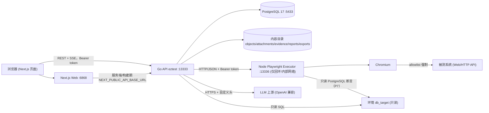
| 进程 | 默认监听 | 依赖的数据 | 谁能访问 |
|---|---|---|---|
| Go API `eztest` | `:13333`（`EZTEST_HTTP_ADDR`） | 5 个内容目录 + `docs/openapi/api.yaml` + PostgreSQL | 浏览器（CORS 单源）、运维脚本 |
| Next.js Web | `6868`（`PORT`） | 无持久数据 | 浏览器 |
| Playwright Executor | `127.0.0.1:13336`（`EZTEST_EXECUTOR_ADDR`） | 每 context 临时目录 | 仅 API（Bearer token） |
| PostgreSQL 17 | `5433`（dev/compose 映射） | `pgdata` | API、备份脚本、只读 db_target |
### 2.2 分层架构与依赖规则
每个限界上下文按 DDD 四层组织：

```text
backend/internal/<context>/
  domain/            聚合、值对象、枚举、领域错误、仓储接口（不依赖框架）
  application/       用例服务、端口（Port）、事件/审计记录
  infrastructure/    适配器：postgres 仓储、eventing/audit/llm/executor 客户端、工具实现
  interfaces/httpapi/ HTTP handler、DTO、路由注册、错误映射
```
**强制依赖规则**（`Agent.md` §6.2，`server.go` 头部注释重申）：

1. `domain` 不 import `application/infrastructure/interfaces`，也不 import 其他上下文。
2. `application` 只依赖本上下文 `domain` + 自己声明的端口接口；跨上下文能力通过 port 注入，由装配根用 `infrastructure/<other-context>` 包（如 `version/infrastructure/resource`）适配，**禁止**一个上下文 import 另一个上下文的 `infrastructure`。
3. `interfaces/httpapi` 只依赖 `application`；HTTP 错误信封统一走 `platform` 包。
4. `internal/server` 只做路由与中间件装配，不含业务逻辑；`cmd/eztest` 是唯一 DI 根（决策 D26）。
5. 共享包 `internal/{config,db,server,platform,integration,testutil}` 不属于任何上下文。

**上下文清单与层次**（16 个）：

| # | 上下文 | 四层完整性 | 说明 |
|---|---|---|---|
| 1 | `identity` | domain/application/infrastructure/interfaces | 用户、令牌、认证、登录限流 |
| 2 | `resource` | 完整 | 系统/环境/应用模型/账号/会话/代码仓/DB 目标 |
| 3 | `version` | 完整 | 版本、需求、关系、澄清、决策、附件、知识 |
| 4 | `codeintel` | 完整 | 代码索引、事实、影响分析、锚点、事实评审 |
| 5 | `mindmap` | 完整 | 用例树、步骤、断言、评审、基线、设计 run、导出、视觉断言 |
| 6 | `execution` | 完整 | 批次、用例运行、步骤/断言结果、证据、调度、GC、DB/视觉断言 |
| 7 | `delivery` | 完整 | 问题、报告、分析 run、全局中心 |
| 8 | `agent` | 完整 | Profile、Session、Run、Message、工具注册表、Agent 中心 |
| 9 | `chain` | application/interfaces | 跨上下文只读投影（探索链路） |
| 10 | `search` | application/interfaces | 跨实体只读搜索 |
| 11 | `workspace` | application/interfaces | 待办中心只读聚合 |
| 12 | `quality` | 完整 | 评测 run 与指标 |
| 13 | `eventing` | 完整 | 事件存储、Hub、SSE、快照、测试发布器 |
| 14 | `storage` | 完整 | 内容寻址对象存储 |
| 15 | `audit` | 完整 | 追加式审计日志 |
| 16 | `llm` | 完整 | LLM 配置、协议适配、重试、模型目录 |

> 说明：`chain`/`search`/`workspace` 是 P8 引入的**只读投影上下文**，只有 application + interfaces 两层，读侧可直接用 SQL provider（如 `chain/application` 注入 `versionchain.New(pool)`），避免为只读视图制造领域模型；但它们仍不 import 其他上下文的 infrastructure。
### 2.3 单一装配根与条件路由挂载
`cmd/eztest/main.go`（约 2,298 行）是唯一装配根，`server.Dependencies` 是 HTTP 面的依赖集合。**nil 依赖 = 该 API 面不挂载**：`server.New` 对每个上下文检查 `deps.X != nil` 才注册路由，因此部分装配的进程（单测、工具进程）不会暴露"后面是 nil"的路由。已实现且被 `server_test.go` 覆盖。

装配顺序（`serve()`，`main.go` L224 起）：

1. `config.Load(os.Getenv)` → JSON `slog` → `db.Open` → `db.MigrateEmbedded`（30 s 启动超时 `startupTimeout`）。
2. `EnsureAdmin`（bcrypt cost 12）→ `llm.ConfigService.SeedFromEnv`（仅当库中没有任何 LLM 配置）。
3. 一个共享 `Snowflake` 生成器（`EZTEST_SNOWFLAKE_NODE_ID`）供所有上下文使用；一个 `audit.Service`；一个 `event.Service` + 进程内 Hub；本地对象存储；PostgreSQL 幂等存储；各上下文 repo/service/adapter。
4. 幂等 seed 12 个 Agent profile（§4.8），每个 allow-list 都对照实时工具注册表校验，不匹配即启动失败。
5. 启动后台 worker：codeintel（有界队列 16）、execution scheduler（tick 默认 2 s）、P7 delivery 分析 poller + autonomy worker、P5 mindmap run coordinator、P8 daily maintenance。
6. Boot recovery：stale agent run → `interrupted`；stale mindmap run → `failed`；执行中残留 case run 按 scheduler 规则在启动时结算。
7. `http.Server`：`BaseContext` 派生自可取消的 `baseCtx`（SSE 停机解阻塞）、`ReadHeaderTimeout: 10s`、**不设 WriteTimeout**（SSE 长连接）。
8. 收到 SIGINT/SIGTERM 后按固定顺序停机（§3.9）。
### 2.4 错误模型：信封、错误码与 reason
**统一错误信封**（`platform/errors.go`，所有 HTTP 错误一致）：

```json
{
  "error": {
    "code": "invalid_argument",
    "message": "limit must be between 1 and 100",
    "request_id": "8f0c…",
    "retryable": false,
    "details": {"field": "limit", "min": 1, "max": 100}
  }
}
```
- `code` 是**封闭集合**（见 §7.3），handler 必须使用 `platform.Code*` 常量，不能拼临时字符串。
- `request_id` 来自 context first、响应头兜底（`WriteError`），保证信封、`X-Request-ID` 头、访问日志三者一致。
- `retryable` 由 handler 显式标注（如 `db_connection_failed` 可重试、`llm_rate_limited` 可重试）。
- `details` 承载结构化、非敏感信息；**业务拒绝的稳定机器码放在 `details.reason`**（如 `baseline_changed`、`issue_state_conflict`），message 给人读。

HTTP 状态映射（全项目一致）：

| 状态 | 典型 code | 场景 |
|---|---|---|
| 400 | `invalid_argument` | 参数/limit/cursor/JSON body 非法 |
| 401 | `unauthenticated` | 无/过期/无效令牌 |
| 403 | `forbidden` | 非 admin 访问管理面；`agent:*` 通道非 admin |
| 404 | `not_found` | 资源不存在；跨版本访问统一 404（不泄露存在性） |
| 409 | `conflict` / `idempotency_conflict` | 状态机冲突、CAS 失败、幂等键同键异体、GC 未开启 |
| 429 | `rate_limited` / `analysis_queue_full` | 令牌桶、SSE 并发上限、codeintel 队列满 |
| 500 | `internal` | panic 恢复、未预期错误 |
| 503 | `unavailable` / `llm_*` / `ai_unavailable` / `executor_unavailable` | 依赖不可用、AI 未配置、执行器不健康 |
| 503 | `storage_corrupted` | 内容寻址对象校验失败 |

**异常路径**：panic 由 `recoverMiddleware` 转 500 并记录 stack + request_id；HTTP handler 不得 panic 泄露堆栈给客户端。
### 2.5 成功信封与游标分页
- 单对象：`{"data": {...}}`；列表：`{"data": [...], "next_cursor": "<opaque>", "has_more": true}`。
- 分页游标 = base64url(`<int64 id>`)，`platform.EncodeCursor/DecodeCursor`；默认 `limit=20`，上限 100（`platform.DefaultLimit/MaxLimit`）；`limit` 非整数与越界用 `LimitError` 区分 `details.reason=not_integer|out_of_range`（spec §5.6 C6）。
- 事件快照例外：`GET /api/stream/events` 返回 `items/snapshot_cursor/has_more`，`limit` + `before_seq`；其游标语义是 channel `seq` 而非数据库 id。
- 审计列表：`GET /api/admin/audit` 最新优先，默认 50、上限 100，ID 游标。
- 前端 `apiGetPage` 同时兼容 `next_cursor` 与 `snapshot_cursor`（`api-client.ts` `readPageCursor`）。
### 2.6 ID 规则：Snowflake 与线上字符串序列化
**D29**：自 P3 起所有新实体用应用层 Snowflake int64（`platform/id/snowflake.go`）：

```text
 63        22 21        12 11          0
+-----------+------------+-------------+
| sign(0)   | 41-bit ms  | 10-bit node | 12-bit seq |
+-----------+------------+-------------+
```
- 自定义纪元 `2024-01-01T00:00:00Z`（`1_704_067_200_000` ms）；node ∈ 0–1023（`EZTEST_SNOWFLAKE_NODE_ID`，默认 1，单实例唯一）；seq 0–4095。
- 严格递增：时钟回拨/同毫秒耗尽时**不 sleep**，而是递增逻辑毫秒（`lastMs++`），避免停钟死锁；代价是超过 4096 ID/ms 时内嵌时间会领先墙钟（代码注释明确列为可接受风险）。
- 线上表示：**新实体 ID 一律十进制字符串**（JSON/URL/工具参数），避免 JS `Number` 精度丢失；P0–P2 遗留 `BIGSERIAL`（user、resource 等）仍是 JSON number。SSE 事件里的 `version_id/case_id/...` 也是字符串。
- 跨上下文引用是逻辑 ID，**不建跨上下文外键**；跨上下文读走 adapter/port。
### 2.7 并发控制：OCC、CAS、唯一索引与单活跃约束
| 机制 | 位置（示例） | 语义 |
|---|---|---|
| 版本号 CAS | 问题确认/驳回 `expectedRevision`（`issue_service.go`）；报告 revision | 客户端带期望 revision，服务端条件 UPDATE；不匹配 → 409 状态冲突 |
| 条件状态更新 | 报告 stale `MarkStale(…, expectedFingerprint)`；分析 run 终态 | WHERE 带旧值，输者不覆盖赢者 |
| 唯一索引 | `uk_run_batch_active`（单版本单活跃批次）；`report(batch_id, revision)`；`agent_run` 活跃唯一；`(version_id, dedupe_key)` 问题去重；`user_account` 部分唯一 admin | 数据库是最终仲裁者；冲突转稳定错误码或"读赢家" |
| 幂等键唯一 | `idempotency_key(user_id,key,method,path)` | `ON CONFLICT DO NOTHING`：先写者赢 |
| 进程内单飞 | mindmap 每 kind 单 run；agent 每 session 单 run；codeintel 队列 | 进程内互斥 + DB 唯一双保险 |
| Advisory lock | 迁移 4242；调度/自主/日维护（leader lock 1163411512） | 跨实例串行化 |
| 有界队列 | codeintel 16；Hub 每订阅 256 缓冲 | 满即拒绝/断开，客户端重放恢复 |

**单活跃批次**是执行域最关键的硬约束：一个版本同一时刻最多一个 `run_batch` 处于 `running`/`planned` 且未终态，由部分唯一索引保证；创建第二个返回 409 `batch_active`（`batch_service.go`）。
### 2.8 事务边界与跨上下文一致性
- **单聚合写**：一个用例服务方法 = 一个数据库事务（或一次带条件的单语句）；跨表写入尽量集中在同一事务（如 version `continuing` 迁移 + 需求插入 + 事件/审计在同一事务提交后发布）。
- **事件与副作用在提交后**：`eventStore.Publish` 先事务提交再返回，调用方拿到事件后才 `hub.Publish`；因此订阅者永远看不到未提交事件。
- **文件 + DB 的两阶段妥协**：报告/导出/证据先写 DB 元数据行、再写文件（或反向），失败返回 5xx 让调用方重试；孤儿文件由 GC/保留策略处理（D30 明确此妥协）。
- **跨上下文**：不做分布式事务，靠"写入方唯一 + 幂等 + 事件补偿"；例如 `version` 继续中迁移由版本/需求服务在同一事务完成，随后事件让读侧刷新。
### 2.9 数据库迁移规范
（详见 §3.2 与 §6.4）三条不可破坏的规则：

1. **append-only**：`order.txt` 只追加；版本号 = 文件位置（1-based），与文件名里的 per-context 编号无关。
2. **已应用文件不可修改**：启动时校验 SHA-256，变更即 `ErrMigrationChecksum` 启动失败。
3. **rename 迁移**：D34 的表名规范（单数、小写下划线）通过独立 rename 迁移完成，只改表名/序列名，不改列、约束与既有索引名。
### 2.10 时间、时区与时钟
- 所有持久化时间用 `TIMESTAMPTZ`，写库前 `UTC()`；事件 `ts` 落库前 `Truncate(time.Microsecond)`，保证"返回对象 = 之后读回对象"字节一致（`eventstore.Publish`）。
- 领域内不直接调 `time.Now()`：服务注入 clock（`wallClock{}`/测试 fake），LLM 重试等待、限流 refill、调度 tick 都可确定性测试。
- 内存/字符串比较用 RFC3339；前端展示本地化。
### 2.11 命名与编码约定总表
| 维度 | 约定 | 依据 |
|---|---|---|
| Go 包/文件 | 小写下划线文件名，包名与目录一致；测试 `*_test.go`，集成测试加 `//go:build integration` | `Agent.md` §6 |
| 表/索引 | 单数小写下划线；`pk_/uk_/idx_` 前缀；迁移文件 `<context>_NNNN_<desc>.sql` | D34 + `migrations/` |
| JSON 字段 | `snake_case`；ID 字段字符串化（新实体） | D29 |
| 错误码 | `platform.Code*` 常量；业务 reason 放 `details.reason` | `platform/errors.go` |
| 事件类型 | `domain.action`，小写点分；channel `version:{id}`/`agent:{sessionID}`/`system` | `eventing/domain/event.go` |
| 审计动作 | `domain.action`，与事件同风格但独立编号空间（`auth.*`、`version.*`…） | `audit/application/recorder.go` |
| env | `EZTEST_` 前缀；执行器侧同前缀但由 Node 读取 | §10 |
| 前端 | App Router 路由目录为 kebab-case；features/<domain> 模块化 | §9 |
| 时间 | UTC 存储，RFC3339 API | §2.10 |
### 2.12 一次写请求的生命周期
以一个带 `Idempotency-Key` 的写请求为例，串联 §2.4–§2.9 的全局约定：

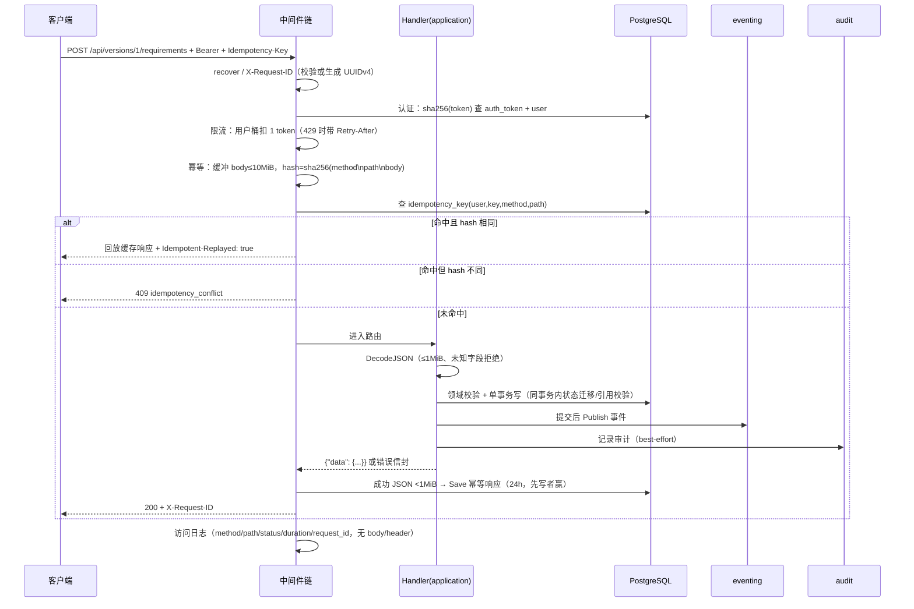
**讲解要点**：认证必须在幂等之前（幂等作用域含用户）；限流在认证之后（按用户计桶）；幂等缓冲发生在路由之前（body 只能读一次）；事件/审计在事务提交后（读侧不会看到未提交状态）；所有步骤的 request_id 贯穿信封、响应头与日志。
## 3 平台内核详细设计
### 3.1 配置加载与校验（config）
实现：[backend/internal/config/config.go](../backend/internal/config/config.go)（716 行，`Load(getenv func(string) string)`，无副作用、可注入测试）。

**设计要点**

1. **纯函数式加载**：只接受 `getenv` 函数，不直接读 `os`，单测可构造任意环境；返回 `(Config, error)`，错误信息**指名环境变量**而非 panic。
2. **三段式结构**：`Config` 结构体（强类型字段）→ 常量区（默认值与上下界，按阶段注释分组）→ `Load`（解析与区间校验）。所有整型都过 `parseBoundedInt`，唯一例外 `EZTEST_AUTONOMY_BATCHES_PER_TICK` 用 `parseUpperClampedInt`（超出上限钳制到 20，低于下限报错；设计理由：笔误不应阻止启动，也不能让一次 tick 扫全库）。
3. **必填项 fail-fast**：`EZTEST_DATABASE_URL`、`EZTEST_SECRET_KEYS`（JSON 对象 `{version: base64-32B}`）、`EZTEST_SECRET_KEY_ACTIVE`（必须在 keys 中）；首次启动额外要求 admin 用户名/密码（由 `EnsureAdmin` 校验，密码 ≥10 字符）。
4. **密钥材料校验在配置层完成**：base64 解码、必须 32 字节、版本号正整数、active 必须存在 —— 让错误尽可能早暴露。
5. **派生默认值**：`EZTEST_INSTANCE_ID` 缺省为 `hostname-pid`（截断到 64 字符，保留 pid 后缀）；`EZTEST_OPENAPI_PATH` 缺省 `docs/openapi/api.yaml`（相对进程 CWD，部署包必须传绝对路径）。
6. **布尔与日志级别**：`EZTEST_GC_ENABLED`、`EZTEST_ENABLE_TEST_ENDPOINTS` 用 `strconv.ParseBool`；`EZTEST_ENABLE_TEST_ENDPOINTS` 未设置时默认 `env != "prod"`；`EZTEST_LOG_LEVEL` 只接受 `debug|info|warn|error`。

**代码结构**：

| 区域 | 内容 |
|---|---|
| `Config` 字段 | 服务（Env/HTTPAddr/WebOrigin/DatabaseURL/TestDatabaseURL/Admin*/Secret*/5 个目录/Executor*/OpenAPIPath）、Agent、Codeintel、Execution、Delivery、RateLimit/GC/Leader、LogLevel/LLMSeed |
| 常量块 | `defaultAgent*`、`defaultSnowflake*`、`defaultCodeIntel*`、`defaultExec*`、`defaultRateLimit*/GC*/Visual*`、`defaultReportDir/DB*/Autonomy/Analysis/Supplement` |
| 解析辅助 | `valueOr`、`parseBoundedInt`、`parseUpperClampedInt`、`parseSecretKeys`、`parseLeaderLockKey`、`parseAgentHTTPAllowlist`、`parseLogLevel`、`instanceIDFor` |
| 校验点 | 必填、区间、正则（`EZTEST_CODEINTEL_PROMPT_VERSION` = `^[a-z0-9.-]{1,32}$`）、实例 ID 字符数 ≤64 |

> 53 个变量的分类表与"未接线变量"见 §10。
### 3.2 数据库连接与嵌入式迁移（db）
实现：[backend/internal/db/db.go](../backend/internal/db/db.go)、[db/migrate.go](../backend/internal/db/migrate.go)、[db/embed.go](../backend/internal/db/embed.go)。

**连接**：`db.Open(ctx, url)` 用 `pgxpool` 建立连接池并 `Ping`；`DB` 暴露 `Pool` 与 `Ping`（供 `/api/health` 就绪探针使用），`Close` 在退出时释放。连接池参数使用 pgx 默认值，不做自定义调参（单机场景足够，避免未验证的调参）。

**迁移算法**（`Migrate`，已实现 + 单测/集成测试）：

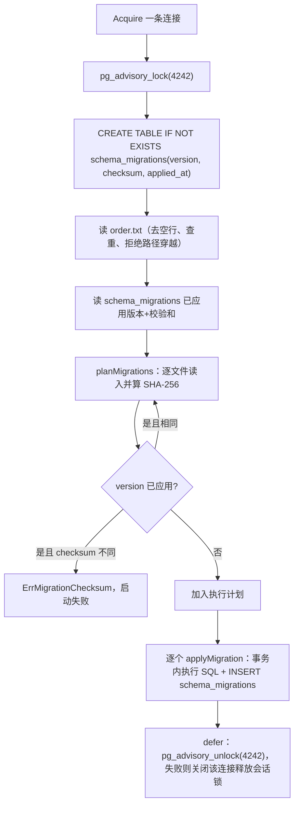
关键不变量：

1. **版本号 = order.txt 位置**（1-based），因此 `identity_0001` 与 `llm_0001` 不会冲突；`order.txt` 是唯一执行顺序来源。
2. **先全量校验再执行**：`planMigrations` 在任何 DDL 前完成所有文件的读取与 checksum 比对，坏文件不会造成"半升级"数据库。
3. **每个迁移独立事务**：`Exec(sql)` 走 pgx simple protocol（支持多语句）+ 记录行，两者同事务提交。
4. **checksum 固定**：已应用文件改动即启动失败（`ErrMigrationChecksum`）。没有 down 迁移；回滚 = 备份恢复。
5. **解锁健壮性**：解锁用 detached 5 s context（`context.WithoutCancel`），失败则关闭物理连接，让 PostgreSQL 释放会话级 advisory lock，避免把仍持锁的连接放回池。
6. 47 个迁移由 `//go:embed migrations/*` 编入二进制（`embed.go`），镜像只需携带二进制；`order.txt` 亦在 embed 范围内。`migrate_order_test.go` 断言 order 与文件集合一致。
### 3.3 HTTP 装配、中间件顺序与健康检查（server）
实现：[backend/internal/server/server.go](../backend/internal/server/server.go)（约 530 行）、`middleware.go`、`cors.go`、`health.go`、`ratelimit.go`。

**中间件真实顺序（outer → inner）**，由 `withMiddleware` 逆序包装得到：

```text
recover → X-Request-ID → 访问日志 → CORS → Bearer 认证 → 限流 → 幂等 → 路由
```
| 层 | 行为 | 关键代码 |
|---|---|---|
| recover | panic → 500 `internal` + stack 日志；因为它在 requestID 外层，从响应头取 request_id 写回 | `recoverMiddleware` |
| request ID | 客户端值仅当匹配 `^[A-Za-z0-9_-]{8,128}$` 才复用，否则生成 UUIDv4；写入 context 与响应头 | `requestIDMiddleware`、`platform/id.RequestID` |
| 访问日志 | 仅 method/path/status/duration/request_id，**不记 header/body**；`statusWriter` 实现 `Flush` 以兼容 SSE | `loggingMiddleware` |
| CORS | 只允许一个配置 origin，不带 credentials；预检 204 + `Access-Control-Max-Age: 600`；暴露 `X-Request-ID, X-Snapshot-Cursor, Idempotent-Replayed, Content-Disposition, X-Content-SHA256, Retry-After`；允许 `Authorization, Content-Type, X-Request-ID, Idempotency-Key, Last-Event-ID` | `cors.go` |
| 认证 | 仅对受保护路径生效：`/api/*` 除 `/api/auth/*`、`/api/health`、`/api/openapi.yaml`；OPTIONS 直接放行 | `authenticatedAPI`、`requiresAuthentication` |
| 限流 | 普通令牌桶（用户或 IP）+ SSE 并发上限；SSE 不计普通桶 | `ratelimit.go` |
| 幂等 | 写方法 + 带 `Idempotency-Key` 才介入；SSE/auth/流式 LLM 测试绕过 | `idempotency.Middleware` |

> **文档与代码不一致（已发现）**：`server.New` 顶部注释写 "recover -> request ID -> logging -> CORS -> auth -> idempotency -> routes"，漏掉了限流层；真实顺序包含 `limiter.Middleware()`（`withMiddleware` L345-349）。以代码为准。

**条件挂载**：`New(cfg, logger, deps)` 依次挂载 health/OpenAPI、auth、users、admin audit、admin GC、stream/stream-events、LLM、storage、agent（含 agent-center）、resources、version、codeintel、mindmap、execution、delivery、chain、workspace、search、quality、test publisher —— 每个都以对应 `deps.* != nil` 为前提。所有 admin 面统一包 `identityhttp.RequireAdmin` + `auditRequestContext`（后者把 request_id/IP/UA/actor 注入 context，供 handler 写审计）。

**健康检查**（`health.go`）：

| 端点 | 语义 | 返回 |
|---|---|---|
| `GET /healthz` | liveness，不触任何依赖 | 恒定 200 `{"status":"ok"}` |
| `GET /api/health` | readiness：DB ping（2 s 超时）；LLM 默认配置能解密；投影只读阈值 | 200 或 503；`data{status,version,commit,db,llm_configured,rate_limit{rps,burst,sse_max},gc{enabled,retention_days,batch_keep}}` |

构建信息：`server.Version`/`server.Commit` 由 `-ldflags "-X .../internal/server.Version=…"` 注入；`/api/openapi.yaml` 从 `EZTEST_OPENAPI_PATH` 读取，文件缺失返回 404 而非 500（部署未带文档是部署问题，不是服务故障）。

> 健康语义边界：`/api/health` 200 **不**代表执行器或 LLM 上游可用；执行器健康在批次创建时探测（503 `executor_unavailable`），LLM 可用性由 AI 路径的 503 `ai_unavailable`/降级表达。
### 3.4 平台公共件（platform）
| 文件 | 机制 | 关键语义 |
|---|---|---|
| `errors.go` | `APIError` 信封、`WriteError`、request-id context | 封闭错误码集合；`Retryable`/`Details` 可选项；信封与响应头 ID 一致 |
| `pagination.go` | 游标编解码、limit 校验 | base64url(int64 id)；`LimitError{Reason: not_integer\|out_of_range, Min, Max}`，`Details()` 返回 `{field,min,max}` |
| `validation.go` | `DecodeJSON(r, dst, maxBytes)` | 体 ≤1 MiB（默认）；必须 JSON object；`DisallowUnknownFields`；拒绝 trailing data；超限 `ErrBodyTooLarge` |
| `id/id.go` | `New()` 32B 随机 base64url（43 字符）；`RequestID()` UUIDv4 | 加密安全随机 |
| `id/snowflake.go` | 见 §2.6 | 严格递增、逻辑毫秒推进 |
| `crypto/aesgcm.go` | AES-256-GCM 密钥环 | `nonce(12)‖ciphertext`；`AAD` 绑定字段；版本化多密钥；未知版本/认证失败有独立 sentinel |
| `idempotency/` | 中间件 + PostgreSQL Store | 见 §7.7 |
| `leader/lock.go` | PostgreSQL 会话级 advisory lock | `Try` 非阻塞取锁，返回 release；解锁用 detached 5 s；解锁失败 hijack+close 连接 |

**AES keyring 细节**（`crypto/aesgcm.go`）：

- `NewKeyring(keys map[int][]byte, active int)`：每个 key 必须 32 字节，版本正数，active 必须在集合内。
- `EncryptWithAAD(plaintext, aad)` 返回 `(nonce‖ciphertext, keyVersion)`；`DecryptWithAAD` 对未知版本返回 `ErrUnknownKeyVersion`、对篡改/错 AAD 返回 `ErrInvalidCiphertext`。
- 设计目的：**同一列换行复制密文会解密失败**（AAD 绑定列/字段语义，如 `eztest.llm.api_key`、`eztest.llm.headers`）。
- 轮换：新增 key 版本并切换 `EZTEST_SECRET_KEY_ACTIVE`，旧版本保留可读；重新加密发生在 LLM 配置更新时。
### 3.5 事件总线与 SSE（eventing）
实现：[backend/internal/eventing](../backend/internal/eventing)（domain/application/infrastructure/postgres/interfaces）。

**存储模型**（`event` + `event_channel`，迁移 `eventing_0001_events.sql` + `eventing_0002_rename_tables.sql`）：

- `event`：`id BIGSERIAL`（内部行 id，不对外）、`channel`、`seq`、`type`、`version_id/batch_id/case_id/step_id/agent_role/session_id`、`ts`、`summary`、`detail JSONB`、`refs JSONB`；公开身份是 `(channel, seq)`。
- `event_channel(channel PK, last_seq, updated_at)`：每 channel 的单调计数器，**分配 seq 与插入事件同一事务**，因此 channel 不会暴露空洞。
- 信封约束（`domain/validate.go`）：channel ≤64 字符、type ≤100、summary ≤500（按 rune）、detail ≤64 KiB 且必须是 JSON object；refs 四数组恒存在（缺省 `[]`，不是 null）。

**发布路径**：`event.Service.Publish` → store（校验 → 分配 seq → 插事件 → 提交）→ 返回已提交 Event → `hub.Publish(event)`。**先提交后广播**，订阅者不会看到失败事件。

**Hub**（单实例、进程内）：

- 每 channel 一个 `map[subscriberID]chan Event`，缓冲 256；`Publish` 永不阻塞：缓冲满即删除该订阅并 close channel（慢消费者被断开，客户端用 Last-Event-ID 重放恢复）。
- `Subscribe` 返回只读 channel + 幂等 cancel；cancel 与 Publish 竞争时由 `removeLocked`/`close` 的一致性保证不重复关闭。

**SSE 端点**：`GET /api/stream?channel=...`（`sse.go`），另有 `GET /api/versions/{id}/stream` 强制 `version:{id}` 通道（客户端 `channel` 被忽略）；`GET /api/stream/events` 与 `GET /api/versions/{id}/events` 是 JSON 快照。算法细节（订阅-先回放、竞态、gap 回放、reset、心跳、慢消费者）在 §5.14 展开。

**通道鉴权**：`agent:{session_id}` 前缀通道在全局 stream 上要求 admin（`agentChannelAdminOnly`，否则 403）；其他通道只需登录。
### 3.6 审计（audit）
实现：[backend/internal/audit](../backend/internal/audit)（`audit_log` 表）。

- **追加式**：`Recorder` 端口只有 `Record/List/ListFiltered`，没有 update/delete（`audit/domain/repository.go` 明确无删除能力）。
- **写入**：`Service` 只做页大小夹取（默认 50、上限 100），落库由 `infrastructure/postgres` 完成；其他上下文通过 `auditapp.Recorder` 注入并自行构造 `Entry`（actor、action、target、request_id、IP、UA、metadata）。
- **读取**：`GET /api/admin/audit`（admin only），ID 游标倒序，过滤参数 `actor`（正整数用户 ID）、`action`（精确匹配，≤200 字符）、`from`/`to`（RFC3339，含边界，from ≤ to）；非法过滤 400 `invalid_argument`（`audit/interfaces/httpapi/handlers.go`）。
- **元数据注入**：`auditRequestContext` 在认证后把 request_id/IP/UA/actor 放入 context；服务层用 `auditapp.MetaFromContext` / `ActorIDFromContext` 组装 entry（如 `storage/application/service.go`）。
- **脱敏红线**：entry 中禁止密码、令牌、哈希、密钥、header 值（`audit/domain/entry.go` 注释 + 各服务实现）。存储对象的审计只记 `sha256/size/content_type`；LLM 测试只记 config id/model/protocol/duration/公开错误码。
- 审计写入是**best-effort**：失败只记日志，不改变业务响应（`storage` 的 `recordCreated` 即示例）。
### 3.7 内容寻址对象存储（storage）
实现：[backend/internal/storage](../backend/internal/storage)，本地文件系统适配器 `infrastructure/localfs/store.go`。

- **对象 ID = 小写 SHA-256**；路径 `<root>/ab/cd/<sha256>`（前 4 个 hex 字符两级散列，`objectPath`）。
- `Put`：流式读 + 边算 hash 边写临时文件，完成后原子 rename 到最终路径；已存在对象复用并**校验大小/内容**（`verifyExistingObject` 会重算 hash，损坏返回 `ErrCorrupted` → HTTP `storage_corrupted`）。
- 上传上限 10 MiB（`maxObjectBytes`）；`Content-Type` 必填（`ErrInvalidContentType`）。
- 元数据在 `storage_object(sha256 PK, size, content_type, relative_path, created_at)`；首次插入返回 `created=true` 才写审计 `storage.object_created`，重复上传去重且**不重复审计**；读/Stat 用持久化的 content type（`fillContentType`），缺失时回退 `application/octet-stream`。
- 接口：admin-only `POST /api/admin/storage/objects`、`GET /api/admin/storage/objects/{sha256}`；无公开 URL、无保留策略（对象由业务引用，GC 不覆盖 storage 上下文）。
- **定位**：`storage` 上下文按 D30 冻结为"既有能力/历史兼容"，新业务文件（附件/证据/报告/导出）走各自上下文的文件存储，而非 storage 对象存储。
### 3.8 LLM 网关（llm）
实现：[backend/internal/llm](../backend/internal/llm)。职责：**配置管理 + 上游协议适配 + 流式归一化 + 重试/超时 + 错误码**；被 `codeintel`、`agent`、`version`（澄清/知识注入）等上下文作为端口使用。

**配置模型**（`llm/domain/config.go`）：

| 字段 | 约束/默认 | 说明 |
|---|---|---|
| protocol | `chat_completions` 或 `responses` | OpenAI 兼容两种方言 |
| base_url | 归一化到以 `/v1` 结尾 | `normalizeBaseURL`：已以 `/v1` 结尾则不重复 |
| api_key / headers | AES-GCM 加密（AAD 绑定字段） | 永远不回显、不落日志；reserved header（`Authorization`/`Content-Type`）拒绝 |
| retry_count | 0–5，默认 2 | 首次尝试之外的次数 |
| retry_interval_ms | 100–30,000，默认 500 | 固定间隔 + 0–100 ms jitter |
| timeout_ms | 1,000–300,000，默认 60,000 | 覆盖整个操作（含重试） |
| stream_enabled / multimodal_enabled | 每配置开关 | 决定是否走流式/多模态探针 |
| is_default | 全库恰好一个 | 并发写 default 冲突 → `ErrDefaultConflict` |

首次启动 `SeedFromEnv` 用 `llm_base_url`/`llm_key`/`llm_model_name` 建默认配置（仅当库中无配置），key 立刻加密落库。

**客户端端口**（`llm/application/client.go`）：

```go
type Client interface {
    Chat(ctx, ChatRequest) (ChatResponse, error)
    ChatStream(ctx, ChatRequest) (<-chan StreamEvent, error)
    ListModels(ctx) ([]llm.ModelInfo, error)
}
```
`ChatRequest` 携带 `Messages []Message{Content []Part(text|image_url), ReasoningContent, ToolCalls, ToolCallID, Name}`、`Tools []ToolSpec`、`Stream/MaxTokens/Thinking/ReasoningEffort`。`StreamEvent` 是归一化事件：`Delta`、`ReasoningDelta`、`Done`（携带装配完成的 ToolCalls/FinishReason/Usage）或 `Err`；一个流最多一个终止事件。

**重试边界**（`llm/application/retry.go`）：

- 非流式：可重试错误（429/5xx/timeout，`LLMError.Retryable=true`）按 `retryCount` 重试，每次等待 `interval + rand(0..100ms)`，整体受 `timeout` 约束；超时后返回 `llm_timeout`。
- **流式只在"尚未返回流"时重试**：一旦 `ChatStream` 返回 channel，后续失败原样下发，绝不重启（避免重复输出）。`wrapStream` 负责在流结束/ctx 取消时释放操作 context。
- 错误映射（`deepseek/client.go`）：401/403→`llm_auth_failed`（不可重试）；429→`llm_rate_limited`（可重试）；4xx→`llm_bad_request`（不可重试）；5xx→`llm_upstream_error`（5xx 可重试）；超时→`llm_timeout`（可重试）；解析失败/流异常结束→`llm_invalid_response`（不可重试）；未配置→`llm_not_configured`。**上游 body 永不进入 message**（防凭据泄露）。
- 体积上限：非流式响应 4 MiB（`maxResponseBytes`），单条 SSE line 1 MiB（`maxSSELineBytes`）。

**协议适配**：`deepseek/chat.go`（chat completions：`delta.content`/`delta.reasoning_content`/`tool_calls` 分片累积）与 `deepseek/responses.go`（responses 协议：`response.output_text.delta` 等事件归一化）。工具调用分片按 `index` 累积成完整 `ToolCall{ID,Name,Arguments}`（arguments 为原始 JSON 串，不回编码）。多模态：`image_url` part 在 chat 协议映射为 `image_url`，在 responses 协议映射为 `input_image`；连通性测试含 1×1 PNG 探针（`interfaces/httpapi/testdata/pixel.png`）。

**管理面**：admin-only `/api/admin/llm/configs`（CRUD + `catalog/refresh` + `test`）；测试支持非流式与流式（SSE `llm.delta/llm.done/llm.error`），审计 `llm.test_succeeded/failed`。
### 3.9 进程生命周期、后台 worker 与优雅停机
`main.go` 的停机顺序是设计的一部分（注释明确"顺序是刻意的，避免停机 abort 被误判为用例结论"）：

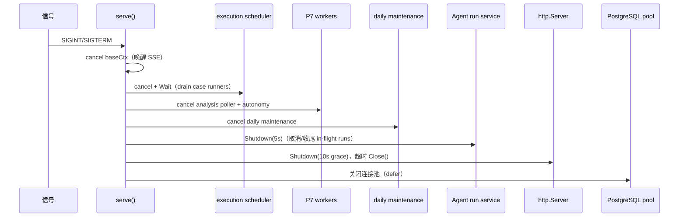
| Worker | 启动位置 | 触发 | 单实例保护 |
|---|---|---|---|
| codeintel 异步 worker | `codeIntelWorker.Start()`（启动早期） | 队列（16） | 进程内；并发受 `EZTEST_CODEINTEL_MAX_CONCURRENT_ANALYSES` |
| execution scheduler | `go executionScheduler.Start(ctx)` | 2 s tick / Notify | leader lock（派生 key） |
| P7 analysis poller | `deliveryAnalysisService.Worker(ctx)` | 2 s 轮询 agent session | 无（幂等 + 状态 CAS） |
| autonomy worker | `go autonomyWorker.Start(ctx)` | tick | leader lock |
| mindmap run coordinator | `mindmapRun.Worker(ctx)` | 2 s 轮询 | 进程内 + 每 kind 单飞 |
| daily maintenance | `go dailyMaintenance.Start(ctx)` | 每日一次 | leader lock |
| P1 Agent runner | 每次 run 一个 goroutine | 请求触发 | 全局并发 `EZTEST_AGENT_MAX_CONCURRENT_RUNS`、每 session 单活跃 |

Boot recovery（启动时同步执行）：`runService.RecoverInterrupted`（running agent run → `interrupted`）、`mindmapRun.RecoverStale`（queued/running → failed, reason `worker_restart`）、执行调度器的启动结算（残留 running case run 由规则决定重跑或结算）。
## 4 限界上下文详细设计
> 每个上下文按固定结构描述：职责与依赖 → 领域模型/不变量 → 应用服务与用例 → 仓储/端口 → HTTP 路由 → 事件/审计 → 错误与状态机 → 测试要点。路由数为该上下文 `interfaces/httpapi` 注册的 method+path 模式数（合计 223，见 §7.2）。
### 4.1 identity（身份与认证）
**职责与依赖**：唯一的账户/令牌来源；不依赖其他业务上下文，被全部 HTTP 面复用（全局 Bearer 中间件 + `RequireAdmin`）。表：`user_account`、`auth_token`（迁移 `identity_0001_users.sql`、`0002_auth_tokens.sql`、`0003_rename_tables.sql`）。

**领域模型与不变量**

| 对象 | 关键字段/约束 |
|---|---|
| `User` | `id BIGSERIAL`、`username` 唯一、`password_hash`（bcrypt cost 12）、`role ∈ {admin,user}`、`status ∈ {active,disabled}`；**部分唯一索引保证全库最多一个 admin 行** |
| `Token` | 只存 `sha256(raw)`；`expires_at = issued + 12h`；`last_seen_at` 最多每 5 min 刷新一次；logout 撤销、重置密码撤销该用户全部令牌 |

- 令牌格式：`ezt_` + 32 字节随机 base64url；明文只在登录响应出现一次。
- 密码：bcrypt cost 12，密码长度上限受 bcrypt 72 字节窗口约束（`user_service_test.go` 有专项测试）。
- 角色只有两种，无 RBAC；admin 唯一性由数据库而非应用保证。

**应用服务**：`AuthService`（Login/Authenticate/Logout）、`UserService`（EnsureAdmin/Create/Update/ResetPassword/List）。`EnsureAdmin` 仅当库无 admin 时用 env 凭据创建；`Authenticate` 校验 token → 查用户 → 状态检查 → 刷新 last_seen（失败不影响认证）。

**登录限流**（内存）：`identityhttp.NewLoginLimiter` 以 IP+username 为键，1 分钟内 5 次失败锁定 1 分钟；bounded 10k 条目防内存膨胀；拒绝记录审计 `auth.login_failed`。`remoteIP` 故意忽略转发头（客户端可控）。

**HTTP 路由（8）**：`POST /api/auth/login`（公开）、`GET /api/auth/me`、`POST /api/auth/logout`（handler 内认证）；admin `GET|POST /api/users`、`GET|PATCH /api/users/{id}`、`POST /api/users/{id}/reset-password`。

**事件/审计**：`auth.login_succeeded|failed`、`auth.logout`、`user.created|updated|password_reset`。**测试要点**：token 过期、last_seen 5 min 节流、logout 撤销、admin 唯一、禁用用户登录拒绝、限流锁定。
### 4.2 resource（公共资源与会话）
**职责与依赖**：管理被测系统、环境、应用模型、账号与访问、浏览器会话、本地代码仓、环境 DB 目标；依赖 `platform/id`、`audit`、`platform/crypto`（不用）、只读网络/Git/DB 适配器。表 13 张：`company`（单行种子、无 CRUD）、`system`、`environment`、`app_model_node`、`account`、`account_system_access`、`session`、`session_snapshot`、`session_lease`、`manual_takeover`、`auth_flow`、`code_repository`、`db_target`。

**领域模型与不变量**

| 聚合 | 关键不变量 |
|---|---|
| Company/System/Environment | 单公司种子；请求不携带 company id，服务层解析默认公司；环境 `kind ∈ {dev,staging,prod,other}`；环境绑定 baseUrl/allowedHosts/login_check/db_target |
| AppModel | `kind ∈ {page,route,api,component}`；来源 `manual\|import\|explored`（P5 扩宽 CHECK） |
| Account/Access | 账号 → 每系统一条 access（authType、login_flow_id、并发上限、凭据状态）；**凭据明文**（D28 决策） |
| Session | 状态机 `pending→acquiring→valid→refreshing→expired/invalid/revoked/failed`，`needs_manual` 为人工接管态；`storage_state` 明文；快照 `session_snapshot`、租约 `session_lease`、人工接管 `manual_takeover(waiting\|completed\|cancelled\|expired)` |
| CodeRepo | 本地只读 Git：path 校验、固定分支、索引状态；D21/D22 不切分支、不改工作树 |
| DBTarget | 一环境一目标；admin-only；仅 PostgreSQL；**密码明文**（D48 例外），API 永不回显 |

**应用服务**：`CatalogService`（系统/环境/应用模型 CRUD）、`AccessService`、`SessionService`（导入/验证/确认/失效/撤销/接管 + 自动登录单飞）、`CodeRepoService`（validate via `gitexec`）、`DBTargetService`（upsert/test 只读探测）、`AuthFlowService`。会话登录检查用 `httpcheck.Checker`（只读 HTTP 探针）。

**仓储/端口**：`resourcepostgres` 4 个仓储（Catalog/Access/Session/CodeRepository）+ `AuthFlowRepository`（雪花 ID）+ `DBTargetRepository`；`pgreadonly.Querier` 同时服务 P7 DB 断言。

**HTTP 路由（53）**：`/api/resources/*` 全部读写；GET 所有登录用户可用，写/动作路由加 admin guard。覆盖 systems/environments/app-models/code-repos/accounts/accesses/auth-flows/sessions/snapshots/takeovers/environments/{id}/db-target。

**事件/审计**：会话生命周期 `resource.session_imported|validated|confirmed|invalidated|revoked`、`resource.takeover_requested|completed|cancelled`、`resource.db_target.upserted|tested|deleted`。**测试要点**：单公司解析、会话状态迁移、接管过期、DB 目标只读、凭据不回显、admin guard。
### 4.3 version（版本、需求、澄清、知识）
**职责与依赖**：版本工作区核心。依赖 `resource`（绑定校验）、`agent`（澄清会话/run）、`eventing`、`audit`、Git 只读、文件系统（附件）、LLM（经 agent 网关）。表 8+1 张：`version`、`requirement`、`requirement_relation`、`requirement_attachment`、`clarification_session`、`clarification_question`、`decision`、`knowledge_entry`；`version_change` 由 codeintel 迁移创建但语义属于版本变更快照。

**领域模型与不变量**

| 聚合 | 关键字段与不变量 |
|---|---|
| Version | `status`、`paused bool + pause_mode(graceful\|immediate)`、`batch_no`、`continue_phase(clarifying\|designing\|executing)`、`code_baseline_commit`、绑定 system/environment/code_repo；**新增/确认/重开需求永不回退 status**（D31），唯一例外是 completed 上创建需求自动 `continuing`（D43） |
| Requirement | `status draft\|clarified\|designed\|verified\|obsolete`（实现仅 `draft⇄clarified`）、`priority must\|should\|could`、`source user\|ai`、验收标准、附件 |
| Relation | `depends_on\|conflicts_with\|overlaps\|shares_scope`；跨需求图 |
| Clarification | session `active\|completed\|cancelled`、question `open\|answered\|dismissed`、decision `proposed\|accepted\|rejected` |
| Knowledge | `kind pattern\|pitfall\|decision\|case_idea`、`status draft\|approved\|rejected`、`confidence high\|medium\|low`；P8 注入澄清/设计 prompt（限额见 §10） |

**应用服务**：`VersionService`（Create/Update/Bindings/StartClarification/EnterDesign/Complete/Continue）、`RequirementService`（CRUD/Confirm/Reopen，含继续中同事务迁移）、`RelationService`、`ClarificationService`（会话、问题、决策、AI 消息）、`AttachmentService`（文件存储 + 文本提取 + 图片 `image_ref`）、`KnowledgeService`（创建/审核/批准读注入）。

**关键算法**：进入设计时允许未澄清需求，但需 `acknowledgeUnclarified` 二次确认（409/400 由 reason 表达）；继续中迁移与需求创建同事务（§5.13）；附件大小/类型限额由 `version/domain/limits.go` 定义。

**HTTP 路由（43，不含 mindmap）**：versions 8、requirements 7、relations 4、clarification 7、questions 3、decisions 3、attachments 4、knowledge 5、版本事件/SSE 2；全部登录用户可用（无 per-route guard）。

**事件/审计**：事件 `version.created/updated/status_changed`、`requirement.added/clarified/updated/deleted/reopened`、`requirement.relation_*`、`clarification.session_started|completed`、`clarification.question_updated`、`clarification.context_updated`、`decision.proposed|decided`、`attachment.added|removed`、`knowledge.created|reviewed`；审计 `version.created|updated|completed|continued`、`version.requirement_*`。**测试要点**：状态机边界、继续中唯一例外、只读确认需求、关系唯一性、附件大小、知识注入限额。
### 4.4 codeintel（代码智能）
**职责与依赖**：只读本地 Git 的 T0 确定性层 + LLM 的 T1 影响分析层；依赖 `resource`（仓库/应用模型）、`version`（版本/需求）、`eventing`、`audit`、`llm`。表 11 张：`code_change_set`、`code_index_run`、`code_entity`、`code_edge`、`code_fact_version`、`code_analysis_cache`、`code_analysis`、`code_impact_candidate`、`code_anchor`、`code_fact_review`、`version_change`。

**领域模型与不变量**

| 对象 | 说明 |
|---|---|
| IndexRun | 异步索引任务：repo/commit/状态/统计；worker 队列满 → 429 `analysis_queue_full` |
| Entity/Edge | 文件级实体与跨栈契约边（`route_to_api` = method + 归一化 path） |
| FactVersion | 事实按 `fact_key` 版本化；相同语义复用，变更则 version+1 并给旧版 `superseded_at` |
| AnalysisCache | 键 `(repo, commit, path, file_hash, model, prompt_version)`；命中不调 LLM（D33） |
| Analysis/Candidate | 影响分析 run + 候选（requirement/app-model），带 confidence、source（direct>contract>relation>ai）、证据摘录 `path+行号+sha256` |
| Anchor | `subject_kind` 含 requirement/app_model/case/issue；`file:line` 由服务端校验 |
| FactReview | 人工事实修正记录（P8） |

**应用服务**：`IndexService`（T0 索引，异步）、`AnalysisService`（影响分析：T0 先行，LLM 可用则增强，否则 `done+degraded`）、`AnchorService`、`FactReviewService`、`RepoQualityService`（覆盖率/事实质量投影）、`GitReader` 只读适配器（`git` CLI）。

**限额**（`EZTEST_CODEINTEL_*`）：20 changed files、64 KiB/file、5,000 index files、180 s 分析超时、并发 1、摘录 40 行、diff 256 KiB；prompt version 默认 `p4.1` 参与缓存键与事实版本。

**HTTP 路由（21）**：`/api/code/repos*` 13 条（树/文件/diff/search/commits/facts/quality/reviews/index）+ `/api/versions/{id}/code/*` 8 条（changes/analyses/anchors）；仅 T0 索引触发加 admin guard，其余登录可用。

**事件/审计**：`code.changed`、`code.impact_computed`（版本通道，只摘要）；审计 `code.read/analyze/review`。**测试要点**：cache 命中、fact 版本化、证据按 commit 内容校验、AI 不可用降级、锚点主体校验、queue full 429。
### 4.5 mindmap（用例脑图）
**职责与依赖**：场景/用例树的设计、评审、冻结、导出与视觉断言管理；依赖 `version`（生命周期、需求来源）、`codeintel`（锚点）、`agent`（4 个设计 Agent）、`eventing`、文件系统导出。表 10 张：`case_node`、`case_step`、`case_assertion`、`case_visual_assertion`、`case_source`、`case_review`、`case_review_finding`、`case_baseline`、`case_design_run`、`case_export`。

**领域模型与不变量**

| 对象 | 状态/约束 |
|---|---|
| case_node | `draft\|reviewed\|executed\|supplemented\|merged\|rejected\|needs_revalidation`；场景/用例两类；树内排序 |
| case_step | action/expected/data；序号连续 |
| case_assertion | `ui\|api\|db\|text\|visual`；target/expression/expected |
| case_visual_assertion | 基线图、阈值、viewport/DPR 指纹、对比结果 |
| case_design_run | `kind explore\|design\|review\|data_plan`（+P7 `incremental_design\|supplement`）、`status queued\|running\|done\|failed\|degraded`；每 kind 单活跃 |
| case_baseline | 冻结时间/`graph_hash`/节点内容快照；**永久只读**，只允许受控叠加（D44） |
| case_review / finding | `draft\|approved\|rejected`；finding `open\|fixed\|dismissed` |
| case_export | Markdown/Mermaid/OPML 文件元数据 + sha256 |

**应用服务**：`GraphService`（节点/步骤/断言/来源/排序、冻结后 409 `baseline_frozen`、受控叠加写路径）、`RunService`（4 类 Agent run：启动、单飞、recover stale）、`ExploreService`（应用探索：HTTP 只读 BFS，40 请求 / 60 s 预算）、`ReviewService`、`BaselineService`、`ExportService`、`VisualAssertionService`（基线审批 ≤5 MiB）。

**硬编码限额（未接线 env，见 §10.3）**：`materializeMaxCases=60`、`exploreMaxRequests=40`、`exploreTotalTimeout=60s`。

**HTTP 路由（31，全部 `/api/versions/{versionId}/mindmap` 下）**：图 CRUD 14、视觉 2、锚点 2、runs 3、增量 2、评审 5、导出 3。

**事件/审计**：`case.created/updated/deleted/reviewed/baseline_frozen/supplemented/revalidation_marked/export_ready/visual_baseline_approved`、`gate.pending/resolved`；审计 `mindmap.case_created|deleted|reordered`、`mindmap.tool.invoked`、`case.export.created`。**测试要点**：冻结后写入 409、受控叠加、单飞、导出确定性、blocker 批准需显式确认。
### 4.6 execution（执行引擎）
**职责与依赖**：批次调度、用例执行、证据、暂停/恢复、DB/视觉断言、GC；依赖 `mindmap`（基线/节点）、`resource`（会话/账号/DB 目标）、`agent`（执行 Agent）、`delivery`（自主链触发）、executor 服务、文件系统。表 6 张：`run_batch`、`case_run`、`step_result`、`assertion_result`、`evidence`、`evidence_ref`。

**领域模型与不变量**

| 对象 | 状态/约束 |
|---|---|
| run_batch | `planned\|running\|done\|failed\|cancelled` + `paused bool` + `pause_mode`；kind `baseline\|incremental\|supplement`；`parent_batch_id`；**单版本单活跃批次**（部分唯一索引 `uk_run_batch_active`）；`graph_hash`、`base_commit/head_commit`、`history_rewritten`、`base_fallback_reason` |
| case_run | `pending\|running\|passed\|failed\|blocked\|inconclusive\|skipped\|interrupted`；终态四态；`failure_class`；`source`（baseline/ai_supplement/incremental）；attempts、timeout、快照引用 |
| step_result | `pending\|running\|passed\|failed\|interrupted`；seq 连续、按快照步骤一一对应 |
| assertion_result | passed/failed/not_run + reason；覆盖 ui/api/db/text/visual |
| evidence | 不可变文件（screenshot/network/console/http/db_result/download/visual_actual/visual_diff），`sha256`、大小、类型；每用例 ≤100 条、单条 ≤10 MiB |

**应用服务**：`BatchService`（创建门禁、计划、暂停/恢复/取消、报告派生）、`Scheduler`（tick 派发、并发上限、leader lock、session 复用）、`CaseRunner`（执行 Agent 循环、步骤/断言提交、预算、超时、证据落盘）、`EvidenceService`（下载/元数据/GC）、`Recorder`（结果持久化 + 事件）、`Recovery`（重启恢复）、`DBAssert`、`VisualAssert`、`GCService`、`AutonomyWorker`、`Maintenance`。

**HTTP 路由（14）**：`/api/versions/{id}/batches*` 6、case-runs 3、execution/sessions 1、evidence 2、batch report 2（`/batches/{batchId}/report` 与 `/export`）。

**事件/审计**：`batch.created|started|paused|resumed|finished`、`run.started|paused|resumed|finished`、`step.finished`、`case.status_changed`、`human.requested`、`gate.pending|resolved`；审计 `execution.batch.created|paused|resumed|cancelled`、`execution.case.finished`、`execution.db_assert.executed`。**测试要点**：单活跃批次、快照一致性、暂停模式、检查点恢复、预算耗尽 = inconclusive(model)、停机不误判、boot recovery。
### 4.7 delivery（问题与报告）
**职责与依赖**：交付物：问题、问题引用、报告 revision、分析 run、全局中心；依赖 `execution`（批次/用例/证据）、`mindmap`（用例）、`codeintel`（锚点）、`version`、`agent`（失败分析/分诊） 。表 5 张：`issue`、`issue_ref`、`report`、`report_ref`、`analysis_run`。

**领域模型与不变量**

| 对象 | 状态/约束 |
|---|---|
| issue | `open\|confirmed\|dismissed`（终态，不重开）；category `defect\|requirement_gap\|other`；severity `blocker\|major\|minor\|info`；source `ai\|human`；`dedupe_key` 唯一 `(version_id, dedupe_key)`；`recurrence_count`；`expectedRevision` CAS |
| issue_ref | 引用类型 `case_run\|case_node\|step_result\|evidence\|requirement\|batch\|commit\|code_anchor`；重复失败只追加引用 |
| report | `draft\|published\|stale`；`(batch_id, revision)` 唯一；`input_fingerprint`（小写 sha256）；Markdown 路径/sha256/size；旧 revision 永不覆盖/删除 |
| analysis_run | `queued\|running\|done\|failed\|degraded`；kind `failure\|issue_triage` |

**应用服务**：`IssueService`（人工建单、确认/驳回、去重合并、CAS）、`IssueIngest`（AI 草稿入库：一事务内按 dedupe_key 合并或插入）、`ReportService`（Ensure/Regenerate/Get/List/Diff/Export/RefreshStale）、`AnalysisService`（失败分析 run 编排）、`GlobalReader`（跨版本只读中心）。

**HTTP 路由（16）**：versions/issues 4、reports 7、batch analysis 3、全局 `GET /api/issues`、`GET /api/reports`。

**事件/审计**：`issue.created|updated`、`report.published|stale`、`analysis.started|finished`；审计 `delivery.issue.created`、`delivery.report.published|exported`、`delivery.analysis.started|finished`。**测试要点**：去重幂等（相同 ref 集 = 重放不增计数）、驳回必填原因、revision 冲突读赢家、fingerprint 稳定性、stale 只发一次事件、报告导出 sha256 校验。
### 4.8 agent（Agent 运行时）
**职责与依赖**：LLM 工具循环的通用运行时；被 version/mindmap/execution/delivery 复用。依赖 `llm` 网关、工具注册表（各上下文实现的工具）、`eventing`（活动流）、`audit`。表 4 张：`agent_profile`、`agent_session`、`agent_run`、`agent_message`。

**领域模型与不变量**

| 对象 | 关键字段/约束 |
|---|---|
| agent_profile | `key` 唯一、`builtin`；system_prompt ≤32,768 字符；allowed_tools 白名单（启动时对照实时注册表校验）；`max_turns 0–100`（0=无限）；`run_seconds 30–3600`；`hard_timeout_seconds 5–300`；thinking auto/enabled/disabled；reasoning_effort none/low/high/max；max_output_tokens 1,024–131,072；model 空 = 默认 LLM 配置 |
| agent_session | 会话标题、activity_channel（默认 `agent:{session_id}`，可指定 version 通道）、状态 |
| agent_run | `running\|done\|failed\|aborted\|interrupted`；终态原因 `completed\|max_turns\|timeout\|model_error\|context_overflow\|aborted_streaming\|aborted_tools\|aborted\|shutdown\|run_hard_timeout\|interrupted`；`turns`、usage、错误 |
| agent_message | LLM 上下文的**权威来源**；`part/kind/status`、tool_call_id、payload JSONB；事件只是其 UI 投影（D27） |

**应用服务**：`ProfileService`（12 个内置 profile 的幂等 seed/更新）、`SessionService`、`RunService`（Start/Abort/Shutdown/RecoverInterrupted、全局并发、每 session 单 run）、`Runner`（循环 + 预算 + 硬超时 + 上下文构建）、`ToolExecutor`（审计每次调用）、`ContextBuilder`（窗口预算）、`ToolRegistry`（64 个工具定义；无 `EZTEST_AGENT_FILE_ROOT` 时注册 62 个）、`CenterService`（13 角色目录/运行观察/质量指标）。

**活动契约 V1（冻结）**：事件 `type=agent.activity`、`channel=agent:{session_id}`、`agent_role=profile.key`、`session_id` 字符串；`detail.kind ∈ run_started|user_message|thinking|text|tool_use|tool_result|usage|decision|run_finished`；thinking/text 分段（1500 ms 或 1024 字符，`final` 标记，按 `(message_id, part)` 重组）；事件只带 preview，全文走消息详情端点。

**HTTP 路由（15）**：admin `/api/agents` 12 条（profiles CRUD/工具目录/sessions/消息/stop）；`/api/agent-center/{catalog,sessions,quality}` 3 条所有登录用户可读（只读，永不返回 prompt/transcript）。

**事件/审计**：`agent.activity`；审计 `agent.profile.updated`、`agent.session.deleted`、`agent.run.aborted`、`agent.tool.invoked`。**测试要点**：单活跃 run、并发预算、max_turns/超时终止原因、工具白名单校验、工具结果 32 KiB 截断、活动事件分段重组、中心不泄漏 prompt。
### 4.9 chain（探索链路只读模型）
**职责**：把「需求 → 用例 → 结果 → 问题」四层确定性图投影出来，供前端 React Flow 渲染；**只读、无表、无写路径**（D53/D54）。依赖 5 个 provider（version/mindmap/execution/delivery/codeintel），每个 provider 用批量 SQL 读自己的层（`chain/application` 注入 `versionchain`/`mindmapchain`/`executionchain`/`deliverychain`/`codeintelchain`，均为只读查询包）。

**算法要点**：应用服务对请求过滤（requirement 状态/结果状态/问题严重度与状态/搜索）、应用"latest-attempt 规则"（同一 case 只取最新 case_run）、节点预算（limit 50–2000 默认 300，requirementLimit 1–500 默认 100；超预算置 truncated 标志）。**路由 1**：`GET /api/versions/{versionId}/exploration-chain`。

**测试要点**：空链、部分层缺失（provider 可选）、预算截断、latest-attempt 正确性、过滤组合。
### 4.10 search（全局搜索）
**职责**：跨实体只读搜索，聚合 3 个 provider（版本/需求、脑图节点、交付问题/报告）。**无表**。查询 `q` 1–100 字符，每类型 1–20 默认 5；聚合失败时返回已得结果并置 `degraded=true`（不整体失败）。**路由 1**：`GET /api/search`。

**测试要点**：空查询 400、每类型上限、部分 provider 失败降级、越权数据不可见（只返回登录用户可读内容）。
### 4.11 workspace（待办中心）
**职责**：聚合「待评审、待接管、待决策 gate」等人工待办；所有登录用户得到评审组，admin 额外得到接管/关卡项（服务端按 identity 过滤，D56）。**无表**。**路由 1**：`GET /api/todos`（limit 1–200 默认 50）。

**测试要点**：普通用户看不到 admin 项、gate 状态过滤、limit 边界。
### 4.12 quality（评测与质量中心）
**职责**：持久化评测 run 与指标，供质量中心展示与门槛判断。表 2 张：`eval_run`、`eval_metric`（迁移 `quality_0001_eval.sql`）。评测由脚本 `scripts/eval.ps1` 驱动（确定性 `deterministic` 与 `real_llm` 两种 mode），HTTP 面只提供**读取 + 记录**。

**领域模型**：`eval_run(mode, corpus, model, status running|passed|failed|error, started/finished)`；`eval_metric(name, value, threshold, baseline, verdict, counts)`。6 个基线指标：`design_coverage`、`impact_recall`、`impact_precision`、`classification_accuracy`、`issue_false_positive_rate`、`supplement_hit_rate`，另加 `visual_classification_accuracy`（P8）。

**HTTP 路由（3，admin only）**：`GET|POST /api/quality/eval-runs`、`GET /api/quality/eval-runs/{id}`。**测试要点**：指标由服务端派生（不信任客户端 verdict）、最新 run 投影、admin guard。
### 4.13 eventing（事件上下文）
**职责**：持久化事件流 + 进程内广播 + SSE/快照 + 测试发布器。表 2 张：`event`、`event_channel`。

**端口**：`Store`（Publish/ListAfter/ListBefore/LatestSeq）、`EventReader`、`EventSubscriber`（Hub）；应用 `Service` 组合 store + hub，提供 `Publish/List/Subscribe`。详见 §3.5、§5.14。

**HTTP 路由（2）**：`GET /api/stream`（SSE）、`GET /api/stream/events`（快照）；版本级 `/stream`、`/events` 由 version 上下文注册但复用同一 handler。**测试要点**：seq 单调、channel 隔离、cursor too old、回放分页 500、慢消费者断开、reset 帧不持久化。
### 4.14 storage（对象存储上下文）
**职责**：内容寻址对象存储（D30 前遗留能力）。表 1 张：`storage_object`；本地文件系统适配器 `localfs`。**路由 2（admin only）**：`POST /api/admin/storage/objects`、`GET /api/admin/storage/objects/{sha256}`。详见 §3.7。**测试要点**：去重、校验和失败、大小限制、Content-Type 要求、审计只写一次。
### 4.15 audit（审计上下文）
**职责**：append-only 审计日志。表 1 张：`audit_log`。**路由 1（admin only）**：`GET /api/admin/audit`。详见 §3.6。**测试要点**：倒序 ID 游标、过滤参数校验、无删除/更新路径、凭据永不入 entry。
### 4.16 llm（LLM 网关上下文）
**职责**：LLM 配置 CRUD、协议适配、重试、模型目录、连通性测试；表 1 张：`llm_config`。**路由 6（admin only）**：`GET|POST /api/admin/llm/configs`、`PATCH|DELETE /api/admin/llm/configs/{id}`、`POST .../catalog/refresh`、`POST .../test`。详见 §3.8。**测试要点**：加密落库/解密读取、reserved header 拒绝、default 唯一、重试边界（流式只重试未开流）、错误码泄漏防护、多模态探针。
### 4.17 跨上下文依赖矩阵
**约定**：命名 `<provider>/infrastructure/<consumer>` —— 适配器放在**提供方**上下文的 infrastructure 里，实现**消费方** application 声明的端口；`cmd/eztest` 负责注入。因此上下文之间不存在 `import .../infrastructure/...` 的横向依赖：消费方只依赖自己的端口接口，提供方只依赖消费方的 application 包（接口）。这是 DDD 依赖倒置 + 单一装配根的组合。

| 提供方 | 对外适配器（目录） | 服务的消费方/端口 |
|---|---|---|
| version | `version/infrastructure/resource`（绑定校验）、`eventing`（事件发布）、`audit`（审计）、`filestore`（附件）、`gitread`（只读 Git）、`agent`（澄清会话）、`chain`/`search`/`workspace`（只读投影 provider） | version 自身端口 + chain/search/workspace 的 provider 端口 |
| codeintel | `codeintel/infrastructure/{resource,version,eventing,audit,llm,gitx,delivery,chain}` | 影响分析需要仓库/版本/事件/审计/LLM；chain 需要代码层 |
| mindmap | `mindmap/infrastructure/{version,resource,codeintel,agent,audit,eventing,filestore,httpclient,chain,search,agenttools}` | 版本生命周期、锚点、Agent run/工具、导出、探索 HTTP、链/搜索投影 |
| execution | `execution/infrastructure/{mindmap,resource,version,agent,delivery,codeintel,eventing,audit,filestore,browser,chain,workspace}` | 基线/快照、会话与 DB 目标、执行 Agent、自主链触发、证据文件、executor 客户端 |
| delivery | `delivery/infrastructure/{execution,mindmap,version,codeintel,agent,eventing,audit,filestore,report,refs,chain,search}` | 批次/用例/证据读、失败分析 Agent、报告文件、问题引用解析、链/搜索投影 |
| agent | `agent/infrastructure/{llm,eventing,audit,postgres,tools}` | LLM 客户端端口、活动事件、审计、消息/运行仓储、64 工具实现 |
| resource | `resource/infrastructure/{postgres,gitexec,httpcheck,pgreadonly,audit}` | Git 只读校验、登录检查、只读 DB 查询、审计 |
| eventing | `eventing/infrastructure/{postgres,hub}` | Store 端口、进程内订阅 |
| llm | `llm/infrastructure/{deepseek,postgres}` | 协议适配、配置仓储 |
| storage/audit/quality | 各自 `infrastructure/postgres`（+ storage `localfs`） | 自身端口 |

**只读投影的例外**：`chain`/`search`/`workspace` 的 provider 用**单条/批量 SQL 直接读提供方表**（如 `version/infrastructure/chain.Reads`），而不是调用提供方 application 服务。理由：只读聚合需要一次查询取完整一层，避免跨上下文 N+1 调用与事务耦合；这些 SQL 仍归属提供方目录、由提供方维护表结构，属"读模型"而非越界写。
## 5 关键流程与算法详细设计
> 本章是面试讲解的核心：每一步给出**触发条件 → 数据读写 → 判定规则 → 失败语义 → 代码位置**。状态机与关键时序用 Mermaid 表达。
### 5.1 澄清对话流程
**参与方**：前端澄清 tab → version 上下文 `ClarificationService` → agent 运行时（profile `clarification-dialog`）→ LLM 网关 → 事件总线 → 前端 SSE。

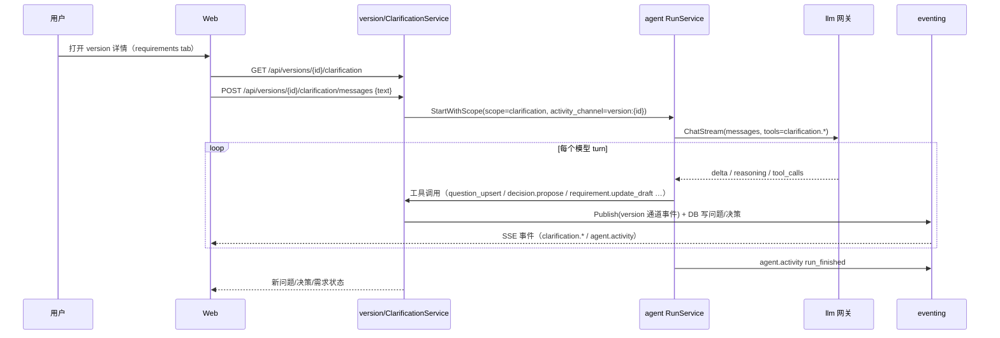
**规则**：

1. 一个版本同时只有一个澄清 run（单飞）；启动前 `AIReady` 探针拒绝"未配置/不可用"的 AI（503 `ai_unavailable`），容量由 `RunService.Start` 原子检查（`ErrCapacity` → 503）。
2. 澄清 Agent 的工具白名单固定 11 个（读写澄清上下文/需求草稿/关系/决策），每次工具调用审计 `agent.tool.invoked`。
3. 问题/决策的写路径由**服务端校验**：tool 只提交结构化参数，服务端负责状态迁移与事件（`clarification.question_updated`/`decision.proposed|decided`）。
4. 澄清会话结束 `POST .../sessions/{sid}/complete` → `clarification.session_completed`；需求确认独立于澄清（§5.2）。
5. 前端用 `connectSSE` 订阅 `version:{id}`，把 `detail.kind=tool_use|tool_result` 渲染为工具行，`text/thinking` 分段流式显示，`usage` 显示 token。

**错误语义**：run 取消 → 保留部分内容（`aborted_streaming|aborted_tools`）；token 预算耗尽 → run 以 `max_turns`/`timeout` 终态结束，用户可见；LLM 错误码原样映射到 `llm_*`。
### 5.2 需求确认与版本状态机
**版本状态机**（`version/domain/version.go` + 各服务的迁移点）：

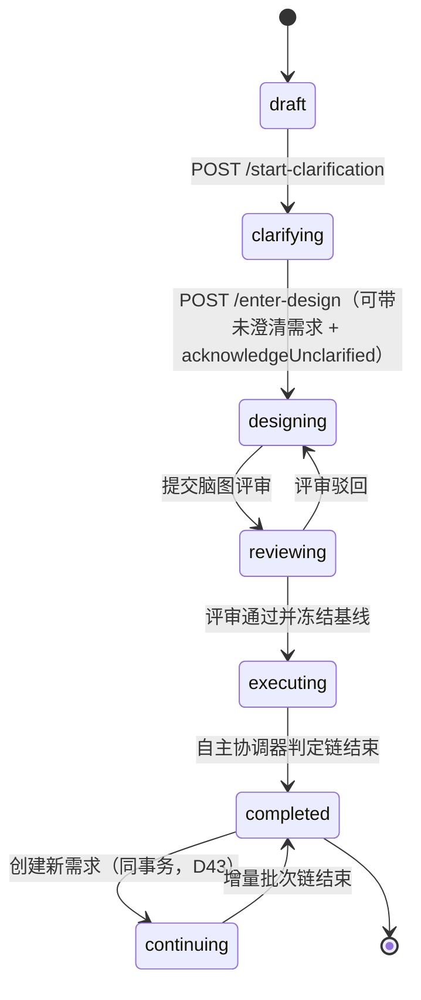
**需求状态**：枚举 `draft|clarified|designed|verified|obsolete`，实际实现迁移仅 `draft→clarified`（confirm）与 `clarified→draft`（reopen）；`designed/verified/obsolete` 为预留枚举（有 CHECK 约束，无业务迁移）。**不变量**：需求的创建/确认/重开不改变版本状态（D31）；唯一例外是 completed 版本上创建需求 → 自动 `continuing` + `continue_phase=clarifying` + 发布 `version.status_changed`（`requirement_service.go` 同事务）。

**版本暂停**：`paused` 是独立布尔 + `pause_mode ∈ graceful|immediate`，不进入版本状态机（D15）；执行中的暂停只影响批次（§5.9）。
### 5.3 脑图设计、评审与冻结
**流程**：

1. **设计 run**：`POST /api/versions/{id}/mindmap/runs`（kind=design/explore/data_plan）→ 创建 `case_design_run(queued)` → 返回 202 + runId；`RunService.Worker` 每 2 s 轮询，单飞后启动 agent run；Agent 通过**单一结构化提交工具**（`case.graph_propose` 等）提交候选图。
2. **服务端物化**：`materialize.go` 在**单事务**内校验并落库候选（节点 ≤60（`materializeMaxCases`）、步骤/断言合法、来源引用存在）；校验失败 → run `failed`（错误只落 `errors` 字段，不含正文）。
3. **AI 不可用**：设计 run 仍可失败为 `failed`/`degraded`；脑图仍可手工编辑（AI 不是必经路径）。
4. **评审**：`POST /mindmap/submit-review` 进入 `reviewing` 并发布 `gate.pending(gate=mindmap_review)`；评审 Agent（kind=review）生成 `case_review_finding`；admin/用户执行 `POST /mindmap/review` 批准/驳回，blocker 级 finding 批准必须显式确认；结果发布 `case.reviewed` + `gate.resolved`。
5. **冻结**：批准后写 `case_baseline`（含 `graph_hash` 与节点快照），发布 `case.baseline_frozen`；此后冻结节点内容不可编辑（409 `baseline_frozen`），只允许 D44 的两类受控写入（追加 `ai_supplement` 节点；状态迁移 `supplemented→merged/rejected`、`reviewed→needs_revalidation`、`merged/needs_revalidation→executed`）。
6. **导出**：`POST /mindmap/export` 服务端生成 Markdown/Mermaid/OPML → 落 `EZTEST_EXPORT_DIR` + `case_export` 元数据 + `case.export_ready`；PNG 由前端对 SVG 光栅化下载（不入库，D38）。

**测试要点**：60 用例上限、冻结后 409、blocker 批准确认、单飞、导出确定性/字段、评审驳回回到 designing。
### 5.4 代码索引与 T0 diff
**T0（确定性、无 LLM）**：

1. 管理员对仓库触发 `POST /api/code/repos/{repoId}/index`（admin guard）→ `code_index_run(queued)` → 202；worker 负责执行。
2. worker 用只读 `git` CLI（`gitx.NewGitReader`）读：HEAD commit、tree（按排除规则）、文件 blob hash、文件级 diff（按需 unified diff，≤256 KiB）、commit 信息；**不切分支、不改工作树**（D21/D22）。
3. 把文件级实体写 `code_entity`，跨栈契约边写 `code_edge(rel='route_to_api')`；索引状态回写 `code_repository`（成功/失败/统计）。
4. 队列有界 16：满 → 429 `analysis_queue_full`；并发受 `EZTEST_CODEINTEL_MAX_CONCURRENT_ANALYSES`（默认 1）；每次 run 有 180 s 超时。

**T0 diff**：`GET /api/code/repos/{repoId}/diff?base=…&head=…` 返回变更文件列表 + 统计；`/diff/file` 返回单文件 unified diff（超 `EZTEST_CODEINTEL_MAX_DIFF_BYTES` 截断并标记）。**文件哈希**：优先 `git-sha1:<40hex>`（blob hash），否则内容 `sha256:<hex>`，用于缓存键与证据校验。

**证据校验**：AI 产生的每条事实/候选必须提供 `path + start_line/end_line + 摘录 sha256`；服务端按 **commit 内容**重新读该行区间复算 sha256，不匹配即丢弃/降级（`impact_service.go`）。**测试要点**：只读、排除规则、超限截断、缓存命中、证据不匹配降级。
### 5.5 影响分析：候选生成与 unmapped
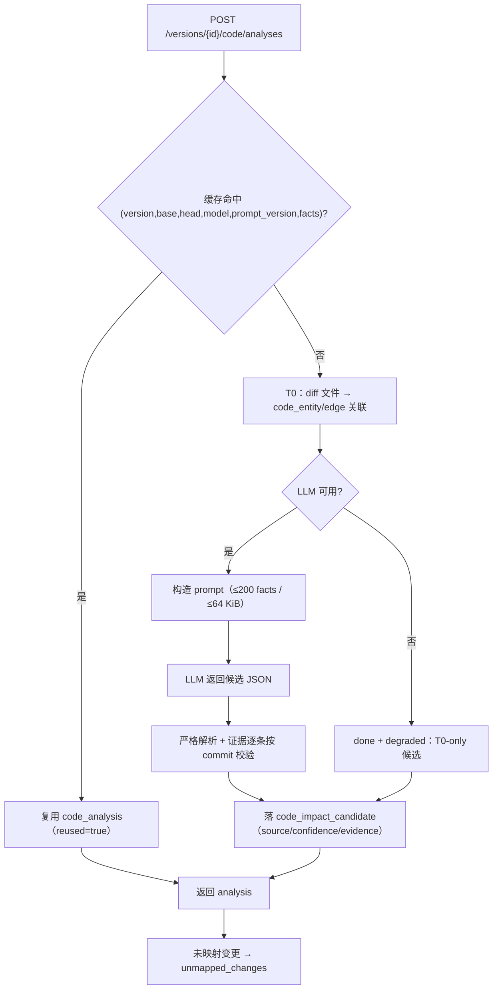
**候选排序/默认勾选（确定性）**：source 优先级 `direct > contract > relation > ai`，同优先级按 `confidence`、再按 subject kind/id；`confidence=low` 默认不勾选但可人工勾选；同一请求重复执行结果稳定（同 commit 重跑一致）。**unmapped**：diff 中无法映射到 requirement/app-model 的变更单独列出，供人工补锚点。**降级**：LLM 不可用 → `done + degraded`，HTTP 2xx 不阻塞（`degraded=true`）；影响分析完成后发 `code.changed`/`code.impact_computed`（只带摘要）。

**P7 增量 base（D49）**：增量批 base = 上一终态批的 `head_commit`；若上一批 head 不是当前 head 的祖先（rebase/强推），回退到版本 `code_baseline_commit` 并在批次/报告标记 `history_rewritten`（`base_fallback_reason`）。
### 5.6 批次创建门禁
`POST /api/versions/{id}/batches`（`batch_service.go`）按顺序执行门禁，任一失败返回 4xx/5xx + 稳定 `details.reason`：

| 顺序 | 门禁 | 失败语义 |
|---|---|---|
| 1 | body 校验（kind、caseIds、parentBatchId） | 400 `invalid_argument` / `invalid_batch_kind` |
| 2 | 版本状态允许（baseline/supplement 需 `executing`；continue 下按 `continue_phase`） | 409 `invalid_version_status` / `version_not_continuable` |
| 3 | 执行器健康（`/healthz` 探测，5 s 超时） | 503 `executor_unavailable` |
| 4 | 基线存在且 `graph_hash` 非空 | 409 `baseline_required` |
| 5 | 自主链未挂起（autonomy_pending） | 409 `autonomy_pending` |
| 6 | 无活跃批次（含 DB 唯一索引兜底） | 409 `batch_active` |
| 7 | 计划：baseline 选基线冻结用例，校验快照图哈希一致；incremental/supplement 选新/受影响用例 | 400 `invalid_case_ids` / 409 `baseline_changed` / 409 `no_cases\|no_incremental_cases` |
| 8 | 用例数 ≤ `EZTEST_EXEC_MAX_CASES_PER_BATCH`（默认 200） | 400 `too_many_cases` |
| 9 | 插入 `run_batch`（单事务，含 `batch_no` 分配） | 唯一冲突 → `batch_active`；其他冲突不误标 |

成功后发布 `batch.created`；`continuing` 下创建批次会把 `continue_phase` 置 `executing`。**执行器不可用即 fail-closed**，不会创建"永远跑不起来"的批次。
### 5.7 调度、并发与用例运行器
**调度 tick（默认 2 s）**：

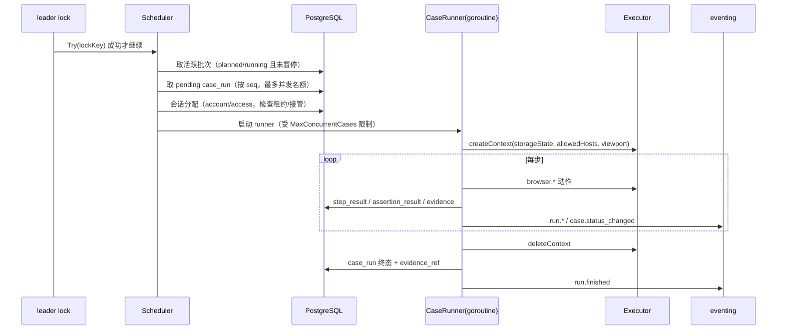
**并发模型**：每 tick 最多补足 `EZTEST_EXEC_MAX_CONCURRENT_CASES`（默认 3，1–8）个 runner；每个 runner 绑定一个 executor context（用例结束即删除，无长租约）；同一版本批次串行推进，不同版本可并行（各自独立批次）。**反压**：session 忙/不可用 → 用例保持 pending 等下一 tick（不是失败）；`ErrSessionNeedsManual` → 生成人工接管等待项（`human.requested`）。

**case runner 内部**：

1. 取用例快照（冻结基线 content + steps + assertions）与执行 profile；创建 agent session（`activity_channel=version:{id}`），执行 Agent 工具预算 `EZTEST_EXEC_MAX_TOOL_CALLS`（默认 30）。
2. 每步通过 `execution.step_record` 提交 `passed|failed|interrupted` + 证据（截图等）；执行器返回 artifact 后服务端落证据文件（≤10 MiB/条、≤100 条/用例）。
3. 断言通过 `execution.assertion_record` 提交；DB 断言走 `execution.db_assert`（只读事务 + 只允许 SELECT/WITH/SHOW/EXPLAIN + 单语句 + 结果 ≤1 MiB、SQL ≤16 KiB）；视觉断言走 `execution.visual_assert`。
4. 结束必须调用 `execution.case_finish`，服务端 `ValidateFinish` 校验（§5.8）；预算耗尽强制 `inconclusive(model)`；用例墙钟超时 `EZTEST_EXEC_CASE_TIMEOUT_MS`（默认 900,000）。
5. 结束时关闭 executor context 与 agent session，写终态 + 事件 +（若失败）交给 P7 失败分析链。
### 5.8 四态判定与失败分类
**服务端 finish 校验（`execution/domain/verdict.go`，已实现 + 单测）**：verdict 必须是四态之一；失败分类矩阵：

| verdict | 允许的 failure_class | 附加条件 |
|---|---|---|
| passed | 空 | 所有步骤 passed；所有断言（含 DB/视觉）passed；证据 ≥1 |
| failed | application | 至少一条断言 failed；证据 ≥1 |
| blocked | environment 或 session | —（证据非必需） |
| inconclusive | model / case / environment | environment 仅当存在视觉环境不匹配的 `not_run` 结果；预算耗尽必须 `inconclusive(model)` |

**分类算法（`Classify`）**：工具错误码优先于 Agent 提议；错误码分组见 `classification.go`：环境类（网络/executor/DB 连接）→ `blocked(environment)`；会话类 → `blocked(session)`；模型/预算类 → `inconclusive(model)`；用例/SQL/只读/截断 → `inconclusive(case)`；仅 target/assertion 类可判 `failed(application)`，且**证据缺失时降级**为 `inconclusive(case, evidence_missing)`；无证据的 timeout 降级 `blocked(environment)`；未知错误码隔离为 `inconclusive(case)`（绝不误伤应用）。视觉判定固定顺序：无基线 → `inconclusive(case, missing_visual_baseline)`；环境不匹配 → `inconclusive(environment, visual_environment_mismatch)`；diff>阈值 → `failed(application, visual_mismatch)`；否则 `passed(visual_match)`。

**证据语义**：`passed`/`failed` 必须有证据（DB/视觉断言的特殊结果也算证据）；`ValidateFinish` 用 `evidenceCount` 判定，缺失即 400 `evidence_missing`，Agent 收到可纠正的工具错误后可重试。
### 5.9 暂停、恢复与重启恢复
| 场景 | 行为 | 代码/事件 |
|---|---|---|
| 优雅暂停 | 停止派发新用例；当前步骤跑完即停；用例以检查点落库；批次 `paused=true, pause_mode=graceful` | `Pause`、`batch.paused` |
| 立即暂停 | 中断当前步骤：executor cancel（abort + 关页重建）、步骤 `interrupted`；用例终态由恢复逻辑决定 | `Pause`、`run.paused` |
| 恢复 | 批次 `paused=false`、`batch.resumed`；从检查点续跑：`Checkpoint(steps)` 返回完成序列 `1..N` 与 `nextSeq`，只补跑未完成部分 | `Resume`、`run.resumed` |
| 单步重跑/重试 | `POST .../case-runs/{id}/rerun` 生成新 attempt；历史保留 | `run.started` |
| 进程重启 | 启动时结算残留 running：按规则重跑或标记；agent run → `interrupted`；mindmap run → failed(`worker_restart`) | `Recovery`、`RecoverInterrupted`、`RecoverStale` |
| 人为取消 | 批次 `cancelled`，未执行用例 `skipped` | `batch.cancelled` |

**检查点算法**：`Checkpoint` 从 seq=1 起连续收集 `passed|failed` 的步骤；遇到 `interrupted/pending/running` 即停，返回 `nextSeq`。因此"步骤 2 被中断"重启后从步骤 2 开始，不重跑步骤 1（spec §5.12 invariant 5）。**停机顺序保护**：停机先停调度器并 drain runner，再停 Agent run service，避免把停机 abort 分类成用例结论（§3.9）。
### 5.10 AI 补全与补全批次
**触发**：基线批终态后，自主协调器（autonomy worker）自动跑一次补全分析（`supplement-agent` profile），产出补全候选；也可人工触发。**规则**（D45/D51）：

1. 每批最多 1 个补全周期；每周期最多 `EZTEST_SUPPLEMENT_MAX_CASES`（默认 5）条新用例。
2. 新用例以 `source=ai_supplement` 追加到脑图（不冻结内容、不改历史），发布 `case.supplemented`；受影响旧用例标记 `needs_revalidation`（`case.revalidation_marked`）。
3. 生成紧随的 `supplement` 批次（`parent_batch_id` 指向基线批），只跑新/受影响用例；批次完成后链继续（分析 → 问题 → 报告）→ 版本完成判定。
4. 补全不可用（`supplement_unavailable`）或超限（`supplement_limit_reached`）→ 记 degraded 原因，不阻塞基线结论。
5. 报告在分析终态后自动生成并发布 revision 1（§5.12）。

**降级**：AI 不可用时补全 run `degraded`，受影响用例退化为 `case_source` 确定性映射，批次仍按基线执行（D51）。
### 5.11 失败分析、问题去重与分诊
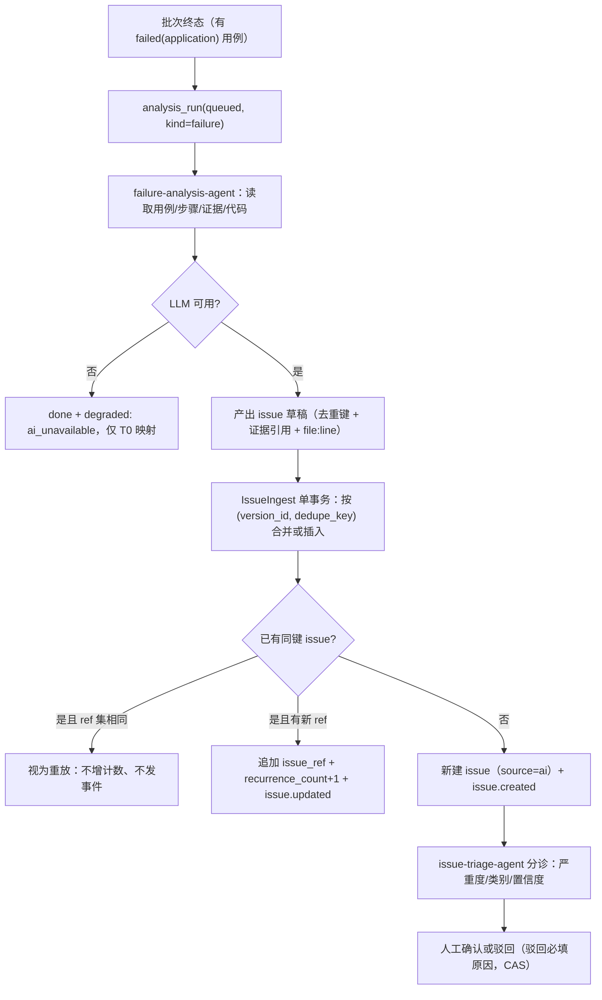
**去重键**：`sha256(version|caseNode|failureClass|normalizedReason)`（D47）；AI 只为 `failed(application)` 与需求缺口建单，环境/会话/模型/用例失败不生成缺陷。**引用**：`issue_ref` 支持 case_run/case_node/step_result/evidence/requirement/batch/commit/code_anchor；代码锚点 `file:line` 由服务端验证后创建 `code_anchor(subject_kind='issue')`。**人工路径**：任意登录用户可确认/驳回；驳回必须给原因（`issue_dismiss_reason_required`），确认/驳回用 `expectedRevision` CAS（`issue_state_conflict`）。
### 5.12 报告生成：确定性内容、fingerprint 与 stale
**生成**：`ReportService.Ensure(version, batch)`：

1. 若已有非 stale 的最新 revision → 直接返回；否则生成 `revision = max+1`（`(batch_id, revision)` 唯一，冲突则读赢家）。
2. `input_fingerprint = sha256(规范化 JSON)`，输入为：批次快照（counts、failureClasses、时间、批次元数据）+ 每 case 的最新 case_run + 问题（批次关联/open）。规范化规则：切片 nil → 空数组、稳定排序、只含确定性字段（`report_content.go` `Compute`）。
3. 渲染确定性 Markdown（摘要/用例结果表/问题汇总/风险/需求覆盖/附录），写文件到 `EZTEST_REPORT_DIR`，落库 `report(…, markdown_path, markdown_sha256, markdown_size)`；DB 行先插入、文件后写。
4. 首次发布自动 `status=published` + `report.published`；读取时重新计算 fingerprint。

**stale 读取规则**：`Get/List/Export` 前调用 `refreshReportStale`：recompute fingerprint；与 `input_fingerprint` 不同 → CAS `MarkStale(expectedFingerprint)` 置 `status=stale` 并**只发一次** `report.stale`（CAS 输者不发）。stale 原因包括 `input_fingerprint_changed`、版本不匹配（`report_version_mismatch`）。

**revision 与 diff**：`regenerate` 追加新 revision（旧 revision 与文件永不删除/覆盖）；`GET .../diff?baseReportId=` 比较两 revision 的内容快照，跨版本比较 → 400 `report_version_mismatch`；不可发布状态 → 409 `report_not_publishable`；导出校验 sha256/size，不暴露文件路径。

**确定性**：报告内容不依赖 LLM 输出（LLM 只影响分析/问题文本），因此同输入重跑得到同一 fingerprint；该性质由 `report_content_test.go` 的"稳定且敏感"测试固定（改输入必变、同输入必同）。
### 5.13 继续中的增量链路
**触发**：completed 版本上创建需求 → 同事务置 `status=continuing`、`continue_phase=clarifying`、`continued_at`，发布 `version.status_changed`（唯一例外，D43）。随后需求澄清/设计/评审完成，进入 `continue_phase=designing`；创建增量批次时置 `executing`。

**增量计划**：`GET /mindmap/incremental-plan` 返回：新用例（新增需求映射）、受影响用例（§5.5 AI/确定性影响 + 锚点 + 关系）、默认勾选集合、降级 warning。增量批 kind=`incremental`，base = 上一终态批 `head_commit`（D49）；无上一批时用版本基线。**batch_no**：只在建批时分配，进入继续中不自增；`history_rewritten` 表示 base 回退。

**完成判定**：自主协调器在「增量批 → 分析 → 问题 → 报告 → 补全 → 补充批」链结束后把 `continuing → completed`，并审计 `version.completed`、发布 `version.status_changed`（带 phase/reason）。
### 5.14 SSE：订阅-回放竞态、stream.reset 与心跳
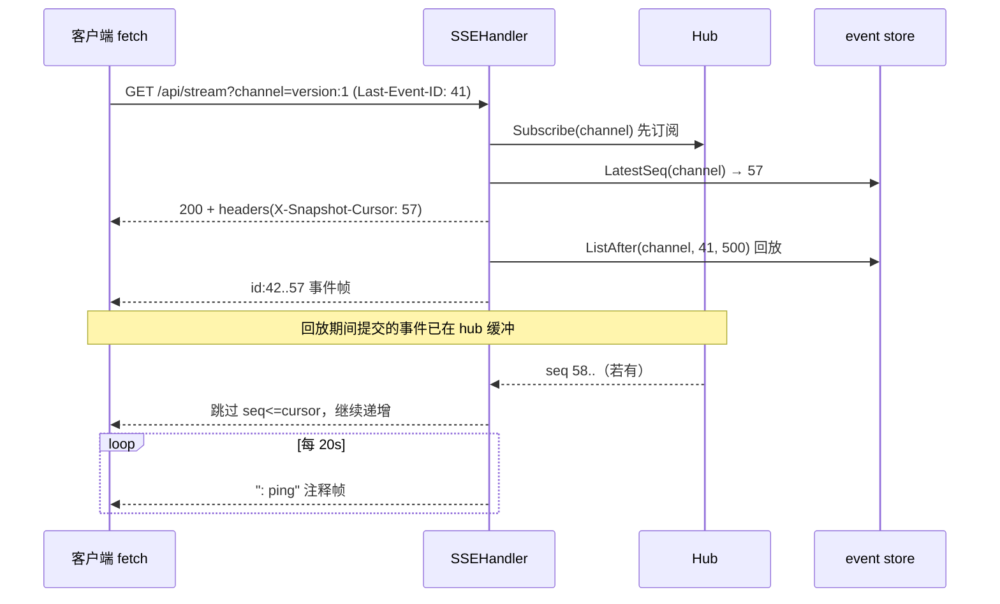
**竞态与正确性**：

1. **先订阅后回放**：回放期间新提交的事件被 hub 缓冲，回放结束后按 seq 去重续发；因此"快照→流"窗口不丢事件（`sse.go` 注释）。
2. **Last-Event-ID 优先于 `since`**；都没有 = live-only（从 `X-Snapshot-Cursor` 起）；显式 `since=0` = 全量回放。
3. **乱序广播 gap 回填**：并发 publisher 提交 seq N、N+1 后，hub 广播无序；若先收到 N+1，handler 调 `replayGap` 只补到 target（不回放 target 本身），随后按 cursor 去重。
4. **cursor too old**：store 校验"cursor > lastSeq"或"cursor 早于保留区首个 seq"→ `ErrCursorTooOld` → handler 发合成 `event: stream.reset`（**无 id、不落库**，`reason=cursor_too_old`、带最新 `snapshot_cursor`），客户端 `onReset` 后重新拉快照。
5. **心跳**：20 s `: ping` 注释帧，防止代理断链；写失败即结束连接。
6. **慢消费者**：hub 缓冲 256 满即断开；客户端用 Last-Event-ID 重放恢复，服务端无状态。
7. **回放分页**：每批 500 行循环直到追上 live edge；快照端点默认 50、上限 100（`limit` + `before_seq`）。
### 5.15 Agent run 状态机、循环与预算
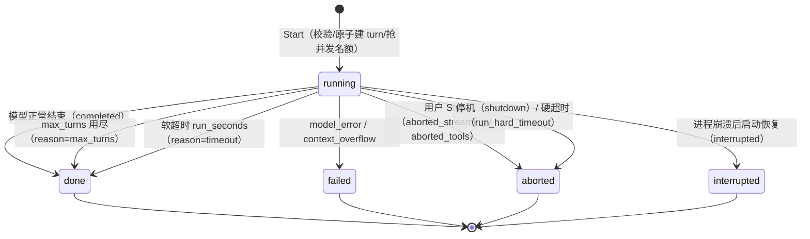
**循环（`runner.go`）**：

1. 组装上下文：`window = model context window`；`budgetChars = window - max(2048, window/4) - 2000`；`ContextBuilder.Build(systemPrompt, history, budgetChars)` 按预算丢弃最旧消息（返回 `DroppedMessages`，事件 `decision=context_truncated`）。溢出 → `failed(context_overflow)`。
2. 每 turn：检查 `max_turns`/软超时/硬超时 → `llm.ChatStream` → 累积 `delta/reasoning/tool_calls` → 若 `tool_calls` 非空：依次执行工具（每次审计 + 活动事件 `tool_use/tool_result`），结果截断到 **32 KiB**（头尾保留，`truncateToolResultForContext`），无工具调用则结束（`completed`）。
3. **并发预算**：全局 `EZTEST_AGENT_MAX_CONCURRENT_RUNS`（默认 4）非阻塞获取，满 → 503 容量错误；每 session 只允许一个 active run（否则 409）。
4. **硬超时**：`hardCtx = run_seconds + hard_timeout_seconds`（profile 未设则 +60 s），到点 `context.Cause` 给出 `run_hard_timeout`；Stop 走 `Abort` → 取消流/工具，保留部分内容（`aborted_streaming`/`aborted_tools`）。
5. **消息落库**：每个 turn 的 assistant/user/tool 消息写 `agent_message`（唯一权威上下文来源），事件只做 UI 投影（D27）；恢复/重放以消息表为准。
6. 收尾：写终态 `agent_run`（status+terminal_reason+usage+turns），发布 `agent.activity run_finished`，审计异常终止（`agent.run.aborted`），释放并发名额。
### 5.16 LLM 流式重试边界
- **可重试**：429、5xx、timeout；**不可重试**：401/403、4xx、invalid_response、unknown。
- **流式**：只在 `ChatStream` 返回错误（尚未拿流）时按 retryCount 重试；一旦拿到 channel，后续任何错误（上游 error 事件、流异常结束、断连）都直接以 `StreamEvent.Err` 下发，不重启（避免重复输出/重复工具调用）。
- **超时**：`timeout_ms` 覆盖整个操作（含重试等待）；等待期间超时 → `llm_timeout`。
- **jitter**：`interval + rand(0..100ms)`，避免重试惊群。
- **边界**：非流式响应 4 MiB、单 SSE 行 1 MiB；上游 body 不进入错误 message、不落日志。
### 5.17 限流、GC、leader lock 与备份恢复
**限流**（`server/ratelimit.go`，进程内）：

- 普通令牌桶：按用户 ID（认证后）或 IP（未认证），`rps`（默认 50，0 关闭）、`burst`（默认 100）；桶以 LRU 链表管理，容量上限 100k，每 1024 请求清扫一次空闲桶（10 min TTL）；拒绝时 `429 rate_limited` + `Retry-After`。
- SSE 独立并发计数：每用户/IP 最多 `EZTEST_RATE_LIMIT_SSE_MAX`（默认 10）条流，超限 429 `sse_concurrency` + `Retry-After: 5`；SSE 不消耗普通桶。
- 豁免路径：`/healthz`、`/api/health`、`/api/openapi.yaml`、`/favicon.ico`、`/assets/`、`/static/`、`/_next/`、CORS 预检。

**GC**（`execution/application/gc_service.go`）：

- `POST /api/admin/gc`（admin）：body `{dryRun?, reason?}`，**默认 dry-run**；非 dry-run 且 `EZTEST_GC_ENABLED=false` → 409。
- 算法：保留最近 `EZTEST_GC_BATCH_KEEP`（默认 3）个终态批次；删除早于 `EZTEST_GC_RETENTION_DAYS`（默认 30）天的证据文件（**仅 `EZTEST_EVIDENCE_DIR` 下**）；DB 元数据同步删除；输出报告（扫描/删除/跳过计数）；审计 GC 运行。
- 每日维护 loop 同样受 leader lock + `GC_ENABLED` 约束（默认 dry-run）。

**leader lock**（`platform/leader/lock.go`）：每 tick `pg_try_advisory_lock(key)`，成功则执行本 tick 并在结束时释放；其他实例 debug 跳过。默认 key 1163411512（可配）；调度器/自主 worker/日维护使用派生 key（相邻整数）。锁是**会话级**：进程崩溃由数据库释放；解锁失败 hijack 并关闭连接。

**备份/恢复**（`scripts/backup.ps1`/`restore.ps1`/`test-backup.ps1`）：`pg_dump` custom 格式 + 5 个内容目录 + `manifest`（文件 sha256 清单）；恢复脚本校验行数与文件哈希；演练记录 174/174 断言 + 恢复库应用 smoke（§12.4）。
### 5.18 端到端主流程时序
把 §5.1–§5.13 串成一条主链路（所有步骤均有对应事件/审计，可被 SSE 与探索链路观察）：

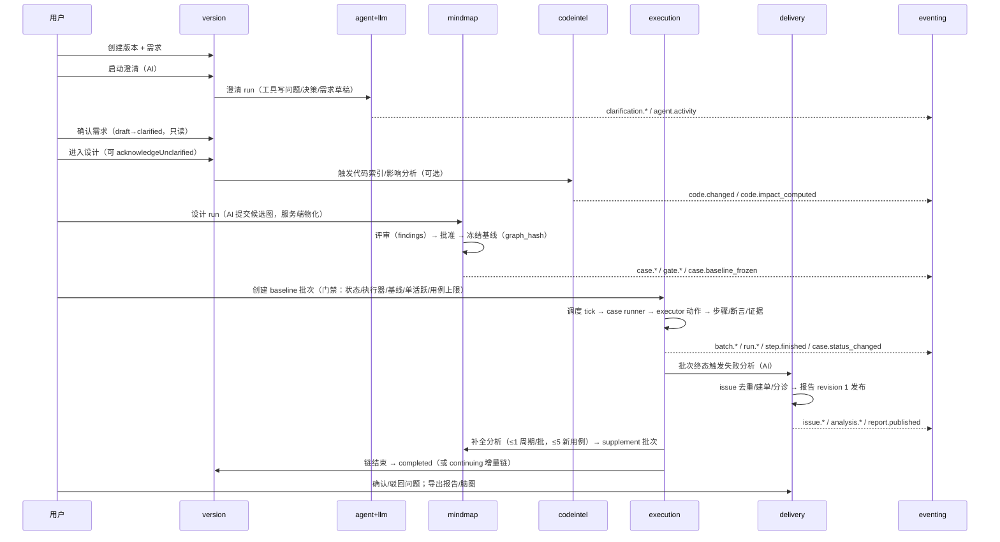
**失败/降级分支**：执行器不可用 → 建批 503（不产生批次）；AI 不可用 → 澄清/设计/分析/补全各自降级（`degraded`/failed），但执行、报告、导出等确定性路径继续；用例失败 → 四态判定 + 失败分类，只有 `failed(application)` 且证据充分才进入问题链；预算/超时 → `inconclusive(model)`，不算应用缺陷。
## 6 数据设计
### 6.1 数据设计原则
1. **一上下文一表组**：表按上下文前缀/归属划分；跨上下文只存逻辑 ID，不建外键。
2. **数据库是最终仲裁者**：所有"单活跃/唯一/去重/单 admin"等硬约束下沉为索引；应用层只做友好错误映射。
3. **不可变优先**：事件、证据、报告 revision、审计日志、基线冻结内容都只追加；修正通过新 revision/新记录表达。
4. **标准字段**：P5 起新表统一 `id`（雪花）、`created_at/updated_at`；枚举存 TEXT + CHECK（见 §6.3），不使用 PostgreSQL ENUM 类型（迁移友好）。
5. **文件与元数据分离**（D30）：文件内容只落文件系统，DB 只存相对路径/sha256/大小/content-type。
6. **JSONB 边界**：`detail/refs/input/result/stats/errors/content` 等半结构化负载用 JSONB，但限制大小（事件 detail ≤64 KiB）、禁止放二进制/凭据。
7. **时间 UTC**，`TIMESTAMPTZ`；JSON 中 RFC3339。
### 6.2 67 张表按上下文清单
> 口径：47 个迁移中的 `CREATE TABLE` 去重 67 个；最终名为 D34 rename 之后的名字；另有框架表 `schema_migrations`（共 68）。

| 上下文 | 表（职责） | 小计 |
|---|---|---|
| identity | `user_account`（账户/角色/状态，部分唯一索引保证单 admin）、`auth_token`（sha256 令牌、过期/最后使用） | 2 |
| audit | `audit_log`（append-only 审计条目） | 1 |
| eventing | `event`（channel+seq 事件、detail/refs）、`event_channel`（每通道 seq 计数） | 2 |
| platform | `idempotency_key`（用户+键+方法+路径→响应缓存，24h） | 1 |
| llm | `llm_config`（协议/baseUrl/加密密钥/重试/超时/默认标记） | 1 |
| storage | `storage_object`（sha256 主键、大小、content-type、相对路径） | 1 |
| agent | `agent_profile`（提示词/工具白名单/预算）、`agent_session`、`agent_run`（状态+终态原因+usage）、`agent_message`（LLM 上下文权威来源） | 4 |
| resource | `company`（单行种子）、`system`、`environment`、`app_model_node`、`account`、`account_system_access`、`session`（storageState/状态机）、`session_snapshot`、`session_lease`、`manual_takeover`、`auth_flow`、`code_repository`、`db_target`（环境只读 PG） | 13 |
| version | `version`（状态/暂停/continue_phase/batch_no/基线 commit）、`requirement`、`requirement_relation`、`requirement_attachment`、`clarification_session`、`clarification_question`、`decision`、`knowledge_entry` | 8 |
| codeintel | `code_change_set`、`code_index_run`、`code_entity`、`code_edge`、`code_fact_version`、`code_analysis_cache`、`code_analysis`、`code_impact_candidate`、`code_anchor`、`code_fact_review`、`version_change`（版本变更快照，codeintel 迁移创建） | 11 |
| mindmap | `case_node`、`case_step`、`case_assertion`、`case_visual_assertion`、`case_source`、`case_review`、`case_review_finding`、`case_baseline`、`case_design_run`、`case_export` | 10 |
| execution | `run_batch`、`case_run`、`step_result`、`assertion_result`、`evidence`、`evidence_ref` | 6 |
| delivery | `issue`、`issue_ref`、`report`、`report_ref`、`analysis_run` | 5 |
| quality | `eval_run`、`eval_metric` | 2 |
| **合计** | | **67** |

**关键约束/索引节选**：

| 表 | 约束/索引 | 目的 |
|---|---|---|
| `user_account` | 部分唯一索引 `WHERE role='admin'` | 全库单 admin |
| `run_batch` | 部分唯一索引（单版本未终态批次） | 单活跃批次 |
| `report` | `UNIQUE(batch_id, revision)` | revision 单调唯一 |
| `issue` | `UNIQUE(version_id, dedupe_key)` | AI 问题去重 |
| `idempotency_key` | `UNIQUE(user_id, key, method, path)` + `expires_at` | 幂等重放 |
| `event` | `UNIQUE(channel, seq)` + `(channel, seq)` 索引 | 通道内单调、可回放 |
| `case_baseline` | `UNIQUE(version_id)`（一次冻结） | D5 只评审/冻结一次 |
| `agent_run` | 每 session 单活跃的唯一索引 | 每会话单 run |
| `storage_object` | `PK sha256` | 内容寻址 |
### 6.3 状态枚举汇总
| 对象 | 枚举值（按代码 CHECK 约束） |
|---|---|
| version.status | `draft`、`clarifying`、`designing`、`reviewing`、`executing`、`completed`、`continuing`、`archived`（仅枚举） |
| version.pause_mode | `graceful`、`immediate` |
| version.continue_phase | `clarifying`、`designing`、`executing` |
| requirement.status | `draft`、`clarified`、`designed`、`verified`、`obsolete` |
| requirement.priority | `must`、`should`、`could` |
| relation.kind | `depends_on`、`conflicts_with`、`overlaps`、`shares_scope` |
| clarification_session.status | `active`、`completed`、`cancelled` |
| clarification_question.status | `open`、`answered`、`dismissed` |
| decision.status | `proposed`、`accepted`、`rejected` |
| knowledge.kind/status/confidence | `pattern\|pitfall\|decision\|case_idea` / `draft\|approved\|rejected` / `high\|medium\|low` |
| case_node.status | `draft`、`reviewed`、`executed`、`supplemented`、`merged`、`rejected`、`needs_revalidation` |
| case_assertion.kind | `ui`、`api`、`db`、`text`、`visual` |
| case_design_run.kind/status | `explore\|design\|review\|data_plan\|incremental_design\|supplement` / `queued\|running\|done\|failed\|degraded` |
| case_review.status / finding.status | `draft\|approved\|rejected` / `open\|fixed\|dismissed` |
| run_batch.status / kind | `planned\|running\|done\|failed\|cancelled` / `baseline\|incremental\|supplement` |
| case_run.status | `pending\|running\|passed\|failed\|blocked\|inconclusive\|skipped\|interrupted` |
| case_run.failure_class | `application\|environment\|session\|model\|case` |
| step_result.status | `pending\|running\|passed\|failed\|interrupted` |
| evidence.kind | `screenshot\|network\|console\|http_exchange\|db_result\|download\|visual_actual\|visual_diff` |
| issue.status/category/severity/source | `open\|confirmed\|dismissed` / `defect\|requirement_gap\|other` / `blocker\|major\|minor\|info` / `ai\|human` |
| report.status | `draft`、`published`、`stale` |
| analysis_run.kind/status | `failure\|issue_triage` / `queued\|running\|done\|failed\|degraded` |
| agent_run.status / terminal_reason | `running\|done\|failed\|aborted\|interrupted` / `completed\|max_turns\|timeout\|model_error\|context_overflow\|aborted_streaming\|aborted_tools\|aborted\|shutdown\|run_hard_timeout\|interrupted` |
| resource session.status | `pending\|acquiring\|needs_manual\|valid\|refreshing\|expired\|invalid\|revoked\|failed` |
| manual_takeover.status | `waiting\|completed\|cancelled\|expired` |
| environment.kind | `dev`、`staging`、`prod`、`other` |
| eval_run.mode/status | `deterministic\|real_llm` / `running\|passed\|failed\|error` |
### 6.4 47 条迁移清单与顺序
> 版本号 = `order.txt` 中的 1-based 位置；文件名中的 per-context 编号与全局版本无关。完整文件见 [migrations/order.txt](../backend/internal/db/migrations/order.txt)。

| # | 迁移文件 | 内容 |
|---|---|---|
| 1 | `identity_0001_users.sql` | 用户表 + 单 admin 部分唯一索引 |
| 2 | `identity_0002_auth_tokens.sql` | 令牌表（hash、过期、last_seen） |
| 3 | `audit_0001_logs.sql` | 审计日志表 |
| 4 | `platform_0001_idempotency.sql` | 幂等键表 |
| 5 | `eventing_0001_events.sql` | 事件表 + 通道计数表 |
| 6 | `llm_0001_configs.sql` | LLM 配置表 |
| 7 | `storage_0001_objects.sql` | 对象元数据表 |
| 8 | `agent_0001_profiles_sessions_runs_messages.sql` | Agent 四表 |
| 9 | `resource_0001_catalog.sql` | 公司/系统/环境/应用模型表 |
| 10 | `resource_0002_accounts_sessions.sql` | 账号/访问/会话/快照/租约/接管 |
| 11 | `resource_0003_code_repositories.sql` | 本地代码仓表 |
| 12 | `version_0001_versions_requirements.sql` | 版本/需求/关系表 |
| 13 | `version_0002_clarification.sql` | 澄清会话/问题/决策/附件 |
| 14 | `agent_0002_activity_channel.sql` | 会话 activity_channel 字段 |
| 15 | `codeintel_0001_code_facts.sql` | 索引/实体/边/事实/缓存 |
| 16 | `codeintel_0002_code_impact.sql` | 分析/候选/锚点 |
| 17 | `identity_0003_rename_tables.sql` | D34 改名 users→user_account 等 |
| 18 | `platform_0002_rename_tables.sql` | idempotency_keys→idempotency_key |
| 19 | `eventing_0002_rename_tables.sql` | events→event、event_channels→event_channel |
| 20 | `audit_0002_rename_tables.sql` | audit_logs→audit_log |
| 21 | `llm_0002_rename_tables.sql` | llm_configs→llm_config |
| 22 | `storage_0002_rename_tables.sql` | storage_objects→storage_object |
| 23 | `agent_0003_rename_tables.sql` | Agent 四表改单数 |
| 24 | `resource_0004_rename_tables.sql` | resource 13 表改单数 + 序列改名 |
| 25 | `version_0003_rename_tables.sql` | version 7 表改单数 |
| 26 | `codeintel_0003_rename_tables.sql` | codeintel 8 表改单数 |
| 27 | `resource_0005_app_model_explored_source.sql` | 应用模型 source 增加 explored |
| 28 | `codeintel_0004_case_anchor_subject.sql` | 锚点 subject_kind 扩宽 case |
| 29 | `mindmap_0001_cases.sql` | 脑图 8 表（节点/步骤/断言/来源/评审/基线/run/导出） |
| 30 | `execution_0001_batches.sql` | 批次/用例运行/步骤/断言/证据表 |
| 31 | `version_0004_execution_state.sql` | 版本执行态（paused/pause_mode/batch_no） |
| 32 | `resource_0006_auth_flows.sql` | auth_flow 表 + access.login_flow_id |
| 33 | `delivery_0001_issue.sql` | issue + issue_ref |
| 34 | `delivery_0002_report.sql` | report + report_ref |
| 35 | `delivery_0003_analysis.sql` | analysis_run |
| 36 | `resource_0007_db_target.sql` | 环境 db_target |
| 37 | `version_0005_continue.sql` | continue_phase/continued_at |
| 38 | `execution_0002_autonomy.sql` | 批次自主链字段（parent/kind/base/head/history_rewritten） |
| 39 | `mindmap_0002_supplement.sql` | 补全/受控叠加字段 |
| 40 | `codeintel_0005_issue_anchor.sql` | 锚点 subject_kind 扩宽 issue |
| 41 | `codeintel_0006_version_change.sql` | version_change 快照表 |
| 42 | `quality_0001_eval.sql` | eval_run/eval_metric |
| 43 | `codeintel_0007_fact_review.sql` | 事实人工评审表 |
| 44 | `version_0006_knowledge.sql` | knowledge_entry |
| 45 | `execution_0004_evidence_purge.sql` | 证据 GC 相关字段/索引 |
| 46 | `mindmap_0003_visual.sql` | case_visual_assertion + 基线字段 |
| 47 | `execution_0005_visual_evidence.sql` | 视觉证据类型（visual_actual/visual_diff） |
### 6.5 保留、删除与备份策略
| 数据 | 保留/删除 | 依据 |
|---|---|---|
| 事件 `event` | 永久保留（无裁剪）；channel 重建/清除会产生 `ErrCursorTooOld` | store 的 `checkReplayCursor` |
| 证据文件 | 超过 `EZTEST_GC_RETENTION_DAYS`（默认 30）且非最近 `EZTEST_GC_BATCH_KEEP`（默认 3）批次的证据可被 GC（默认 dry-run） | `gc_service.go` |
| 报告 Markdown/导出/附件 | **不被 GC 覆盖**；需人工/运维清理 | release notes §已知限制 5 |
| 审计 | 永久追加，无删除 API | `audit/domain/repository.go` |
| 幂等记录 | `expires_at`（24h）后由 store 清理语句删除 | `idempotency/postgres.go` |
| 会话快照/租约 | 业务状态驱动，过期会话保留供审计 | resource 领域 |
| 备份 | `pg_dump` custom + 5 内容目录 + sha256 manifest；恢复校验后重建 | `scripts/backup.ps1`、`restore.ps1` |
### 6.6 关键表字段与 DDL 节选
> 以下节选自迁移文件，体现"约束在 DB"的设计；字段完整定义见对应 SQL。

**`event` / `event_channel`**（`eventing_0001_events.sql`）：

```sql
CREATE TABLE event_channels (
  channel TEXT PRIMARY KEY,
  last_seq BIGINT NOT NULL DEFAULT 0,
  updated_at TIMESTAMPTZ NOT NULL DEFAULT now()
);
CREATE TABLE events (
  id BIGSERIAL PRIMARY KEY,
  channel TEXT NOT NULL REFERENCES event_channels(channel) ON DELETE RESTRICT,
  seq BIGINT NOT NULL, type TEXT NOT NULL,
  version_id TEXT, batch_id TEXT, case_id TEXT, step_id TEXT, agent_role TEXT, session_id TEXT,
  ts TIMESTAMPTZ NOT NULL, summary TEXT NOT NULL DEFAULT '',
  detail JSONB NOT NULL DEFAULT '{}',
  refs JSONB NOT NULL DEFAULT '{"evidence":[],"case":[],"requirement":[],"code":[]}',
  created_at TIMESTAMPTZ NOT NULL DEFAULT now(), UNIQUE(channel, seq)
);
```
要点：`event_channels` 是 seq 分配的行锁点；`events.id` 仅内部使用；`UNIQUE(channel,seq)` 同时服务回放与幂等发布；`refs` 默认值固定四空数组（信封契约）。

**单活跃批次**（`execution_0001_batches.sql`）：

```sql
CONSTRAINT uk_run_batch_version_no UNIQUE (version_id, batch_no),
CREATE UNIQUE INDEX uk_run_batch_active
  ON run_batch(version_id) WHERE status IN ('planned','running');
CREATE UNIQUE INDEX uk_case_run_batch_case_attempt ... -- (batch_id, case_node_id, attempt)
```
要点：`batch_no` 在版本内唯一且只增；部分唯一索引只在"未终态"集合上生效，`done/failed/cancelled` 自动释放槽位；case_run 的 attempt 唯一保证重跑不覆盖历史。

**报告 / 问题唯一性**（`delivery_0001_issue.sql`、`delivery_0002_report.sql`）：

```sql
CONSTRAINT uk_report_batch_revision UNIQUE (batch_id, revision),
input_fingerprint TEXT NOT NULL CHECK (input_fingerprint ~ '^[0-9a-f]{64}$'),
CONSTRAINT uk_issue_version_dedupe UNIQUE (version_id, dedupe_key)
```
要点：revision 唯一 → 并发生成冲突时"读赢家"；fingerprint 用 CHECK 固定 64 位小写 hex（服务端仍然校验，属 defense in depth）；`dedupe_key` 允许 NULL（人工建单）但唯一约束对非空值生效。

**单 admin**（`identity_0001_users.sql`）：`role`/`status` 用 CHECK 约束，部分唯一索引 `CREATE UNIQUE INDEX users_one_admin ON users(role) WHERE role='admin'`。
## 7 接口设计
### 7.1 OpenAPI 契约约定
- 文件 [docs/openapi/api.yaml](openapi/api.yaml)：OpenAPI **3.0.3**、`info.version: 0.9.0`（**注意：这是契约版本，不是产品版本 `0.1-preview`**，见 §14.5）、680,007 字节、手工维护（非代码生成）。
- 覆盖：**169 个 path 条目**（168 个 `/api/*` + `/healthz`）、**223 个 operation**；方法分布 GET 102 / POST 73 / PATCH 24 / DELETE 19 / PUT 5；tags 22 个（auth、users、llm、agents、stream、storage、audit、resources、code-repos、versions、code、mindmap、execution、delivery、chain、search、workspace、agent-center、knowledge、quality、admin、health）。
- 服务方式：`GET /api/openapi.yaml`（公开、`Content-Type: application/yaml`、从 `EZTEST_OPENAPI_PATH` 读文件）；文件缺失 → 404（不阻塞启动）。
- 一致性保障：`server.New` 的路由注册数与 OpenAPI operation 数在"全量装配"下一致（223/223）；条件挂载时实际暴露面可能更小（部分装配/测试进程）。`scripts/check-docs.ps1` 与 `frontend` 内脚本对文档/契约做静态检查。
### 7.2 223 个路由按前缀分组
> 口径：`mux.Handle/HandleFunc` 注册的 method+path 模式；"系统"为 `server.go` 直接挂载的 health/openapi/gc/test-publisher。

| 上下文/前缀 | 数量 | 代表性路由（不逐条展开见附录 §14.4） |
|---|---|---|
| resource `/api/resources/*` | 53 | `GET\|POST /systems`、`.../systems/{id}/environments`、`/app-models`、`/accounts`、`/accesses`、`/sessions`、`/takeovers`、`/auth-flows`、`/code-repos`、`/environments/{id}/db-target` |
| version `/api/versions/*`（不含 mindmap/code/execution/delivery 子面） | 43 | `GET\|POST /api/versions`、`PATCH /{id}`、`PUT /{id}/bindings`、`/start-clarification`、`/enter-design`、`/{id}/changes`、requirements/relations/clarification/questions/decisions/attachments/knowledge、`/{id}/stream`+`/events` |
| mindmap `/api/versions/{versionId}/mindmap/*` | 31 | graph/nodes/steps/assertions/visual/sources/anchors、runs、incremental-plan、review、findings、export |
| codeintel `/api/code/*` + `/api/versions/{id}/code/*` | 21 | repos/tree/file/diff/facts/search/commits/quality/reviews；versions code changes/analyses/anchors |
| delivery `/api/versions/{id}/issues\|reports` + `/api/issues\|reports` | 16 | issue CRUD/confirm/dismiss、report ensure/publish/regenerate/export/diff、batch analysis |
| agent `/api/agents` + `/api/agent-center` | 15 | profiles CRUD、tools、sessions/messages/stop；center catalog/sessions/quality |
| execution `/api/versions/{id}/batches\|case-runs\|execution\|evidence` | 14 | 批次 CRUD/pause/resume/cancel、case-runs/rerun、execution/sessions、evidence 下载/meta、batch report |
| identity `/api/auth` + `/api/users` | 8 | login/me/logout；users CRUD/reset-password |
| llm `/api/admin/llm/configs` | 6 | CRUD、catalog/refresh、test |
| quality `/api/quality/eval-runs` | 3 | list/get/create |
| eventing `/api/stream`、`/api/stream/events` | 2 | SSE、快照 |
| storage `/api/admin/storage/objects` | 2 | 上传、下载 |
| audit `/api/admin/audit` | 1 | 审计查询 |
| chain `/api/versions/{id}/exploration-chain` | 1 | 探索链路 |
| search `/api/search` | 1 | 全局搜索 |
| workspace `/api/todos` | 1 | 待办 |
| 系统 | 5 | `GET /healthz`、`GET /api/health`、`GET /api/openapi.yaml`、`POST /api/admin/gc`、`POST /api/admin/stream/test-events`（仅 test endpoints 开启） |
| **合计** | **223** | |

**写路径幂等**：所有写方法接受 `Idempotency-Key`；列表均为游标信封；admin-only 见 §11.3。
### 7.3 错误码枚举表
| code | HTTP | retryable | 触发 |
|---|---|---|---|
| `invalid_argument` | 400 | 否 | 参数/limit/cursor/JSON body 非法、状态前置条件不满足（部分） |
| `unauthenticated` | 401 | 否 | 无/过期/无效令牌 |
| `forbidden` | 403 | 否 | 非 admin 管理面、`agent:*` 通道非 admin |
| `not_found` | 404 | 否 | 资源不存在/跨版本访问 |
| `conflict` | 409 | 否 | 状态机冲突、CAS 失败、GC 未开启、批次活跃 |
| `idempotency_conflict` | 409 | 否 | 同幂等键不同请求体 |
| `rate_limited` | 429 | 是 | 令牌桶/SSE 并发/登录限流 |
| `internal` | 500 | 否 | panic 恢复/未预期错误 |
| `unavailable` | 503 | 是 | 依赖不可用（DB/executor/GC 未配置） |
| `storage_corrupted` | 503 | 否 | 内容寻址对象校验失败 |
| `llm_not_configured` | 503 | 否 | 无可用的默认 LLM 配置 |
| `llm_auth_failed` | 502 | 否 | 上游 401/403 |
| `llm_rate_limited` | 429 | 是 | 上游 429 |
| `llm_bad_request` | 502 | 否 | 上游 4xx |
| `llm_upstream_error` | 502 | 视状态 | 上游 5xx/流错误 |
| `llm_timeout` | 504 | 是 | 操作超时 |
| `llm_invalid_response` | 502 | 否 | 解析失败/流异常结束 |

> 另有业务级 503 `ai_unavailable`（AI 未配置/不可用）与 `executor_unavailable`（执行器不健康），以 `platform.WriteError` 的 message+code 表达；具体 reason 见 §7.4。
### 7.4 reason 码目录（节选）
> reason 是业务拒绝/降级的稳定机器码，位于 `error.details.reason` 或响应 `degraded` 字段；message 面向人。以下为对代码中 118 个 reason 类字面量归并后的核心目录（按上下文）。

| 上下文 | reason（节选） |
|---|---|
| 通用/游标 | `not_integer`、`out_of_range`、`invalid_cursor`、`invalid_limit`、`invalid_argument` |
| 版本/需求 | `invalid_version_status`、`version_not_continuable`、`baseline_changed`、`baseline_required`、`batch_active`、`autonomy_pending`、`no_cases`、`too_many_cases`、`invalid_case_ids`、`invalid_batch_kind`、`invalid_parent_batch`、`no_incremental_cases`、`history_rewritten`、`invalid_continue_phase`、`invalid_pause_mode` |
| 脑图/评审 | `baseline_frozen`、`review_not_found`、`materialize_failed`、`invalid_case_tree`、`invalid_visual_configuration`、`visual_baseline_invalid`、`visual_baseline_read_failed`、`missing_visual_baseline`、`visual_environment_mismatch`、`visual_mismatch`、`visual_match`、`visual_compare_failed` |
| 执行 | `invalid_finish_verdict`、`invalid_step_results`、`invalid_assertion_results`、`invalid_failure_class`、`verdict_not_justified`、`budget_exhausted`、`evidence_missing`、`unclassified`、`db_target_missing`、`db_connection_failed`、`db_query_failed`、`db_readonly_violation`、`db_result_truncated`、`db_expected_invalid`、`unsupported_assertion_kind`、`session_state_conflict`、`lease_conflict`、`no_valid_session`、`no_eligible_access`、`login_check_not_configured`、`login_check_failed`、`mfa`、`captcha`、`credential_invalid` |
| 交付 | `issue_state_conflict`、`issue_dismiss_reason_required`、`issue_ref_invalid`、`report_not_publishable`、`report_export_failed`、`report_stale`、`report_version_mismatch`、`report_not_found`、`invalid_report_filter`、`analysis_active`、`analysis_not_applicable`、`analysis_not_found`、`analysis_in_progress`、`analysis_not_done`、`analysis_queue_full`、`analysis_timeout`、`ai_unavailable`、`no_candidates`、`supplement_unavailable`、`supplement_limit_reached`、`autonomy_pending`、`run_in_progress` |
| 代码智能 | `baseline_not_found`、`commit_not_found`、`git_unavailable`、`path_not_file`、`invalid_line`、`parse_error`、`export_corrupted`、`export_not_found` |
| Agent/LLM | `context_overflow`、`max_turns`、`model_error`、`budget_exhausted`、`aborted_streaming`、`aborted_tools`、`run_hard_timeout`、`shutdown`、`interrupted` |
| 流/回放 | `cursor_too_old`（`stream.reset.reason`） |
### 7.5 SSE 事件目录
**信封（V1 冻结）**：`seq`、`channel`、`type`、`version_id`、`batch_id`、`case_id`、`step_id`、`agent_role`、`session_id`、`ts`、`summary`、`detail`（JSON object ≤64 KiB）、`refs{evidence,case,requirement,code}`（恒为数组）。

| 命名空间 | 事件类型 | 数量 |
|---|---|---|
| version | `version.created`、`version.updated`、`version.status_changed` | 3 |
| requirement | `requirement.added`、`requirement.clarified`、`requirement.updated`、`requirement.deleted`、`requirement.reopened`、`requirement.relation_added`、`requirement.relation_updated`、`requirement.relation_removed` | 8 |
| clarification | `clarification.session_started`、`clarification.session_completed`、`clarification.question_updated`、`clarification.context_updated` | 4 |
| attachment | `attachment.added`、`attachment.removed` | 2 |
| decision | `decision.proposed`、`decision.decided` | 2 |
| case | `case.created`、`case.updated`、`case.deleted`、`case.reviewed`、`case.run_started`、`case.run_finished`、`case.baseline_frozen`、`case.export_ready`、`case.supplemented`、`case.revalidation_marked`、`case.status_changed`、`case.visual_baseline_approved` | 12 |
| gate | `gate.pending`、`gate.resolved` | 2 |
| batch | `batch.created`、`batch.started`、`batch.paused`、`batch.resumed`、`batch.finished` | 5 |
| run | `run.started`、`run.paused`、`run.resumed`、`run.finished` | 4 |
| step | `step.finished` | 1 |
| human | `human.requested` | 1 |
| issue | `issue.created`、`issue.updated` | 2 |
| report | `report.published`、`report.stale` | 2 |
| analysis | `analysis.started`、`analysis.finished` | 2 |
| knowledge | `knowledge.created`、`knowledge.reviewed` | 2 |
| code | `code.changed`、`code.impact_computed` | 2 |
| agent | `agent.activity`（`detail.kind` 九种，§4.8） | 1 |
| system | `system.test`（测试端点专用） | 1 |
| **合计** | | **56** |

通道：`system`、`version:{id}`、`agent:{session_id}`（admin-only 实时订阅）；事件 detail 只放 id/计数/状态/哈希摘要，不放凭据/证据正文/prompt/LLM 原文。
### 7.6 审计动作目录
> 56 个动作（`Action*` 常量 37 + 内联 `Action:` 字面量去重后合计）。审计只追加，无更新/删除 API。

| 命名空间 | 动作 | 数量 |
|---|---|---|
| auth | `auth.login_succeeded`、`auth.login_failed`、`auth.logout` | 3 |
| user | `user.created`、`user.updated`、`user.password_reset` | 3 |
| llm | `llm.config_created`、`llm.config_updated`、`llm.config_deleted`、`llm.test_succeeded`、`llm.test_failed` | 5 |
| storage | `storage.object_created` | 1 |
| version | `version.created`、`version.updated`、`version.completed`、`version.continued`、`version.requirement_created`、`version.requirement_updated`、`version.requirement_deleted`、`version.requirement_confirmed`、`version.requirement_reopened` | 9 |
| resource | `resource.db_target.upserted\|tested\|deleted`、`resource.session_imported\|validated\|confirmed\|invalidated\|revoked`、`resource.takeover_requested\|completed\|cancelled` | 11 |
| execution | `execution.batch.created\|paused\|resumed\|cancelled`、`execution.case.finished`、`execution.db_assert.executed` | 6 |
| delivery | `delivery.analysis.started\|finished`、`delivery.issue.created`、`delivery.report.published\|exported` | 5 |
| agent | `agent.profile.updated`、`agent.session.deleted`、`agent.run.aborted`、`agent.tool.invoked` | 4 |
| mindmap | `mindmap.case_created\|deleted\|reordered`、`mindmap.tool.invoked` | 4 |
| case export | `case.export.created` | 1 |
| codeintel | `code.read`、`code.analyze`、`code.review` | 3 |
| dev | `sse.test_published` | 1 |
| **合计** | | **56** |
### 7.7 幂等键与重放协议
- **请求**：写方法携带 `Idempotency-Key: ^[A-Za-z0-9_-]{8,128}$`；缺失/非法 → 400 `invalid_argument`（非法形状直接拒绝，不静默忽略）。
- **作用域**：`(userID, key, method, path)`；请求哈希 = `sha256(method + "\n" + path + "\n" + body)`。
- **流程**（`idempotency/middleware.go`）：
  1. 非写方法、SSE、`/api/auth/*`、流式 LLM 测试直接放行；
  2. 未认证放行（认证中间件在更外层，正常情况下不会发生）；
  3. body 缓冲 ≤10 MiB（超过则原样透传不缓存，防止无界内存）；
  4. 同作用域键在进程内**串行化**（`keyedLocks`，引用计数回收），保证并发重试只执行一次；
  5. 查询存储：命中且哈希一致 → 回放（`Idempotent-Replayed: true`）；命中但哈希不同 → 409 `idempotency_conflict`；
  6. 未命中 → 执行 handler，成功且 JSON 且 <1 MiB 才写入（24 h TTL，`ON CONFLICT DO NOTHING` 先写者赢）；保存失败只记日志（副作用已发生）；
  7. 回放/首次都经 `responseRecorder` 统一写出，保证状态码与 body 一致。
- **GET/HEAD/OPTIONS 永不缓存**；错误响应不缓存。
### 7.8 执行器内部协议摘要
- 传输：HTTP/JSON，默认 `127.0.0.1:13336`；除 `/healthz` 外全部要求 `Authorization: Bearer <EZTEST_EXECUTOR_TOKEN>`（timing-safe 比较，token 不落日志）。
- 路由：`GET /healthz`、`POST /v1/contexts`、`POST /v1/contexts/{id}/actions`、`POST /v1/contexts/{id}/cancel`、`DELETE /v1/contexts/{id}`。
- 响应：成功 `{ok:true,result,artifacts?}`；失败 `{ok:false,error:{code,message}}`；HTTP 状态按 code 映射（401/400/404/409/413/500）。
- 详细动作/限额/安全模型见 §8。
### 7.9 请求/响应示例
**登录（公开）**

```http
POST /api/auth/login
Content-Type: application/json

{"username": "admin", "password": "<password>"}
```
```json
{
  "data": {
    "token": "ezt_<43 chars>",
    "expires_at": "2026-10-30T13:00:00Z",
    "user": {"id": 1, "username": "admin", "role": "admin", "status": "active"}
  }
}
```
**创建版本（登录 + 幂等）**

```http
POST /api/versions
Authorization: Bearer ezt_...
Idempotency-Key: 4f0c2b0e-create-v1
Content-Type: application/json

{"name": "订单结算", "label": "order-settlement", "description": "首版范围"}
```
响应 `{"data": {...version DTO...}}`，包含 `id`（十进制字符串）、`status: "draft"`、`paused`、`batchNo`、绑定信息；同一 `Idempotency-Key` 重试返回缓存响应并带 `Idempotent-Replayed: true`。

**业务拒绝（reason 在 details）**

```json
{
  "error": {
    "code": "conflict",
    "message": "version 42 already has an active batch",
    "request_id": "0f9b6a2c-...-...",
    "retryable": false,
    "details": {"reason": "batch_active"}
  }
}
```
**列表分页**：`GET /api/versions?limit=20&cursor=NDI` → `{"data":[...],"next_cursor":"NDM","has_more":true}`。

**SSE 帧（持久事件 + 心跳 + reset）**

```text
id: 128
event: user_message
data: {"seq":128,"channel":"version:42","type":"user_message","version_id":"42",...,"refs":{"evidence":[],"case":[],"requirement":["7"],"code":[]}}

: ping

event: stream.reset
data: {"channel":"version:42","snapshot_cursor":579,"reason":"cursor_too_old"}
```
**执行器动作（内部协议，仅 API 调用）**：`POST http://127.0.0.1:13336/v1/contexts/{id}/actions` + Bearer token，body `{"action":"click","args":{...}}` → `{"ok":true,"result":{...}}`；端点/限额见 §8。
## 8 执行器详细设计
实现：[executor/src](../executor/src) 8 个源文件（`server`、`contexts`、`actions`、`snapshot`、`visual`、`security`、`limits`、`healthcheck`）；`executor/package.json`（Playwright 1.64.1、pixelmatch 8、pngjs 7，Node ≥20.11）。定位：**无状态浏览器执行服务**，不访问业务数据库，只做 context/动作/产物（D40）。
### 8.1 进程、传输与配置
| 项 | 值 |
|---|---|
| 监听 | `EZTEST_EXECUTOR_ADDR`（默认 `127.0.0.1:13336`，`host:port` 解析支持 IPv6 方括号） |
| 认证 | `Authorization: Bearer $EZTEST_EXECUTOR_TOKEN`；服务启动时 token 必填，否则退出码 1；比较用 `crypto.timingSafeEqual`（长度不等直接拒绝） |
| 请求体上限 | 通用 1 MiB（`MAX_REQUEST_BYTES`）；动作路由 16 MiB（`MAX_ACTION_REQUEST_BYTES`，容纳 5 MiB 视觉基线 base64） |
| 上下文并发 | `EZTEST_EXECUTOR_MAX_CONTEXTS`（默认 8）；超出 → 409 `context_limit` |
| 日志 | 每请求一行 `method path status duration`；**不打印 header/body/token** |
| 停机 | SIGINT/SIGTERM → 关闭 server → `manager.close()`（关闭全部 context 与 browser）→ exit 0 |
### 8.2 HTTP 端点表
| 方法/路径 | 请求 | 成功响应 | 失败 |
|---|---|---|---|
| `GET /healthz` | — | 200 `{status:"ok",version,contexts,maxContexts,browserVersion?}` | 503 `status:"degraded"`（浏览器无法启动） |
| `POST /v1/contexts` | `{key?, allowedHosts[], baseUrl?, storageState?, sessionStorage?, viewport?, deviceScaleFactor?}` | `{contextId,browserVersion}` | 400 `invalid_arguments`、409 `context_limit` |
| `POST /v1/contexts/{id}/actions` | `{action, args}` | `{ok:true,result,artifacts?}` | 400/404/413 + `{ok:false,error:{code,message}}`；动作级失败也返回 200 envelope（除参数/上下文/过大） |
| `POST /v1/contexts/{id}/cancel` | — | `{ok:true,result:{canceled}}` | 404 |
| `DELETE /v1/contexts/{id}` | — | `{ok:true,result:{closed:true}}` | 404 |

**错误码闭集**（`security.mjs`/`server.mjs`/`contexts.mjs`）：`invalid_request`、`invalid_arguments`、`context_not_found`、`context_limit`、`too_large`、`unauthorized`、`target_not_found`、`target_ambiguous`、`host_not_allowed`、`executor_timeout`、`canceled`、`internal`、`degraded`（健康）。
### 8.3 动作表与参数契约
`actions.mjs` 的 `HANDLERS` 注册 11 个动作 + `visual.compare`（视觉模块）+ `close`（contexts 特判）：

| 动作 | 关键参数 | 返回/产物 |
|---|---|---|
| `goto` | `url`、`wait_until ∈ load\|domcontentloaded\|networkidle\|commit`、`timeout_ms` | `{url,status}` |
| `snapshot` | `max_chars?`（≤12,000） | `{url,title,aria,truncated}`；ARIA YAML，≤12 KiB |
| `click` / `fill` / `press` | `target`、`value`、`secret?`(fill)、`key`(press) | `{ok:true}`；`fill(secret=true)` 的值进入 scrub 集合 |
| `wait_for` | `target`、`state ∈ attached\|detached\|visible\|hidden` | `{ok:true}` |
| `screenshot` | `full_page?` | `{full_page,bytes}` + `screenshot` artifact（PNG base64+sha256） |
| `console` | `tail?`（≤200） | `{items:[{type,text,…}]}`（环形缓冲 500） |
| `network` | `tail?` | `{items:[{url,status,…}]}`（环形缓冲 500，URL 脱敏） |
| `download` | `target` | `{filename,bytes}` + `download` artifact（临时目录写盘、stat 限 10 MiB、关闭时清理） |
| `storage_state` | `include_session_storage?` | 当前 cookies + localStorage + 各 origin sessionStorage |
| `visual.compare` | `baseline_base64`、`threshold 0–0.1`、`viewport`、`device_scale_factor`、`selector?`、`region?` | `{environment_match,diff_ratio,mismatch_boxes,width,height,actual_*}` + `visual_actual`/`visual_diff` artifacts |
| `close` | — | 删除 context |

**target 形态**（`parseTarget`）：`{role,name?,exact?}` / `{text}` / `{test_id}` / `{selector}`，**必须且只能有一种**；定位后 `count==0 → target_not_found`，`count>1 → target_ambiguous`（要求精化选择器），再 `waitFor(visible)`。

**超时模型**：默认动作超时 15 s，`goto` 30 s；请求可传 `timeout_ms`，`resolveTimeout` 夹取到 [1, 60,000]；外层 `withAbort` 再加 250 ms 兜底（`timeoutMs + 250`），保证"动作自身超时先触发，硬中止兜底"；取消信号来自 per-context `AbortController`。
### 8.4 限额模型
| 限额 | 值 | 实现位置 |
|---|---|---|
| 通用请求体 | 1 MiB | `server.mjs readBody` |
| 动作请求体 | 16 MiB | `MAX_ACTION_REQUEST_BYTES` |
| artifact | 10 MiB | `ensureArtifactSize`/`ensureArtifactFileSize` |
| ARIA 快照 | 12,000 字符 / 12 KiB（UTF-8 安全截断） | `snapshot.mjs` |
| console/network 环形缓冲 | 500 条 | `pushRing` |
| 动作超时 | 15 s（goto 30 s），硬上限 60 s + 250 ms | `security.mjs`/`actions.mjs` |
| context 数 | 默认 8 | `DEFAULT_MAX_CONTEXTS` |
| secret 集合 | ≤32 条 × ≤1024 字符/条 | `registerSecret`（超限拒绝而非逐出，防止被逐出后泄漏） |
| 视觉基线 | ≤5 MiB（API 侧 `EZTEST_VISUAL_BASELINE_MAX_BYTES`） | `visual.mjs parseVisualCompareArgs` |
| 页恢复超时 | 5 s | `RECOVERY_TIMEOUT_MS` |
| 健康缓存 | 10 s | `READINESS_TTL_MS` |
### 8.5 安全模型
执行器是"能访问任意 URL 的进程"，因此安全边界放在执行器内部而非调用方：

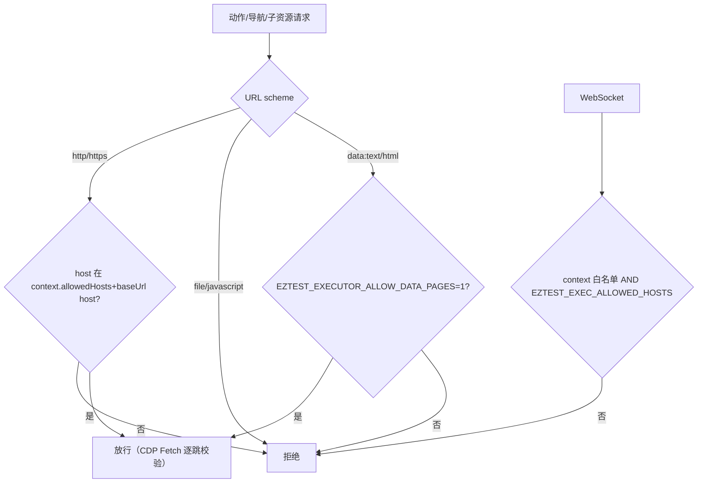
1. **host 白名单**：`allowedHosts` 支持精确匹配、`*.suffix`/`.suffix` 子域通配（apex 需显式列出）；每个 context 的 `baseUrl` host 自动加入。`EZTEST_EXEC_ALLOWED_HOSTS`（默认 loopback）是执行器级 WebSocket 白名单，**两条链都要通过**。
2. **重定向/子资源**：`context.route` 看不到重定向目标，因此用 **CDP `Fetch` 域**拦截每个请求（`installRequestGuard`），逐跳 `classifyUrl` 决定 continue/fail；请求早于 CDP 连接时由 context 级 early route 兜底。
3. **弹窗 / Worker / SW**：弹窗首次导航直接 abort（协议无 popup 动作）；Service Worker `serviceWorkers:"block"`（绕过页面级 guard）；Worker/SharedWorker 由 init script 覆盖构造函数抛错（`worker_blocked`）。
4. **协议白名单**：只允许 `http:`/`https:`；`file:`、`javascript:` 拒绝；`data:text/html` 仅在自测开关下允许。
7. **凭据脱敏**：`fill(secret=true)` 的值登记到 context 的 secret 集合；错误 message、URL、console/network、snapshot 全部替换为 `***`；`snapshot` 额外把页面上所有 `input[type=password]` 的 value 加入脱敏集合（`captureSnapshot`），URL/title 也脱敏。
8. **产物大小在写盘前用 `stat` 校验**（download），截图在内存中校验。
### 8.6 浏览器启动与回退
`contexts.mjs launchChromium()` 的顺序：

1. `EZTEST_EXECUTOR_CHROMIUM_PATH` 显式指定路径 → 直接使用（最高优先级）。
2. pinned Playwright Chromium（`chromium.launch({headless:true})`）。
3. 若 pinned 不可用：扫描 `PLAYWRIGHT_BROWSERS_PATH` / `%LOCALAPPDATA%\ms-playwright` / `~/.cache/ms-playwright` 下最新的 `chromium-<rev>` 目录，按平台后缀找可执行文件。
4. 仍失败则回退系统 `channel: chrome` / `channel: msedge`。
5. 全部失败：`health()` 返回 `{status:"degraded",error:...}`，`/healthz` 503；**第一次请求时懒启动**，失败不缓存（`browserPromise` 可重试），但健康结果缓存 10 s。

运行形态：**单 Chromium 实例 + 每 context 一个 browser context + 一个受控 page + 串行动作队列**（`entry.tail` promise 链）；每 context 独立 `AbortController`。**取消/超时恢复**：仅 abort 不会停止浏览器侧操作，必须关页并重建（`#recoverCanceledPage`，关页/建页都受 5 s 限制，失败则留空让下一动作重建）。`deleteContext` 关闭 browser context 并清理临时目录；`close()` 关全部 context 与 browser。
### 8.7 健康检查与测试
- `src/healthcheck.mjs`：Node 单文件探针，调用 `/healthz`，非 200 退出非零（Compose healthcheck `["CMD","node","src/healthcheck.mjs"]`）。
- 测试：`executor/test/*.test.mjs` 7 个文件（actions/contexts/limits/security/server/snapshot/visual），`node --test --test-concurrency=1`；Compose/CI 中显式安装 Playwright Chromium 后执行。
- 已验证证据：打包 smoke 中"执行器 round-trip（create → goto → snapshot → screenshot → delete）"与 `browserVersion` 存在被检查（§13.2）。
### 8.8 API 工具到执行器动作的映射
执行 Agent 只看到 17 个 P6 工具；其中 10 个 `browser.*` 经 `execution/infrastructure/browser` 客户端翻译成协议 A′ 动作，其余由 API 进程直接处理（不经过浏览器）：

| Agent 工具 | 执行器动作/API 行为 | 关键约定 |
|---|---|---|
| `browser.goto` | `goto` | `wait_until` + 30 s 超时；host 白名单在 executor 强制 |
| `browser.snapshot` | `snapshot` | 返回 ARIA YAML ≤12 KiB；密码/secret 已脱敏 |
| `browser.click` / `browser.fill` / `browser.press` | `click` / `fill` / `press` | `target` 四选一；凭据填充传 `secret=true` |
| `browser.wait_for` | `wait_for` | state 四值；超时受 60 s 硬上限 |
| `browser.screenshot` | `screenshot` | artifact base64+sha256 → API 落证据文件 |
| `browser.console` / `browser.network` | `console` / `network` | ring buffer 500，tail ≤200 |
| `browser.download` | `download` | 临时目录写盘 + stat 限 10 MiB + 文件名清洗 |
| `http.request` | **API 自己发 HTTP** | 非浏览器请求，仍受环境 allowedHosts/只读约束 |
| `execution.step_record` | API 持久化 `step_result` | seq 必须属于快照、顺序递增 |
| `execution.assertion_record` | API 持久化 `assertion_result` | 断言 kind 决定校验器（ui/api/db/text/visual） |
| `execution.case_finish` | API `ValidateFinish` | 四态 + 失败分类矩阵 + 证据非空（§5.8） |
| `execution.db_assert` | API 只读 PostgreSQL | 只读事务 + SELECT/WITH/SHOW/EXPLAIN + 单语句 + 结果/SQL 上限 |
| `execution.visual_assert` | executor `visual.compare` + API 基线 | 基线 ≤5 MiB；环境不匹配 → inconclusive(environment) |
| `execution.case_context` | API 读取 | 返回用例/会话/绑定的只读上下文（不含凭据明文） |

**上下文生命周期**：一个 case run 创建一个 executor context（注入 `storageState`/`sessionStorage`/viewport/DPR/allowedHosts），用例结束（成功/失败/取消）立即 `DELETE`；进程崩溃的 context 由 executor 自行在重启时清理（内存态，无持久租约）。
## 9 前端详细设计
### 9.1 技术栈与工程约束
| 维度 | 选择 |
|---|---|
| 框架 | Next.js **16.4.3** App Router（RSC + client components），`reactStrictMode`，`output: "standalone"` |
| UI | React **19.3.1**、TypeScript 5.9（`strict`，路径别名 `@/*`）、Tailwind CSS 4.3（CSS 变量 token + `@theme inline`，class 暗色模式）、Radix UI（tabs/dropdown-menu）、lucide-react 图标 |
| 可视化 | `@xyflow/react` 12.12（探索链路）；脑图为自研 SVG 布局引擎（`features/mindmap/mindmap-layout.ts`），不用 React Flow |
| 主题 | `next-themes` 0.4.6（`defaultTheme="system"`），顶栏切换 + 设置页外观 |
| 请求/流 | 自研 `lib/api-client.ts`（fetch + 信封）+ `lib/sse-client.ts`（fetch 流式，非 EventSource） |
| 质量 | Vitest 5 + Testing Library + jsdom + axe-core；Playwright 1.64（E2E）；Biome 2.6 lint/format；`tsc --noEmit` |

**目录约定**：`src/app`（路由壳/布局）、`src/features/<domain>`（16 个功能模块：versions、mindmap、execution、delivery、resources、code-intel、code-repos、knowledge、agent-console、quality、llm-settings、users、settings、shell、sse-test、auth）、`src/components/ui`（设计系统）、`src/lib`、`src/navigation`。跨 feature 的导航数据放 `src/navigation`（`Agent.md` §6.4）。
### 9.2 13 条页面路由
| 路由 | 模块 | 说明 |
|---|---|---|
| `/login` | `app/login/page.tsx` | 公开登录页（无应用壳）；已登录访问被重定向到 `/` |
| `/` | `app/(app)/page.tsx` | 概览/平台健康仪表盘（API/PostgreSQL/LLM/SSE 卡片） |
| `/versions` | `features/versions/VersionsPage.tsx` | 版本列表：状态筛选、游标分页、新建版本对话框 |
| `/versions/[id]` | `features/versions/VersionDetailPage.tsx` | 版本工作台（10 Tab，核心界面） |
| `/versions/[id]/mindmap` | `features/mindmap/MindmapPage.tsx` | 全幅脑图路由（同组件，无 `max-w-6xl` 限制） |
| `/issues` | `features/delivery/components/GlobalIssuesPage.tsx` | 跨版本问题中心（筛选 + 深链回版本） |
| `/reports` | `features/delivery/components/GlobalReportsPage.tsx` | 跨版本报告中心 |
| `/knowledge` | `features/knowledge/KnowledgePage.tsx` | 知识库：所有人可读 approved；admin 有 draft/rejected 审核队列 |
| `/code-repos` | `features/code-repos/CodeReposPage.tsx` | 本地 Git 仓库、索引 run、变更集、事实/锚点入口 |
| `/resources` | `features/resources/ResourcesPage.tsx` | 公共资源 4 Tab：系统与环境 / 应用模型 / 账号与访问 / 会话 |
| `/agents` | `features/agent-console/AgentCenterPage.tsx` | Agent 中心 3 Tab：角色目录 / 运行观察 / 配置与控制台 |
| `/quality` | `features/quality/QualityPage.tsx` | admin-only 评测指标面板；普通用户看到显式拒绝页（API 403） |
| `/settings` | `app/(app)/settings/page.tsx` | 账户卡 + 主题；admin 额外 5 Tab：用户 / LLM / SSE 测试 / 基础配置 / 审计日志 |

**路由守卫**：`app/(app)/layout.tsx` 在 `AuthProvider` 恢复会话期间显示"正在验证会话…"，无会话重定向 `/login`；`app/layout.tsx` 为根布局（`lang="zh-CN"`，ThemeProvider + AuthProvider）。`/login` 在 `(app)` 组之外。
**导航**：`src/navigation/nav-items.ts` 11 个目的地，`visibleNavItems(isAdmin)` 过滤 admin-only（质量中心）；`< lg` 断点用 `MobileNav` 抽屉替代固定侧栏。
### 9.3 版本详情 10 个 Tab 与深链
`features/versions/VersionTabs.tsx` 固定 10 项（顺序即默认）：

| `?tab=` | 名称 | 关键能力 |
|---|---|---|
| `requirements` | 需求与澄清 | 需求编辑/确认/重开、关系图、澄清对话（SSE）、问题/决策面板、绑定编辑 |
| `mindmap` | 用例脑图 | SVG 图 + 编辑面板 + 评审 + AI run + 导出（Markdown/Mermaid/OPML/PNG） |
| `overview` | 总览 | 需求覆盖、结果统计、问题 Top5、覆盖矩阵、批次时间线、知识 |
| `sessions` | 执行会话 | Agent transcript 分组/搜索/错误过滤、工具调用、token usage |
| `exploration` | 探索链路 | React Flow 图 + 过滤/仅异常/跟随执行/列表视图、问题 Sheet |
| `broadcast` | 实时播报 | 事件时间线（类型/等级/Agent 过滤）、加载更早、重连提示 |
| `results` | 结果与证据 | 批次分组用例表、步骤/断言、证据缩略图与查看器（含视觉对比滑块） |
| `issues` | 问题 | 筛选/搜索、确认/驳回、证据/代码/需求引用 |
| `report` | 报告 | 批次选择、revision 徽章、stale 横幅、diff、Markdown 导出 |
| `code` | 代码与变更 | 变更时间线、索引/分析 run、影响候选勾选、unmapped diff 预览 |

**稳定深链**：`?tab=<value>`（未知值回退）、`?batch=<batchId>`（执行/报告 tab 的批次选择）、`?issue=<issueId>`（`?tab=issues&issue=…`）、`?report=<reportId>`、`?case=<caseNodeId>`（`?tab=mindmap&case=…`）、`?abnormal=1`（探索链路仅异常）。`/resources` 深链 `?tab=systems|app-models|accounts|sessions`、`?system=<id>`、`?session=<id>`；`/knowledge` 深链 `?version=`、`?review=`。
### 9.4 组件分层与状态管理
- **状态**：局部 `useState/useReducer` + 自定义 hooks（`useApi`/`useSSE` 类模式）；无 Redux/Zustand/React Query 等全局状态库；跨页共享仅 `AuthProvider`（会话/角色）、`ThemeProvider`、少量 context（如版本选择器）。
- **设计系统**（`src/components/ui`）：`StatusBadge`、`EmptyState`、`ErrorState`（显示 request id）、`Skeleton`；`cn()` = `clsx + tailwind-merge`。
- **统一状态**：每个数据区块都有 loading / empty / error / degraded 四态；SSE 区块额外有 `实时连接/重连中` 状态徽章。
- **权限渲染**：`canWrite = role === "admin"`；只读用户看到「只读」徽章、写控件隐藏；后端仍是最终权限仲裁。
### 9.5 api-client 与 sse-client
**`api-client.ts`**（332 行）：

- `DEFAULT_API_BASE_URL = "http://localhost:13333"`；`NEXT_PUBLIC_API_BASE_URL` 在**构建期内联**，改变 API 地址需重新构建 Web 包。
- `apiFetch<T>`：解析 URL → 附 Bearer（来自 `auth-storage` 的 sessionStorage）→ `Accept`/`Content-Type`/`X-Request-ID`/`Idempotency-Key` → fetch → 非 2xx 转 `ApiError{status,code,message,requestId,retryable,details}` → 成功解包 `{data}`。
- `apiGetPage`：保留 `next_cursor`/`snapshot_cursor`/`has_more`。
- **401 规则**：只有本次请求确实附带了 Bearer 才 `clearSession()`（失败登录不会清掉已有会话）。
- 网络失败 → `code="network_error"`、retryable=true；非 JSON 成功体 → `invalid_response`。
- 唯一 fetch 出口（`apiFetch`/`apiStreamFetch`），feature 层不直接 fetch。

**`sse-client.ts`**（328 行）：

- 用 `fetch`（EventSource 无法带 Authorization 头），`Accept: text/event-stream`；`Last-Event-ID` 取上次 seq。
- 增量帧解析器：注释行（`:`）忽略、空行 dispatch、`data:` 多行 join、`id/event/data` 字段；兼容 CRLF。
- **去重**：优先用 data JSON 的 `seq`，回退 frame `id`；`seq <= lastSeq` 丢弃。
- **`stream.reset`**：不当作普通事件；解析 data 后调 `onReset`，调用方重新拉快照（并保持 lastSeq）。
- **重连**：1 s 起指数退避（×2）至上限 30 s，附加 0–999 ms jitter；`attempt` 在连接成功后清零。
- **45 s 无字节超时**：取消 reader 并 abort，进入重连。
- **401**：永久停止（`stopped=true`）、清会话、不再重试，交给受保护布局跳登录。
- 状态机 `connecting → live → reconnecting → closed`（`onStatus`）；返回 cleanup 函数 abort + 清理定时器。
- `consumeSSEStream`：读一次已打开的流（LLM 测试用，事件 `llm.delta/llm.done/llm.error`），共享同一帧解析器但不去重/重连。
### 9.6 UI 状态、主题与可访问性
- 主题：CSS 变量双配色（light/dark），`next-themes` class 模式；字体 Inter/Segoe UI/PingFang SC/Microsoft YaHei + JetBrains Mono。
- 可访问性：skip-to-content 链接、交互控件 aria-label、Radix 组件自带键盘/焦点管理；`a11y.test.tsx`（axe-core）与各组件测试覆盖。
- 响应式：`lg` 以上固定侧栏；以下汉堡抽屉；宽表横向滚动；Tab 栏换行。
- 视觉语言：slate/blue SaaS 风格、2xl 圆角卡片、状态徽章色系（success/info/warning/danger/neutral）。
### 9.7 构建、测试与 i18n 现状
- 构建：`pnpm build`（Next 16 默认 Turbopack，standalone 输出；`next build --webpack` 作为回退）；`next.config.ts` 对全部路径设置安全头（nosniff、Referrer-Policy、X-Frame-Options DENY、Permissions-Policy、**CSP Report-Only**）。
- 测试：Vitest 138 个文件（组件/单元/a11y）；Playwright 30 个 E2E spec（真实 API + 真实 Chrome + 真实 executor + deterministic fake LLM），由 `scripts/e2e.ps1` 驱动。
- **i18n：无**。无 next-intl/i18next、无 locale 路由、无语言开关；UI 硬编码简体中文（`lang="zh-CN"`），少量英文技术串（`revision N`、`Batch #N`、ID、profile key）。这是明确的现状缺口，不是隐藏特性。
### 9.8 页面与 API 映射
| 页面/Tab | 主要 API（均为 Bearer + `{data}` 信封） | 实时通道 |
|---|---|---|
| `/login` | `POST /api/auth/login` | — |
| 应用壳/顶栏 | `GET /api/auth/me`、`GET /api/versions?limit=…`（版本切换器）、`GET /api/todos` | — |
| `/` 概览 | `GET /api/health`（平台卡片） | — |
| `/versions` | `GET\|POST /api/versions`、`GET /api/resources/*`（绑定下拉） | — |
| 版本详情 `requirements` | versions/requirements/relations/attachments/clarification/questions/decisions/knowledge 系列 | `version:{id}` |
| `mindmap` | `/api/versions/{id}/mindmap/*`（图/评审/run/导出/视觉） | `version:{id}` |
| `overview` | versions + requirements + batches + issues + code changes 组合读 | `version:{id}` |
| `sessions` | `GET /api/versions/{id}/execution/sessions`、`/api/agents/sessions*`（admin 控制台） | `version:{id}` / `agent:{sessionId}`（admin） |
| `exploration` | `GET /api/versions/{id}/exploration-chain` | `version:{id}` |
| `broadcast` | `GET /api/versions/{id}/events`（快照） | `version:{id}` |
| `results` | batches/case-runs/evidence 系列、batch report | `version:{id}` |
| `issues` | `/api/versions/{id}/issues*`、`/api/issues` | `version:{id}` |
| `report` | `/api/versions/{id}/reports*`（含 export/diff/regenerate） | `version:{id}` |
| `code` | `/api/versions/{id}/code/*`、`/api/code/*` | `version:{id}` |
| `/issues`、`/reports` | `GET /api/issues`、`GET /api/reports`（跨版本，游标分页） | — |
| `/knowledge` | `GET /api/knowledge`、版本知识/审核接口 | — |
| `/code-repos` | `/api/resources/code-repos*`、`/api/code/repos/*` | — |
| `/resources` | `/api/resources/*`（系统/环境/模型/账号/会话/接管/DB 目标） | — |
| `/agents` | `/api/agents/*`、`/api/agent-center/*` | `agent:{sessionId}`（admin） |
| `/quality` | `/api/quality/eval-runs*`（admin） | — |
| `/settings` | users/llm configs/audit/gc 只读投影/health | `system`（SSE 测试） |

> 约定：所有列表页走游标（`apiGetPage`）；所有写操作在必要时附 `Idempotency-Key`（如创建版本/批次/报告发布）；错误统一渲染 request id（`ErrorState`）。
## 10 配置设计
### 10.1 加载、校验与失败语义
- 入口：`config.Load(os.Getenv)`；任何非法值返回 error，`main()` 打印 `eztest: <error>` 并退出码 1（不 panic）。
- 失败即启动失败（fail-fast）：必填缺失、区间越界、密钥格式错误、正则不匹配、实例 ID 过长。
- 例外：`EZTEST_AUTONOMY_BATCHES_PER_TICK` 超上限**钳制**到 20（不失败），低于 1 失败。
- 路径类变量相对进程 CWD；部署包必须写绝对路径（`scripts/package/init-config.*` 会重写）。
- 大小写：LLM 种子变量是**小写** `llm_base_url`/`llm_key`/`llm_model_name`（历史约定），其余全大写。
### 10.2 53 个 EZTEST_* 变量分类表
> 口径：`config.go` 中解析的变量去重 53 个。表格列：默认值 / 范围 / 生效位置。

| 分类 | 变量 | 默认 | 范围/取值 | 生效位置 |
|---|---|---|---|---|
| **必填** | `EZTEST_DATABASE_URL` | — | PostgreSQL URL | db.Open |
| 必填 | `EZTEST_SECRET_KEYS` | — | JSON `{ver: base64-32B}` | keyring |
| 必填 | `EZTEST_SECRET_KEY_ACTIVE` | — | 正整数，须在 keys 中 | keyring |
| 首启 | `EZTEST_ADMIN_USERNAME` | — | 非空 | EnsureAdmin |
| 首启 | `EZTEST_ADMIN_PASSWORD` | — | ≥10 字符 | EnsureAdmin |
| 服务 | `EZTEST_ENV` | `dev` | `dev/staging/prod/other`（自由字符串，`prod` 影响 test endpoints 默认值） | 启动 |
| 服务 | `EZTEST_HTTP_ADDR` | `:13333` | host:port | http.Server |
| 服务 | `EZTEST_WEB_ORIGIN` | `http://localhost:6868` | 单个 origin | CORS |
| 服务 | `EZTEST_LOG_LEVEL` | `info` | `debug/info/warn/error` | slog |
| 服务 | `EZTEST_INSTANCE_ID` | `<hostname>-<pid>` | ≤64 字符 | leader 诊断 |
| 服务 | `EZTEST_OPENAPI_PATH` | `docs/openapi/api.yaml` | 文件路径 | `/api/openapi.yaml` |
| 服务 | `EZTEST_ENABLE_TEST_ENDPOINTS` | `env != prod` | bool | 测试发布器挂载 |
| 目录 | `EZTEST_STORAGE_DIR` | `.data/objects` | 目录 | storage localfs |
| 目录 | `EZTEST_VERSION_ATTACHMENT_DIR` | `.data/version-attachments` | 目录（0700） | 需求附件 |
| 目录 | `EZTEST_EVIDENCE_DIR` | `.data/evidence` | 目录（0700） | 执行证据/GC |
| 目录 | `EZTEST_REPORT_DIR` | `.data/reports` | 目录（0700） | 报告 Markdown |
| 目录 | `EZTEST_EXPORT_DIR` | `.data/exports` | 目录（0700） | 脑图导出 |
| ID | `EZTEST_SNOWFLAKE_NODE_ID` | `1` | 0–1023 | 全局 ID 生成 |
| Agent | `EZTEST_AGENT_FILE_ROOT` | 空 | 只读根目录（空=禁用 file.list/read） | 工具注册 |
| Agent | `EZTEST_AGENT_HTTP_ALLOWLIST` | `127.0.0.1,localhost` | 逗号分隔 host（可带端口），空值非法 | http.get 工具 |
| Agent | `EZTEST_AGENT_TOOL_TIMEOUT_MS` | `10000` | 1000–60000 | 工具执行 |
| Agent | `EZTEST_AGENT_MAX_CONCURRENT_RUNS` | `4` | 1–32 | RunService |
| Codeintel | `EZTEST_CODEINTEL_MAX_CHANGED_FILES` | `20` | 1–200 | 影响分析 |
| Codeintel | `EZTEST_CODEINTEL_MAX_FILE_BYTES` | `65536` | 1 KiB–1 MiB | 索引/分析 |
| Codeintel | `EZTEST_CODEINTEL_MAX_INDEX_FILES` | `5000` | 1–50000 | 索引 |
| Codeintel | `EZTEST_CODEINTEL_ANALYSIS_TIMEOUT_MS` | `180000` | 30 s–10 min | worker |
| Codeintel | `EZTEST_CODEINTEL_MAX_CONCURRENT_ANALYSES` | `1` | 1–4 | worker |
| Codeintel | `EZTEST_CODEINTEL_PROMPT_VERSION` | `p4.1` | `^[a-z0-9.-]{1,32}$` | 缓存键/事实版本 |
| Codeintel | `EZTEST_CODEINTEL_MAX_EXCERPT_LINES` | `40` | 1–200 | 摘录 |
| Codeintel | `EZTEST_CODEINTEL_MAX_DIFF_BYTES` | `262144` | 4 KiB–1 MiB | diff 上限 |
| Execution | `EZTEST_EXEC_MAX_CONCURRENT_CASES` | `3` | 1–8 | scheduler |
| Execution | `EZTEST_EXEC_MAX_TOOL_CALLS` | `30` | 1–200 | case runner 预算 |
| Execution | `EZTEST_EXEC_CASE_TIMEOUT_MS` | `900000` | 1 s–1 h | case runner |
| Execution | `EZTEST_EXEC_MAX_CASES_PER_BATCH` | `200` | 1–1000 | 建批 |
| Execution | `EZTEST_EXEC_WORKER_INTERVAL_MS` | `2000` | 100–60000 | scheduler tick |
| Execution | `EZTEST_EXEC_EVIDENCE_MAX_BYTES` | `10485760` | 1 KiB–100 MiB | 证据 |
| Execution | `EZTEST_EXEC_EVIDENCE_PER_CASE` | `100` | 1–1000 | 证据 |
| Execution | `EZTEST_EXECUTOR_URL` | `http://127.0.0.1:13336` | URL | executor client |
| Execution | `EZTEST_EXECUTOR_TOKEN` | — | 必填（executor 侧强制） | executor 认证 |
| Delivery | `EZTEST_DB_RESULT_MAX_BYTES` | `1048576` | 64 KiB–16 MiB | db_assert |
| Delivery | `EZTEST_DB_SQL_MAX_BYTES` | `16384` | 1 KiB–64 KiB | db_assert |
| Delivery | `EZTEST_AUTONOMY_BATCHES_PER_TICK` | `4` | 1–20（超上限钳制 20） | autonomy worker |
| Delivery | `EZTEST_ANALYSIS_MAX_CASES` | `20` | 1–50 | 失败分析 |
| Delivery | `EZTEST_SUPPLEMENT_MAX_CASES` | `5` | 1–20 | 补全 |
| 视觉 | `EZTEST_VISUAL_BASELINE_MAX_BYTES` | `5242880` | 64 KiB–20 MiB | 基线审批 |
| 限流 | `EZTEST_RATE_LIMIT_RPS` | `50` | 0–1000（0 关闭） | 令牌桶 |
| 限流 | `EZTEST_RATE_LIMIT_BURST` | `100` | 1–5000 | 令牌桶 |
| 限流 | `EZTEST_RATE_LIMIT_SSE_MAX` | `10` | 1–100 | SSE 并发 |
| GC | `EZTEST_GC_ENABLED` | `false` | bool | 非 dry-run 开关 |
| GC | `EZTEST_GC_RETENTION_DAYS` | `30` | 1–3650 | 证据保留 |
| GC | `EZTEST_GC_BATCH_KEEP` | `3` | 1–50 | 保留批次 |
| Leader | `EZTEST_LEADER_LOCK_KEY` | `1163411512` | int64 | 调度/自主/维护 |
| 测试 | `EZTEST_TEST_DATABASE_URL` | 空 | 集成/测试库 URL（仅脚本/测试读取） | 测试 |
### 10.3 未接线与保留变量
以下变量在 `.env.example`/README 中出现但不是当前 Go 代码生效的控制点（**不得当作可配置能力对外宣传**）：

| 变量 | 文档值 | 实际情况 |
|---|---|---|
| `EZTEST_MINDMAP_MAX_CASES` | 60 | **未接线**；后端硬编码 `materializeMaxCases=60`（`mindmap/application/materialize.go`） |
| `EZTEST_EXPLORE_MAX_REQUESTS` | 40 | **未接线**；`exploreMaxRequests=40`（`explore_service.go`） |
| `EZTEST_EXPLORE_TIMEOUT_MS` | 5000 | **未接线**；实际预算 `exploreTotalTimeout=60s` |
| `EZTEST_CHAIN_MAX_NODES` | — | 未接线；chain 使用请求参数 `limit`（50–2000） |
| `EZTEST_SEARCH_MAX_RESULTS_PER_TYPE` | — | 未接线；搜索用请求参数 `perType`（1–20） |
| `EZTEST_TODOS_MAX` | — | 未接线；todos 用请求参数 `limit`（1–200） |
| `EZTEST_VISUAL_DIFF_THRESHOLD` | — | 保留/未读；阈值在每条视觉断言上配置 |
| `EZTEST_EXECUTOR_ADDR` 等 | — | 由 **executor 进程**读取，不影响 API |
### 10.4 运行时读取与执行器侧变量
**API 运行时额外读取（不走 config.Load，未做启动校验）**：

| 变量 | 默认 | 位置 |
|---|---|---|
| `EZTEST_KNOWLEDGE_MAX_INJECT` | 5（钳制） | `version/application/knowledge_service.go` |
| `EZTEST_KNOWLEDGE_MAX_BYTES` | 4096（钳制） | 同上 |

**执行器进程变量（Node 侧）**：`EZTEST_EXECUTOR_ADDR`（默认 `127.0.0.1:13336`）、`EZTEST_EXECUTOR_TOKEN`（必填）、`EZTEST_EXECUTOR_MAX_CONTEXTS`（默认 8）、`EZTEST_EXECUTOR_CHROMIUM_PATH`、`EZTEST_EXECUTOR_ALLOW_DATA_PAGES`、`EZTEST_EXEC_ALLOWED_HOSTS`（默认 loopback）、`EZTEST_EXECUTOR_VERSION`（健康输出）。

**Web 变量**：`NEXT_PUBLIC_API_BASE_URL`（构建期内联，默认 `http://localhost:13333`）；运行期 `PORT`/`HOSTNAME`/`NODE_ENV`。

> 组合口径：`.env.example` 共 63 个 `EZTEST_*` 键 = 53（config 解析）+ 2（knowledge 运行时）+ 7（executor 侧）+ `EZTEST_MINDMAP_MAX_CASES`/`EZTEST_EXPLORE_MAX_REQUESTS`/`EZTEST_EXPLORE_TIMEOUT_MS`/`EZTEST_VISUAL_DIFF_THRESHOLD` 等未接线项（部分重叠于前两类）。
### 10.5 典型部署配置组合
| 场景 | 关键配置 | 说明 |
|---|---|---|
| 源码开发（`scripts/dev-*.ps1`） | PG `127.0.0.1:5433`、API `:13333`、Web `6868`、executor `127.0.0.1:13336`、`EZTEST_OPENAPI_PATH` 由脚本改成绝对路径、`EZTEST_ENABLE_TEST_ENDPOINTS=true`（非 prod 默认） | `.env` 由 `dev-api.ps1` 注入进程环境；三个进程分别启动 |
| E2E/验收（`scripts/e2e.ps1`） | 专用 `eztest_e2e` 库、自有端口、fake LLM、fixture 站点、`EZTEST_RUN_REAL_LLM` 默认关 | 测试不污染开发库；Playwright 用真实 Chrome + 真实 executor |
| Docker Compose | `EZTEST_DATABASE_URL=postgres://…@postgres:5432/…`、`EZTEST_EXECUTOR_URL=http://executor:13336`、内容目录 `/data/*`、`EZTEST_ENABLE_TEST_ENDPOINTS=false` | 单机四服务；executor 不发布端口；**未实际运行验证** |
| 免 Docker 包（Windows/Linux） | 包内 `.env`：`EZTEST_ENV=production`、`HTTP_ADDR=127.0.0.1:13333`、数据库 URL 由 `init-config` 传入、5 个内容目录指向 `<pkg>/data/*`、`EXECUTOR_URL/TOKEN`、`OPENAPI_PATH` 绝对路径、`GC_ENABLED=false` | PostgreSQL 17 为外部前置；Linux 先跑 `install-linux-deps.sh`；包 smoke 10/10 PASS（记录） |
| 多实例（未完整验证） | 每实例不同 `EZTEST_SNOWFLAKE_NODE_ID`/`EZTEST_INSTANCE_ID`；共享 DB 与 leader key | 仅调度/自主/维护互斥；SSE/限流/agent 仍是进程内 |
## 11 安全设计
### 11.1 威胁模型与信任边界
| 信任域 | 内容 | 边界控制 |
|---|---|---|
| 浏览器（不可信） | 用户输入、token、SSE 数据 | 所有输入服务端校验；token 放 sessionStorage；CSP report-only；XSS 转义 |
| 公网/内网 API 边界 | REST/SSE | Bearer + 角色 + 限流 + CORS 单源 + body 上限 + 安全头（网关/反代补 TLS） |
| 内部执行器网络 | API ↔ executor | 独立 Bearer token；executor 默认只绑回环；host 白名单；无业务 DB 访问 |
| API 进程（可信但最小权限） | 业务逻辑、文件、DB | 非 root 运行（Docker UID 10001）；文件目录 0700；凭据不明文落日志 |
| PostgreSQL | 全部业务数据 | 单实例内网；无行级安全（单租户）；备份文件需按敏感数据处理 |
| LLM 上游（外部） | prompt/响应 | 只发送必要上下文；凭据加密存储；响应体不落日志、错误不回显 |

**明确的非目标**：无多租户隔离、无 RBAC、无字段级权限、无静态加密的数据库（除 LLM 凭据）、无应用层 TLS/HSTS。部署建议：仅在可信网络暴露，或置于自有 TLS 反代之后（release notes 明示）。
### 11.2 认证令牌与密码
| 项 | 值 | 依据 |
|---|---|---|
| 令牌格式 | `ezt_` + 32 字节 `crypto/rand` base64url | `identity/domain/token.go` |
| 存储 | 只存 `sha256(raw)`；明文只在登录响应出现一次 | 同上 |
| TTL | 12 小时 | `TokenTTL` |
| last_seen | 最多每 5 分钟刷新一次（避免每请求写库） | `TokenSeenInterval` |
| 撤销 | logout 撤销当前 token；重置密码撤销该用户全部 token | `AuthService`/`UserService` |
| 密码哈希 | bcrypt cost **12**；72 字节输入窗口（超长密码被 bcrypt 截断，测试固定该行为） | `main.go bcryptCost`、`user_service_test.go` |
| 登录限流 | IP+username 1 分钟内 5 次失败 → 锁 1 分钟；内存有界 10k | `identity/interfaces/httpapi` |
| 认证失败响应 | 401 `unauthenticated`，不区分"用户不存在/密码错误" | handler |
| 禁用用户 | 登录与令牌认证均拒绝 | `user.status` |

> 单 admin 由数据库部分唯一索引保证（`identity_0001_users.sql`），不依赖应用逻辑。
### 11.3 权限矩阵
| 能力/面 | admin | user（登录） | 匿名 |
|---|---|---|---|
| `POST /api/auth/login` | ✓ | ✓ | ✓ |
| `me`/`logout` | ✓ | ✓ | ✗ |
| `/api/users/*` | ✓ | ✗ | ✗ |
| `/api/admin/llm/*`、`/api/admin/storage/*`、`/api/admin/audit`、`/api/admin/gc`、`/api/admin/stream/test-events` | ✓ | ✗ | ✗ |
| `/api/agents/*`（profiles/sessions/tools/stop） | ✓ | ✗ | ✗ |
| `/api/agent-center/*` | ✓ | ✓（只读） | ✗ |
| `/api/resources/*` 读 | ✓ | ✓ | ✗ |
| `/api/resources/*` 写/动作 | ✓ | ✗ | ✗ |
| 版本/需求/澄清/脑图/代码读/执行/交付/链路/搜索/待办 | ✓ | ✓（全部登录用户） | ✗ |
| `/api/versions/{id}/code/repos/{repoId}/index`（T0 索引触发） | ✓ | ✗ | ✗ |
| `/api/quality/eval-runs/*` | ✓ | ✗ | ✗ |
| `/api/stream`（`version:*`/`system` 通道） | ✓ | ✓ | ✗ |
| `/api/stream`（`agent:*` 通道） | ✓ | ✗ → 403 | ✗ |
| `/healthz`、`/api/health`、`/api/openapi.yaml` | ✓ | ✓ | ✓ |

**实现方式**：全局 Bearer 中间件 + 各上下文路由的 `RequireAdmin` 包装（§3.3）；agent 通道在 handler 层额外校验（`agentChannelAdminOnly`）；普通用户"只读"由前端隐藏写控件 + 后端 guard 双重保证。
### 11.4 加密范围与明文边界
| 数据 | 存储方式 | 说明 |
|---|---|---|
| LLM API key、自定义 headers | **AES-256-GCM 加密**（`nonce‖ciphertext`，AAD 绑定字段），keyring 版本化 | 唯一加密范围；轮换旧版本可读 |
| 用户密码 | bcrypt hash（cost 12） | 不可逆 |
| 认证令牌 | SHA-256 hash | 明文不落库 |
| 被测系统账号密码（`account_system_access.credential`） | **明文** | D28 明确设计：内部工具、非生产秘密 |
| 会话 storageState / sessionStorage | **明文** | D28；API 不回显、不写事件/日志/证据 |
| 环境 DB 目标密码（`db_target`） | **明文** | D48 例外：admin-only、API 永不回显、不进 prompt/事件/日志/证据 |
| 证据/报告/导出文件 | 文件系统 0700 根目录，内容不加密 | 依赖主机/磁盘安全 |

> 面试要点：这是**有意识的范围裁剪**，不是遗漏；文档与验收记录均如实记录（README "已知限制"、release notes §2）。加密能力（keyring/AAD/轮换）已实现且被单测覆盖，但只服务 LLM 凭据。
### 11.5 Web 侧安全
| 面 | 措施 |
|---|---|
| XSS | React 默认转义；无 `dangerouslySetInnerHTML` 渲染用户内容；导出文件以 `Content-Disposition` 下载 |
| CSRF | 不使用 Cookie 认证（Bearer 放 `Authorization`），CSRF 面天然很小；CORS 只允许单源且不带 credentials |
| CORS | 精确 origin 比较；预检只回显允许方法/头；响应暴露头白名单（§3.3） |
| 安全头 | Next 全路径：`X-Content-Type-Options: nosniff`、`Referrer-Policy`、`X-Frame-Options: DENY`、`Permissions-Policy`、CSP **Report-Only**（含 `connect-src` 允许 API 源与 ws/wss） |
| SQL 注入 | 全部 SQL 参数化（pgx `$n`）；DB 断言只读 + 语句白名单 + 单语句；无字符串拼接用户输入 |
| 路径穿越 | 文件存储校验相对路径（拒绝 `..`/绝对路径/symlink 逃逸）、文件名清洗、根内校验 |
| 上传 | Content-Type 必填、大小上限；版本附件类型白名单（文本/截图） |
| 点击劫持 | `X-Frame-Options: DENY` + CSP `frame-ancestors 'none'` |
| 依赖 | `scripts/security-audit.ps1` 检查 headers/资源 guard/license；`govulncheck` 在审计中 SKIP（未安装） |

> 已知：CSP 为 report-only（App Router/Tailwind 需要 inline style/script，强行 enforce 会破坏 UI；`next.config.ts` 注释给出切换条件）。
### 11.6 敏感数据、审计与日志
- **日志**：访问日志只记 method/path/status/duration/request_id；executor 不记 header/body/token；LLM 错误不回显上游 body；panic 日志含 stack 但不含请求体。
- **事件/证据**：detail 只放 id/计数/状态/哈希；证据是截图/网络/console 等页面产物，不含凭据（fill secret 已脱敏）。
- **审计**：append-only、admin-only 读取；entry 禁止凭据（§3.6）；审计写入 best-effort。
- **导出/报告**：Markdown 只含业务摘要；文件路径不暴露给 API 消费者（下载走服务端读文件）。
- **备份**：数据库 + 内容目录备份包含明文凭据 → 备份必须按敏感数据保护（release notes 提示）。
### 11.7 限流与部署边界
- 令牌桶 + SSE 并发 + 登录限流（§5.17）；限流是**进程内**，多实例部署时每实例独立计数（已知限制）。
- 执行器默认只监听 `127.0.0.1`；Compose 中不发布端口（`expose`）；生产部署若跨主机必须自行加网络策略 + 强 token。
- API 非 root 运行、内容目录 0700、`/data/*` 由镜像预创建；CSP/CORS/认证均假设前置反代提供 TLS（应用内不做 TLS）。
- `EZTEST_ENABLE_TEST_ENDPOINTS` 默认在非 prod 环境开启（测试事件发布器），prod 默认关闭。
## 12 测试与验收设计
### 12.1 测试分层与规模
| 层 | 规模（本次统计） | 工具/位置 |
|---|---|---|
| Go 单元测试 | 485 源文件 / 384 测试文件 / **2,808** 个 `Test\|Benchmark\|Fuzz` | `go test ./...`，`backend/internal/**` |
| Go 集成测试 | 73 个 `//go:build integration` 文件 | 需要 `EZTEST_TEST_DATABASE_URL`（`_test`/`_e2e` 库名由脚本强制） |
| 前端单元/组件/a11y | **138** 个 Vitest 文件 | `frontend/src/**/*.test.ts(x)`，Testing Library + jsdom + axe-core |
| 前端 E2E | **30** 个 Playwright spec | `frontend/e2e/`，真实 API + Chrome + executor + fake LLM |
| 执行器测试 | 7 个 `test/*.test.mjs`（89 个用例，记录值） | `node --test`，真实 Chromium |
| 契约/场景测试 | fake LLM 分阶段脚本（P4–P7） | `scripts/fake-llm*.test.cjs`、`scripts/acceptance-*.ps1` |
| 验收/SLO/安全/备份 | 脚本化门禁 | `scripts/{acceptance,slo,security-audit,test-backup}.ps1` |

**测试放置原则**：domain 纯函数单测（状态机/分类/检查点/指纹）；application 用 fake 端口测用例；infrastructure 用集成测试；HTTP 层有 handler 测试；跨上下文契约用独立 `_test.go` 断言事件/审计/路由。
### 12.2 测试门与脚本
`scripts/test.ps1`（快检门，已实现）：Go 单元 → Go 集成 → 执行器 node 测试 → fake-LLM P7/P6 契约脚本 → 前端 lint/typecheck/vitest。`scripts/e2e.ps1`：启动 API/Web/executor/fake LLM/fixture（专用 `eztest_e2e` 库与自有端口），跑 Playwright。`scripts/acceptance.ps1`：完整 P0–P8 门（`-StaticOnly` 时无需 DB/Playwright）。`scripts/check-docs.ps1`/`check-ci.ps1`/`check-clean.ps1`：静态契约（文档/OpenAPI/Compose/env/无秘密、CI 结构、工作区干净）。

**CI**（`.github/workflows/ci.yml`，2 job）：Ubuntu job 跑 Go 单元 + 集成（Postgres 17 service，:5433）、前端 lint/typecheck/test、executor 安装 Chromium 后测试；windows-latest job 跑 `check-ci.ps1` + `acceptance.ps1 -StaticOnly`。**Playwright E2E 与真实 LLM 验收不在 CI 范围**；**CI 未在 GitHub runner 上实际执行过**（静态结构校验为绿，见 §12.5）。
### 12.3 Fake LLM 与 fixture 体系
- `scripts/fake-llm.cjs`（约 99 KB）：OpenAI 兼容本地服务，按 P4–P7 场景返回确定性响应，含分阶段测试 `fake-llm.p4/p5/p6/p7.test.cjs`；用于 E2E/acceptance 在无真实 LLM 时跑通全链路。
- `scripts/fixture-target.cjs`（约 26 KB）：本地被测 Web 站点（登录/下单/结算页面），供执行器真实浏览器 E2E。
- `scripts/fixture-db.ps1`：一次性 PostgreSQL fixture 库（DB 断言场景）；`fixture-codeintel-repo.ps1`：构造本地 Git 仓库（索引/diff/影响分析场景）。
- 真实 LLM 验收另设 `EZTEST_RUN_REAL_LLM=1` 开关，默认不跑。
### 12.4 eval、SLO、安全审计与备份演练
| 门禁 | 脚本 | 内容 | 记录结果（已提交） |
|---|---|---|---|
| 确定性评测 | `scripts/eval.ps1` | 6 个基线指标 + 视觉分类指标，阈值/基线/verdict 落 `eval_run/eval_metric` | 确定性 7/7 metrics PASS |
| Real LLM 评测 | `eval.ps1 -RealLLM` | 真实模型跑评测语料 | **未生成**（单次 real LLM 验收不等于矩阵） |
| SLO | `scripts/slo.ps1`/`slo-chain.ps1` | 本机测量 SSE、执行、链路的延迟/吞吐行 | 6/6 行测量（单主机，非生产 SLA） |
| 安全审计 | `scripts/security-audit.ps1` | 响应头、资源 guard、axe、依赖 license | live 45 PASS/1 SKIP/0 FAIL（SKIP=govulncheck 未安装）；static 32 PASS/2 SKIP |
| 备份演练 | `scripts/test-backup.ps1` | `pg_dump` + 内容目录 + manifest + 恢复校验 + 恢复库应用 smoke | 174/174 断言 + 恢复库 smoke 5/5 |
### 12.5 已记录验收证据与未验证项
**已记录（`docs/acceptance/p8/acceptance.md` 与 release notes，2026-10-29/30）**：

| 项 | 结果 |
|---|---|
| Go build/vet/unit | PASS（本次评审复核 `go build ./...`、`go vet ./...`、`go test -count=1 ./...`；工具链 go1.24.6 windows/amd64） |
| Playwright E2E（fake LLM + fixtures） | 41 tests passed（26+9+5+1） |
| 真实 LLM + 真实 Chrome 验收 | 29/29 checks（单模型 deepseek-flash、单次运行），17 张截图 |
| 确定性评测 | 7/7 指标通过 |
| SLO | 6/6 行（本机） |
| 备份恢复 | 174/174 + 恢复库应用 smoke |
| 安全审计 | live 45/1 SKIP/0 FAIL；static 32/2 SKIP |
| 包 smoke（Windows + Linux） | **PASS 10/10**（release notes 记录，含内置 Chromium 与一次性 PG 17） |

**未验证 / 明确未运行**：

1. Docker/Compose 镜像从未构建、栈从未启动（仅 `frontend/scripts/validate-compose.mjs` 静态校验）。
2. GitHub CI 从未在 runner 上执行（只有静态结构检查）。
3. 真实 LLM 评测语料（`eval.ps1 -RealLLM`）未生成；real LLM 验收是单模型单次，不是矩阵。
4. 复合 `scripts/acceptance.ps1` 全量门在本机未取得一次全绿（各组件分别通过，主机负载超时记录）。
5. 多实例部署（除 leader lock 外）未验证；跨实例 SSE 广播不支持。
6. Linux 上真实浏览器启动由包 smoke 的 WSL 场景覆盖记录，但未在裸机发行版矩阵上验证。
### 12.6 关键测试断言示例
| 机制 | 断言（测试位置） |
|---|---|
| 四态矩阵 | `passed` 缺失证据 → 400 `evidence_missing`；`inconclusive(environment)` 无视觉不匹配证据 → 拒绝；预算耗尽必须 `inconclusive(model)`（`execution/domain/verdict_test.go` 等） |
| 失败分类降级 | 工具码 `timeout` + 无证据 → `blocked(environment)`；环境类码永不产出 `failed(application)`；未知码 → `inconclusive(case)`（`classification_test.go`） |
| 检查点 | 步骤 1 passed、步骤 2 interrupted → `completed=[1]`、`nextSeq=2`（`checkpoint_test.go`） |
| 单活跃批次 | 第二个活跃批次创建 → 409 `batch_active`；终态批次释放槽位（`batch_service_test.go` + DB 集成测试） |
| SSE 回放 | 先订阅后回放不丢事件；`id <= cursor` 去重；旧 cursor → `stream.reset(reason=cursor_too_old)`；慢消费者断开（`eventing/.../sse_test.go`、`hub_test.go`） |
| 幂等 | 同键同体重放返回原响应 + `Idempotent-Replayed`；同键异体 → 409；并发同键只执行一次（`idempotency/middleware_test.go`） |
| 报告指纹 | 同输入 fingerprint 稳定、任一输入变化 fingerprint 变化（`delivery/domain/report_content_test.go`） |
| stale 一次 | 已 stale 报告再次读取不重复发 `report.stale`；CAS 输者不覆盖（`report_service_test.go`） |
| 版本继续中 | completed 上建需求 → 同事务 `continuing` + `continue_phase=clarifying` + 事件；确认/重开需求不改状态（`continuing_service_test.go`、`requirement_continuing_test.go`） |
| 认证 | token 12h 过期；last_seen 5 min 节流；logout 撤销；禁用用户拒绝；密码 bcrypt cost 12（`identity/application/*_test.go`） |
| 执行器 | target 多匹配 → `target_ambiguous`；secret 脱敏覆盖错误/snapshot/URL；host 白名单拒绝（`executor/test/*.test.mjs`） |
| 迁移 | order.txt 重复/路径穿越/缺文件被拒；校验和变化 → `ErrMigrationChecksum`（`db/migrate*_test.go`） |
| 事件信封 | channel ≤64、type ≤100、summary ≤500、detail ≤64 KiB 且必须是 object（`eventing/domain/validate_test.go`） |
## 13 部署与发布设计
### 13.1 Docker Compose 设计
文件：[deploy/docker-compose.yml](../deploy/docker-compose.yml)、[deploy/Dockerfile.api](../deploy/Dockerfile.api)、[deploy/Dockerfile.web](../deploy/Dockerfile.web)、执行器 [executor/Dockerfile](../executor/Dockerfile)。

| 服务 | 镜像/构建 | 端口 | 健康检查 | 依赖 |
|---|---|---|---|---|
| `postgres` | `postgres:17` | `5433:5432` | `pg_isready`（12 次 × 5 s） | — |
| `api` | 多阶段 `golang:1.24.6-alpine` → Alpine 运行，非 root UID 10001，`CGO_ENABLED=0`，ldflags 注入 version/commit | `13333:13333` | `wget /healthz` | postgres healthy |
| `executor` | 基于 `mcr.microsoft.com/playwright:v1.64.1-noble`，非 root `pwuser`，`shm_size: 1gb` | `expose 13336`（**不发布**） | `node src/healthcheck.mjs` | — |
| `web` | `node:22-alpine` + pnpm 11 + `NEXT_PUBLIC_API_BASE_URL` build arg | `6868:6868` | `wget /login` | api healthy |

卷：`pgdata`、`objects`、`attachments`、`evidence`、`reports`、`exports`（分别挂 `/data/*`）；api 通过 `env_file: ../.env` 读配置，并覆盖 DB URL（`postgres:5432`）与内容目录。**已知缺口**：compose 未注入 `EZTEST_EXEC_ALLOWED_HOSTS`/`EZTEST_VISUAL_BASELINE_MAX_BYTES`（走默认）；**整栈从未启动**。
### 13.2 免 Docker 运行包布局与生命周期脚本
构建产物（`scripts/build-release.ps1`，已实现，约 109 KB）：`eztest-0.1.0-preview.1-windows-x64.zip`（≈365 MiB / 383,098,901 B）与 `eztest-0.1.0-preview.1-linux-x64.tar.gz`（≈344 MiB / 360,517,083 B），附 `SHA256SUMS.txt`。包内布局（两平台同骨架）：

```text
eztest-<ver>-<os>-x64/
  VERSION  manifest.json  PACKAGE.md  LICENSE  THIRD_PARTY_NOTICES.md  .env.example  docs/openapi/api.yaml
  bin/eztest(.exe)              # Go API，静态 18.8–19.2 MB
  web/                          # Next standalone（server.js + .next/static）
  executor/{package.json,src,node_modules}   # 生产依赖 18.6 MB
  playwright-browsers/  runtime/node/  data/{objects,version-attachments,evidence,reports,exports}/
  init-config.*  start-eztest.*  stop-eztest.*  status-eztest.*  smoke-test.*  install-linux-deps.sh
```
**生命周期脚本**（`scripts/package/`，PowerShell 5.1 / bash 双份）：

| 脚本 | 行为 |
|---|---|
| `init-config` | 复制模板 → 生成 `EZTEST_SECRET_KEYS`/`ACTIVE`、executor token、admin 密码（≥20 字符）；重写路径为包内绝对路径；**绝不打印秘密值**；`.env` 仅属主可读 |
| `start-eztest` | 解析 `.env` → 预检（二进制/文档/端口/DB TCP 可达）→ 先 API（等 `/healthz` + `/api/health .data.db=ok`，60 s）→ executor（等 `/healthz` 带 `browserVersion`）→ web（等 `/login`）；pid/日志落 `run/`/`logs/` |
| `status-eztest` | pid 存活 + 4 个健康探针 + PG TCP，表格输出 |
| `stop-eztest` | web → executor（进程树，kill 掉 Chromium 子进程）→ API 优雅停止；不动 PG 与数据 |
| `smoke-test` | 10 项检查：PG、`/healthz`、`/api/health`（db=ok/version 匹配）、OpenAPI 200、未认证 401、admin 登录 + me、executor 健康（browserVersion）、executor round-trip（goto→snapshot→screenshot→delete）、web `/login` 含 EzTest、5 个数据目录存在 |

已记录：Windows 与 Linux(WSL) 两包 smoke 均 **10/10 PASS**（release notes）；产物在 `.tmp/release` 构建，**归档不提交仓库**（`release/` 为输出目录）。
### 13.3 构建流水线
`scripts/build-release.ps1` 步骤（与打包计划一致，已实现）：

1. 前置检查（go/node/pnpm、OpenAPI 文件、6868 端口与 `next dev/build` 守卫）。
2. API 交叉编译两次（windows/linux amd64，`CGO_ENABLED=0`，`-trimpath -s -w -X .../server.Version/Commit`）。
3. Web 构建一次（`NEXT_PUBLIC_API_BASE_URL` 注入）→ 复制 `.next/standalone` + `.next/static`；扫描并裁剪平台原生模块（sharp/@img），断言无 `*.node/*.dll/*.so/*.exe`。
4. Executor 生产依赖 staging（`pnpm install --prod --frozen-lockfile --node-linker=hoisted`，断言 0 symlink/0 原生）。
5. 按 OS 下载/解压 Playwright 浏览器（chromium 1248、headless shell、ffmpeg 1013；写 `INSTALLATION_COMPLETE`）。
6. Node 22 运行时（Windows zip / Linux tar.xz，仅 `bin/node` + LICENSE）。
7. 组装包树、写 `VERSION`/`manifest.json`/`PACKAGE.md`、脚本 sanity（bash `-n`/PowerShell Parser + 无仓库路径泄漏）。
8. 归档（zip / tar.gz）+ `SHA256SUMS.txt`。
9. Windows 原生 + WSL Linux smoke。

> 语义说明：`NEXT_PUBLIC_API_BASE_URL` 是**构建期内联**，改 API 地址需重构建 Web；包默认 `http://localhost:13333` 与包内 API 默认端口一致，开箱即用。
### 13.4 main/dev 双分支发布
- `dev` 是开发主线（含设计规格、验收记录、内部脚本）；`main` 是**策展后的公开快照**（不是 dev 的历史合并）。
- `scripts/prepare-main-release.ps1`：用 `.tmp/main-work` 的 git worktree 组装 main（公开允许清单 + 少量链接脱敏），校验无禁止路径/内容，默认 dry-run，`-Commit`/`-Push` 显式提交。
- `scripts/build-release.ps1` 产物 + `docs/release-notes/0.1-preview.md` 构成 GitHub release（`v0.1.0-preview.1`）。
- 无 git tag 时用 `git rev-parse --short HEAD` 作为 Commit 注入 `/api/health`。
### 13.5 升级、回滚与备份
- **升级**：替换二进制/包 → 进程启动自动应用新迁移（append-only）。已发布版本的迁移文件不可改；改则启动失败（校验和）。
- **回滚**：不支持 down 迁移；回滚 = 用备份恢复数据库 + 5 个内容目录到旧版本时点，再启动旧二进制。
- **备份**：`scripts/backup.ps1`（`pg_dump -Fc` + 内容目录 + sha256 manifest）；`restore.ps1` 校验后恢复；`test-backup.ps1` 演练（§12.4）。`EZTEST_SECRET_KEYS` **不要**与备份放一起丢失——丢了已加密的 LLM 凭据不可恢复（release notes 明示）。
- **数据相容**：升级前停 web/executor，API 迁移期间短暂不可用（单实例、无滚动升级设计）。
## 14 附录
### 14.1 关键文件索引
| 主题 | 文件 |
|---|---|
| 装配根/启动/停机 | [backend/cmd/eztest/main.go](../backend/cmd/eztest/main.go) |
| 路由/中间件/健康/限流/CORS | [backend/internal/server/](../backend/internal/server) |
| 配置 | [backend/internal/config/config.go](../backend/internal/config/config.go) |
| 迁移执行器/嵌入 | [backend/internal/db/migrate.go](../backend/internal/db/migrate.go)、[db/embed.go](../backend/internal/db/embed.go) |
| 平台公共件 | [backend/internal/platform/](../backend/internal/platform)（errors/pagination/validation/crypto/id/idempotency/leader） |
| 事件/SSE | [backend/internal/eventing/](../backend/internal/eventing) |
| 审计 | [backend/internal/audit/](../backend/internal/audit) |
| 存储 | [backend/internal/storage/](../backend/internal/storage) |
| LLM 网关 | [backend/internal/llm/](../backend/internal/llm) |
| Agent 运行时 | [backend/internal/agent/](../backend/internal/agent) |
| 执行引擎 | [backend/internal/execution/](../backend/internal/execution) |
| 交付 | [backend/internal/delivery/](../backend/internal/delivery) |
| 脑图 | [backend/internal/mindmap/](../backend/internal/mindmap) |
| 代码智能 | [backend/internal/codeintel/](../backend/internal/codeintel) |
| 前端 | [frontend/src/app/](../frontend/src/app)、[frontend/src/features/](../frontend/src/features)、[frontend/src/lib/](../frontend/src/lib) |
| 执行器 | [executor/src/](../executor/src) |
| 部署 | [deploy/](../deploy) |
| 脚本 | [scripts/](../scripts) |
| OpenAPI | [docs/openapi/api.yaml](openapi/api.yaml) |
### 14.2 枚举与常量总表
| 类别 | 值 |
|---|---|
| Agent run 终态原因 | `completed`、`max_turns`、`timeout`、`model_error`、`context_overflow`、`aborted_streaming`、`aborted_tools`、`aborted`、`shutdown`、`run_hard_timeout`、`interrupted` |
| Agent 活动 kind | `run_started`、`user_message`、`thinking`、`text`、`tool_use`、`tool_result`、`usage`、`decision`、`run_finished` |
| Agent profile key（12） | `runtime-diagnostic`（builtin）+ `clarification-dialog`、`requirement-analysis`、`context-recon`、`app-exploration`、`case-design`、`case-review`、`case-data-plan`、`supplement-agent`、`execution-agent`、`failure-analysis-agent`、`issue-triage-agent` |
| Agent 中心 13 角色 | 上述 11 个 + `report`（确定性）、`knowledge`（人工审核） |
| 工具数 | 64 个定义；无 `EZTEST_AGENT_FILE_ROOT` 时注册 62 个（`file.list`/`file.read` 关闭） |
| 执行器动作（13） | `goto`、`snapshot`、`click`、`fill`、`press`、`wait_for`、`screenshot`、`console`、`network`、`download`、`storage_state`、`visual.compare`、`close` |
| 执行器错误码 | `invalid_request`、`invalid_arguments`、`context_not_found`、`context_limit`、`too_large`、`unauthorized`、`target_not_found`、`target_ambiguous`、`host_not_allowed`、`executor_timeout`、`canceled`、`internal`、`degraded` |
| 事件通道 | `system`、`version:{id}`、`agent:{session_id}` |
| 报告 schema | `eztest.report.v1`；状态 `draft\|published\|stale` |
| 评测指标 | `design_coverage`、`impact_recall`、`impact_precision`、`classification_accuracy`、`issue_false_positive_rate`、`supplement_hit_rate`、`visual_classification_accuracy` |
| 后端依赖（go.mod） | `github.com/jackc/pgx/v5 v5.7.6`、`golang.org/x/crypto`（无其他直接依赖） |
| 前端关键版本 | next 16.4.3、react 19.3.1、@xyflow/react 12.12.0、tailwindcss 4.3.3、vitest 5、@playwright/test 1.64.1、biome 2.6.3 |
| 执行器关键版本 | playwright 1.64.1、pixelmatch 8.0.0、pngjs 7.0.0、Node ≥20.11 |
### 14.3 术语与缩写
> 补充 §1.4 术语表：此处收面试高频缩写与代码注释中的简写。

| 缩写 | 全称/说明 |
|---|---|
| D# | 系统蓝图决策记录编号（D1–D69，见 `docs/design/system-blueprint.md` §3.2/§19） |
| A′ | 执行器协议代号（D40）：HTTP/JSON 类型化动作协议 |
| T0/T1 | 代码智能确定性层（Git）/ AI 理解层 |
| SSE | Server-Sent Events |
| OCC/CAS | 乐观并发控制 / 比较并交换 |
| CAS（存储） | Content-Addressed Storage（与上条同缩写，语境区分） |
| GC | 证据垃圾回收 |
| SLO | Service Level Objective（本仓库为本机测量脚本） |
| E2E | 端到端测试 |
| spec §x.y | 代码注释中引用的阶段设计规格章节（`docs/design/*`） |
### 14.4 OpenAPI path 索引
> 按前缀归并（共 168 个 `/api/*` path 条目 + `/healthz`）；完整 schema 见 [api.yaml](openapi/api.yaml)。

| 前缀 | path 模式（归并） |
|---|---|
| `/api/auth` | `login`、`me`、`logout` |
| `/api/users`、`/api/admin/*` | `users`、`users/{id}`、`users/{id}/reset-password`、`admin/audit`、`admin/gc`、`admin/stream/test-events`、`admin/llm/configs*`、`admin/storage/objects*` |
| `/api/agents` | `profiles`、`profiles/{id}`、`tools`、`sessions`、`sessions/{id}`、`sessions/{id}/messages`、`sessions/{id}/messages/{message_id}`、`sessions/{id}/stop` |
| `/api/agent-center` | `catalog`、`sessions`、`quality` |
| `/api/resources` | `systems`、`systems/{id}`、`systems/{id}/environments`、`systems/{id}/app-models`、`systems/{id}/app-models/import`、`environments/{id}`、`environments/{id}/db-target`、`environments/{id}/db-target/test`、`app-models/{id}`、`code-repos`、`code-repos/{id}`、`code-repos/{id}/validate`、`accounts`、`accounts/{id}`、`accounts/{id}/accesses`、`accesses/{id}`、`accesses/{id}/sessions`、`auth-flows`、`auth-flows/{id}`、`sessions`、`sessions/{id}`、`sessions/{id}/snapshots`、`sessions/{id}/validate`、`sessions/{id}/confirm`、`sessions/{id}/invalidate`、`sessions/{id}/revoke`、`sessions/{id}/takeovers`、`takeovers`、`takeovers/{id}/complete`、`takeovers/{id}/cancel` |
| `/api/versions` | （根）、`{id}`、`{id}/bindings`、`{id}/start-clarification`、`{id}/enter-design`、`{id}/changes`、`{id}/stream`、`{id}/events`、`{id}/requirements`、`{id}/requirements/{rid}`、`{id}/requirements/{rid}/confirm`、`{id}/requirements/{rid}/reopen`、`{id}/requirements/{rid}/attachments`、`.../attachments/{aid}`、`.../attachments/{aid}/content`、`{id}/relations`、`{id}/relations/{relId}`、`{id}/clarification`、`{id}/clarification/sessions`、`.../sessions/{sid}/complete`、`{id}/clarification/messages`、`{id}/clarification/analyze`、`{id}/clarification/recon`、`{id}/clarification/questions`、`{id}/clarification/questions/{qid}`、`{id}/decisions`、`{id}/decisions/{did}`、`{id}/knowledge`、`{id}/knowledge/{kid}`、`{id}/knowledge/{kid}/review`、`{id}/exploration-chain`、`{id}/mindmap/*`（31 条）、`{id}/code/*`（8 条）、`{id}/batches/*` 与 execution/delivery 子面 |
| `/api/code` | `repos`、`repos/{repoId}/{index,index-runs/latest,index-runs/{runId},tree,file,diff,diff/file,facts,search,commits/{sha},quality}`、`repos/{repoId}/facts/{factId}/reviews` |
| `/api/issues`、`/api/reports`、`/api/knowledge`、`/api/search`、`/api/todos` | 全局只读中心/搜索/待办 |
| 其他 | `/api/quality/eval-runs{,/{id}}`、`/api/stream{,/events}`、`/healthz`、`/api/health`、`/api/openapi.yaml` |
### 14.5 文档与代码不一致清单
| # | 不一致 | 证据/处理 |
|---|---|---|
| 1 | `server.New` 的注释漏写限流层 | 注释顺序 recover→requestID→logging→CORS→auth→idempotency→routes；实际 `withMiddleware` 在 auth 后插入 rate limiter。以代码为准（§3.3）。 |
| 2 | 既有评审摘要记"事件类型 54、审计动作 55" | 本次源码扫描为 **56/56**：事件多出 `attachment.added\|removed`、`run.*`（4）、`step.finished`、`human.requested` 等 execution/version 侧类型；审计多 1 条（`Action*` 常量 37 + 内联去重合计 56）。数字以本文口径为准，摘要数字偏小。 |
| 3 | `.env.example`/README 把 P5 三个变量（`EZTEST_MINDMAP_MAX_CASES`、`EZTEST_EXPLORE_MAX_REQUESTS`、`EZTEST_EXPLORE_TIMEOUT_MS`）当可调项 | 代码硬编码 60/40/60 s，未读取 env（§10.3）。 |
| 4 | OpenAPI `info.version: 0.9.0` vs 产品/包版本 `0.1.0-preview.1` | 契约版本 ≠ 产品版本；无 git tag 时 commit 由构建注入 `/api/health`。 |
| 5 | 打包计划文档（`.tmp/review/packaging-plan.md`）称"包未构建" | 当前 HEAD `45e8d15` 已有 `scripts/build-release.ps1`、`scripts/package/*`、release notes 与"两包 smoke 10/10 PASS"记录；本文按实际状态描述（§13.2）。 |
| 6 | 既有评审摘要记"scripts 34 个（28 ps1）" | 当前统计 **36 个文件（30 ps1 + 6 cjs）**，新增 `build-release.ps1`、`prepare-main-release.ps1` 等。 |
| 7 | 既有评审摘要记"测试函数 2,809、执行器测试 8 个文件" | 当前扫描 2,808 个测试函数、执行器测试 7 个文件（`test/*.test.mjs`；`helpers.mjs` 不算测试）。统计口径差异。 |
| 8 | `docs/design/system-blueprint.md` §12.2 提到 11 个 Tab（含"资源与会话"），前端实际 10 个 Tab | 前端 `VersionTabs.tsx` 为 10 项；"资源与会话"是独立页面 `/resources`。 |
| 9 | 前端首页 CTA 仍写"用例脑图、执行中心与报告会按后续阶段逐步接入" | 功能已上线（P5–P7 已交付），文案过时；仅影响文案，不影响功能（§9.2）。 |
| 10 | `README` 曾称 SLO 仅 dry-run、备份 smoke 待办 | 后续验收记录已更新为实测/通过；以 `docs/acceptance/p8/acceptance.md` 与 `docs/release-notes/0.1-preview.md` 为准。 |
| 11 | 事件信封中 `refs` 字段名 `case`（单数）与表名 `case_node`/JSON 语义 | 冻结契约使用 `refs.case`，为兼容不可改；文档按契约记录。 |
| 12 | 执行器 `visual.compare` 不在 `actions.mjs` HANDLERS 中（视觉模块注册） | 属实现组织方式，不是不一致；§8.3 已注明。 |
| 13 | 迁移文件编号存在 per-context 空洞（缺 `execution_0003`） | 全局版本号由 `order.txt` 位置决定，文件名编号只是可读标签，空洞无害；`migrate_order_test.go` 只校验 order.txt 与文件集一致，不校验编号连续。 |

---

*文档结束。维护约定：修改实现时同步更新本文对应章节与 §14.5 不一致清单；本文只描述已核验的代码行为，不描述设计意图中的未实现部分（未实现项以"未验证/未接线"显式标注）。*
