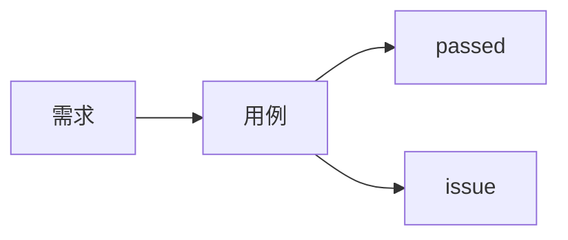

# EzTest P7 全自主闭环与交付 — 阶段设计规格

- **版本**：v1.0（2026-10-28）
- **阶段**：P7（`docs/design/implementation-phases.md` §2-P7）
- **分支**：`feat/p7-autonomous-loop`
- **性质**：P7 实现与验收的唯一阶段依据。与主蓝图冲突时以主蓝图为准（`Agent.md` §3）；本 spec 新增决策 D43–D52，落地时必须同步主蓝图决策记录与受影响章节。
- **阅读依据**：
  - `docs/design/system-blueprint.md` §5（领域/生命周期）、§6（Agent）、§7（代码智能）、§8（执行）、§10（数据）、§11（API）、§12（前端）、§15（阶段/决策）、§18（决策记录）
  - `docs/design/implementation-phases.md` §1、§2-P6/P7、§2.9、§4
  - `docs/design/frontend-design.md` §4.1、§4.2、§4.3.1–4.3.7、§5.1–5.2、§6
  - `docs/design/code-intelligence.md` §5.7、§6、§9
  - `docs/design/auth-session-model.md` §10（Session 指纹/报告引用）
  - `docs/superpowers/specs/2026-10-28-eztest-p6-execution-design.md`（P6 交接边界）
  - 调研摘要：`.superpowers/sdd/p7-research/design-digest.md`、`.superpowers/sdd/p7-research/codebase-survey.md`（非权威，仅输入）

---

## 0. 一页结论

P7 在 P6 的"可执行"之上补齐"自主闭环 + 交付"：执行后由 3 个新 Agent（补全、失败分析、问题整理）产出补充用例、失败结论与问题单；批次报告持久化并可标记 stale、做批次差异；版本完成后新增需求自动进入 `continuing`，走增量设计/影响分析/增量批次；DB 断言（只读）在 Go API 侧执行并落证据。所有 AI 能力不可用时降级为"纯基线执行 + 人工查看"，主流程不崩。

新增一个限界上下文 `delivery`（问题/报告/分析 run），并加法扩展 `resource`（目标库配置）、`version`（`continue_phase`）、`execution`（批次种类/来源/自主编排/DB 断言）、`mindmap`（补全写路径/补全 run）、`codeintel`（issue 锚点/增量 base）。P6 已冻结的 API、事件与报告端点保持兼容，只做加法。

**P7 不做**（防止范围蔓延）：知识沉淀/评测（P8）、多用户协作、外部工单同步、视觉断言（D7）、Mock/测试数据夹具、跨用例语义依赖、版本归档实现（P8）。`version_change` 表 P7 不建。

---

## 1. 阶段目标、范围与退出标准

### 1.1 目标

1. 基线批次执行完成后，AI 能发现覆盖缺口并补充用例，自动回填脑图并继续执行，不修改已冻结基线。
2. 每个终态批次都有失败分析、问题候选与持久化报告；报告含问题、批次差异、evidence stale 标记。
3. `completed` 版本新增需求后自动进入 `continuing`，支持增量澄清/设计/影响分析/增量批次/暂停恢复/报告 Batch N。
4. DB 断言（只读）可配置、可执行、可取证，P6 遗留 db 断言用例可重跑。
5. 前端交付 §2.9 #7/#9/#12/#13/#18/#21/#22；问题、报告、继续中、探索链路、总览真实可用。
6. 真实 LLM / 真实 PostgreSQL 只读库 / 真实浏览器全链路验收通过。

### 1.2 范围

| 能力 | 交付内容 |
|---|---|
| 探索/补全 Agent | `supplement-agent`；基线批次后覆盖缺口分析；`incremental_design` 模式产出新增用例 + AI 受影响旧用例；自动回填 `case_node`（`source=ai_supplement`）；自动创建补充批次 |
| 失败分析 Agent | `failure-analysis-agent`；只分析 `failed(application)` 用例，产出根因/置信度/重跑建议/问题候选；不改写 P6 历史 |
| 问题整理 Agent | `issue-triage-agent`；语义去重/合并/问题单文本；服务端确定性落库、证据/步骤/代码锚点关联 |
| 问题（Issue） | `issue`/`issue_ref` 表、状态机、列表/详情/确认/驳回、代码锚点、全局问题列表 |
| 报告（Report） | `report`/`report_ref` 表、按批次 Revision、自动发布、stale、批次差异、Markdown 导出（含 Mermaid 覆盖图）、全局报告列表 |
| DB 断言 | 环境级 `db_target` 配置（admin）、只读执行、`db_result` 证据、判定/分类放开、P6 用例重跑 |
| 继续中 | `completed + 新需求 → continuing`、`continue_phase`、增量设计/影响分析、增量批次、暂停/恢复、完成后报告 |
| 前端 | 版本详情问题/报告 Tab、总览完善、探索链路问题节点、继续中徽章/横幅/新增需求入口、DB 目标配置、全局问题/报告中心 |

### 1.3 明确不做

- 视觉断言、像素比对（P8，D7）。
- 知识沉淀/评测集（P8，D4/D8）。
- 外部工单同步（只留 `external_ref` 字段，D14）。
- Mock/测试数据夹具、跨用例语义依赖（P6 spec §14 未排期）。
- 多版本并行执行、多人协作编辑、MFA 真实供应商。
- `version_change` 表（P8；P7 的 `/changes` 读时派生）。
- 报告 PDF 导出（frontend-design 明确后续）。

### 1.4 与 P6 的交接输入（必须全部承接）

| P6 遗留 | P7 处理 |
|---|---|
| 含 db 断言用例一律 `inconclusive(case, unsupported_assertion_kind)` | 放开；只读 DB 断言可执行；P6 遗留用例可重跑 |
| Batch 1 报告读时派生，无 issue/revision/stale/diff | 新增持久化报告；P6 端点保留 |
| 无 `issue`/`report` 实体 | 新增 `delivery` 上下文 |
| 无 `continuing` 入口，`continuing→completed` 被拒 | 需求创建触发 continuing；自主编排完成 |
| 建批只允许 `executing` | 允许 `continuing` 的增量批；补充批自动创建 |
| 冻结基线拒绝补全写入 | 受控叠加层（D44） |
| `case_run`/快照无来源 | `case_run.source` + 快照 `origin` + `run_batch.kind` |
| 执行器不访问业务 DB | DB 断言在 Go API 侧执行 |
| P6 报告 DTO 负向测试、迁移尾部断言、P7 空态断言 | P7 任务内同步修改，不破坏 P6 语义 |

### 1.5 退出标准（实现依据）

逐条对应 `implementation-phases.md:257-262`，验收证据见 §13：

1. 执行中 AI 能发现覆盖缺口并补用例，回填脑图且不阻断执行。
2. 完成后新增需求触发 continuing → 增量批次 → 新报告版本；支持暂停/恢复。
3. 问题带步骤/证据/代码位置；报告分批次、evidence stale 标记。
4. DB 断言（只读）可配置并执行；连接/权限失败 → `blocked(environment)` 或 `inconclusive(case)`，不误判应用缺陷；P6 遗留 db 断言用例可重跑。
5. AI 补全/失败分析不可用时，降级为纯基线执行 + 人工查看（不崩）。

---

## 2. 决策记录（D43–D52）

> 以下为本阶段新增决策，必须同步到 `system-blueprint.md` 决策记录；编号接续 P6 的 D42。

| D# | 决策 | 理由 | 代价/约束 |
|---|---|---|---|
| **D43** | `completed` 版本上 **创建需求成功即自动进入 `continuing`**：同事务置 `status=continuing`、`continue_phase=clarifying`、`continued_at=now()`，发布 `version.status_changed`。这是 D31"需求操作不改 Version.status"的**唯一例外**；确认/重开需求仍不改状态。`batch_no` 只在建批时分配，不在进入继续中时自增。`continuing→completed` 由自主协调器在增量批次链结束后触发。 | 同时满足前端旅程 C 与 D31 的主语义；状态变更可追溯、可幂等。 | D31 需新增例外说明；需求创建路径必须与版本状态同事务；并发创建需求只允许一次状态迁移。 |
| **D44** | **基线永久只读 + 受控叠加层**：`case_baseline` 行、`graph_hash`、冻结节点内容不可改；P7 只开两条写路径：① 追加 `source=ai_supplement` 的新节点（含步骤/断言/来源）；② 仅状态迁移 `supplemented→merged/rejected`、`reviewed→needs_revalidation`、`merged/needs_revalidation→executed`。冻结节点的内容编辑仍 409 `baseline_frozen`。`case_run.source`、快照 `origin`、`run_batch.graph_hash` 记录来源与当前工作图哈希。 | 保留 P5 冻结语义与基线可审计；补全可回填且不破坏历史。 | 需要新的受控 GraphService 方法；所有旧测试中"冻结即全部 409"的断言需按两条例外更新。 |
| **D45** | **链式批次**：`run_batch.kind ∈ {baseline, incremental, supplement}`，`parent_batch_id`；不修改在飞批次；基线批终态后自动跑补全分析，产出新用例后自动创建紧随的 supplement 批；`continuing` 下的批为 incremental。单版本单活跃批次不变；版本完成由自主协调器在"分析→问题→报告→补全→补充批"链结束后判定，取代 P6 的无条件 `CompleteExecution`。每批最多 1 个补全周期、每周期最多 5 条新用例。 | 避免在飞批次追加导致的计数/快照/报告不变量破坏；"继续执行"用紧随批次实现，基线执行不被阻塞。 | P6 scheduler 完成路径、批次门禁、Version 完成时机均需改造；P6 的"批次完成即版本完成"测试需更新。 |
| **D46** | **每批一报告 + Revision**：`report` 按 `(batch_id, revision)` 唯一；分析终态后自动生成并发布 revision 1；读取时用 `input_fingerprint` 判断 stale；重新生成 → revision+1；支持批次差异与 Markdown 导出。P6 的 `GET /batches/{id}/report` 派生端点保持原样，P7 新增版本级报告 API。`version_change` 不建表，`/changes` 由需求/批次/报告/问题读时派生（P8 再建表）。 | 报告可复现、可追溯、不破坏 P6 契约；差异按报告快照计算。 | 需新增报告文件存储根与 stale 计算；P6 报告与 P7 报告并存，前端 P7 使用新端点。 |
| **D47** | **Issue 模型**：`issue` + `issue_ref`；状态 `open→confirmed/dismissed`（终态，不重开）；AI 只为 `failed(application)` 与需求缺口建单，环境/会话/模型/用例失败不生成缺陷；AI 单按 `sha256(version|caseNode|failureClass|normalizedReason)` 去重；任意登录用户可确认/驳回，驳回必填原因；`code_anchor(subject_kind='issue')` 由服务端验证 `file:line` 后创建。 | 问题必须可追溯、可去重、不误报环境问题；权限与 P3 版本域一致。 | 重复失败只追加引用/复发计数，不重开已驳回单；跨批次语义合并依赖问题整理 Agent，服务端仍做硬去重。 |
| **D48** | **DB 断言目标库**：环境级 `db_target`（一环境一目标），admin-only；**密码明文存储**（D28 同类例外，admin-only、API 永不回显、不进入 prompt/事件/日志/证据）；仅 PostgreSQL；Go API 侧执行，只读事务 + 仅 SELECT/WITH/SHOW/EXPLAIN + 单语句 + 超时/行数/字节上限；结果落 `db_result` 证据；连接/权限失败 → `blocked(environment)`，SQL/只读/截断错误 → `inconclusive(case)`，绝不判应用缺陷。 | 复用本机 PG 与 D28 的明文存储惯例；只读由事务+角色+语句三层强制；执行器不接触业务 DB（D40）。 | 明文凭据是安全风险点，必须在 admin 权限、日志/事件/证据脱敏、UI 不回显上严格约束；只支持 PostgreSQL。 |
| **D49** | **增量影响 base**：增量批 base = 上一终态批的 `head_commit`（无历史批用版本 `code_baseline_commit`）；head = 建批时固定分支 HEAD；若上一批 head 不是当前 head 的祖先（rebase/强推），回退版本基线并在批次/报告标 `history_rewritten`。P4 影响分析请求新增可选 `baseCommit`（默认版本基线），缓存/唯一键包含 base。 | 只分析上次已测以来的新变更，避免增量批越跑越宽；非祖先时安全回退。 | 需改 P4 分析服务/HTTP 请求；批次需记录 `base/head` 与回退标记。 |
| **D50** | `version_change` 表 P7 不建；`GET /api/versions/{id}/changes` 由需求创建时间、批次、报告、问题读时派生；建表与事件回放留 P8。 | 避免无明确字段的表；P7 前端只需要变更列表/时间线。 | `/changes` 无持久快照，历史时点不可复现（P8 补）。 |
| **D51** | **3 个 LLM Profile + 确定性交付**：`supplement-agent`（覆盖缺口 + 增量设计/AI 受影响用例）、`failure-analysis-agent`、`issue-triage-agent`；报告由确定性服务生成。AI 不可用时：分析/补全 marked degraded，受影响用例降级为 `case_source` 确定性映射，批次仍按基线执行。所有 Agent run 预算 MaxTurns 20 / 600s；每批最多 3 个分析类 run。 | 用户确认 3 Agent 方案；报告可复现；AI 失败不拖垮主流程。 | 新增 3 个 profile/工具/run 表；issue 文本来自 LLM，落库/去重/锚点仍服务端校验。 |
| **D52** | **权限/审计/事件**：版本域写操作（问题确认/驳回、报告生成/导出、增量设计触发、补全批）任意登录用户；DB 目标配置 admin；审计动作 `delivery.issue.created/confirmed/dismissed`、`delivery.report.published/exported`、`delivery.analysis.started/finished`、`resource.db_target.upserted/tested`、`version.continued/completed`；新增事件 ID 一律十进制字符串；新增原因码以 §7.11 为准。 | 与 P3/P5/P6 的版本域权限一致；审计可追溯；避免 JS 精度问题。 | 不审计凭据/SQL 结果/证据正文/prompt；全局问题/报告中心只读。 |

---

## 3. 架构与模块边界

### 3.1 新增/变更模块

```text
backend/internal/
├─ delivery/                         # P7 新限界上下文（问题/报告/分析）
│  ├─ domain/                        # issue, report, analysis, dedupe, stale, diff, errors, constants
│  ├─ application/                   # issue_service, report_service, analysis_service, triage, agent_tool, ports
│  ├─ infrastructure/                # {postgres,filestore,agent,eventing,audit,execution,mindmap,codeintel,version}
│  └─ interfaces/httpapi/            # /api/versions/{id}/issues|reports, /api/issues, /api/reports
├─ resource/                         # P2 上下文：新增 db_target 领域/服务/仓储/HTTP
├─ version/                          # P3 上下文：continue_phase、需求创建触发 continuing、完成/暂停扩展
├─ execution/                        # P6 上下文：批次 kind/parent/graph_hash/source、自主编排 worker、db_assert 工具、判定放开
├─ mindmap/                          # P5 上下文：supplement/incremental_design run、受控写路径、AI 受影响用例
├─ codeintel/                        # P4 上下文：impact baseCommit、issue 锚点
├─ agent/                            # P1 上下文：新 profile seed 由各上下文适配器完成，不改运行时
└─ cmd/eztest/main.go                # 唯一组装根：新服务/worker/端口装配
```

前端：

```text
frontend/src/features/
├─ delivery/                         # 问题列表/详情、报告列表/详情/差异、全局中心
├─ versions/                         # 继续中徽章/横幅、新增需求入口、总览完善、Tab 挂载
├─ execution/                        # 探索链路问题节点、批次种类/来源展示、SSE 刷新扩展
└─ resources/                        # 环境级 DB 目标配置（admin）
frontend/src/app/(app)/issues|reports/  # 全局问题/报告中心页面
```

### 3.2 依赖方向

- `delivery/domain` 只依赖标准库与 `platform` 纯类型；不导入 pgx/HTTP/LLM。
- `delivery/application` 只依赖 `delivery/domain`、`platform` 与自身端口；不导入 infrastructure/interfaces。
- `delivery/infrastructure` 实现 domain/application 端口，可导入其他上下文的 **application 接口**（execution/mindmap/codeintel/version/agent/eventing/audit），不得导入其他上下文 infrastructure/interfaces（`Agent.md` §6.2）。
- `delivery/interfaces/httpapi` 只调用 delivery application；DTO 与领域对象分离。
- 由 `cmd/eztest` 注入所有端口；delivery 不直接读取 execution 表，经 execution application 查询端口。
- 事件统一走 `eventing`（P0）与 `version:{id}` 通道；delivery 不新建 SSE 通道。

### 3.3 端口清单（跨上下文）

| 使用方 | 端口 | 提供方 | 方法（语义） |
|---|---|---|---|
| delivery.application | `ExecutionReader` | execution.application | `BatchForDelivery(versionID,batchID)`、`CaseRunsForBatch`、`CaseRunDetail`、`EvidenceMeta` |
| delivery.application | `CaseGraphReader` | mindmap.application | `RequirementsForVersion`、`CasesForVersion`、`CaseSources`、`CoverageSummary` |
| delivery.application | `AnchorWriter/Reader` | codeintel.application | `CreateIssueAnchor`、`ListAnchors(subject=issue)` |
| delivery.application | `VersionReader` | version.application | `Get`（状态/环境/仓库/commit/continue_phase） |
| delivery.application | `AgentRuntime` | agent.application | `StartWithScope`、`GetRun`、`Cancel`、`ListSessions` |
| delivery.application | `EventPublisher`/`AuditSink`/`ReportStore` | P0/P6 适配 | 发布、审计、报告文件读写 |
| execution.application | `AnalysisPort` | delivery.application | `StartFailureAnalysis`、`GetAnalysis`、`StartIssueTriage`、`EnsureReport`、`GetReport` |
| execution.application | `CodeImpactPort` | codeintel.application | `StartImpact(versionID, baseCommit, headCommit?)`、`GetImpact(analysisID)`（继续中增量设计触发，P4 不可用返回 degraded） |
| execution.application | `SupplementPort` | mindmap.application | `StartSupplement`、`GetSupplementRun`、`CreateSupplementBatchCases`、`MarkSupplementMerged` |
| execution.application | `VersionPort` | version.application | `CompleteExecution`、`CompleteContinuing`、`ContinuePhase`、`MarkPaused`、`SetBatchNo` |
| mindmap.application | `DeliveryPort` | delivery.application | `CreateRequirementGapIssues`（补全升级） |
| resource.application | `ReadOnlyQuery` | resource.infrastructure | 执行只读 SQL；返回列/行/截断/耗时 |
| execution.application | `DBQueryPort` | resource.application | `Query(environmentID, sql, limits)` |
| codeintel.application | `IssueAnchorPort` | codeintel.application | 由 delivery 调用创建 issue 锚点 |

---

## 4. 数据模型

### 4.1 迁移清单（只追加）

| 顺序 | 文件 | 内容 |
|---|---|---|
| 33 | `delivery_0001_issue.sql` | `issue`、`issue_ref` |
| 34 | `delivery_0002_report.sql` | `report`、`report_ref` |
| 35 | `delivery_0003_analysis.sql` | `analysis_run` |
| 36 | `resource_0007_db_target.sql` | `db_target` |
| 37 | `version_0005_continue.sql` | `continue_phase`、`continued_at` |
| 38 | `execution_0002_autonomy.sql` | `run_batch` 列、`case_run.source`、`evidence.kind=db_result`、`autonomy_done` |
| 39 | `mindmap_0002_supplement.sql` | `case_design_run` 新 kind、`batch_id` |
| 40 | `codeintel_0005_issue_anchor.sql` | 放开 `subject_kind='issue'` |

> `order.txt` 末尾按上表追加；`scripts/acceptance.ps1` 的"末尾恰为 P6 三迁移"断言必须改为"包含且顺序正确"（见 §12.6）。

### 4.2 DDL

#### 4.2.1 `issue` / `issue_ref`

```sql
CREATE TABLE IF NOT EXISTS issue (
  id                BIGINT NOT NULL,
  version_id        BIGINT NOT NULL,
  batch_id          BIGINT,
  case_run_id       BIGINT,
  case_node_id      BIGINT,
  step_result_id    BIGINT,
  source            TEXT NOT NULL CHECK (source IN ('ai','human')),
  category          TEXT NOT NULL DEFAULT 'defect'
                      CHECK (category IN ('defect','requirement_gap','other')),
  severity          TEXT NOT NULL CHECK (severity IN ('blocker','major','minor','info')),
  status            TEXT NOT NULL DEFAULT 'open'
                      CHECK (status IN ('open','confirmed','dismissed')),
  confidence        TEXT NOT NULL DEFAULT 'medium'
                      CHECK (confidence IN ('high','medium','low')),
  failure_class     TEXT CHECK (failure_class IN
                      ('application','environment','session','model','case')),
  dedupe_key        TEXT CHECK (dedupe_key IS NULL OR dedupe_key ~ '^[0-9a-f]{64}$'),
  title             TEXT NOT NULL CHECK (title <> '' AND length(title) <= 200),
  description       TEXT NOT NULL DEFAULT '',
  repro_steps       TEXT NOT NULL DEFAULT '',
  expected          TEXT NOT NULL DEFAULT '',
  actual            TEXT NOT NULL DEFAULT '',
  rerun_suggestion  TEXT NOT NULL DEFAULT '',
  external_ref      TEXT NOT NULL DEFAULT '',
  recurrence_count  INT NOT NULL DEFAULT 0 CHECK (recurrence_count >= 0),
  revision          INT NOT NULL DEFAULT 1 CHECK (revision >= 1),
  dismissed_reason  TEXT NOT NULL DEFAULT '',
  created_by        BIGINT NOT NULL,
  updated_by        BIGINT NOT NULL,
  confirmed_by      BIGINT,
  confirmed_at      TIMESTAMPTZ,
  dismissed_by      BIGINT,
  dismissed_at      TIMESTAMPTZ,
  created_at        TIMESTAMPTZ NOT NULL DEFAULT now(),
  updated_at        TIMESTAMPTZ NOT NULL DEFAULT now(),
  CONSTRAINT pk_issue PRIMARY KEY (id),
  CONSTRAINT uk_issue_version_dedupe UNIQUE (version_id, dedupe_key),
  CONSTRAINT ck_issue_dismiss_reason CHECK (
    status <> 'dismissed' OR dismissed_reason <> ''),
  CONSTRAINT ck_issue_ai_required CHECK (
    source <> 'ai' OR (
      dedupe_key IS NOT NULL AND (
        category = 'requirement_gap'
        OR (failure_class IS NOT NULL AND case_node_id IS NOT NULL)
      )
    )
  )
);
CREATE INDEX IF NOT EXISTS idx_issue_version_status
  ON issue(version_id, status, severity, id DESC);
CREATE INDEX IF NOT EXISTS idx_issue_batch ON issue(batch_id, id);
CREATE INDEX IF NOT EXISTS idx_issue_case_run ON issue(case_run_id, id);

CREATE TABLE IF NOT EXISTS issue_ref (
  issue_id   BIGINT NOT NULL REFERENCES issue(id) ON DELETE CASCADE,
  ref_kind   TEXT NOT NULL CHECK (ref_kind IN
               ('case_run','case_node','step_result','evidence','requirement',
                'batch','commit','code_anchor')),
  ref_id     TEXT NOT NULL CHECK (ref_id <> ''),
  created_at TIMESTAMPTZ NOT NULL DEFAULT now(),
  CONSTRAINT pk_issue_ref PRIMARY KEY (issue_id, ref_kind, ref_id)
);
CREATE INDEX IF NOT EXISTS idx_issue_ref_target ON issue_ref(ref_kind, ref_id);
```

约束说明：
- 雪花 ID 由 `platform/id` 生成；JSON/URL/事件/工具参数一律十进制字符串（D29）。
- `dedupe_key` 仅 AI 单必填；人工单为 NULL（PG 唯一索引允许多个 NULL）。
- `issue_ref.ref_id` 用 TEXT 以同时容纳 BIGINT ID 与 40 位 commit；服务端按 `ref_kind` 校验格式与归属（同版本、同批次、证据存在、commit 40-hex）。
- 代码位置不复制到 issue；经 `code_anchor(subject_kind='issue', subject_id=issue.id)` 查询。
- `issue_ref` 是问题引用的唯一真相；evidence_ref 不重复写（P6 的 `evidence_ref.ref_kind='issue'` 保留但 P7 不主动使用）。

#### 4.2.2 `report` / `report_ref`

```sql
CREATE TABLE IF NOT EXISTS report (
  id                 BIGINT NOT NULL,
  version_id         BIGINT NOT NULL,
  batch_id           BIGINT NOT NULL,
  revision           INT NOT NULL CHECK (revision >= 1),
  status             TEXT NOT NULL DEFAULT 'draft'
                       CHECK (status IN ('draft','published','stale')),
  title              TEXT NOT NULL DEFAULT '',
  content            JSONB NOT NULL,
  input_fingerprint  TEXT NOT NULL CHECK (input_fingerprint ~ '^[0-9a-f]{64}$'),
  markdown_path      TEXT NOT NULL DEFAULT '',
  markdown_sha256    TEXT CHECK (markdown_sha256 IS NULL
                       OR markdown_sha256 ~ '^[0-9a-f]{64}$'),
  markdown_size      BIGINT NOT NULL DEFAULT 0 CHECK (markdown_size >= 0),
  stale_reason       TEXT NOT NULL DEFAULT '',
  generated_by       BIGINT,
  published_at       TIMESTAMPTZ,
  created_at         TIMESTAMPTZ NOT NULL DEFAULT now(),
  updated_at         TIMESTAMPTZ NOT NULL DEFAULT now(),
  CONSTRAINT pk_report PRIMARY KEY (id),
  CONSTRAINT uk_report_batch_revision UNIQUE (batch_id, revision)
);
CREATE INDEX IF NOT EXISTS idx_report_version
  ON report(version_id, created_at DESC, id DESC);
CREATE INDEX IF NOT EXISTS idx_report_batch ON report(batch_id, revision DESC);

CREATE TABLE IF NOT EXISTS report_ref (
  report_id  BIGINT NOT NULL REFERENCES report(id) ON DELETE CASCADE,
  ref_kind   TEXT NOT NULL CHECK (ref_kind IN
               ('batch','case_run','issue','evidence','requirement','commit','code_anchor')),
  ref_id     TEXT NOT NULL CHECK (ref_id <> ''),
  created_at TIMESTAMPTZ NOT NULL DEFAULT now(),
  CONSTRAINT pk_report_ref PRIMARY KEY (report_id, ref_kind, ref_id)
);
CREATE INDEX IF NOT EXISTS idx_report_ref_target ON report_ref(ref_kind, ref_id);
```

#### 4.2.3 `analysis_run`

```sql
CREATE TABLE IF NOT EXISTS analysis_run (
  id               BIGINT NOT NULL,
  version_id       BIGINT NOT NULL,
  batch_id         BIGINT NOT NULL,
  kind             TEXT NOT NULL CHECK (kind IN ('failure','issue_triage')),
  status           TEXT NOT NULL DEFAULT 'queued'
                     CHECK (status IN ('queued','running','done','failed','degraded')),
  agent_session_id BIGINT,
  agent_run_id     BIGINT,
  model            TEXT NOT NULL DEFAULT '',
  prompt_version   TEXT NOT NULL DEFAULT '',
  input            JSONB,
  result           JSONB,
  stats            JSONB,
  errors           JSONB,
  created_by       BIGINT NOT NULL,
  created_at       TIMESTAMPTZ NOT NULL DEFAULT now(),
  updated_at       TIMESTAMPTZ NOT NULL DEFAULT now(),
  started_at       TIMESTAMPTZ,
  finished_at      TIMESTAMPTZ,
  CONSTRAINT pk_analysis_run PRIMARY KEY (id)
);
CREATE UNIQUE INDEX IF NOT EXISTS uk_analysis_run_active
  ON analysis_run(batch_id, kind) WHERE status IN ('queued','running');
CREATE INDEX IF NOT EXISTS idx_analysis_run_batch
  ON analysis_run(batch_id, created_at DESC, id DESC);
```

#### 4.2.4 `db_target`

```sql
CREATE TABLE IF NOT EXISTS db_target (
  id                   BIGINT NOT NULL,
  environment_id       BIGINT NOT NULL,
  name                 TEXT NOT NULL DEFAULT '' CHECK (length(name) <= 100),
  host                 TEXT NOT NULL CHECK (host <> ''),
  port                 INT NOT NULL CHECK (port BETWEEN 1 AND 65535),
  database_name        TEXT NOT NULL CHECK (database_name <> ''),
  username             TEXT NOT NULL CHECK (username <> ''),
  password             TEXT NOT NULL CHECK (password <> ''),
  ssl_mode             TEXT NOT NULL DEFAULT 'disable'
                         CHECK (ssl_mode IN ('disable','require','verify-ca','verify-full')),
  connect_timeout_ms   INT NOT NULL DEFAULT 3000 CHECK (connect_timeout_ms BETWEEN 500 AND 30000),
  statement_timeout_ms INT NOT NULL DEFAULT 5000 CHECK (statement_timeout_ms BETWEEN 500 AND 60000),
  max_rows             INT NOT NULL DEFAULT 100 CHECK (max_rows BETWEEN 1 AND 1000),
  enabled              BOOLEAN NOT NULL DEFAULT true,
  last_tested_at       TIMESTAMPTZ,
  last_test_status     TEXT NOT NULL DEFAULT '' CHECK (last_test_status IN ('','ok','failed')),
  last_test_message    TEXT NOT NULL DEFAULT '',
  created_by           BIGINT NOT NULL,
  updated_by           BIGINT NOT NULL,
  created_at           TIMESTAMPTZ NOT NULL DEFAULT now(),
  updated_at           TIMESTAMPTZ NOT NULL DEFAULT now(),
  CONSTRAINT pk_db_target PRIMARY KEY (id),
  CONSTRAINT uk_db_target_environment UNIQUE (environment_id)
);
```

- 同上下文外键可选；`environment_id` 只做逻辑引用，不建跨上下文 FK（D34/Agent.md §6.9）。`environment` 表已由 resource_0004 重命名为单数。
- 明文 `password` 是 D48 决策；仓储/服务不得把该字段放入任何 DTO、事件、日志、审计、证据或 LLM prompt。

#### 4.2.5 `version` 列

```sql
ALTER TABLE version ADD COLUMN IF NOT EXISTS continue_phase TEXT
  CHECK (continue_phase IN ('clarifying','designing','executing'));
ALTER TABLE version ADD COLUMN IF NOT EXISTS continued_at TIMESTAMPTZ;
```

#### 4.2.6 `run_batch` / `case_run` / `evidence` 列

```sql
ALTER TABLE run_batch ADD COLUMN IF NOT EXISTS kind TEXT NOT NULL DEFAULT 'baseline'
  CHECK (kind IN ('baseline','incremental','supplement'));
ALTER TABLE run_batch ADD COLUMN IF NOT EXISTS parent_batch_id BIGINT;
ALTER TABLE run_batch ADD COLUMN IF NOT EXISTS base_fallback_reason TEXT NOT NULL DEFAULT '';
ALTER TABLE run_batch ADD COLUMN IF NOT EXISTS graph_hash TEXT;
UPDATE run_batch SET graph_hash = baseline_hash WHERE graph_hash IS NULL;
ALTER TABLE run_batch ALTER COLUMN graph_hash SET NOT NULL;
ALTER TABLE run_batch ADD COLUMN IF NOT EXISTS supplement_attempted BOOLEAN NOT NULL DEFAULT false;
ALTER TABLE run_batch ADD COLUMN IF NOT EXISTS autonomy_done BOOLEAN NOT NULL DEFAULT false;
UPDATE run_batch SET autonomy_done = true WHERE status IN ('done','failed','cancelled');
ALTER TABLE run_batch ADD CONSTRAINT ck_run_batch_graph_hash
  CHECK (graph_hash ~ '^[0-9a-f]{64}$');
ALTER TABLE run_batch ADD CONSTRAINT ck_run_batch_supplement_parent
  CHECK (kind <> 'supplement' OR parent_batch_id IS NOT NULL);
CREATE INDEX IF NOT EXISTS idx_run_batch_parent ON run_batch(parent_batch_id, id);

ALTER TABLE case_run ADD COLUMN IF NOT EXISTS source TEXT NOT NULL DEFAULT 'baseline'
  CHECK (source IN ('baseline','ai_supplement'));

ALTER TABLE evidence DROP CONSTRAINT IF EXISTS evidence_kind_check;
ALTER TABLE evidence ADD CONSTRAINT ck_evidence_kind CHECK (kind IN
  ('screenshot','http_exchange','console_log','network_log','download','db_result'));
```

- `graph_hash` 回填为 `baseline_hash`；P7 新批次写入当前工作图哈希（基线 + 已合并补全）。
- `autonomy_done`：P6 历史终态批次置 true，避免自主 worker 重跑历史；P7 新批次终态后由 worker 置 true。
- `case_run.source` 回填 `baseline`；快照 `origin` 缺失时按 `baseline` 处理。

#### 4.2.7 `case_design_run` 扩展

```sql
ALTER TABLE case_design_run DROP CONSTRAINT IF EXISTS case_design_run_kind_check;
ALTER TABLE case_design_run ADD CONSTRAINT ck_case_design_run_kind CHECK (kind IN
  ('explore','design','review','data_plan','supplement','incremental_design'));
ALTER TABLE case_design_run ADD COLUMN IF NOT EXISTS batch_id BIGINT;
CREATE UNIQUE INDEX IF NOT EXISTS uk_case_design_run_supplement_batch
  ON case_design_run(batch_id, kind)
  WHERE kind IN ('supplement','incremental_design') AND status IN ('queued','running');
CREATE INDEX IF NOT EXISTS idx_case_design_run_batch
  ON case_design_run(batch_id, kind, created_at DESC);
```

#### 4.2.8 `code_anchor` 扩展

```sql
ALTER TABLE code_anchor DROP CONSTRAINT IF EXISTS ck_code_anchor_subject_kind;
ALTER TABLE code_anchor ADD CONSTRAINT ck_code_anchor_subject_kind CHECK (subject_kind IN
  ('version','requirement','app_model','case','issue'));
```

### 4.3 ID / 存储 / 命名硬约束

- 所有 P7 新表主键雪花 `BIGINT`，应用层生成；禁止自增（D29）。
- 表名/字段/索引按 D34；审计列 `created_at/updated_at`；`issue_ref/report_ref` 只加 `created_at`（引用不可变）。
- 报告文件写入 `EZTEST_REPORT_DIR`（默认 `.data/reports`），布局 `{version_id}/{report_id}.md`；DB 只存相对路径 + sha256 + size；根内校验、0600/0700、临时文件 + 原子 rename（D30/Agent.md §6.8）。
- 证据 `db_result` 仍走 P6 证据根 `EZTEST_EVIDENCE_DIR`，布局沿用 P6；DB 只存相对路径 + sha256 + size + mime。
- 不新增对 P0 `storage` 内容寻址对象存储的依赖。

---

## 5. 领域模型与状态机

### 5.1 Version：continuing 与 continue_phase

**状态**：沿用 P3/P6 枚举，不改既有迁移。P7 只新增 `continue_phase` 与 `continued_at`。

| 迁移 | 触发者 | 前置条件 | 副作用 |
|---|---|---|---|
| `completed → continuing` | **创建需求成功**（D43） | 版本可见、非 archived、无活跃批次（`planned/running`）；同一事务 | `status=continuing`、`continue_phase=clarifying`、`continued_at=now()`、`revision+1`、发 `version.status_changed`；需求正常落库 |
| `continuing`（phase 更新） | 需求确认/新增 | 无活跃批次 | 全部需求 `status<>draft` → `designing`；仍有 draft → `clarifying`；不改 `paused` |
| `continuing → continuing(executing)` | 增量批次创建 | 见 §6.1 | `continue_phase=executing`、`batch_no` 由 `AllocateBatchNo` 分配 |
| `continuing → completed` | 自主编排器 finalize | 版本无活跃批次、所有终态批次 `autonomy_done=true`、无 `draft` 需求、至少一个增量批次 | `status=completed`、`continue_phase=NULL`、发 `version.status_changed`、审计 `version.completed` |
| `executing → completed` | 自主编排器 finalize | 无活跃批次、所有终态批次 `autonomy_done=true`、至少一个批次 | 同上；替代 P6 scheduler 的无条件完成 |
| `executing/continuing` 暂停 | 批次暂停/恢复 | 有活跃批次 | 沿用 P6：`paused` 独立布尔、`pause_mode`；暂停不改 `status/continue_phase` |

规则：

1. **D31 语义**：除 D43 的"completed 上创建需求"外，任何需求操作（确认/重开/编辑/删除）都不改变 `Version.status`。
2. **并发**：需求创建用 `UPDATE version SET status='continuing' ... WHERE id=$1 AND status='completed'` CAS；影响行数为 0 且当前已是 continuing → 正常插入需求；当前状态不允许（archived）→ 409 `version_not_continuable`。
3. **batch_no**：只在建批时由 `AllocateBatchNo` 自增；进入 continuing 时不自增。前端展示"继续中（第 N+1 批）"用 `batch_no+1` 计算。
4. **无批次时的暂停**：`POST /batches/{id}/pause` 不存在目标；前端禁用暂停按钮。`continue_phase` 为 clarifying/designing 时 `paused` 保持 false。
5. **finalize 幂等**：`UPDATE version SET status='completed' WHERE id=$1 AND status IN ('executing','continuing')`；影响 0 行视为已处理。
6. **archived**：P7 不实现归档动作；archived 版本拒绝需求创建/建批/继续中动作（404/409 由版本服务决定，沿用 P3 可见性）。

### 5.2 CaseNode：补全与受影响状态

**既有枚举**（`mindmap_0001_cases.sql:13-15`）：`source ∈ {user_input, ai_generated, ai_supplement}`；`status ∈ {draft, reviewed, executed, supplemented, merged, rejected, needs_revalidation}`。

P7 允许的**状态迁移**（仅经新受控服务方法；内容列 `title/description/priority/preconditions/test_data/steps/assertions` 不可改）：

| 从 | 到 | 触发 | 说明 |
|---|---|---|---|
| — | `supplemented` | 补全 Agent 物化 | `source=ai_supplement`；带步骤/断言/已确认需求来源；插入时冻结守卫放行 |
| `supplemented` | `merged` | 纳入增量/补充批次 | 建批前由执行服务标记；表示"已被某批次采用" |
| `supplemented` | `rejected` | 用户显式驳回 | `PATCH .../nodes/{id}/supplement {decision:"reject"}`；内容保留、不进批次 |
| `reviewed` | `needs_revalidation` | AI 受影响用例标记（高/中置信） | 原内容不变，仅状态；可批量 |
| `merged` | `executed` | P6 执行投影 | 扩展 P6 `MarkExecuted` 允许 |
| `needs_revalidation` | `executed` | 增量批执行完成 | 扩展 P6 `MarkExecuted` 允许 |
| `reviewed` | `executed` | P6 原路径 | 不变 |
| `executed` | `needs_revalidation` | 后续增量影响 | 允许再次标记 |
| `merged/needs_revalidation` | `rejected` | 用户显式驳回 | 仅尚未被任何批次执行过的节点 |

不可迁移：`rejected → *`、`executed → merged/supplemented`、任何已冻结节点的内容编辑（仍 409 `baseline_frozen`）。

**基线守卫的唯二例外**：

1. `GraphService.AppendSupplementNode`：插入新节点/步骤/断言/来源；校验版本存在、基线已冻结、至少 1 个已确认需求来源、至少 1 步骤、≥1 断言、非重复；不改 `case_baseline`/`graph_hash`。
2. `GraphService.TransitionNodeStatus`：只更新 `status`/`updated_at`/`updated_by`；校验允许矩阵与节点归属；不改内容/步骤/断言/来源。

**补全节点去重**：服务端计算 `supplement_key = sha256(version_id | normalized_title | sorted steps | sorted assertions)`，与同版本所有 case_node 的即时计算结果比较；重复则跳过并在 run result 记 `duplicate_skipped`，不报错。

**补全来源**：每条补全节点必须写 `case_source`（`ref_kind='requirement'` 且 `ref_id` 为已确认需求；可选 `app_model`），`source='ai_supplement'`；可额外写 `ref_kind='ai_run'`、`ref_id=runId` 作为追溯。禁止无需求来源的补全节点。

**事件**：插入 → `case.created` + `case.supplemented`；状态迁移 → `case.status_changed`，其中 `needs_revalidation` 另发 `case.revalidation_marked`。detail 只放 id/状态/来源计数，不放用例正文。

### 5.3 RunBatch / CaseRun：种类与来源

**RunBatch**：

| 字段 | 值 | 说明 |
|---|---|---|
| `kind` | `baseline` / `incremental` / `supplement` | P6 历史默认 `baseline` |
| `parent_batch_id` | 可空 | `supplement` 必填；`incremental` 指向上一终态批（可空=首个增量） |
| `graph_hash` | 64-hex | 建批时当前工作图哈希；P6 历史回填 `baseline_hash` |
| `baseline_hash` | 64-hex | 版本冻结基线哈希，永久不变 |
| `base_fallback_reason` | `''` / `history_rewritten` | 增量 base 回退标记 |
| `supplement_attempted` | bool | 本批是否已尝试过后补全（只对 baseline 使用） |
| `autonomy_done` | bool | 自主链是否已收尾；P6 历史终态批次为 true |

**CaseRun**：新增 `source ∈ {baseline, ai_supplement}`；快照 `CaseSnapshotNode.origin` 同值。P6 历史快照缺 `origin` 时按 `baseline` 解析。`case_hash` 只包含快照内容；补充节点因 `origin/source` 不同自然产生不同哈希。

**建批门禁（扩展 P6，按顺序）**：

| 模式 | 前置 |
|---|---|
| `baseline` | 版本 `status=executing`；系统/环境已绑定；基线存在；无活跃批次；该版本所有终态批次 `autonomy_done=true`（上一轮自主链已收尾）；`baseline_hash` 未变；`caseIds` ⊆ 基线用例；执行器健康 |
| `incremental` | 版本 `status=continuing`；`continue_phase ∈ {designing,executing}`；基线存在；无活跃批次；该版本所有终态批次 `autonomy_done=true`；`caseIds` 非空且 ⊆ 当前工作图（含 `supplemented/merged/needs_revalidation`）；`graph_hash` 等于当前工作图；执行器健康；base/head 按 D49 计算 |
| `supplement` | 版本 `status=executing`；无活跃批次；`parent_batch_id` 为本版本已终态批次；`caseIds` 全部为该批补全 run 产出且状态 `supplemented`；执行器健康 |

- `caseIds` 省略：baseline 选全部基线用例；incremental 不默认全量（必须显式传，防止误全量回归）；supplement 不省略。
- 上限沿用 `EZTEST_EXEC_MAX_CASES_PER_BATCH`；增量批同样受限。
- 单活跃批次唯一索引不变；暂停中的批次仍占活跃位。
- 建批成功后：选中补全节点 → `merged`；版本（continuing）→ `continue_phase=executing`；发布 `batch.created`。
- **不修改在飞批次**：任何补全/受影响用例都进入下一批次，不允许向 `planned/running` 批次追加 `case_run`。

**完成**：批次终态后不再由 scheduler 直接改版本状态；由自主 worker 判定（§6.2/§6.3）。P6 的批次计数不变，`case_count` 建批时固定。

### 5.4 Issue

**状态机**：`open → confirmed` 或 `open → dismissed`；`confirmed/dismissed` 为终态，P7 不支持重开；重复失败只增加 `recurrence_count` 与引用，不改状态。

**字段语义**：

- `source`：`ai`（失败分析/问题整理/补全升级）或 `human`（人工创建）。
- `category`：`defect`（应用缺陷）、`requirement_gap`（补全发现的需求缺口）、`other`。
- `severity`：`blocker/major/minor/info`（与 P5 review finding 对齐）。
- `confidence`：`high/medium/low`；AI 单必填，人工单默认 `medium`。
- `failure_class`：AI 缺陷单必填且只能为 `application`；`requirement_gap` 可为空。
- `dedupe_key`：AI 单必填，`sha256(version_id | case_node_id | failure_class | normalized_failure_reason)`；需求缺口单为 `sha256(version_id | 'requirement_gap' | requirementIdSet)`。
- `title/description/repro_steps/expected/actual/rerun_suggestion`：AI 单由问题整理/失败分析产出；人工单可全填。
- `external_ref`：预留外部工单号，P7 不写入。
- `revision`：OCC 版本；确认/驳回要求 `expectedRevision` 匹配，否则 409 `issue_state_conflict`。
- `dismissed_reason`：驳回必填，非空。

**引用 `issue_ref`**：至少 1 条（AI 缺陷单必须有 `case_run` 或 `case_node`；需求缺口单必须有 `requirement`；人工单可 0 条）。服务端校验：

- `case_run/case_node/step_result/evidence/batch` 属于同一 `version_id`；`step_result` 属于该 `case_run`；`evidence` 存在且属于该版本。
- `requirement` 属于该版本。
- `commit` 为 40-hex。
- `code_anchor` 属于该 issue 主体（创建锚点后回填 `issue_ref(ref_kind='code_anchor')`）。

**代码锚点**：问题落库后，服务端对 AI 单的 `codeRefs` 逐条校验：`path` 在版本绑定仓库内、`line` 合法、仓库 HEAD 可读；通过 `codeintel.AnchorService` 创建 `subject_kind='issue'` 锚点（`created_by`=操作用户，`created_by_kind='user'`）。任一条失败不影响问题落库，记录 `warnings`；前端显示"无代码位置"。

**去重/合并**：

- 插入前按 `(version_id, dedupe_key)` 查已有：
  - 已有 `open` → 追加新 refs、`recurrence_count+1`、置信度取较高、必要时更新 `actual`；发 `issue.updated`。
  - 已有 `confirmed/dismissed` → 追加 refs、`recurrence_count+1`，状态不变；发 `issue.updated`。
  - 不存在 → 新建，发 `issue.created`。
- 问题整理 Agent 可把多条候选合并为一个草稿（一个 dedupe_key），服务端仍做上述硬去重。

**权限**：任意已登录用户可创建人工单、确认/驳回；管理员无额外特权（DB 目标配置除外）。审计 `delivery.issue.created/confirmed/dismissed`，只记 id/状态/severity/来源，不记正文/证据内容。

**AI 单 actor**：自动物化的问题 `created_by` 取该批次 `created_by`（无批次时取版本 `created_by`），`updated_by` 同；代码锚点 `created_by` 同 actor，`created_by_kind='user'`（P4 既有约束）。

### 5.5 Report

**状态机**：`draft → published → stale`；`stale` 后可重新生成新 revision（旧 revision 保留）；P7 不删除报告。

**唯一性**：`(batch_id, revision)` 唯一；同一批次自动生成 revision 1；手动重新生成取 `max(revision)+1`。

**内容快照 `content`**（JSONB，规范化、确定性排序）：

```json
{
  "schema": "eztest.report.v1",
  "version": {"id":"...","name":"...","label":"...","status":"...","codeBaselineCommit":"..."},
  "batch": {"id":"...","batchNo":2,"kind":"incremental","status":"done","baselineHash":"...","graphHash":"...","codeBaseCommit":"...","headCommit":"...","startedAt":"...","finishedAt":"..."},
  "summary": {"caseCount":12,"passed":9,"failed":1,"blocked":1,"inconclusive":1,"skipped":0,"interrupted":0,"flakyCount":1},
  "cases": [{"caseRunId":"...","caseNodeId":"...","title":"...","source":"baseline","status":"failed","failureClass":"application","attempt":1,"stepCount":3,"assertionCount":2,"evidenceCount":4}],
  "requirements": [{"requirementId":"...","title":"...","status":"clarified","caseCount":3,"passed":2,"failed":1}],
  "issues": [{"issueId":"...","title":"...","severity":"major","status":"open","confidence":"high","category":"defect","caseNodeId":"...","codeRefs":[{"path":"src/x.ts","line":42}]}],
  "risks": ["..."],
  "degraded": false,
  "appendix": {"environment":"...","system":"...","commit":"...","generatedAt":"..."}
}
```

- `cases` 按 `case_node_id` 升序；`issues` 按 severity 权重、issue id 降序；`requirements` 按 requirement id 升序。
- `source` 来自 `case_run.source`；`batch.kind` 区分基线/增量/补全。
- `issues` 包含：该批次关联的问题 + 生成时版本内所有 `open/confirmed` 问题（避免旧问题从报告中消失），按 issue id 去重。
- 不包含：凭据、storageState、Authorization/Cookie、LLM prompt/原文、证据正文、文件系统路径、数据库密码、SQL 结果集全文（只有计数/摘要）。

**`input_fingerprint`**：

```
sha256( canonical_json( [
  batch: {id,status,finished_at,counts},
  latest_case_run_per_case_node: [{case_run_id,attempt,status,failure_class,updated_at}],
  issues_linked_to_batch_or_open: [{issue_id,status,revision,updated_at}]
] ) )
```

- 读取报告（列表/详情）时重算；若 `status=published` 且不等 → CAS 更新 `status='stale'`、`stale_reason`、发 `report.stale`（只发一次）。
- 证据不可变，不进入指纹；P8 GC 删除证据时再扩展。
- `stale` 只影响提示与发布语义，不删除内容；导出仍可下载旧 revision。

**差异**：两份同版本报告（base/target）按 `content` 快照比较：

- 用例：`case_node_id` 交集状态变化；target-only = `newCases`；base-only = `removedCases`；`passed→failed/blocked/inconclusive` = `regressed`；`failed/blocked/inconclusive→passed` = `recovered`；其余 = `changed`。
- 问题：target-only = `addedIssues`；base `open/confirmed` → target `dismissed` 或缺失 = `fixedIssues`；base `dismissed` → target `open/confirmed` 不出现（问题不会重开）。
- 返回计数与明细；明细中的 ID 全部为十进制字符串。

### 5.6 AnalysisRun

| 字段 | 值 |
|---|---|
| `kind` | `failure`（失败分析）/ `issue_triage`（问题整理） |
| `status` | `queued/running/done/failed/degraded` |
| 唯一 | 同 `(batch_id, kind)` 只允许一个 queued/running |

- `failure` 输入：`{versionId,batchId,caseRunIds:[...]}`，只含 `failed(application)` 用例（上限 20，超出在 stats 记 `truncated:true`）。
- `failure.result`：`{candidates:[{caseNodeId,caseRunId,title,description,severity,confidence,failureClass:"application",rerunSuggestion,codeRefs:[{path,line,reason}],evidenceIds:[...]}]}`。
- `issue_triage` 输入：`{versionId,batchId,candidates:[...],existingIssues:[...]}`（existing 只含 open 问题摘要）。
- `issue_triage.result`：`{issues:[{dedupeKey,title,description,reproSteps,expected,actual,severity,confidence,caseRunId,caseNodeId,evidenceIds,codeRefs,mergeIntoIssueId?}]}`。
- 物化：triage done → 事务内按 §5.4 去重/合并/落库；triage failed/degraded → 用 failure candidates 兜底物化（标题=失败断言摘要，confidence 降一级）；failure failed/degraded → 不建单，报告标 degraded。
- 重启：boot 时 queued/running 的 analysis_run 置 `failed`（reason `stale_run_recovered`），由自主 worker 继续 degrade/报告。
- 审计：`delivery.analysis.started/finished`，只记 kind/status/计数/耗时，不记 prompt/结果正文。

### 5.7 DbTarget

- 一环境一目标（`UNIQUE(environment_id)`）；admin-only CRUD。
- 连接参数：host/port/database/username/password/sslmode；密码明文（D48）但 API 只返回 `credentialSet=true`。
- 测试连接：`SELECT version(), current_setting('transaction_read_only'), current_user`；返回延迟、只读状态、角色告警（`rolsuper/rolcreaterole/rolcreatedb=true` 时 warning `role_has_write_privileges`），不返回密码/完整 DSN。
- 只读执行三层：
  1. 连接串 `default_transaction_read_only=on`；
  2. 事务 `BEGIN READ ONLY` + `SET LOCAL statement_timeout`；
  3. SQL 首关键字白名单 `SELECT/WITH/SHOW/EXPLAIN` + 单语句（extended protocol）+ 长度 ≤16KiB + 拒绝 `COPY/CALL/DO/SET/RESET/BEGIN/COMMIT/ROLLBACK/CREATE/ALTER/DROP/INSERT/UPDATE/DELETE/TRUNCATE/GRANT/REVOKE/VACUUM/ANALYZE`。
- 结果上限：`max_rows`（默认 100，取 `max_rows+1` 判断截断）、总字节 ≤1MiB；超限标 `truncated`。
- 错误映射：连接/认证/DNS/超时 → `db_connection_failed`（环境）；SQL 语法/权限/只读违规 → `db_query_failed`/`db_readonly_violation`（用例）；截断/期望非法 → `db_result_truncated`/`db_expected_invalid`（用例）。
- 目标禁用/缺失 → `db_target_missing`（环境）。

### 5.8 覆盖与受影响用例

**受影响用例来源（D51）**：

1. 主路径：`incremental_design` 补全 run 读取 P4 影响结果 + `case_source` 映射 + 新需求关系，输出 `affected_cases[{case_node_id, reason, confidence, source:"requirement"|"code", requirementIds, codeRefs}]`。
2. 服务端校验：case 属于版本、当前未删除、不是 `draft`；`confidence=high/medium` 才默认标记 `needs_revalidation`；`low` 只展示、不标记。
3. 用户确认：前端 `incremental-plan` 展示新用例 + 受影响用例 + `unmapped_changes`；用户可勾选/取消；建增量批时以 `caseIds` 为准。
4. 降级：AI 不可用/失败 → 用 `case_source` 确定性映射（受影响需求/应用模型关联的已评审用例，confidence=medium）；仍可人工勾选；无 P4 结果时为空集 + 警告。

**覆盖矩阵**：报告/总览按需求统计关联用例数与结果；需求覆盖 = 该需求关联的已评审用例数 > 0；缺口 = 已确认需求无用例，由补全 Agent 优先分析。

---

## 6. 核心流程

### 6.1 继续中（completed → continuing → 增量批次 → completed）

**步骤**（API/事件顺序）：

1. `POST /api/versions/{id}/requirements`（completed 版本）：同事务创建需求 + `completed→continuing` + `continue_phase=clarifying` + `continued_at`；发 `version.status_changed`（detail 含 `phase=clarifying`）。
2. 用户/AI 澄清新需求：沿用 P3 澄清/确认 API；全部需求 `status<>draft` 时，版本服务把 `continue_phase` 原子更新为 `designing`，发 `version.status_changed`（phase=designing）。
3. 自主 worker 检测 `continuing + designing`：
   a. 若版本绑定代码仓且存在上一终态批：调用 P4 影响分析，base=上一批 `head_commit`（D49），head=当前 HEAD；等待完成/降级。
   b. 启动 `case_design_run(kind='incremental_design', batch_id=上一批 id)`，使用 `supplement-agent`；输入含 P4 结果、`unmapped_changes`、新需求、现有用例/来源。
   c. run done 后物化：新增补全节点（`supplemented`）、高/中置信受影响节点标 `needs_revalidation`、需求缺口升级为 issue（`category=requirement_gap`）；发 `case.supplemented/case.revalidation_marked/issue.created`。
4. 前端拉 `GET /api/versions/{id}/mindmap/incremental-plan`，展示新用例/受影响用例/未映射变更/警告；用户确认选择。
5. `POST /api/versions/{id}/batches` `{kind:"incremental", caseIds:[...], parentBatchId:"..."}`：门禁 §5.3；创建快照（含 `origin`）、`case_run.source`、`base/head`；选中补全节点置 `merged`；`continue_phase=executing`。
6. 批次执行（P6 引擎 + P7 db 断言）；暂停/恢复沿用 P6；暂停不改 phase。
7. 批次终态 → 自主链（§6.3）：失败分析 → 问题整理 → 报告 → （增量批不做后补全）；`autonomy_done=true`。
8. finalize：无活跃批次、所有终态批 `autonomy_done=true`、无 `draft` 需求 → `continuing→completed`、`continue_phase=NULL`、发 `version.status_changed`；报告 Batch N 可切换/看差异。
9. 若期间又新增需求：创建需求时若 phase≠executing → 回到 `clarifying`；若 batch 活跃 → 保持 executing，finalize 时因存在 draft 需求不完成，批次结束后置 `clarifying`，再走步骤 2–8。

**无代码仓/无 P4**：跳过 3a；3b 的输入 `impact=null`；受影响用例走降级映射或人工选择；不阻塞。

**无新增用例**：用户可直接选受影响旧用例建增量批；若 `caseIds` 为空 → 409 `no_incremental_cases`。

### 6.2 自主编排 worker（execution 上下文）

`AutonomyWorker`：常驻 goroutine，tick 2s，单实例；扫描 `run_batch`：`status IN ('done','failed','cancelled') AND autonomy_done=false`，且所属版本 `status IN ('executing','continuing') AND paused=false`。对每个批次按顺序推进（每 tick 最多处理 `EZTEST_AUTONOMY_BATCHES_PER_TICK`，默认 4）：

1. **失败分析**（仅当存在 `case_run.status='failed' AND failure_class='application'`）：
   - 无 `analysis_run(kind='failure')` → 调 delivery 端口创建并启动；`status=queued`；返回（下 tick 再看）。
   - `queued/running` → 返回。
   - `done` → 进入 2。
   - `failed/degraded` → 跳过 2，进入 3（报告 degraded）。
2. **问题整理**（仅当 failure `done` 且 `candidates` 非空）：
   - 无 `analysis_run(kind='issue_triage')` → 创建并启动；返回。
   - `queued/running` → 返回。
   - `done` → 进入 3。
   - `failed/degraded` → 用 failure candidates 兜底物化，进入 3。
3. **报告**：
   - 无该批次 `report` → 调 delivery `EnsureReport(version,batch)`（生成 + 发布 revision 1）；返回（下 tick 确认存在）。
   - 已有最新报告且 `status=stale` → 调 `Regenerate` 生成 revision+1（每轮自主链最多一次；生成后 fingerprint 应与当前一致）；返回。
   - 已有最新报告且 `published/draft` → 进入 4。
4. **后补全**（仅 `batch.kind='baseline' AND supplement_attempted=false`）：
   - 置 `supplement_attempted=true`（CAS，防止重复）。
   - 调 mindmap 端口启动 `case_design_run(kind='supplement', batch_id=batch.id)`；启动失败/AI 不可用 → 记 degraded，进入 6。
   - 返回。
5. **补全结果处理**（当存在该批次 supplement run）：
   - `queued/running` → 返回。
   - `done` 且新用例 >0 → 若尚无 `run_batch(parent_batch_id=batch.id, kind='supplement')`：调 execution 建批（caseIds=新节点、kind=supplement、parent=batch）；节点置 `merged`；返回。若已有子批 → 进入 6。
   - `done` 且 0 新用例 / `failed/degraded` / 超过上限 → 进入 6。
6. **收尾**：CAS `autonomy_done=true`；审计 `delivery.analysis/report` 已各自记录。然后调 `VersionPort.TryFinalize(versionID)`：
   - 条件：无活跃批次、该版本所有终态批 `autonomy_done=true`、存在至少一个批次、`paused=false`；
   - `executing` → `completed`；
   - `continuing` 且无 `draft` 需求且存在至少一个 `incremental` 批次 → `completed`，否则保持 continuing（若 phase=executing 且无 draft → 置 `designing`？保持 executing 直到用户再操作，不自动重开）。
   - 完成时发 `version.status_changed`、审计 `version.completed`。

**规则**：

- 补全链只对 `baseline` 批次触发一次；`incremental`/`supplement` 批次不做后补全，避免无限循环。增量需求的新用例由 `incremental_design` 负责。
- 所有 LLM 启动失败不改变批次状态，只标记分析/补全 degraded；报告 `degraded=true`。
- Worker 重启后可安全重入：所有推进都以 DB 状态为准，CAS 更新 `supplement_attempted/autonomy_done`。
- 单实例约束：P7 默认单实例；多实例部署需 leader 选举（P8），本阶段不做。
- 分析/补全任务失败不会把批次重开；P6 的批次状态不变。

**继续中增量设计 worker（同一 worker 的第二段扫描）**：

1. 扫描 `version.status='continuing' AND continue_phase='designing' AND paused=false`。
2. 取最近终态批次为 `parent`；若版本绑定代码仓：
   - 查询 `parent.head_commit → 当前 HEAD` 的 P4 影响分析；无则调 `CodeImpactPort.StartImpact`（base=parent head，head=当前 HEAD）；queued/running → 返回等待；done → 记录；failed/degraded → 记 `impact_unavailable` 继续。
   - 无代码仓/无 parent → 跳过影响分析，记录 warning。
3. 无该 parent 的 `incremental_design` run → 启动 `case_design_run(kind='incremental_design', batch_id=parent.id)`（supplement-agent）；启动失败 → run 入 degraded（或直接写空计划），前端显示 warning。
4. run queued/running → 返回；done/degraded → **不自动建批**，等待用户在增量计划面板确认选择并调用 `POST /batches(kind=incremental)`。
5. 若 run done 后新用例/受影响用例均为 0：计划面板显示"无增量用例"，用户可手动追加需求或手动勾选旧用例；不自动完成版本。
6. 用户创建增量批后 `continue_phase=executing`，进入批次链；版本完成后由 finalize 清空 phase。

> 该段与批次自主链共享单实例 worker；两段互不阻塞。所有启动均以 DB 状态为准，可安全重入。

### 6.3 失败分析 → 问题整理 → 报告

1. `AnalysisService.StartFailure(version,batch)`：取该批 `failed(application)` 的 case_run（最多 20），创建 `analysis_run(kind='failure', status=queued)`，启动 P1 run（`failure-analysis-agent`，`activity_channel=version:{id}`）；工具只读 case/step/assertion/evidence meta/code facts。
2. Agent 运行结束：`MaterializeFailure` 校验提交的 candidates（case 归属、failure_class=application、有证据/代码引用、置信度枚举），写 `analysis_run.result`，状态 done；无提交 → degraded。
3. 自主 worker 启动 `issue_triage`：输入 failure candidates + 版本内 open issues；Agent 输出 issue 草稿（可合并）；`MaterializeIssues` 事务内按 §5.4 去重/合并/锚点；发 `issue.created/updated`。
4. 报告生成：读取批次、case_runs、最新 attempt、issues、需求覆盖、环境/commit；生成 `content` + `input_fingerprint`；写 Markdown 文件；插入 report（status=published, revision=max+1? 自动仅 revision 1）；发 `report.published`。
5. 报告中 `degraded`：failure failed/degraded、triage failed/degraded、supplement unavailable 任一为 true。
6. 报告生成后，若批次 kind=baseline，worker 继续后补全（§6.2 步骤 4）。

### 6.4 补全运行与物化

1. **触发**：
   - `baseline` 批次终态且报告已生成、`supplement_attempted=false`、版本未暂停 → worker 启动 `supplement` run（mode=`post_batch`）。
   - `continuing + designing` → worker 启动 `incremental_design` run（mode=`incremental_design`）；同一 `(batch_id,kind)` 只允许一个 active。
2. **输入**：版本/批次、需求（已确认）、现有用例/来源、覆盖矩阵、P4 影响结果（incremental_design）、失败摘要（post_batch）；不传证据正文/凭据。
3. **工具**：`supplement.context_read`、`supplement.case_propose`、`supplement.affected_cases_propose`、`supplement.escalate`。
4. **物化**：
   - 新用例：校验标题/步骤/断言/需求来源/去重；插入节点（`source=ai_supplement`, `status=supplemented`）、步骤、断言、`case_source`；发 `case.created` + `case.supplemented`。
   - 受影响用例（仅 incremental_design）：高/中置信 → `needs_revalidation`；list 存入 run.result；发 `case.revalidation_marked`。
   - 升级：`requirement_gap` → 调 delivery 创建 issue（category=requirement_gap, severity=major, confidence, refs=requirementIds, no case）；发 `issue.created`。
   - 重复/非法/超上限：跳过并记录 warnings，不使整个 run 失败。
5. **预算/终止**：MaxTurns 20、600s；单 run 新用例 ≤5、受影响建议 ≤20；每批补全周期 ≤1；无新用例/无受影响/预算耗尽 → done（不是 failed）。
6. **失败**：LLM 不可用/超时 → `degraded`；已物化的节点/标记保留（事务提交后），不再回滚。

### 6.5 报告生成、stale 与差异

1. **生成**：`ReportService.Ensure(version,batch)`：
   - 已有该批报告且未 stale → 返回最新；
   - 否则生成 `content`（§5.5）、计算 `input_fingerprint`、渲染 Markdown（含 `mermaid` 覆盖图）、写文件、插入 `report`（revision=1 或 max+1，status=published）、写 `report_ref`、发布 `report.published`。
   - 生成事务：先在 DB 插入（唯一约束防并发），再写文件；文件写失败 → 事务回滚/标记 failed，下 tick 重试。
2. **读取**：列表/详情先重算指纹；published 且不一致 → CAS stale + `report.stale`（detail: reportId,batchId,reason）。
3. **重新生成**：`POST .../reports/{id}/regenerate` → 新 revision（max+1），旧 revision 保留；不删除旧文件。
4. **导出**：`GET .../reports/{id}/export?format=markdown` → 读文件、校验 sha256/size、流式返回 + `X-Content-SHA256`；文件缺失 → 500 `report_export_failed`（不静默重生成）。
5. **差异**：`GET .../reports/{id}/diff?baseReportId=...`；base 缺省=同版本上一批次的最新 report；返回 §5.5 结构；两报告必须同版本。
6. **P6 兼容**：`GET /api/versions/{id}/batches/{batchId}/report` 保持派生逻辑与 DTO 不变；P7 前端报告 Tab 使用新端点。

### 6.6 DB 断言执行

1. 执行 Agent 在 `execution.case_context` 中看到 `kind=db` 的断言（含 `expression`、`expected`、`target`；不含凭据）。
2. Agent 调用 `execution.db_assert {assertionId}`：
   - 校验 case_run 归属、assertion 属于该用例快照且 `kind=db`、未重复记录；
   - 读取版本 `environment_id` → resource `db_target`（enabled）；缺失 → 工具错误 `db_target_missing`；
   - SQL 校验（§5.7），执行只读查询；失败映射见 §5.7；
   - 比较 expected（§6.6.1）；捕获 `db_result` 证据（JSON 文件，含 sql/columns/rows/truncated/elapsed_ms；不含凭据）；写 `assertion_result(kind='db', target=targetName, expected, actual, verdict, failure_reason)`；
   - 返回 `{verdict, rowCount, truncated, elapsedMs, actualPreview}`（≤4KiB）。
3. Agent 继续执行/收尾；`case_finish` 的 `ValidateFinish` 按 §6.6.2。
4. 连接/权限失败：工具返回 `db_connection_failed`；Agent 必须 `case_finish blocked(environment)`；若 Agent 误判 passed/failed，服务端拒绝（db 断言未提交 + 失败原因）。
5. SQL/只读/截断错误：工具返回 `db_query_failed/db_readonly_violation/db_result_truncated`；Agent `case_finish inconclusive(case)`。
6. 断言不匹配：`failed(application)`，证据/`assertion_result` 必须齐备。

#### 6.6.1 期望值比较

- `expected` 必须是 JSON：`{"rows":[[...],...],"ordered":true|false}`（`ordered` 默认 true）；也接受裸二维数组（视为 ordered=true）。
- 值规范化：NULL→`null`；布尔→`true/false`；数字→十进制字符串（去尾零）；时间→RFC3339 字符串；其余→字符串。
- 行/列完全匹配 + `ordered` 语义；`truncated=true` → `inconclusive(case, db_result_truncated)`；`expected` 非法 JSON → `inconclusive(case, db_expected_invalid)`。

#### 6.6.2 判定改动（P6 → P7）

- 移除"含 db 断言只能 inconclusive(case, unsupported_assertion_kind)"硬规则。
- `ValidateFinish`：所有断言（含 db）必须且只能提交一次；`passed` 要求所有步骤 passed 且所有断言 passed（含 db）；`failed` 至少一个断言 failed（含 db）；`blocked/inconclusive` 矩阵沿用 P6。
- `passed/failed` 仍需至少一条证据（db 证据计入）。
- 分类：db 连接/认证/超时 → `environment`；db SQL/权限/只读/截断/期望非法 → `case`；db 断言不匹配 → `application`。
- P6 遗留历史 `case_run` 不回溯；重跑时按新规则执行。

### 6.7 暂停/恢复、重启与降级

- **暂停/恢复**：批次级沿用 P6；`paused` 独立布尔；continuing 的批次同样支持优雅/立即暂停；无批次时前端禁用暂停。
- **重启**：
  - P6 recovery 处理 running→interrupted、batch paused(restart)、版本 paused；
  - delivery analysis worker 启动时把 queued/running 的 `analysis_run` 置 failed（`stale_run_recovered`）；
  - mindmap supplement worker 启动时把 queued/running 的 supplement run 置 failed/degraded；
  - autonomy worker 从 DB 状态继续：失败分析失败 → 报告 degraded；补全失败 → `autonomy_done` 可继续；报告缺失 → 重生成。
- **降级**：
  - LLM 不可用：failure/supplement/triage 启动失败 → 对应 run `degraded`；报告 `degraded=true`；批次仍执行/完成；
  - 补全不可用：不建补全批；增量设计不可用：受影响用例走确定性映射，仍可人工建增量批；
  - DB 目标缺失/连接失败：`blocked(environment)`，不误判应用缺陷；
  - P4 不可用：增量设计无 impact 输入，显示警告，人工选择受影响用例。

### 6.8 代码 base/head 与历史回退

- `baseline` 批次：`code_baseline_commit=version.code_baseline_commit`；`head_commit`=建批时固定分支 HEAD。
- `incremental` 批次：`code_baseline_commit=parent.head_commit`（无 parent 用版本基线）；`head_commit`=建批时 HEAD；若 parent head 缺失/非当前 HEAD 祖先 → 回退版本基线、`base_fallback_reason='history_rewritten'`，报告/批次 DTO 明示。
- `supplement` 批次：继承 parent 的 base/head，不重新分析代码影响；`graph_hash` 为当前工作图。
- 执行期间 HEAD 变化不打断批次（D23）；只在下一次增量批建批时体现。
- P4 影响分析请求 `baseCommit`：≥40-hex、必须是当前 HEAD 祖先（否则 422 `invalid_base_commit`）；默认版本基线（P4 既有行为不变）；缓存/唯一键含 base。

### 6.9 幂等与并发

| 动作 | 幂等/并发策略 |
|---|---|
| 需求创建 + continuing | 版本 CAS；需求同事务；重复请求由 `Idempotency-Key` 中间件兜底 |
| 增量批次创建 | 单活跃唯一索引 + 版本 CAS；冲突 409 `batch_active`/`continuing_batch_conflict` |
| 分析 run 启动 | `uk_analysis_run_active`；冲突返回已有/409 `analysis_active` |
| 补全 run 启动 | `uk_case_design_run_supplement_batch`；冲突返回已有/409 `run_in_progress` |
| 问题去重 | `uk_issue_version_dedupe`；冲突追加 refs/复发计数 |
| 报告生成 | `uk_report_batch_revision`；并发插入冲突后读取已有 |
| DB 测试连接 | 无状态；同环境并发测试允许，最后写入者覆盖 `last_tested_*` |
| 自主 worker | 单实例 + CAS `supplement_attempted/autonomy_done`；重复执行安全 |

---

## 7. API 规格

### 7.1 通用约定

- 成功信封 `{"data": ...}`；列表 `{"data":[...],"next_cursor":"...","has_more":false}`；错误 `{"error":{code,message,request_id,retryable,details}}`（P0/P6 不变）。
- 所有实体 ID 在 JSON/URL/事件/工具参数中为十进制字符串（D29）；URL 路径参数用字符串解析为 `int64`。
- 写操作支持 `Idempotency-Key`（全局中间件）；语义重复返回首次结果或 200。
- 权限：除特别标注 admin 外，均要求已登录用户；403 `forbidden`；404 不暴露不存在/不可见资源。
- 分页：`limit` 1–100（默认 20/50，按端点），`cursor` 不透明；列表按 `created_at DESC, id DESC`。
- 时间 RFC3339（UTC）；布尔/枚举小写。
- 所有新端点写 OpenAPI `docs/openapi/api.yaml`，并同步前端类型。

### 7.2 Version / continuing

| 方法/路径 | 说明 | 权限 |
|---|---|---|
| `GET /api/versions/{id}` | DTO 加法字段：`continuePhase: ""|"clarifying"|"designing"|"executing"`、`continuedAt`；保留 `paused/pauseMode/batchNo` | 登录 |
| `POST /api/versions/{id}/requirements` | **行为扩展**：completed 版本上成功创建需求 → 同事务置 continuing/clarifying；响应体仍为需求 DTO；状态变化经事件/重拉版本可见 | 登录 |
| `GET /api/versions/{id}/changes` | 读时派生变更列表：`{items:[{kind:"requirement_added"|"batch_finished"|"report_published"|"issue_created"|"code_changed", at, refId, summary}], nextCursor, hasMore}`；按时间倒序 | 登录 |

`ContinuePhase` 只在 `status=continuing` 时有值；completed 后为 `null`。`GET /versions/{id}/changes` 数据源：需求 `created_at`、批次 `created_at/finished_at`、报告 `published_at`、问题 `created_at`、P4 `code.changed` 事件（若存在）；不建新表（D50）。

### 7.3 Issue

| 方法/路径 | 说明 |
|---|---|
| `GET /api/versions/{id}/issues` | 筛选：`status`、`severity`、`category`、`batchId`、`caseRunId`、`caseNodeId`、`q`（标题模糊，≤100 字符）、`cursor`、`limit`；排序 severity 权重→id DESC |
| `POST /api/versions/{id}/issues` | 人工建单：`{title,severity,description?,category?,confidence?,caseRunId?,caseNodeId?,requirementId?,expected?,actual?,reproSteps?}`；201；`source=human`；`dedupeKey=null` |
| `GET /api/versions/{id}/issues/{issueId}` | 详情含 `refs`、`codeRefs`、关联批次/用例摘要 |
| `PATCH /api/versions/{id}/issues/{issueId}` | `{status:"confirmed"|"dismissed", expectedRevision, comment?}`；`dismissed` 必填 `comment`；CAS 冲突 409；成功发 `issue.updated`；confirmed/dismissed 终态 |
| `GET /api/issues` | 全局列表（跨版本）：同筛选 + `versionId`；返回 `versionName` 摘要与深链字段；只读 |

**IssueView**：

```json
{
  "id": "184...", "versionId": "184...", "batchId": "184...|null",
  "caseRunId": "184...|null", "caseNodeId": "184...|null", "stepResultId": "184...|null",
  "source": "ai|human", "category": "defect|requirement_gap|other",
  "severity": "blocker|major|minor|info", "status": "open|confirmed|dismissed",
  "confidence": "high|medium|low", "failureClass": "application|null",
  "title": "...", "description": "...", "reproSteps": "...", "expected": "...", "actual": "...",
  "rerunSuggestion": "...", "recurrenceCount": 0, "revision": 1,
  "refs": [{"kind":"case_run","id":"184..."}],
  "codeRefs": [{"anchorId":"184...","path":"src/x.ts","line":42,"kind":"file_line","label":"..."}],
  "dismissedReason": "", "createdBy": "1", "confirmedBy": "1|null", "confirmedAt": "...|null",
  "dismissedBy": "1|null", "dismissedAt": "...|null",
  "createdAt": "...", "updatedAt": "..."
}
```

- `codeRefs` 由 codeintel `code_anchor(subject_kind='issue',subject_id=issueId)` 查询；失败/无锚点返回空数组。
- 详情额外 `case`/`requirement`/`batch` 摘要对象，避免前端二次请求；不含证据正文。
- 列表项可省略 `description/reproSteps/expected/actual`（详情返回），但 `title/severity/status/confidence/refs/codeRefs` 必有。

### 7.4 Report

| 方法/路径 | 说明 |
|---|---|
| `GET /api/versions/{id}/reports` | 筛选 `batchId`、`status`、`cursor`、`limit`；按 `created_at DESC`；返回列表项（不含 `content`） |
| `POST /api/versions/{id}/reports` | `{batchId}`：确保该批报告存在（无则生成并发布 revision 1；有且未 stale 返回 200 已有；并发唯一约束冲突后读取已有）；201/200 |
| `GET /api/versions/{id}/reports/{reportId}` | 详情含 `content`；读取时做 stale 检查 |
| `POST /api/versions/{id}/reports/{reportId}/publish` | draft→published；已 published/stale → 409 `report_not_publishable`；自动发布后该端点主要用于手动草稿 |
| `POST /api/versions/{id}/reports/{reportId}/regenerate` | 生成 revision+1（201），旧 revision 保留；若已有更新的 revision 返回最新（200） |
| `GET /api/versions/{id}/reports/{reportId}/export?format=markdown` | 流式 Markdown + `X-Content-SHA256`；`format` 仅 `markdown`（Mermaid 内嵌）；缺文件 500 `report_export_failed` |
| `GET /api/versions/{id}/reports/{reportId}/diff?baseReportId=...` | 差异；base 缺省=上一批次最新报告；两报告必须同版本 |
| `GET /api/reports` | 全局列表：筛选 `versionId`、`status`、`cursor`、`limit`；返回版本名/批次号/深链 |

**ReportView**（详情）：

```json
{
  "id":"184...","versionId":"184...","batchId":"184...","batchNo":2,"batchKind":"incremental",
  "revision":1,"status":"published|stale|draft","title":"...",
  "content": { "schema":"eztest.report.v1", "...": "§5.5" },
  "inputFingerprint":"64hex",
  "markdown":{"sha256":"64hex","sizeBytes":1234,"downloadPath":"/api/versions/.../reports/.../export?format=markdown"},
  "staleReason":"","publishedAt":"...","createdAt":"...","updatedAt":"..."
}
```

**ReportDiffView**：

```json
{
  "baseReportId":"...","targetReportId":"...","baseBatchNo":1,"targetBatchNo":2,
  "summary":{"addedIssues":1,"fixedIssues":0,"regressed":1,"recovered":2,"newCases":3,"removedCases":0,"changed":1},
  "addedIssues":[{"issueId":"...","title":"...","severity":"major"}],
  "fixedIssues":[...],
  "regressedCases":[{"caseNodeId":"...","title":"...","from":"passed","to":"failed"}],
  "recoveredCases":[...],
  "changedCases":[...],
  "newCases":[{"caseNodeId":"...","title":"...","source":"ai_supplement"}],
  "removedCases":[...]
}
```

### 7.5 Analysis

| 方法/路径 | 说明 |
|---|---|
| `GET /api/versions/{id}/batches/{batchId}/analysis` | 列表（可按 `kind` 筛选），返回 `AnalysisView`；批次必须属于版本 |
| `GET /api/versions/{id}/batches/{batchId}/analysis/{analysisId}` | 详情含 `result/stats/errors` |
| `POST /api/versions/{id}/batches/{batchId}/analysis` | 手动启动失败分析：`{kind:"failure"}`；批次必须终态且有 application 失败；202；活动中的同 kind 返回 409 `analysis_active`；成功后将批次 `autonomy_done=false` 以使 worker 继续。仅用于运维/验收重试，正常流程自动触发 |

**AnalysisView**：`id/versionId/batchId/kind/status/model/promptVersion/result/stats/errors/startedAt/finishedAt/createdAt`。`result` 中的候选/问题草稿为结构化 JSON；不含 LLM 原文。

### 7.6 Mindmap（补全/增量设计）

| 方法/路径 | 说明 |
|---|---|
| `POST /api/versions/{versionId}/mindmap/runs` | **扩展** `kind ∈ {explore,design,review,data_plan,supplement,incremental_design}`。`supplement` 允许 `executing`（基线批终态后由 worker 启动，用户手动启动需满足版本 executing 且最近批次终态）；`incremental_design` 允许 `continuing + designing` 且存在上一终态批。body：`{kind, batchId?, mode?, nodeIds?, ...}`；`supplement`/`incremental_design` 的 `batchId` 必填（父批次）。202；活动冲突 409 `run_in_progress` |
| `GET /api/versions/{versionId}/mindmap/incremental-plan` | 继续中增量设计计划：最近 `incremental_design` run + 新补全节点 + 受影响节点/提案 + `unmappedChanges` + `defaultCaseIds` + `warnings` + `degraded`；无 run 时返回 200 空计划 |
| `PATCH /api/versions/{versionId}/mindmap/nodes/{nodeId}/supplement` | `{decision:"accept"|"reject"}`：仅 `source=ai_supplement` 且未被执行；accept→`merged`，reject→`rejected`；发 `case.status_changed`；非法 409 `case_status_conflict` |

**IncrementalPlanView**：

```json
{
  "versionId":"...","phase":"designing|executing","parentBatchId":"...",
  "run": {"id":"...","kind":"incremental_design","status":"done|degraded|failed|running","result":{}},
  "newCases":[{"nodeId":"...","title":"...","priority":"P1","confidence":"high","requirementIds":["..."],"status":"supplemented"}],
  "affectedCases":[{"nodeId":"...","title":"...","confidence":"high","reason":"...","source":"code|requirement","selected":true}],
  "unmappedChanges":[{"path":"src/x.ts","summary":"..."}],
  "defaultCaseIds":["..."],
  "warnings":[{"code":"history_rewritten","message":"..."}],
  "degraded":false
}
```

- `defaultCaseIds` = 所有 `newCases` + `affectedCases` 中 `confidence∈{high,medium}` 的节点；用户可改。
- `unmappedChanges` 来自最近 P4 影响结果；无 P4 时为空 + warning `impact_unavailable`。

### 7.7 Execution（批次扩展）

| 方法/路径 | 说明 |
|---|---|
| `POST /api/versions/{id}/batches` | body 加法字段：`kind?`（默认 `baseline`）、`caseIds?`、`parentBatchId?`。baseline 沿用 P6 门禁；incremental 见 §5.3；supplement 只允许 worker（用户调用 403 `forbidden` 或 409 `supplement_batch_automatic`）。响应 `batchDTO` 增 `kind/parentBatchId/graphHash/baseFallbackReason` |
| `GET /api/versions/{id}/batches` | 筛选增 `kind`；列表项含 `kind`/`parentBatchId` |
| `GET /api/versions/{id}/batches/{batchId}` | DTO 增字段；`caseCounts` 不变 |
| 其余 pause/resume/cancel/case-runs/rerun/report | 语义不变；pause/resume 对 continuing 的 incremental 批同样生效 |

**batchDTO 加法字段**：`kind: "baseline"|"incremental"|"supplement"`、`parentBatchId: string|null`、`graphHash: string`、`baseFallbackReason: ""|"history_rewritten"`。P6 前端类型/测试按加法字段更新。

### 7.8 Resource：DB 目标

| 方法/路径 | 说明 |
|---|---|
| `GET /api/resources/environments/{id}/db-target` | admin；不存在返回 200 `data:null`（或 404？P2 资源 GET 惯例：返回 null 更易前端）；包含 `credentialSet`，不含密码 |
| `PUT /api/resources/environments/{id}/db-target` | admin；upsert：`{name?,host,port,database,username,password?,sslmode?,connectTimeoutMs?,statementTimeoutMs?,maxRows?,enabled?}`；`password` 省略=保留原值（首次必填）；422 `db_target_invalid` |
| `DELETE /api/resources/environments/{id}/db-target` | admin；删除配置（不删除目标库数据）；204 |
| `POST /api/resources/environments/{id}/db-target/test` | admin；测试连接，body 可选覆盖当前表单（不落库）；返回 `{ok,latencyMs,serverVersion,currentUser,transactionReadOnly,warnings}`；失败 200 `{ok:false,error:{reason,message}}` 或 422（二选一，spec 采用 **200 + ok:false** 便于表单展示） |

**DbTargetView**：

```json
{
  "id":"...","environmentId":"...","name":"","host":"127.0.0.1","port":5433,
  "database":"eztest_target","username":"eztest_ro","credentialSet":true,
  "sslmode":"disable","connectTimeoutMs":3000,"statementTimeoutMs":5000,"maxRows":100,
  "enabled":true,"lastTestedAt":"...|null","lastTestStatus":"ok|failed|","lastTestMessage":"...",
  "createdAt":"...","updatedAt":"..."
}
```

- 密码永不返回；审计/事件/日志不记录 `password`。
- `environment` 必须属于可见系统；admin 才可写；普通用户 GET 403（配置面整体 admin）。

### 7.9 Codeintel 扩展

| 方法/路径 | 变化 |
|---|---|
| `POST /api/versions/{versionId}/code/analyses` | body 增可选 `baseCommit`（40-hex，当前 HEAD 祖先；否则 422 `invalid_base_commit`）；缺省=版本 `code_baseline_commit`（P4 既有行为不变）；缓存/唯一键含 base |
| `GET /api/versions/{versionId}/code/analyses/*` | DTO 增 `baseCommit`（已有字段则复用）；`baseFallbackReason` 由批次/报告携带 |
| `POST /api/versions/{versionId}/code/anchors` | `subjectKind` 增 `issue`；创建时校验 issue 属于该版本；普通登录用户可创建（P4 既有权限），服务端仍用 `codeintel.AnchorService` |
| `GET /api/versions/{versionId}/code/anchors?subjectKind=issue&subjectId=...` | 查询问题锚点；鉴权/归属校验 |

- P4 的 `code_anchor` 表 CHECK 已由迁移放开；domain `ValidateSubjectKind` 增 `issue`；OpenAPI enum 增 `issue`。
- 服务端创建锚点时 `created_by_kind` 仍为 `user`（P4 既有约束），`created_by` = 当前操作用户（AI 物化时用触发继续中/系统管理员 actor；spec 采用**批次创建者/继续中触发者**作为 actor，避免系统用户）。

### 7.10 全局中心

- `GET /api/issues`：跨版本问题列表，任意登录用户；返回 `issue` 摘要 + `versionName`；深链字段 `versionId/tab=issues/issueId`。
- `GET /api/reports`：跨版本报告列表；返回 `report` 摘要 + `versionName/batchNo`；深链 `versionId/tab=report/reportId`。
- 全局列表只读，不做批量确认/导出（P7 范围）。

### 7.11 错误 reason 全表（新增）

| reason | HTTP | retryable | 场景 |
|---|---|---|---|
| `version_not_continuable` | 409 | false | completed 以外/archived 版本创建需求触发继续中失败 |
| `continuing_batch_conflict` | 409 | false | continuing 建增量批时状态/批次冲突（与 `batch_active` 区分：并发创建） |
| `no_incremental_cases` | 409 | false | 增量批 caseIds 为空 |
| `invalid_case_ids` | 422 | false | 用例不属于当前工作图/基线/版本 |
| `baseline_changed` | 409 | false | baseline_hash 与冻结基线不一致（沿用 P6） |
| `run_in_progress` | 409 | false | 同 (version,kind)/(batch,kind) 已有活动补全 run |
| `supplement_batch_automatic` | 409 | false | 用户试图手工创建 supplement 批 |
| `supplement_limit_reached` | 409 | false | 补全周期/用例上限 |
| `analysis_active` | 409 | false | 同批同 kind 分析已活动 |
| `analysis_not_applicable` | 409 | false | 批次非终态/无 application 失败 |
| `issue_state_conflict` | 409 | false | 状态/CAS revision 冲突 |
| `issue_dismiss_reason_required` | 422 | false | 驳回未填原因 |
| `issue_ref_invalid` | 422 | false | 引用跨版本/不存在/格式非法 |
| `report_not_publishable` | 409 | false | 非 draft 发布 |
| `report_export_failed` | 500 | true | 报告文件缺失/损坏 |
| `report_stale` | 409 | false | 对 stale 报告执行仅允许 published 的操作 |
| `invalid_base_commit` | 422 | false | base 非 40-hex/非祖先/不属于仓库 |
| `db_target_invalid` | 422 | false | 配置字段非法/环境缺失 |
| `db_target_missing` | 409 | false | 环境未配置/已禁用目标库 |
| `db_connection_failed` | 503 | true | 连接/认证/DNS/超时 |
| `db_query_failed` | 422 | false | SQL 语法/权限/执行错误 |
| `db_readonly_violation` | 422 | false | 语句非只读/写操作被拒 |
| `db_result_truncated` | 422 | false | 结果超行数/字节上限 |
| `db_expected_invalid` | 422 | false | db 断言 expected 非法 JSON |
| `unsupported_subject_kind` | 422 | false | codeintel 锚点主体非法（`issue` 已放开，其余仍拒） |

通用错误沿用 P0/P6；P7 不新增 HTTP 状态码族。所有错误 `details.reason` 稳定机读，`message` 中文可读，不回显 SQL 结果/凭据。

---

## 8. 事件契约

### 8.1 新增事件类型（`version:{id}` 通道）

| type | 触发 | summary/detail 限制 | refs |
|---|---|---|---|
| `case.supplemented` | 补全节点物化 | `{nodeId,source:"ai_supplement",requirementCount}`；不放用例正文 | case |
| `case.revalidation_marked` | 受影响节点标记 | `{nodeId,confidence,source}` | case, requirement/code |
| `issue.created` | 问题落库 | `{issueId,severity,status,source,confidence}` | case, evidence |
| `issue.updated` | 确认/驳回/合并/复发 | `{issueId,status,revision,recurrenceCount}` | case, evidence |
| `report.published` | 报告发布 | `{reportId,batchId,revision,degraded}` | batch |
| `report.stale` | 报告过期 | `{reportId,batchId,reason}` | batch |
| `analysis.started` | 失败分析/问题整理启动 | `{analysisId,kind,batchId}` | batch |
| `analysis.finished` | 失败分析/问题整理终态 | `{analysisId,kind,status,candidateCount,issueCount,degraded}` | batch, case |

- 复用 P6 的 `batch.created/started/finished`、`run.*`、`step.*`、`evidence.created`、`case.status_changed`、`human.requested`、`gate.*`；补全/增量批次通过 `batch.created` 的 `kind` 区分；Agent 活动继续走 `agent.activity`（channel 由 run 设置）。
- `version.status_changed` 的 detail 增 `phase`（continuing 时）与 `reason`（如 `new_requirement`）；不复用 `version.created`。
- `issue.updated` 同时用于确认/驳回/合并/复发；不新增 `issue.confirmed/dismissed`，避免枚举膨胀。

### 8.2 事件信封与限制

- 信封沿用 P0/P6：`seq/type/version_id/batch_id/case_id/step_id/agent_role/session_id/ts/summary/detail/refs`。
- `summary ≤500 rune`，`detail ≤64KiB`，`refs ≤20`；ID 一律十进制字符串（D29，覆盖 P5 的 number 例外，P7 新事件不再使用 number）。
- 不放：凭据、storageState、Authorization/Cookie、LLM prompt/原文、证据正文、SQL 结果集、文件系统路径、报告正文。
- 写后发：事务提交后发布；发布失败只记日志，不回滚业务。

### 8.3 OpenAPI / 前端同步

- `VersionEventType` 枚举追加上述 8 个；`docs/openapi/api.yaml` 同步。
- `scripts/acceptance.ps1` 的 P6 事件数量检查改为"≥ 现有 + 8"；新增静态 needle 检查 8 个类型。
- 前端 `useExecution.isExecutionRefreshEvent` 增 `issue.*/report.*/analysis.*/case.supplemented/case.revalidation_marked`；`useVersionStream` 的事件联合类型同步。
- 事件 detail 中的 ID 字符串化有单测钉住。

---

## 9. Agent 设计（P7）

### 9.1 新增 Profile

| key | 名称 | Builtin | MaxTurns | RunSeconds | HardTimeout | Model | PromptVersion |
|---|---|---|---|---|---|---|---|
| `supplement-agent` | 补全 Agent | false | 20 | 600 | 120 | 空（用默认 LLM） | `p7-supplement-v1` |
| `failure-analysis-agent` | 失败分析 Agent | false | 20 | 600 | 120 | 空 | `p7-failure-v1` |
| `issue-triage-agent` | 问题整理 Agent | false | 20 | 600 | 120 | 空 | `p7-triage-v1` |

- 全部 `Thinking=disabled`、`MaxOutputTokens=8192`；管理员可经 P1 profile API 修改提示词/模型（D2）。
- 启动时由 `main.go` 在 builtin profile 之后幂等 seed（`EnsureBuiltin` 不覆盖管理员编辑）；若 live registry 缺少任一 allowed tool，启动失败并输出缺失工具名（fail-closed，P5/P6 同款）。
- `execution-agent` 的 allowed tools 需追加 `execution.db_assert`：新增启动期幂等 `EnsureToolAllowed("execution-agent","execution.db_assert")`（仅在缺失时追加，保留管理员其它编辑），并更新 seed 常量；不覆盖其他工具。若该 profile 的 system prompt 尚未包含 `execution.db_assert`，启动期幂等追加一条规则（保留管理员已编辑文本，只在缺失时追加）："db 断言必须用 execution.db_assert 执行；连接/权限失败 finish blocked(environment)，SQL/只读/截断错误 finish inconclusive(case)。"
- 三个 profile 的 run 均通过 `AgentRuntime.StartWithScope` 启动；`RunScope` 增 `VersionID/BatchID/SupplementRunID/AnalysisRunID`（P7 加法扩展）；`activity_channel=version:{id}`。

### 9.2 supplement-agent

**触发**：① baseline 批次终态、报告已生成后（post_batch，每批最多一次）；② continuing+designing（incremental_design，每父批一次）。

**工具**：

| 工具 | 输入 | 输出/限制 |
|---|---|---|
| `supplement.context_read` | `{mode, batchId?, requirementIds?}` | 需求、用例、覆盖矩阵、最近结果摘要、P4 影响摘要；不含证据正文/凭据 |
| `supplement.case_propose` | `{cases:[{title,description,priority,preconditions,testData,steps:[{action,expected,data}],assertions:[{kind,target,expression,expected}],requirementIds,confidence,rationale}]}` | 累计到 run scope；单 run ≤5；服务端校验结构/需求来源 |
| `supplement.affected_cases_propose` | `{cases:[{caseNodeId,confidence,reason,source,requirementIds,codeRefs}]}` | 仅 incremental_design；≤20；服务端校验节点归属/非 draft |
| `supplement.escalate` | `{title,detail,requirementIds}` | 需求缺口升级；≤3；物化为 `requirement_gap` issue |
| `supplement.finish` | `{summary}` | 可选；显式结束并记录 summary |

**提示词要点**（`p7-supplement-v1`）：

1. 只依据给定需求/用例/结果/影响摘要，不臆造需求；重大需求缺失必须 `supplement.escalate`，不得自行造需求（D3/D10）。
2. 新增用例必须含已确认需求来源、≥1 步骤、≥1 断言；不得越过环境白名单；不得重复既有用例。
3. 补全不改基线；只提议，不直接写库。
4. incremental_design 需同时给出受影响旧用例（高/中/低置信 + 原因 + 来源），低置信默认不选。
5. 最多 5 条新用例、20 条受影响建议；无发现时直接结束。

**物化**：见 §6.4；只接受结构合法的提议；重复/非法项记 warnings，不失败整个 run。

### 9.3 failure-analysis-agent

**触发**：批次终态且存在 `failed(application)` 用例；每批最多一次。

**工具**：

| 工具 | 输入 | 说明 |
|---|---|---|
| `analysis.case_list` | `{batchId}` | 只返回 failed(application) 用例摘要（≤20） |
| `analysis.case_detail` | `{caseRunId}` | 步骤/断言/分类/证据元数据（不含证据字节） |
| `analysis.evidence_meta` | `{evidenceIds:[]}` | kind/sha256/size/mime；不含内容 |
| `analysis.code_read` | `{refs:[{path,startLine,endLine}]}` | P4 只读代码事实/片段；≤10 文件、每文件≤80 行 |
| `analysis.candidate_propose` | `{candidates:[...]}` | 累计；≤20 |
| `analysis.finish` | `{summary}` | 可选 |

**candidate 结构**：`{caseNodeId,caseRunId,title,description,severity,confidence,failureClass:"application",rerunSuggestion,codeRefs:[{path,line,reason}],evidenceIds:[]}`。

**提示词要点**：只分析有证据的断言失败；根因、置信度、重跑建议必须可解释；不得把环境/会话/模型/用例错误报成 application；不得改写历史结论；代码位置必须来自实际读取的片段。

**物化**：校验 case 归属、failure_class、证据/代码 refs；写 `analysis_run.result`；失败/无候选 → degraded（报告仍生成）。

### 9.4 issue-triage-agent

**触发**：failure 分析 done 且 candidates 非空；每批最多一次。

**工具**：

| 工具 | 输入 | 说明 |
|---|---|---|
| `triage.candidate_list` | `{}` | failure 分析候选 |
| `triage.issue_list` | `{}` | 版本内 open issues 摘要（id/title/severity/dedupeKey 不可见） |
| `triage.context_read` | `{caseRunIds:[],evidenceIds:[]}` | 用例/证据元数据/代码位置摘要 |
| `triage.issue_draft` | `{issues:[{dedupeKey,title,description,reproSteps,expected,actual,severity,confidence,caseRunId,caseNodeId,evidenceIds,codeRefs,mergeIntoIssueId?}]}` | ≤20 |
| `triage.finish` | `{summary}` | 可选 |

**提示词要点**：同一根因合并为一张问题单；不同失败类/根因不得合并；问题描述必须可复现、含期望/实际；置信度与严重级要保守；不得删除/改写已确认问题；不得创建环境/会话/模型缺陷单。

**物化**：事务内按 §5.4 硬去重；`mergeIntoIssueId` 只允许 open issue；代码锚点 best-effort；失败不阻塞报告（记录 warnings）。

### 9.5 execution.db_assert（P6 执行 Agent 加法工具）

- 工具名：`execution.db_assert`；仅 `execution-agent` 白名单。
- 输入：`{assertionId}`；输出：`{verdict:"passed"|"failed"|"inconclusive",rowCount,truncated,elapsedMs,actualPreview,reason?}`。
- 服务端从 case snapshot 取 SQL/expected/target，不信任工具参数；不接受连接串/凭据参数。
- 同一 `(case_run, assertion)` 只允许执行一次；重复调用返回已记录结果（幂等）。
- 执行失败返回 P6 工具错误结构 `{code:"invalid_arguments"|"tool_error",reason,...}`，reason 见 §7.11；Agent 按提示 finish blocked/inconclusive。
- 证据：`db_result` JSON 文件 + `evidence_ref(assertion_result/case_run)`；`assertion_result` 由服务端写入，Agent 不需要再调用 `execution.assertion_record`（若调用则拒绝 `assertion_already_recorded`）。

### 9.6 工具注册与组装

- `supplement`/`analysis`/`triage` 工具放所属上下文 application 层（P6 先例 `execution/application/agent_tool`），由 `main.go` 在创建 registry 前 append；profile seed 前用 live registry 校验。
- `execution.db_assert` 放 `execution/application/agent_tool`，注册到同一 registry；P6 的 `ValidateTools` 需允许 P7 工具。
- 工具错误只含 reason/短消息，不含 SQL 结果/凭据/prompt。

### 9.7 降级矩阵

| 故障 | 行为 |
|---|---|
| LLM 配置缺失/网关失败 | failure/supplement/triage run 创建为 `degraded`；报告 `degraded=true`；批次照常完成 |
| Agent 超时/预算耗尽 | run `degraded`；已物化内容保留；报告标注 |
| P4 影响分析不可用 | incremental_design 无 impact 输入；受影响用例走确定性映射；warning |
| 补全无新用例 | 不创建 supplement 批；正常收尾 |
| DB 目标缺失/连接失败 | `blocked(environment)`，不生成应用缺陷/问题 |
| 报告文件写失败 | 下 tick 重试；超过 3 次标 failed，报告仍可在 DB content 查看（导出 500） |

---

## 10. 前端设计

### 10.1 版本详情：继续中与头部

- 状态徽章：`completed` 显示"已完成"；`continuing` 显示"继续中（第 N 批）"（N=`batchNo+1`）；`paused` 独立叠加"已暂停"。
- 顶部操作：baseline 执行中显示暂停/恢复；completed 显示"新增需求"；continuing 显示"新增需求" + "查看变更"；无活跃批次时禁用暂停。
- 横幅（`continuing-banner`）：
  - clarifying：`继续中（第 N 批）· 增量澄清` + "去澄清"；
  - designing：`继续中（第 N 批）· 增量设计` + "查看增量计划"；
  - executing：`继续中（第 N 批）· 增量执行` + 进度；
  - 与已暂停叠加：`继续中（第 2 批）· 已暂停`。
- `新增需求`（completed/continuing）：打开需求编辑器；提交后（completed）立即变 continuing，前端以事件/重拉版本更新徽章；提示"已进入继续中"。
- 增量计划面板（`incremental-plan`）：新用例/受影响用例勾选、置信度徽章、理由、未映射变更警告、默认全选高/中；"创建增量批次"按钮，成功后跳转批次/结果 Tab。
- Tab 集合保持 P3 的 9 个，不新增第 10 个；问题/报告 Tab 由占位替换为真实实现。

### 10.2 总览 Tab（§2.9 #7）

- 4 张指标卡：需求覆盖（已确认/已覆盖/缺口）、用例结果（通过/失败/阻塞/未执行）、问题（open/confirmed 按 severity）、当前批次（Batch N · kind · commit）。
- 需求×用例覆盖矩阵小图（可展开），数据来自报告 `requirements` + mindmap。
- 批次时间线：Batch 1…N，标 kind（基线/增量/补全）、commit、结果计数、报告入口。
- 问题 Top 5（open，severity 降序）+ 跳转问题 Tab。
- 代码变更摘要（若绑定仓库）：changed files/影响用例数/`unmapped` 数 + 跳转代码 Tab。
- 空态：无批次/无报告/无问题时显示引导，不渲染假数据。
- testid：`overview-metrics`、`overview-coverage-matrix`、`overview-batch-timeline`、`overview-issue-top`、`overview-code-summary`。

### 10.3 问题 Tab 与全局问题中心（§2.9 #12/#22）

- 列表列：severity、标题、status、confidence、关联需求/用例、证据数、批次、代码位置（file:line 或"—"）。
- 筛选：status/severity/category/batch；搜索标题；游标分页；每行深链到证据/用例/代码。
- 详情抽屉：复现步骤、期望/实际、证据列表（复用 EvidenceViewer）、环境/Session 指纹（若 P6 数据有）、关联需求、代码锚点、建议；操作"确认"/"驳回（原因必填）"；确认/驳回后按钮禁用并显示操作人/时间。
- 复制 Markdown/工单格式（纯文本复制，不请求外部工单）。
- 驳回弹窗 `issue-dismiss-dialog`：原因必填，提交后关闭并刷新。
- 空态："当前批次暂无问题" + 若报告 degraded 显示"AI 分析不可用，问题可能不完整"。
- 全局 `/issues`：跨版本列表 + version 筛选 + 深链 `versions/{id}?tab=issues&issue={id}`；侧边导航 phase 改为 P7。
- testid：`issues-tab`、`issue-row-{id}`、`issue-detail`、`issue-confirm-btn`、`issue-dismiss-btn`、`issue-dismiss-dialog`、`issue-code-ref`、`issue-evidence-link`、`global-issues-page`。

### 10.4 报告 Tab 与全局报告中心（§2.9 #13/#21/#22）

- 批次选择器（`report-batch-selector`）列出所有批次（含 kind/结果计数）；选中后加载该批最新报告。
- 报告头：Batch N · kind · revision · status（published/stale/draft）· 发布时间 · degraded 标记 · 导出按钮。
- stale 横幅（`report-stale-banner`）：原因 + "重新生成"按钮（生成新 revision）。
- 摘要卡：四态/分类/flaky/证据数/耗时；用例明细表（含 source 徽章 基线/补充）；问题汇总；需求覆盖矩阵；风险/结论；附录（环境/commit/生成时间）。
- 差异视图（`report-diff`）：选择 base 批次（默认上一批）→ 新增问题/已修复/回归/恢复/新用例/消失用例计数与明细。
- 导出：下载 Markdown（含 Mermaid 覆盖图），显示 sha256 前缀；失败提示 retryable。
- 报告内容为空/降级：显示 degraded 提示 + 重试分析入口（仅运维）。
- 全局 `/reports`：跨版本报告列表 + 深链 `versions/{id}?tab=report&report={id}`；导航 phase 改为 P7。
- testid：`report-tab`、`report-batch-selector`、`report-revision-badge`、`report-stale-banner`、`report-export-btn`、`report-diff`、`report-diff-base`、`report-case-source`、`global-reports-page`。

### 10.5 探索链路 Tab（§2.9 #9）

- 沿用 P6 SVG 三层（需求→用例→结果）；新增：
  - 问题节点：红色菱形（`chain-issue-node-{id}`），点击打开问题详情；数据来自 `/issues`。
  - AI 补充用例：虚线 + "AI"角标（P6 已有样式，P7 有真实数据）。
  - 受影响用例：黄色描边 + `needs_revalidation` 文本（不只靠颜色）。
  - 批次筛选：当前批次/全部批次；问题节点按批次过滤。
- 空态：无问题时显示"本批次未发现问题"；AI 降级时显示提示。
- 节点抽屉：摘要/证据/深链（问题/用例/报告）。
- testid：`chain-issue-node-{id}`、`chain-supplement-badge`、`chain-revalidation-badge`、`chain-batch-filter`。

### 10.6 批次/结果/执行视图扩展

- 批次列表与选择器显示 kind 徽章（基线/增量/补全）与 parent；补全批显示"由补全 Agent 创建"。
- 结果表：db 断言行显示 `db` 徽章、行数/耗时/截断/只读违规；证据查看器支持 `db_result`（JSON 表格预览 + 下载）。
- 执行会话/Broadcast：新事件类型过滤；`analysis.*`、`issue.*`、`report.*` 可见。
- 暂停/恢复：incremental/supplement 批同样可用；无批次时禁用。

### 10.7 资源：DB 目标配置

- 位置：`/resources` → 系统/环境 → 环境详情新增"目标数据库"分区（admin）。
- 表单：host/port/database/username/password/sslmode/超时/行数上限/enabled；密码只写不回显，显示"已设置"占位；留空=保留。
- "测试连接"按钮：显示延迟、只读状态、角色告警；失败显示 reason/message。
- 普通用户只读：不显示分区或显示只读摘要（按 P2 资源页规则）。
- testid：`db-target-form`、`db-target-test-btn`、`db-target-result`、`db-target-password-state`、`db-target-readonly-warning`。

### 10.8 状态、SSE、空态与错误

- SSE：`useExecution`/`useVersionStream` 刷新过滤加入 P7 8 类事件；断线显示"重连中"，不把断线渲染成空。
- 事件去重按 seq；报告/问题详情同时用 HTTP 快照 + SSE 增量，避免顺序问题。
- 空态/错误/权限：403 显示"无权限"；404 返回版本列表；422/409 显示可读错误 + 重试建议；500/503 显示 retryable。
- 所有 ID 保持字符串，不 `Number()`；深链参数用字符串。

### 10.9 稳定 testid 清单（Playwright 验收）

```text
continuing-badge, continuing-banner, continue-phase-label, add-requirement-btn,
incremental-plan, incremental-plan-new-case, incremental-plan-affected-case,
incremental-plan-create-batch, incremental-plan-warning,
issues-tab, issue-row-{id}, issue-detail, issue-confirm-btn, issue-dismiss-btn,
issue-dismiss-dialog, issue-code-ref, issue-evidence-link,
report-tab, report-batch-selector, report-revision-badge, report-stale-banner,
report-export-btn, report-diff, report-diff-base, report-case-source,
chain-issue-node-{id}, chain-supplement-badge, chain-revalidation-badge,
overview-metrics, overview-batch-timeline,
db-target-form, db-target-test-btn, db-target-result, db-target-readonly-warning,
global-issues-page, global-reports-page
```

---

## 11. 权限、审计与安全

### 11.1 权限矩阵

| 能力 | 匿名 | 普通用户 | 管理员 | 说明 |
|---|---|---|---|---|
| 版本/需求/批次/问题/报告/增量设计 读 | 401 | ✅ | ✅ | 版本域 P3 口径 |
| 创建需求（含触发 continuing） | 401 | ✅ | ✅ | D43 |
| 确认/驳回问题、人工建单 | 401 | ✅ | ✅ | D47/D52 |
| 生成/重新生成/导出报告 | 401 | ✅ | ✅ | 报告是版本交付物 |
| 启动补全/增量设计（手动） | 401 | ✅ | ✅ | 通常自动 |
| 创建增量批/暂停恢复批次 | 401 | ✅ | ✅ | P6 口径 |
| DB 目标 CRUD/测试连接 | 401 | 403 | ✅ | D48 |
| 全局问题/报告列表 | 401 | ✅ | ✅ | 只读 |
| 系统/环境/账号/Session/代码仓配置 | 401 | 403 | ✅ | P2 不变 |
| 分析/补全 run 详情 | 401 | ✅ | ✅ | 不含 prompt 原文 |

### 11.2 审计动作

| 动作 | 触发 | 字段（只允许） |
|---|---|---|
| `version.continued` / `version.completed` | 进入继续中/完成 | version_id, from, to, phase, actor |
| `delivery.issue.created` | AI/人工建单 | issue_id, version_id, source, severity, category, actor |
| `delivery.issue.confirmed` / `delivery.issue.dismissed` | 状态变更 | issue_id, actor, reason（驳回原因可审计） |
| `delivery.report.published` / `delivery.report.exported` | 发布/导出 | report_id, batch_id, revision, actor, sha256 |
| `delivery.analysis.started` / `finished` | run 生命周期 | analysis_id, batch_id, kind, status, candidate/issue count, actor |
| `resource.db_target.upserted` / `tested` / `deleted` | 配置/测试 | environment_id, target_id, host, database, result, actor |
| `execution.db_assert.executed` | DB 断言执行 | assertion_result_id, case_run_id, verdict, row_count, elapsed_ms（不含 SQL 结果/密码） |

- 审计 sink 沿用 `audit/application`；失败不阻塞业务（P6 口径）。
- 不记录：密码/连接串、storageState、Authorization/Cookie、LLM prompt/原文、证据正文、SQL 结果集、报告正文。

### 11.3 安全边界

1. **DB 凭据**：仅 resource 仓储/服务解密使用；API/DTO/事件/审计/证据/报告/日志/LLM prompt 永不出现；`db_target` 读取必须 admin。
2. **SQL**：只读事务 + 首关键字白名单 + 单语句 + 超时 + 行数/字节上限；禁止写/DDL/多语句；DB 角色权限作为最后防线；测试连接对高权限角色告警。
3. **Agent**：工具 fail-closed；profile 白名单；Agent 不接收凭据；工具参数不落 prompt；run 结束后会话仍可回放但不含敏感信息。
4. **代码锚点**：路径必须根内、行号合法、只读读取；不写仓库、不切分支。
5. **报告/导出**：文件根内校验、0600/0700、sha256；下载鉴权与版本归属校验；不暴露文件系统路径。
6. **问题引用**：跨版本引用拒绝；commit 40-hex；evidence 归属校验；不返回证据正文。
7. **事件**：detail 限制 64KiB；ID 字符串；不含正文/凭据/路径。

---

## 12. 测试策略

> 分层原则：领域/状态机/去重/报告组装/差异/stale/权限/上限用确定性测试；AI 质量、增量 AI 判断、DB 真实只读、前端交互分别用真实资源验收（§12.7–§12.9）。

### 12.1 Go 单元测试（`*_test.go`，同包）

| 模块 | 必测 |
|---|---|
| version | completed 建需求自动 continuing（含并发 CAS 只迁移一次）；archived 拒绝；确认后 clarifying→designing；batch 创建后 executing；finalize 条件（无活跃批/所有 autonomy_done/无 draft）；paused 不阻断 finalize 但暂停时不 finalize；continue_phase 清空 |
| execution / batch | 三种 kind 的门禁矩阵；caseIds 归属；graph_hash 计算/校验；incremental base/head 选择与 history_rewritten 回退；supplement 批 parent 必填；单活跃；选中补全节点 merged；P6 baseline 行为不变 |
| execution / autonomy | worker 状态机：无失败→报告；失败→分析→triage→报告；triage failed 兜底；报告后启动补全；补全 0 新例/有子批/失败收尾；`autonomy_done` CAS；重入安全；暂停跳过；版本 finalize 条件 |
| execution / verdict | 移除 db 硬拒绝；db 断言提交/通过/失败/缺失；passed 全断言；failed 含 db；evidence 要求；旧 P6 矩阵保留 |
| execution / db_assert | SQL 白名单/单语句/长度；只读事务参数；行数/字节截断；expected 比较（ordered/unordered/null/数字/时间）；错误映射；证据/断言落库；重复调用幂等 |
| mindmap | AppendSupplementNode 冻结放行但内容编辑 409；状态矩阵；去重；case_source 需求来源；materialize supplement/incremental_design；affected 高/中标记、低不标记；run kind 门禁；incremental-plan 组装 |
| delivery / issue | 状态机/CAS；驳回原因；AI 单必填字段；dedupe 新建/追加/confirmed/dismissed 复发；refs 归属；代码锚点 best-effort；人工单 |
| delivery / report | content 确定性排序/hash；fingerprint 稳定；stale 检测只发一次；revision+1；diff 各分类；Markdown 模板；导出 sha256；P6 端点不变 |
| delivery / analysis | failure/triage 状态机；候选校验；triage 兜底；结果/错误不含敏感信息；重启 stale 恢复 |
| resource / db_target | admin-only；密码不回显；upsert 保留密码；字段校验；测试连接结果/角色告警；只读查询错误映射；禁用/缺失 |
| codeintel | baseCommit 合法性/祖先校验/缓存键；issue 锚点创建/查询；subjectKind enum |
| HTTP | 所有 P7 端点路由/DTO/字符串 ID/错误 reason/权限/幂等/分页；OpenAPI 一致性 |

### 12.2 Go 集成测试（`internal/<ctx>/integration`，真实 PostgreSQL）

- 迁移 33–40 可重复执行；`order.txt` 顺序；唯一索引/CHECK/回填正确。
- issue dedupe 并发插入只产生一张；report 并发生成只产生一个 revision；analysis/supplement 唯一 active。
- version continuing 并发需求创建只迁移一次；finalize CAS。
- autonomy worker 用 fake 端口驱动完整链（不调 LLM），验证状态落库与幂等。
- DB target 真实连接测试（本机 PG，只读角色）；只读事务拒绝写入；错误映射。
- 报告文件存储（临时目录）原子写/sha256/根内校验。

### 12.3 前端单元测试（Vitest）

- continuing 徽章/横幅/phase；新增需求入口；增量计划勾选/默认选择/警告。
- issues 列表/详情/确认/驳回/驳回原因必填/代码深链。
- report 批次切换/revision/stale/重新生成/diff/导出错误。
- exploration 问题/AI 补充/受影响样式与文本。
- db target 表单密码占位/测试连接/告警。
- SSE 刷新过滤包含 P7 事件；空态/错误/403；ID 字符串不转 Number。
- 更新 P6 的 P7 空态断言（`VersionDetailPage.test.tsx`、`ExplorationTab.test.tsx` 等）。

### 12.4 E2E（Playwright + fake LLM + fixture + 真实 executor/local PG）

| spec | 场景 |
|---|---|
| `p7-continuing.spec` | 完成版本→新增需求自动 continuing→澄清→fake incremental_design→plan→建增量批→fake 执行（含 db 断言）→报告/问题→completed |
| `p7-issues-report.spec` | seed 失败批→fake 失败分析/问题整理→问题确认/驳回→报告发布/stale/重新生成/差异/导出 |
| `p7-supplement.spec` | 基线批→fake 补全→自动 supplement 批→报告 source 徽章/批次差异 |
| `p7-degraded.spec` | 关闭 fake LLM→批次完成→报告 degraded→页面不崩 |
| `p7-db-config.spec` | 管理员配置目标库→测试连接→只读告警；普通用户不可见/403 |

- fake LLM 模式由 `__p7-mode` 控制；每个 spec 独立数据库 schema/版本，避免串扰。
- 截图/console error 收集沿用 P6 `scripts/e2e.ps1`。

### 12.5 fake LLM P7 契约

- `scripts/fake-llm.cjs` 新增 marker/模式：
  - `EzTest 的补全 Agent`（`normal|noop|degraded|invalid`）；
  - `EzTest 的失败分析 Agent`（`normal|degraded|invalid`）；
  - `EzTest 的问题整理 Agent`（`normal|degraded|invalid`）；
  - `/__p7-mode` 读写；按 run.scope/step 返回确定性工具调用序列。
- 场景：补全 1–2 条新用例 + 1 条受影响；失败分析 1–2 候选；问题整理 1 张问题单；db 断言调用 `execution.db_assert`；降级模式直接返回文本/空。
- `scripts/fake-llm.p7.test.cjs` 覆盖 marker/模式/工具名/JSON 结构；接入 `scripts/acceptance.ps1`（同时把 p5/p6 契约测试纳入或明确手工步骤）。

### 12.6 门禁修复点（会立即红）

| 位置 | 修复 |
|---|---|
| `scripts/acceptance.ps1` 迁移尾部断言 | 改为"包含 P6 三迁移且 P7 迁移顺序正确"，不再要求末尾恰为 P6 |
| `scripts/acceptance.ps1` db-assertion SKIP | 改为 P7 通过（fake/真实 DB 场景） |
| `report_service_test.go:390` | 保持 P6 DTO 不含 issue/stale；P7 新 DTO 单测 |
| `VersionDetailPage.test.tsx`/`ExplorationTab.test.tsx` | 替换 P7 空态断言 |
| `VersionTabs` 占位测试 | issues/report 真实渲染 |
| OpenAPI 事件/reason 数量 | 追加 8 事件、P7 reason；静态 needle |
| 前端 nav phase | `/issues`/`/reports` 从 P7 规划改为 P7 可用 |
| `scripts/acceptance.ps1` P7 区块 | 新增 §13 检查项（≥20 条） |

### 12.7 真实 LLM 验收（gated）

命令：`$env:EZTEST_RUN_REAL_LLM="1"; powershell -NoProfile -ExecutionPolicy Bypass -File scripts/acceptance-p7-llm.ps1`

场景（顺序执行，记录 token/耗时）：

1. **补全**：fixture 版本（仓库 commit A、基线用例含覆盖缺口）→ 真实 LLM 执行基线批（1–2 条 pass）→ 补全 Agent 提议 ≥1 `ai_supplement` → 自动 supplement 批执行 → 报告中 source=ai_supplement 可见；断言不阻断基线。
2. **失败分析 + 问题整理**：含必然失败断言的真实执行 → `failed(application)` → 失败分析候选 → 问题整理落库 → 问题含 case/step/evidence/代码位置；环境/会话失败不生成缺陷（对照）。
3. **继续中**：新增需求 → continuing → 在 fixture 仓库追加 commit B（改订单页面/接口）→ 增量设计（P4 影响 + 补全）→ 受影响用例/新用例 → 增量批真实执行 → 报告 Batch 2 + 差异；暂停/恢复一次。
4. **降级**：关闭 LLM（fake/空配置）→ 基线批仍完成，报告 degraded，页面可查看；不崩。

通过标准：脚本全绿；DoD-1/2/3/5 的真实 LLM 证据齐全；token 预算记录（建议上限 3,000,000 input tokens，超出需用户确认）。

### 12.8 真实 DB 验收（本机 PostgreSQL）

命令：`powershell -NoProfile -ExecutionPolicy Bypass -File scripts/acceptance-p7-db.ps1`

准备（脚本幂等）：
- 目标库 `eztest_p7_target`；只读角色 `eztest_p7_ro`（`LOGIN` + `CONNECT` + `USAGE` + `SELECT` on fixture 表；无 INSERT/UPDATE/DELETE/DDL）；
- fixture 表 `db_order_fixture(id,status,amount)`，种子 3 行；写入角色 `eztest_p7_rw` 仅用于 seed。

检查：
1. admin 配置目标库 + 测试连接（只读状态 true；高权限角色告警按角色）。
2. db 断言 passed（`SELECT count(*) ...` 与 expected 匹配）。
3. db 断言 failed（值不匹配）→ `failed(application)` + db_result 证据。
4. 写 SQL（`UPDATE ...`）→ `inconclusive(case, db_readonly_violation)`，不判应用缺陷。
5. 错误密码/端口 → `blocked(environment, db_connection_failed)`。
6. 行数超限 → `inconclusive(case, db_result_truncated)`。
7. P6 遗留含 db 断言用例重跑 → 可执行、不假通过。
8. 普通用户访问 DB 配置 → 403；密码不出现在 API/事件/审计/证据/报告/日志（grep 断言）。

### 12.9 真实浏览器人工验收（Lead 代用户）

- 环境：本机 API/Web/executor/fixture + 真实 LLM（`.env` deepseek-flash）+ 本机 PostgreSQL（真实目标库只读账号）+ 真实浏览器。
- 步骤与证据：`01-continuing-banner.png`、`02-incremental-plan.png`、`03-create-incremental-batch.png`、`04-supplement-report.png`、`05-issues-list.png`、`06-issue-detail.png`、`07-issue-confirm.png`、`08-report-batch1.png`、`09-report-diff.png`、`10-report-export.png`、`11-db-target-config.png`、`12-db-target-test.png`、`13-overview.png`、`14-exploration-issues.png`、`15-degraded.png`、`console-errors.txt`、`network-errors.txt`、DB 查询结果、事件快照、报告 Markdown、token/耗时统计。
- 人工核对：无假数据、无凭据/密码/Cookie/Authorization 展示；状态徽章/横幅/phase 一致；问题/报告深链可用；导出内容与页面一致；暂停/恢复与 continuing 叠加显示正确。
- 输出 `.superpowers/sdd/2026-10-28-eztest-p7-autonomous-loop/acceptance.md`（gitignored），含 DoD 映射、遗留、证据路径。

### 12.10 全量门禁命令

```powershell
# 快速门禁：Go 单元 + 集成 + executor + 前端 lint/typecheck/unit
powershell -NoProfile -ExecutionPolicy Bypass -File scripts/test.ps1

# 总验收（P0–P7 静态/契约/迁移/OpenAPI）
powershell -NoProfile -ExecutionPolicy Bypass -File scripts/acceptance.ps1

# E2E（fake LLM + fixture + executor）
powershell -NoProfile -ExecutionPolicy Bypass -File scripts/e2e.ps1

# 真实 LLM（gated，预算内）
$env:EZTEST_RUN_REAL_LLM="1"; powershell -NoProfile -ExecutionPolicy Bypass -File scripts/acceptance-p7-llm.ps1

# 真实 DB
powershell -NoProfile -ExecutionPolicy Bypass -File scripts/acceptance-p7-db.ps1
```

---

## 13. 验收标准映射

### 13.1 implementation-phases P7 退出标准

| DoD | 验收证据 | 真实性 |
|---|---|---|
| 1. 执行中发现覆盖缺口并补用例、回填脑图、不阻断执行 | `acceptance-p7-llm.ps1` 场景 1；E2E `p7-supplement.spec`；事件 `case.supplemented`；报告 source 徽章；基线批状态不受影响 | 真实 LLM 质量 + fake 确定性 |
| 2. 新增需求→continuing→增量批次→新报告；暂停/恢复 | 真实 LLM 场景 3；E2E `p7-continuing.spec`；批次 kind/continue_phase 断言；暂停/恢复 UI | 真实浏览器 + fake 状态机 |
| 3. 问题带步骤/证据/代码位置；报告分批次、stale | 真实 LLM 场景 2；E2E `p7-issues-report.spec`；DB 行/事件/报告 JSON；stale 触发测试 | 真实 LLM + 真实浏览器 |
| 4. DB 断言只读可配置执行；错误不误判；P6 用例重跑 | `acceptance-p7-db.ps1` 全部检查；Go 集成测试；P6 遗留重跑 | **必须真实 PG** |
| 5. AI 不可用降级为纯基线 + 人工查看 | E2E `p7-degraded.spec`；真实 LLM 场景 4；degraded 报告/UI | 真实浏览器 + fake/关闭 LLM |

### 13.2 前端 §2.9 锚点

| # | 锚点 | 证据 |
|---|---|---|
| 7 | 总览指标卡与批次时间线 | `13-overview.png`；`overview-metrics/overview-batch-timeline` |
| 9 | 探索链路问题节点/AI 补充/受影响高亮 | `04-supplement-report.png`、`14-exploration-issues.png` |
| 12 | 问题列表/详情/确认/驳回/深链 | `05-issues-list.png`、`06-issue-detail.png`、`07-issue-confirm.png` |
| 13 | 报告批次切换/差异/导出 | `08-report-batch1.png`、`09-report-diff.png`、`10-report-export.png` |
| 18 | completed→continuing→completed 徽章/横幅/新增需求/批次差异 | `01-continuing-banner.png`、`02-incremental-plan.png`、`03-create-incremental-batch.png` |
| 21 | Markdown/Mermaid 导出 | `09/10` 证据 + 导出文件（含 Mermaid 代码块） |
| 22 | 全局问题/报告中心深链 | `global-issues-page`/`global-reports-page` E2E + 深链手工核对 |

### 13.3 阶段门禁（implementation-phases §4）

① 退出标准验收通过（§13.1）；② 设计文档同步（§14）；③ 自动化测试关键路径全绿；④ 下一阶段依赖接口冻结（P8 只读消费 P7 报告/问题/事件）；⑤ 演示给用户（本 spec 的真实验收即演示）。

---

## 14. 文档同步（实现完成前必须）

1. `docs/design/system-blueprint.md`
   - 决策记录追加 D43–D52（原文照抄 §2）；
   - §5.3/5.4/5.5/5.6：Issue/Report/Version 状态、`continue_phase`、批次 kind/source、补全状态；
   - §8：批次/补全/失败分析/DB 断言边界；
   - §10.2：新增 `issue`/`issue_ref`/`report`/`report_ref`/`analysis_run`/`db_target` 表，列名按 D34；
   - §11：新 API/事件/错误；§12：前端交付；
   - §15：P7 实现注记与 P8 遗留（`version_change`、证据 GC、多实例 leader、PDF）。
2. `docs/design/implementation-phases.md`
   - §2-P7 注记"已实现口径"（D43–D52 摘要）；§2.9 #22 标注 P7 已交付轻量全局中心；不改变 P0–P8 编号。
3. `docs/design/frontend-design.md`
   - §4.3.1/4.3.3/4.3.6/4.3.7/§5.1–5.2 增加 P7 实施注记（问题/报告/继续中/增量计划/DB 目标）。
4. `docs/design/code-intelligence.md`
   - 影响分析 `baseCommit` 可选参数、issue 锚点、增量 base 回退。
5. `docs/design/auth-session-model.md`
   - 报告/问题中的环境/Session 指纹引用（只读、不泄凭据）。
6. `Agent.md`
   - §6.1 目录树新增 `delivery` 上下文与 `frontend/src/features/delivery`；
   - §6.5 新上下文接入说明；上下文名清单加 `delivery`；
   - 不记录进度/任务状态。
7. `docs/openapi/api.yaml`
   - 所有 P7 端点/DTO/枚举/reason；`VersionEventType` 8 个新事件；`code_anchor.subjectKind` 加 issue。
8. `README.md`
   - 新增 P7 章节：能力、验收命令、环境变量、已知限制；修正 `/reports` 文案。
9. `.env.example` / `docs/dev-setup.local.md`
   - `EZTEST_REPORT_DIR`、`EZTEST_AUTONOMY_BATCHES_PER_TICK`、`EZTEST_ANALYSIS_MAX_CASES`、`EZTEST_SUPPLEMENT_MAX_CASES`、`EZTEST_DB_RESULT_MAX_BYTES`、`EZTEST_DB_SQL_MAX_BYTES`。
10. `scripts/acceptance.ps1` 的静态检查更新（迁移/事件/reason/testid）。

---

## 15. 风险与开放问题

### 15.1 主要风险

| 风险 | 影响 | 缓解 |
|---|---|---|
| 基线冻结守卫改造回归 P5/P6 | 冻结写入/评审/快照测试大量红 | 先写状态矩阵单测；只开两条受控路径；逐条更新旧断言并在 review 中核对 |
| 自主 worker 无限循环/重复建批 | 版本永远不完成或重复补全批 | `supplement_attempted`/`autonomy_done` CAS；每批 1 周期/5 用例；单活跃批唯一索引；worker 单实例 |
| 版本完成时机变化破坏 P6 | P6 批次完成测试期待立即 completed | spec 明确新语义；P6 测试改为"finalize 后 completed"，并加 P7 自主链测试 |
| 报告 stale 误判/漏判 | 用户困惑/报告不更新 | 指纹字段固定、单测覆盖 rerun/issue 状态；stale 只提示不删除；重新生成保留 revision |
| DB 明文密码 | 安全审计风险 | D48 明确例外；admin-only；API/事件/日志/证据/报告/prompt 全链路脱敏；验收 grep |
| AI 补全"自嗨扩用例" | 范围/成本失控、覆盖噪声 | 需求来源必填、单 run ≤5、每批 ≤1、重大缺口升级不造需求、真实 LLM 验收核对 |
| AI 受影响用例误判 | 增量批过宽/漏测 | 高/中/低置信 + 用户确认；低置信不默认选；AI 不可用走确定性映射；报告记录理由 |
| 真实 LLM 质量/成本不可控 | 验收不稳定/超预算 | fake 层先锁确定性；真实脚本 gated + 场景固定；token 上限 3M 并记录 |
| P4 baseCommit 改动影响缓存/历史 | 影响分析结果不一致 | base 进入缓存/唯一键；默认行为不变；非祖先回退；P4 既有测试全跑 |
| 前端占位/P6 测试更新遗漏 | 门禁红/空态残留 | §12.6 清单逐项；E2E + 单元测试更新 |
| 迁移尾部断言/P6 OpenAPI 数量断言 | acceptance 立即红 | 任务 1（迁移）与验收脚本任务同批修复；静态检查改为包含式 |
| Docker 镜像不可本机构建 | 部署验收受限 | 沿用 P6 静态校验；记录已知限制（P8） |

### 15.2 开放问题（不阻塞 P7，记录给 P8）

1. `version_change` 表与历史时点回放（P8）。
2. 证据 GC 与报告 stale 的联动（P8）。
3. 多实例自主 worker leader 选举/分布式锁（P8）。
4. 报告 PDF、问题外部工单同步（P8/后续）。
5. 问题重开/合并语义、跨批次语义去重增强（P8）。
6. 非 PostgreSQL 目标库（P8/后续）。
7. P6 遗留 `EXEC_MAX_TOOL_CALLS` 未强制、WS 白名单、executor timeout 后台完成（P8，沿用 P6 acceptance 已知限制）。

---

## 16. 附录

### 16.1 环境变量

| 变量 | 默认 | 含义 |
|---|---|---|
| `EZTEST_REPORT_DIR` | `.data/reports` | 持久化报告 Markdown 根；0600/0700、根内校验 |
| `EZTEST_AUTONOMY_BATCHES_PER_TICK` | `4` | 自主 worker 每 tick 最多处理批次数（1–20） |
| `EZTEST_ANALYSIS_MAX_CASES` | `20` | 失败分析单 run 最多用例数（1–100） |
| `EZTEST_SUPPLEMENT_MAX_CASES` | `5` | 补全单 run 最多新用例数（1–20） |
| `EZTEST_DB_RESULT_MAX_BYTES` | `1048576` | db_result 单断言结果字节上限（64KiB–16MiB） |
| `EZTEST_DB_SQL_MAX_BYTES` | `16384` | db 断言 SQL 文本上限（1KiB–64KiB） |

预算/上限仍受 profile MaxTurns/RunSeconds 与批次 `EZTEST_EXEC_MAX_CASES_PER_BATCH` 约束。

### 16.2 Profile Prompt 版本

`p7-supplement-v1`、`p7-failure-v1`、`p7-triage-v1`；保存在 run 的 `prompt_version` 字段，便于 P8 评测对比。

### 16.3 报告 Markdown 模板（确定性）

```markdown
# {version.name} — Batch {batch.batchNo} 报告（{kind}，revision {revision}）

- 版本状态：{status}
- 批次状态：{batch.status}
- 代码：{base} → {head}（commit）
- 生成时间：{generatedAt}
{degraded 警告}

## 1. 执行摘要
- 用例：{caseCount}；通过 {passed}、失败 {failed}、阻塞 {blocked}、不确定 {inconclusive}、跳过 {skipped}、中断 {interrupted}
- 失败分类：application {n} / environment {n} / session {n} / model {n} / case {n}
- 问题：open {n} / confirmed {n} / dismissed {n}

## 2. 需求覆盖
| 需求 | 状态 | 用例数 | 通过 | 失败 |
|---|---|---|---|---|

## 3. 用例结果
| 用例 | 来源 | 结果 | 分类 | 证据数 | 步骤/断言 |
|---|---|---|---|---|---|

## 4. 问题
| 严重级 | 标题 | 状态 | 置信度 | 关联用例 | 代码位置 |
|---|---|---|---|---|---|

## 5. 风险与结论
{risks}

## 6. 附录
- 环境/系统：{environment}
- 代码：{base} → {head}
- 报告指纹：{inputFingerprint}

## 7. 覆盖关系图

```

### 16.4 真实 DB fixture（脚本幂等）

```sql
CREATE DATABASE eztest_p7_target;
CREATE ROLE eztest_p7_ro LOGIN PASSWORD '<acceptance-only>';
GRANT CONNECT ON DATABASE eztest_p7_target TO eztest_p7_ro;
-- 在目标库：
CREATE TABLE IF NOT EXISTS db_order_fixture (
  id BIGSERIAL PRIMARY KEY, status TEXT NOT NULL, amount NUMERIC(12,2) NOT NULL
);
INSERT INTO db_order_fixture(id, status, amount) VALUES
  (1, 'paid', 10.00), (2, 'paid', 20.00), (3, 'refunded', 5.00)
ON CONFLICT (id) DO NOTHING;
GRANT USAGE ON SCHEMA public TO eztest_p7_ro;
GRANT SELECT ON db_order_fixture TO eztest_p7_ro;
-- 断言示例：SELECT count(*)::text FROM db_order_fixture WHERE status='paid'; -- expected {"rows":[["2"]]}
```

> fixture 只用于本机验收；不得写入版本仓库或生产库。真实验收脚本负责创建/清理并记录。

### 16.5 交付物清单

- 代码：backend `delivery` 上下文 + version/resource/execution/mindmap/codeintel 扩展 + 前端 delivery/versions/execution/resources + OpenAPI。
- 测试：Go 单测/集成、Vitest、Playwright P7 spec、fake LLM P7 契约、acceptance P7 区块。
- 脚本：`acceptance-p7-llm.ps1`、`acceptance-p7-db.ps1`、fixture DB 脚本、E2E helpers。
- 文档：本 spec + 主蓝图/implementation-phases/frontend-design/code-intelligence/auth-session-model/Agent.md/README/OpenAPI/.env.example。
- 验收：`.superpowers/sdd/2026-10-28-eztest-p7-autonomous-loop/acceptance.md` + 截图/日志/DB/事件/报告证据。

---

*本规格 v1.0（2026-10-28）。实现中如需偏离，必须先在主蓝图新增 D# 并更新本 spec，经用户确认后执行；禁止代码先行、文档后补（`Agent.md` §5.3）。*

